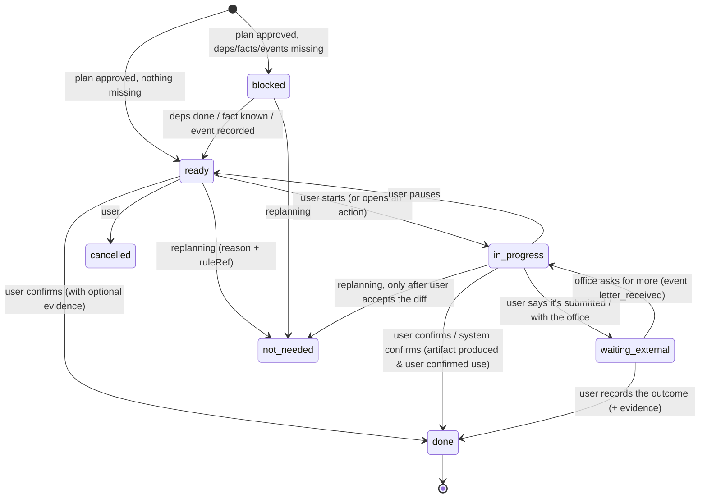
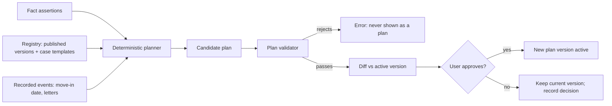

# 04 — The living case: domain model

Design rule: **state is computed from facts, rules and recorded events; an LLM may propose, never write state.**

## 1. Structure: which model

| Option | Strength | Weakness |
|---|---|---|
| A. Directed acyclic task graph | Dependencies explicit, "what's next" is a query | Nothing about history; replanning is a graph rewrite |
| B. Rule-driven workflow / state machine | Clear legal states | Rigid; real cases skip, repeat and branch |
| C. Versioned case plan with explicit dependencies | Diffable, auditable, matches "propose → approve" | Needs a planner that can regenerate deterministically |
| D. Hybrid | | More concepts |

**Recommendation: D = C + A + a small state machine per task.** ADR-N003.
- **Plan versions** (C) are immutable snapshots produced by a deterministic planner from (facts, registry versions, events).
- **Within a version**, tasks form a DAG (A) built from procedure `steps[].dependsOn`, document needs and cross-procedure links. Cycles are rejected by the validator.
- **Each task** has a small lifecycle (B, §3).
- **Persistence:** an append-only event log is the source of truth on the device, with materialised current state. No graph database: a DAG of ≤200 nodes per case is a few rows; recursive queries or in-memory traversal suffice. Production already uses PostgreSQL; the device uses an embedded store (09 §3).

## 2. Entities

Terminology changes from the working list:
- "World/Journey" becomes **Case template** (the reusable recipe);
- "User fact" becomes **Fact assertion** (it may be unconfirmed);
- "Assumption" is reserved for the rare case where the user explicitly says "plan as if X". The planner itself never assumes; unknown facts branch (§5).

| Entity | Purpose | Key fields | Owner / lives where | Lifecycle | Retention |
|---|---|---|---|---|---|
| **Case template** | Goal-level recipe: which procedures, in what order, under which conditions | id, goal (4 langs), procedures[{id, when: Rule}], links[] | Registry (server, public, versioned) | draft → published → withdrawn | Public |
| **Case** | One goal of one person | id (random), templateId, goalText (user's words, device-only), language, status, createdAt, companion settings | Device | draft → active → paused → closed → archived | Until the user deletes; wipe-all available |
| **Fact assertion** | A decision-relevant, non-identifying fact | key (from the fact catalogue), value / `__unknown__`, origin (user_answer, user_confirmed_extraction, extracted_unconfirmed, derived), at, supersedes | Device | asserted → confirmed → superseded | With the case |
| **Personal details** | Identifying data needed only to fill forms (name, PESEL, address, birth date) | field → value, formId(s) it serves | **Device only, encrypted, never sent to any server or LLM** | entered → used → wiped (optional auto-wipe after printing) | User-controlled; default "forget after export" [HYPOTHESIS] |
| **Rule reference** | Link from anything in the plan to the registry | procedureId, versionNo, itemKind, itemId, quoteIds[], verificationLevel, checkedAt | Inside plan versions | immutable | With the plan |
| **Plan version** | Immutable plan snapshot | no, inputsHash (facts + registry version ids + events), plannerVersion, createdAt, approvedAt, approvedBy=user, validatorReport | Device | proposed → approved (active) → superseded | All versions kept (they are small) |
| **Milestone** | A user-meaningful outcome ("Registered", "PESEL received") | id (stable), title, taskIds[], ruleRefs | In a plan version | derived | — |
| **Task** | One thing the user (or the system) does | id (stable across versions: `procedureId:stepId[:variant]`), kind (prepare, get_document, fill_form, visit, pay, wait, respond, decide), deps[], due (derived), docs[], actions[], ruleRefs[], status, completion | Plan + task state table | §3 | With the case |
| **Dependency** | Why B waits for A | from, to, type (task_done, document_ready, event_occurred, fact_known, cross_case), ruleRef | In a plan version | — | — |
| **Event** | Something that happened or will happen | type (fact_changed, move_in_date_set, letter_received, rule_changed, rule_withdrawn, deadline_due, reminder_sent, task_status_changed, user_note), at, payload, origin (user, system, registry) | Device event log | append-only | With the case |
| **Document / artifact** | A file or a paper the case needs or produced | kind (official_blank, filled_official, generated_draft, user_upload, checklist), templateRef {formId, version, sha256, fieldMapVersion}, status (needed, draft, ready, used), provenance | Device (files in app storage) | needed → draft → ready → used / superseded | User-controlled; scans opt-in only (§08) |
| **Evidence** | What supports a completion or a fact | kind (user_confirmation, artifact, official_reference_number, photo_of_stamp), at, refs | Device | append-only | With the case |
| **Action** | One tool invocation | toolId, level (0–3), request, preconditions, permission, result, evidence, reversal | Device audit | requested → approved → done / failed / reverted | With the case |
| **Companion** | Presentation of the case assistant | name (optional), tone, language | Device | — | — |
| **Activity entry** | Human-readable history | at, actor (user, system, companion-proposal), summary, refs | Device, append-only | — | With the case |

Security boundaries:
- everything personal stays on the device;
- the server knows registry content only;
- an AI call receives a **case brief**: fact keys/values (non-identifying), task titles, registry excerpts. It never receives personal details, uploaded files or the goal text unmasked (10 §3).

## 3. Task lifecycle

Flags orthogonal to state: `overdue` (derived from `due`), `stale` (a rule it depends on changed and is not re-checked), `disputed` (sources disagree).

Completion is typed and never inferred by an LLM:

| completion.kind | Meaning | Who can set it |
|---|---|---|
| user_confirmed | "I did it" | User tap (the companion may *propose*; the user confirms) |
| system_confirmed | The system produced and the user used an artifact (e.g. form filled and exported) | System + user acknowledgement |
| authority_evidence | User recorded official evidence (reference number, decision date, a photo of a stamp) | User, with an evidence record |
| unknown | Never set automatically; the task stays in its last state | — |

"Done" in Formalka never means "accepted by the authority" unless the evidence says so; the UI words differ ("You marked this done" vs. "Recorded: decision of 12 Nov").

## 4. Plan generation and change over time

Diff rules (by stable task id):

| Change | What happens |
|---|---|
| New task | Added as `proposed` until approval |
| Task no longer derived, status ∈ {ready, blocked} | `not_needed` with the reason (fact or rule that changed) |
| Task no longer derived, status ∈ {in_progress, waiting_external} | Shown as "may no longer be needed", stays until the user confirms |
| Task no longer derived, status = done | Kept as history, never removed |
| Due date, office, documents or fee changed | Field-level diff with old → new and the source |
| Document already prepared but now a different form version | Old artifact marked `superseded`, never deleted |
| Source withdrawn | Affected tasks `stale`; no new dates derived; official link shown |

Examples from the brief:
- **The user moves city:** the office and booking links change, the deadline does not (it counts from moving in at the new address: a new `move_in_date_set` event).
- **Another document arrives:** an evidence or artifact entry; tasks may become ready.
- **A requirement changes:** the rule changes and the case is flagged; replanning is proposed and never automatic.
- **A task becomes unnecessary:** `not_needed` with the reason.
- **Two cases share a dependency:** a cross_case dependency, e.g. PESEL from registration feeding a work case. One task exists; the other case references it.
- **An assumption is corrected:** the fact is superseded and a new plan is proposed.
- **The procedure becomes unsupported:** the case is `paused` and keeps its history and artifacts, with a handoff to the office or free legal aid.

## 5. Unknowns and branching

A fact answered "Nie wiem" or not asked yet evaluates as unknown (three-valued, as `packages/rules` does today). The planner:
1. keeps items whose rule is `unknown` and marks them "depends on …" (never hides);
2. when two items are alternatives (e.g. 4-day vs 30-day deadline), shows both, each with its condition. The earliest date is highlighted as "safe if unsure", **only** when a rule says both are deadlines for the same act;
3. lists the facts whose answers would change the plan, ordered by how many items they decide (05 §3).

## 6. Database schema proposal

Device store: `schemas/case-store.sql` (SQLite dialect; the same shape maps to IndexedDB object stores). Server registry: existing PostgreSQL tables plus three additions (`schemas/registry-additions.sql`):
- `case_templates`;
- `task_templates`;
- `form_templates` (form id, version, sha256, field map).

No user data on the server.
