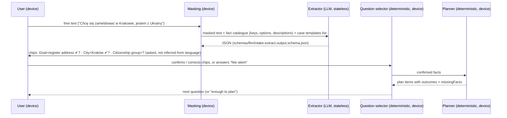

# 05 — Intake and dynamic questioning

Principle (ADR-0003, already in force): **the LLM extracts and phrases; deterministic rules decide what to ask and what the plan contains.**

## 1. Pipeline



1. **Intent and template:** the extractor proposes up to 3 case templates with confidence. Smart search (bge-m3, already in production) supplies candidate guides as a cross-check. If they disagree, or confidence is below threshold, the user picks from a short list. The goal is never guessed silently.
2. **Fact extraction:** only keys from the fact catalogue (`content/facts/*.yaml`), only option values defined there, each with the user's own words as the evidence span. Identifying data is masked before the call (`packages/domain/src/privacy`). If the model returns a PESEL, name or address, the response is discarded.
3. **Confirmation:** extracted facts are `extracted_unconfirmed` until the user taps "Tak" on the chip. **Only confirmed facts change the plan.** Language is never evidence of citizenship (rule 5). "I'm from Ukraine" yields a citizenship-group candidate to confirm, not UKR status.
4. **Conflicts:** two assertions for one key (e.g. "temporary" then "I'll live here for good") → a clarification question with both options; the newer one is not taken silently.
5. **Free text that doesn't match an option:** stays a note. The question is asked again with options plus "Nie wiem", never coerced into a near option.

## 2. What to ask next: deterministic selection

Inputs:
- the candidate template's procedures;
- for every plan item (route, condition, step, document, fee, deadline, pitfall), its rule's three-valued outcome and `missingFacts` (`packages/rules/src/evaluate.ts`).

Score each missing fact *f*:

```
score(f) = Σ over items i where f ∈ missingFacts(i):  weight(kind(i)) × (1 if f can settle i alone else 0.5)
weight: route 10 · deadline 8 · document 6 · "can do online / in person" 6 · fee 4 · step 3 · office 3 · pitfall 1
```

- Ask the highest-scoring fact. Break ties with the order of the fact catalogue (it encodes prerequisites, e.g. citizenship group before stay type).
- A fact answered "Nie wiem" scores 0 for the rest of the intake. It can be asked again later from the plan ("answer this to narrow the plan").
- This is an information-gain-inspired heuristic over a known decision structure, not an entropy calculation. The structure is small (tens of rules per procedure), so exhaustive evaluation is cheap and exact.

## 3. When to stop

| Plan state | Reached when | Shown as |
|---|---|---|
| **A. Preliminary** | Template chosen and the route rule is `applies` or `unknown` | "First outline: n steps, m depend on your answers" |
| **B. Verified, actionable** | No missing fact scores > 0, and every shown item has a rule reference and passes the validator | "Your plan" with sources |
| **C. With unresolved blockers** | Remaining facts answered "Nie wiem", or the question cap is reached (default 12, configurable per template), or sources disagree | Plan with labelled branches and "what would settle this" |

The intake never loops: each fact is asked at most once in intake, and the cap is hard. "Nie wiem" is always accepted (rule 6); the plan then shows every branch.

## 4. Corrections

Every fact chip is editable from the plan. An edit supersedes the assertion (event `fact_changed`) and triggers replanning with a diff (04 §4). Nothing the user approved is overwritten without their approval.

## 5. Structured contracts

| Contract | Direction | Schema | Validation |
|---|---|---|---|
| Intake extraction | LLM → app | `schemas/llm/intake-extract.output.schema.json` | Zod/JSON Schema; keys and option values checked against the catalogue; evidence spans must occur in the masked input; else discarded |
| Companion answer | LLM → app | `schemas/llm/companion-answer.output.schema.json` | Citations must reference rule ids present in the brief; proposals go to the approval queue, never applied |
| Letter (notice) analysis (later phase) | LLM → app | `schemas/llm/notice-analysis.output.schema.json` | Dates and deadlines extracted are candidates; the deadline shown is computed from a registry rule, never from the model |
| Validator report | deterministic | `schemas/validator-report.schema.json` | — |

Schema validity is not truth: a valid JSON object with a wrong fact is still wrong. Hence the user confirmation (§1.3), the catalogue check, and the evaluation set (11).

Failure handling:
- model timeout or invalid output → one retry, then fall back to structured questions (the product works without the LLM);
- three consecutive extraction failures in a case → the case continues in structured mode, and the event is recorded.
