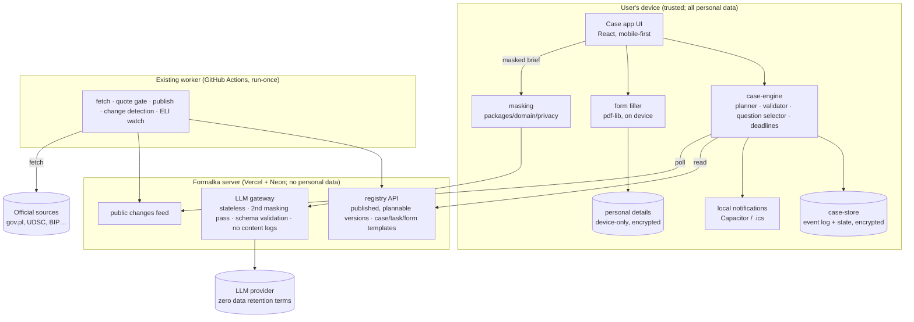

# 09 — System architecture and platform

## 1. Shape: local-first, with a public registry and a stateless AI gateway

Trust boundaries:
1. **Device ↔ server:** only public registry requests and masked AI briefs cross. No case id, no personal details, no files.
2. **Server ↔ LLM provider:** the provider sees masked briefs; its output is untrusted until schema-checked and confirmed by the user.
3. **Worker ↔ official sources:** fetched content is data, never instructions (rule 7).

## 2. Modules: reuse, extend, build

| Module | Kind | Built on | Notes |
|---|---|---|---|
| `packages/case-engine` | New pure TypeScript package | `packages/rules`, `packages/domain` | Planner, validator, replanner/diff, question selector, deadline calculator; no I/O; runs on device and in CI. The spike in `spikes/s1-case-engine` is its prototype |
| `packages/case-store` | New | IndexedDB/OPFS (web), SQLite or filesystem via Capacitor (native) | Event log + materialised state; encryption at rest; export/import (backup file) |
| Registry API | Extend `apps/web` route handlers | Existing DB tables + `case_templates`, `task_templates`, `form_templates` | Public, cacheable, read-only |
| Changes feed | Extend the worker | `change_events`, publishes, withdrawals | Public JSON; no user data |
| LLM gateway | New, small | ADR-0006 capability adapters (extract, compose) | Stateless; rate limits like smart search; no request logging of content |
| Case app | New app (`apps/case`) | Next.js static export or a Vite SPA (decided in Phase 1), `packages/ui` tokens, `packages/i18n` | Separate from the guide site; the guides stay server-rendered |
| Native shells | New | Capacitor | Local notifications, secure storage, filesystem, share, optional biometric lock |

Not introduced:
- no microservices, no queue, no graph database, no multi-agent framework;
- no workflow DSL beyond the existing rule format plus templates;
- no persistent agents.

## 3. Platform strategy (mobile-first)

Evaluated against the product's actual needs:

| Need | A. Next.js/React PWA | B. React Native + Expo (iOS, Android, web) | C. Web-first React + Capacitor shells |
|---|---|---|---|
| Mobile interaction quality | Good; WebView/Safari limits on gestures | Best (native) | Good (same as A inside a native shell) |
| Interactive journey map (≤100 nodes) | SVG/Canvas fine | Fine (needs RN libraries) | Fine |
| Animation, reduced motion | CSS/JS, existing motion engine (ADR-0019) | Reanimated | Same as A |
| **Scheduled reminders without a server** | **No**: Notification Triggers not launched [FACT] | Yes (local notifications) | **Yes** (Capacitor Local Notifications) [FACT] |
| Push on iOS | Only after "Add to Home Screen" + server push [FACT] | Yes (APNs) | Yes (APNs) |
| **Durable local storage on iOS** | **Risky**: Safari removes script-writable storage after 7 days without interaction, Home Screen apps exempt [FACT, WebKit; later bug reports] | Yes | Yes (native storage) |
| PDF view and form filling | pdf.js + pdf-lib | Native modules or a WebView anyway | pdf.js + pdf-lib, native share/open |
| Camera and files | Web APIs (limited) | Native | Native plugins |
| Desktop productivity | Excellent | Weak (react-native-web) | Excellent (the same web app) |
| Reuse of Formalka (React, i18n, tokens, rules) | High | Low for UI; logic packages reusable | High |
| One-person effort | Lowest | Highest (second UI stack, native builds) | Low–medium (one UI; native config, store builds) |
| Release complexity | None (web deploy) | EAS builds, two stores | Two stores when published; Android internal testing without review |
| Platform restrictions | iOS PWA limits above | Store review | Store review (state the app is independent, ADR-0010) |

**Recommendation: C, web-first React with Capacitor shells** (ADR-N006).

Why the alternatives lose:
- **A alone** can't keep a weeks-long case reliably on iOS Safari and can't remind without a server that knows the date. Both conflict with the local-first privacy model, so the PWA becomes the desktop and Android-web channel, not the only one.
- **B** doubles the UI work for one developer and weakens desktop, where long reading and printing happen.

Change from ADR-0010:
- ADR-0010 planned Capacitor in remote-URL mode for the *guide site*.
- The *case app* must be a bundled static app shell (offline, local data), with registry data fetched at runtime so withdrawals still apply.
- The guide site keeps ADR-0010 as is.

| | Recommendation |
|---|---|
| **Product platform** | Mobile-first app experience; the same app on desktop web for reading and printing |
| **Technical stack** | React + TypeScript app (shared packages), Capacitor 7-era shells [version to be pinned in Phase 1], existing Next.js/Vercel/Neon/Cloudflare for the public registry, feed and LLM gateway |
| **Initial distribution** | Private alpha: web build behind invite (protected deployment the owner sets up) + Android APK through Play internal testing (no public listing); iOS only through the web build at first (a known limitation, mitigated by export/backup) |
| **Long-term distribution** | Public web + Google Play + App Store (TestFlight first), after the evaluated beta |

## 4. Model choice (no pick before evaluation, ADR-0006)

Prices verified 2026-10-15:
- **Anthropic** (official pricing page), per million tokens, input/output:
  - Claude Haiku 5.5: $0.10 / $0.50 (≤100K-token prompts; cache hit $0.01);
  - Claude Sonnet 5.5: $2 / $10 (cache hit $0.10);
  - Claude Opus 5.5: $4 / $20;
  - Batch API: −50%.
- **Mistral** (mistral.ai pricing pages, via search):
  - Small 4: $0.15 / $0.60;
  - Medium 3.5: $1.5 / $7.5.

| Capability | Candidates | Selection criteria |
|---|---|---|
| Intake extraction (structured JSON, PL/UK/RU/EN) | Claude Haiku 5.5, Mistral Small 4 | Extraction F1 on the 4-language set (11), schema validity, refusal/hallucinated-key rate, latency p95 |
| Companion answers (grounded, cited) | Claude Sonnet 5.5, Mistral Medium 3.5 | Citation accuracy, "not in sources" honesty, multilingual quality (native-reader scored), cost per answer |
| Offline evaluation / judge support | Claude Opus 5.5 | Only with human-labelled references (never self-grading) |
| Embeddings (intent → guide) | Cloudflare bge-m3 (in production) | Already measured |

Non-price requirements:
- zero-data-retention terms per ADR-0009 [OPEN: confirm availability on the chosen account per provider];
- the processing region (EU preference, ADR-0005) [OPEN].

Routing: one small model for extraction and one mid model for the companion. Escalation only on schema failure, not on content.

## 5. Failure isolation

| Failure | Effect | Behaviour |
|---|---|---|
| LLM provider down or slow | No free-text intake, no companion | Structured questions continue; the plan, reminders and forms work |
| Registry API down | No new plans | Cached registry snapshot with its "last checked" date; existing plans readable |
| Changes feed stale | Rule changes not seen | "Last checked for changes: …" shown; nothing is invented |
| Device storage lost | Case gone | Export/import backup file (encrypted); clear warning at plan approval |
| Form hash changed | Fill disabled | Official link shown; template marked for review |
| Notification permission denied | No reminders | `.ics` export offered; in-app attention list |
