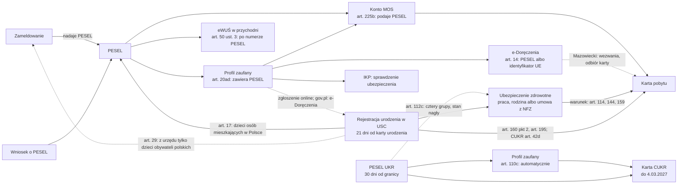

# 20. Matter maps: the next matters, mapped as services

**Status:** lab design documents by Claude, 17.10.2026, at the owner's request ("kolejne sprawy w pełni zmapowane, z wielokrotnością scenariuszy, przemyślanym user flow"). They are not independent.
- Nothing in them is built. Before Phase 1 nothing new reaches the prototype (the owner, 16.10).
- They are the design input for doc 19's waves, each still behind its gate.

## 1. The maps

| Map | Doc 19 | Content level | Scenarios | Valid as of |
|---|---|---|---|---|
| [`maps/residence-temporary.md`](maps/residence-temporary.md): temporary residence permit and card | Wave 2, matter 3 | Draft reference, engine comparison (26 rows), five prototype restrictions, one engine change (R4 in progress) | 24 flow scenarios (FS1–FS24), on top of the reference's 15 cases; 9 evaluation scenarios (res-01 to res-09) | 17.10.2026 |
| [`maps/cukr-ukr.md`](maps/cukr-ukr.md): the UKR status, PESEL UKR, the CUKR card | Wave 3, matter 7 | Sources (R1) and this map | 20 (CU1–CU20) | **17.10.2026, to be re-checked before use**; the CUKR window closes on 4.03.2027 |
| [`maps/e-government-access.md`](maps/e-government-access.md): PESEL, the trusted profile, e-Doręczenia | Wave 4, matter 10 | Sources (R1) and this map | 12 (EG1–EG12) | 17.10.2026 |
| [`maps/health-insurance.md`](maps/health-insurance.md): NFZ, ZUS, the voluntary NFZ agreement | Wave 4, matter 11 | Sources (R1) and this map | 27 (HS1–HS27) | 17.10.2026; the PESEL UKR rules changed on 5.03.2026 |
| [`maps/civil-status.md`](maps/civil-status.md): a birth, a marriage, a death, a foreign record | Wave 4, matter 14 | Sources (R1) and this map | 25 (CS1–CS25) | 17.10.2026 |

Wave 1 (address registration and PESEL) is mapped in doc 18 §3.

## 2. One format for every map

1. **Who it is for.** By the status the person states, never by nationality or language (rule 4).
2. **The journey.** Stages with steps on and off the phone, each with its basis (FACT with the source), and the loss points (HYPOTHESIS until interviews).
3. **The critical moments.** Where design and testing effort goes first.
4. **Scenarios.** Fictional situations, what the app should do, and what it must never say.
5. **The user flow.** Intake questions with "Nie wiem", levels, each screen per stage, handoffs to people, and a flow diagram. Anything not built is labelled PROPOSED.
6. **What the blueprint and production's guide would need.**
7. **Validation:** confirmers, moderated tasks with doc 18 §6.1 thresholds, and open questions.

## 3. How the matters depend on each other

The maps show that the matters form a chain. A person who misses an early link is blocked later, often at a deadline.

**Consequences for the product (PROPOSED, the owner decides):**
- The PESEL case should end with "what PESEL opens next", not "done".
- The residence and CUKR cases should start with a prerequisite level, linked to the PESEL case.
- The interviews should ask about the trusted profile (decision D4 in the overnight report).
- The residence case's insurance condition should link to the health insurance case. The CUKR compare card should name the change in health care (PROT art. 112c; UdSC: the same access as any permit holder).
- The birth case should end with "co dalej z dzieckiem": the child's address registration (the office does it only for children of Polish citizens), its insurance, and its own residence title. The residence map has no route for a child born in Poland yet (FA art. 160 pkt 2, 195).

## 4. What would come next, in order

1. **Work** (matter 9): what the person must check about the employer's permit or notification. The health map's first critical moment (was the employee reported?) and the residence map's work-while-waiting note connect here.
2. **Taxes** (matter 12). This needs a tax adviser as confirmer (doc 19 wave 5).

Health insurance (matter 11) and civil status (matter 14), first in this list on 17.10, are now mapped (§1).

Each starts with sources (R1), as these did.
