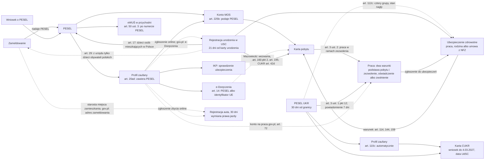

# 20. Matter maps: the next matters, mapped as services

**Status:** lab design documents by Claude, 17.10.2026, at the owner's request ("kolejne sprawy w pełni zmapowane, z wielokrotnością scenariuszy, przemyślanym user flow"). They are not independent.
- Nothing in them is built. Before Phase 1 nothing new reaches the prototype (the owner, 16.10).
- They are the design input for doc 19's waves, each still behind its gate.

## 1. The maps

| Map | Doc 19 | Content level | Scenarios | Valid as of |
|---|---|---|---|---|
| [`maps/residence-temporary.md`](maps/residence-temporary.md): temporary residence permit and card | Wave 2, matter 3 | Draft reference, engine comparison (26 rows), five prototype restrictions, one engine change (R4 in progress); checked by the separate agent on 17.10 (`research/2026-10-16-residence/sources/CHECK.md`) | 24 flow scenarios (FS1–FS24), on top of the reference's 15 cases; 9 evaluation scenarios (res-01 to res-09) | 17.10.2026 |
| [`maps/cukr-ukr.md`](maps/cukr-ukr.md): the UKR status, PESEL UKR, the CUKR card | Wave 3, matter 7 | Sources (R1) and this map | 20 (CU1–CU20) | **17.10.2026, to be re-checked before use.** Checked by the separate agent on 17.10.2026 and corrected (`research/2026-10-17-ukr/sources/CHECK.md`). Protection runs to 4.03.2028 (EU decision 2026/1912); 4.03.2027 is UdSC's date to file CUKR by. The dates of the military-obligations rule differ between the decision and UdSC (OPEN-C12) |
| [`maps/e-government-access.md`](maps/e-government-access.md): PESEL, the trusted profile, e-Doręczenia | Wave 4, matter 10 | Sources (R1) and this map | 12 (EG1–EG12) | 17.10.2026. Checked by the separate agent on 17.10.2026 and corrected (`research/2026-10-17-egov/sources/CHECK.md`) |
| [`maps/health-insurance.md`](maps/health-insurance.md): NFZ, ZUS, the voluntary NFZ agreement | Wave 4, matter 11 | Sources (R1) and this map; its facts checked once by a separate agent and corrected (`research/2026-10-17-health/sources/CHECK.md`) | 27 (HS1–HS27) | 17.10.2026; the PESEL UKR rules changed on 5.03.2026 |
| [`maps/civil-status.md`](maps/civil-status.md): a birth, a marriage, a death, a foreign record | Wave 4, matter 14 | Sources (R1) and this map; its facts checked once by a separate agent and corrected (`research/2026-10-17-civil/sources/CHECK.md`) | 25 (CS1–CS25) | 17.10.2026 |
| [`maps/vehicles-licence.md`](maps/vehicles-licence.md): registering a vehicle, plates, a sale, a foreign licence | Wave 4, matter 15 | Sources (R1) and this map; its facts checked once by a separate agent and corrected (`research/2026-10-17-vehicles/sources/CHECK.md`) | 21 (VS1–VS21) | 17.10.2026; the road traffic act changes again on 18.01.2027 |
| [`maps/work.md`](maps/work.md): may I work here, on what basis, and what the employer must do | Wave 5, matter 9 | Sources (R1) and this map, checked by the separate agent on 17.10 (`research/2026-10-17-work/sources/CHECK.md`) | 24 (WS1–WS24) | 17.10.2026; the visa-free rules changed in August 2026; the Ukrainian transitional rule runs to 5.03.2029 |
| [`maps/permanent-residence.md`](maps/permanent-residence.md): permanent residence and the EU long-term resident permit | Wave 5, matter 8 | Sources (R1) and this map; checked by the separate agent on 17.10.2026 and corrected (`research/2026-10-17-permanent/sources/CHECK.md`) | 20 (PS1–PS20) | 17.10.2026 |
| [`maps/child-benefit-800.md`](maps/child-benefit-800.md): the child benefit 800+ for foreigners | Wave 5, matter 13 | Sources (R1) and this map; checked by the separate agent on 17.10.2026 and corrected (`research/2026-10-17-benefits/sources/CHECK.md`) | 17 (BS1–BS17) | 17.10.2026; the dates differ for PESEL UKR holders (5.03.2026) |
| [`maps/school.md`](maps/school.md): school and preschool for a child from abroad | Wave 5, matter 16 | Sources (R1) and this map; checked by the separate agent on 17.10.2026 and corrected (`research/2026-10-17-school/sources/CHECK.md`) | 16 (SS1–SS16) | 17.10.2026; most special school rules for Ukrainian pupils ended on 31.08.2026 |
| [`maps/unemployment.md`](maps/unemployment.md): registering as unemployed, for a foreigner | Wave 5, matter 17 | Sources (R1) and this map; checked by the separate agent on 17.10.2026 and corrected (`research/2026-10-17-unemployment/sources/CHECK.md`) | 17 (US1–US17) | 17.10.2026; the benefit's amounts change each 1 June |
| [`maps/karta-polaka.md`](maps/karta-polaka.md): the Karta Polaka | Wave 5, matter 18 | Sources (R1) and this map; checked by the separate agent on 17.10.2026 and corrected (`research/2026-10-17-karta-polaka/sources/CHECK.md`) | 14 (KS1–KS14) | 17.10.2026; the settlement benefit on hold since 15.01.2026 (the minister's notice) |
| [`maps/moving.md`](maps/moving.md): moving, deregistering and leaving Poland, for a foreigner | Wave 6, matter 19 | Sources (R1) and this map; checked by the separate agent on 17.10.2026 and corrected (`research/2026-10-17-moving/sources/CHECK.md`) | 13 (MS1–MS12, MS9a) | 17.10.2026; a CUKR card shows no address (SA art. 42m) |
| [`maps/business.md`](maps/business.md): registering a business (CEIDG) as a foreigner | Wave 6, matter 20 | Sources (R1) and this map; **not yet checked by the separate agent** | 13 (BS1–BS13) | 17.10.2026; from 1.11.2026 a PESEL and online only for a new business |
| [`maps/real-estate.md`](maps/real-estate.md): buying real estate in Poland as a foreigner | Wave 6, matter 21 | Sources (R1) and this map; **not yet checked by the separate agent** | 12 (RS1–RS12) | 17.10.2026; a flat in the border zone (Gdańsk, Szczecin…) needs a permit |
| [`maps/recognition.md`](maps/recognition.md): recognition of a foreign diploma or school certificate | Wave 6, matter 22 | Sources (R1) and this map; **not yet checked by the separate agent** | 10 (QS1–QS10) | 17.10.2026; school certificates changed on 1.07.2025 |
| [`maps/invitation.md`](maps/invitation.md): inviting a foreigner to Poland | Wave 6, matter 23 | Sources (R1) and this map; **not yet checked by the separate agent** | 5 (IS1–IS5) | 17.10.2026 |

Wave 1 (address registration and PESEL) is mapped in doc 18 §3.

## 2. One format for every map

1. **Who it is for.** By the status the person states, never by nationality or language (rule 4).
2. **The journey.** Stages with steps on and off the phone, each with its basis (FACT with the source), and the loss points (HYPOTHESIS until interviews).
3. **The critical moments.** Where design and testing effort goes first.
4. **Scenarios.** Fictional situations, what the app should do, and what it must never say.
5. **The user flow.** Intake questions with "Nie wiem", levels, each screen per stage, handoffs to people, and a flow diagram. Anything not built is labelled PROPOSED.
6. **What the blueprint and production's guide would need.**
7. **Validation:** confirmers, moderated tasks with doc 18 §6.1 thresholds, and open questions.

## 3. How the matters depend on each other

The maps show that the matters form a chain. A person who misses an early link is blocked later, often at a deadline.

**Consequences for the product (PROPOSED, the owner decides):**
- The PESEL case should end with "what PESEL opens next", not "done".
- The residence and CUKR cases should start with a prerequisite level, linked to the PESEL case.
- The interviews should ask about the trusted profile (decision D4 in the overnight report).
- The residence case's insurance condition should link to the health insurance case. The CUKR compare card should name the change in health care (PROT art. 112c; UdSC: the same access as any permit holder).
- The vehicle and licence cases should check residence first and link to the address-registration case: both offices are those of the place of residence, and gov.pl's licence page asks for the registered address.
- The birth case should end with "co dalej z dzieckiem": the child's address registration (the office does it only for children of Polish citizens), its insurance, and its own residence title. The residence map has no route for a child born in Poland yet (FA art. 160 pkt 2, 195).
- The work case should ask for the stay basis first and never answer "możesz pracować" from it alone: legal work needs the stay basis and a permit, a declaration or an exemption. It links to the residence case (a residence and work permit), the e-government case (the trusted profile for the praca.gov.pl account) and the health case (insurance through work).

## 4. What would come next, in order

The owner chooses the next one. Vehicles and the driving licence (matter 15), which the owner raised on 17.10, and work (matter 9), after the owner's "Później kontynuuj z pracą", are now mapped (§1). Candidates: doc 19's new matters 20–26.

Taxes (matter 12) are set aside by the owner (17.10.2026). Health insurance (matter 11) and civil status (matter 14) are now mapped (§1). Doc 19 lists seven new candidate matters (20–26).

Each starts with sources (R1), as these did.
