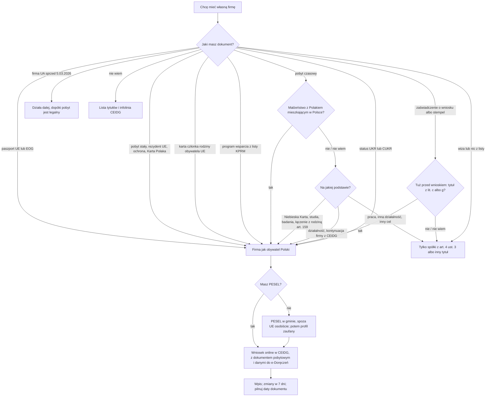

# Map: registering a business (CEIDG) as a foreigner

**Status:** a lab map by Claude, 17.10.2026. It is not independent, and nothing in it is built or shown to people. Doc 19 matter 20 (wave 6). Production's registry has no business registration procedure. **Checked by the separate checking agent on 17.10.2026** (`research/2026-10-17-business/sources/CHECK.md`); the corrections were made in the lab after re-reading each provision and page, and are not independently verified.

**Why it matters:**
- Who may open a sole proprietorship (JDG) depends on what the person holds in Poland, not on the nationality alone, except for citizens of the EU and EEA states (FACT, FE art. 4 ust. 1): a residence title, protection, the Karta Polaka, family membership of an EU citizen, or a support programme (FACT, FE art. 4 ust. 2); for Ukrainian citizens also the CUKR card (FACT, SA art. 42w). The others may use only a limited partnership, a limited joint-stock partnership, an sp. z o.o., a simple joint-stock company or a joint-stock company, unless international agreements provide otherwise (FACT, FE art. 4 ust. 3).
- **A change in two weeks:**
  - from 1.11.2026 a foreign person applying to CEIDG must have a PESEL, or the EU cross-border identifier (FACT, FE art. 4 ust. 9);
  - a new business can then be registered only online, except a minor's application, which is filed only on paper until 31.10.2028 (FACT, Dz.U. 2026 poz. 507 art. 15–16);
  - the CEIDG service page on biznes.gov.pl (ou736) states the change, but the page on foreigners (00806, updated 23.07.2026 by its metadata) still describes registering at a municipality without a PESEL (PAGES).
- **Ukrainian citizens:**
  - since 5.03.2026 a legal stay and a PESEL no longer open a business (FACT, the special act's art. 23 repealed by Dz.U. 2026 poz. 203 art. 17 pkt 10);
  - a new one needs temporary protection, another title of FE art. 4 ust. 2, or the CUKR card (FACT, FE art. 4 ust. 2 pkt 2, SA art. 42w);
  - a business begun before continues while the stay is legal (FACT, WD art. 42).
- **Unregistered activity:** since 1.06.2025 it is closed to foreigners without an FE art. 4 ust. 1–2 title (FACT, PP art. 5 ust. 7).
- **When the title ends,** the minister deletes the entry by decision (FACT, CEIDG art. 29 ust. 1 pkt 2). For a CUKR card holder that provision does not name the special act, so the ground is open (OPEN-B8).
- **Since 27.04.2026 a pending residence application is proved by a certificate from MOS,** not a passport stamp (FACT, UoC art. 108 ust. 1 pkt 1, 206 ust. 1 pkt 1, 222a ust. 1 pkt 1; M.P. 2026 poz. 370); page 00806 still asks for the stamp (PAGES).

**Sources:** `research/2026-10-17-business/sources/` (README there), cited as:
- FE: the act on foreign entrepreneurs, consolidated Dz.U. 2026 poz. 1313;
- CEIDG: the CEIDG act, consolidated Dz.U. 2026 poz. 30, with Dz.U. 2026 poz. 507's points by their dates;
- 507: Dz.U. 2026 poz. 507, the act changing the CEIDG act;
- PP: Prawo przedsiębiorców, consolidated Dz.U. 2025 poz. 1480;
- SA: the special act on aid to Ukrainian citizens (the former art. 23, Dz.U. 2025 poz. 337; art. 42 ust. 12a and 42w, Dz.U. 2026 poz. 1293);
- WD: the winding-down act, Dz.U. 2026 poz. 203;
- UoC: the act on foreigners;
- UEL: the act on population records, consolidated Dz.U. 2026 poz. 384;
- PAGES: biznes.gov.pl (00806, 00115, 001466, ou736, 03155).

Labels: FACT, INFERENCE, OPEN (OPEN-B1 to B9 in the sources README), PROPOSED.

**Content rules for this matter (PROPOSED):**
- **The document decides, never the language** (rule 4). The app asks which residence document the person holds and matches it to FE art. 4 ust. 2; it never infers it from nationality, language or name. Citizenship is asked only where it is the rule itself (EU and EEA, FE art. 4 ust. 1), by the document.
- **"Nie wiem" is a route:** the app shows the list of titles with the document each one is shown with (PAGES 00806 table), and the CEIDG helpline.
- **No taxes:** the tax form, VAT and the tax office's steps are matter 12, which the owner set aside on 17.10.2026. The app says the application also notifies the tax office (CEIDG art. 6 ust. 3) and stops there.
- **No action claimed:** never "zarejestrowaliśmy firmę" or "masz NIP". The app shows what the person filed, as the person's date.
- **The 1.11.2026 change is shown with its article.** From that date the paper route for a new business drops out of the plan.

## 1. Who it is for

| The person says | Route | Basis |
|---|---|---|
| "Jestem obywatelem UE, Norwegii, Islandii albo Liechtensteinu" | A JDG on the same terms as Polish citizens | FE art. 3 pkt 6, 4 ust. 1 (FACT) |
| "Mam zezwolenie na pobyt stały albo rezydenta długoterminowego UE" | A JDG on the same terms | FE art. 4 ust. 2 pkt 1 lit. a–b (FACT) |
| "Mam Niebieską Kartę, zezwolenie na studia, na badania albo na połączenie z rodziną" | A JDG on the same terms, if the permit was granted under UoC art. 127, 137a, 144 (studies), 151 ust. 1 (research), 159 ust. 1 (joining a foreigner with a listed title) or 186 ust. 1 pkt 3, 4 or 7 | FE art. 4 ust. 2 pkt 1 lit. c (FACT); a family permit under UoC art. 160 (for example as a Polish citizen's family member) is not in lit. c (FACT); with a Polish spouse living in Poland, lit. g |
| "Mam pobyt czasowy i jestem żonaty / zamężna z Polakiem mieszkającym w Polsce" | A JDG on the same terms, whatever the permit's purpose | FE art. 4 ust. 2 pkt 1 lit. g (FACT) |
| "Jestem członkiem rodziny obywatela UE i mieszkam z nim" | A JDG on the same terms | FE art. 4 ust. 2 pkt 4 (FACT) |
| "Uczestniczę w programie wsparcia dla cudzoziemców (np. Poland. Business Harbour)" | A JDG on the same terms, for a programme on the Chancellery's list | FE art. 4 ust. 2 pkt 6, ust. 8 (FACT); the list not read (OPEN-B2) |
| "Mam pobyt czasowy i pracę" | Not a JDG on that title; a company (ust. 3), or another title | FE art. 4 ust. 2–3 (INFERENCE that the work permit is not among the titles) |
| "Mam pobyt czasowy na działalność gospodarczą" | A JDG only if the permit was granted to continue a business already in CEIDG; otherwise a company | FE art. 4 ust. 2 pkt 1 lit. h, ust. 3 (INFERENCE for UoC art. 142 in general) |
| "Mam status uchodźcy, ochronę uzupełniającą, zgodę humanitarną albo pobyt tolerowany" | A JDG on the same terms | FE art. 4 ust. 2 pkt 1 lit. d–f (FACT) |
| "Mam Kartę Polaka" | A JDG on the same terms, while the card is valid | FE art. 4 ust. 2 pkt 3 (FACT) |
| "Jestem z Ukrainy, mam status UKR" | Temporary protection: a JDG on the same terms | FE art. 4 ust. 2 pkt 2 (FACT); the status document: CEIDG art. 8 ust. 8 (FACT), which pages 001466 and 00806 describe differently (OPEN-B9) |
| "Jestem z Ukrainy, mam kartę CUKR" | A JDG on the same terms; unregistered activity and the deletion rule are open, since those provisions name only FE art. 4 | SA art. 42w (FACT); OPEN-B8 |
| "Jestem z Ukrainy, firmę mam od 2023 r." | It continues on the old rule while the stay is legal | WD art. 42 (FACT) |
| "Czekam na decyzję w sprawie pobytu" | Only if, right before the application, the person held a title of pkt 1 lit. c or g, and the application was filed in time (a temporary permit) or during a legal stay (permanent residence, EU long-term resident) without unfilled formal gaps; not while the case is suspended at the person's own request. The proof since 27.04.2026: the certificate from MOS (a stamp only in cases begun before) | FE art. 4 ust. 2 pkt 5; UoC art. 108, 206, 222a ust. 1; Dz.U. 2025 poz. 1794 art. 12, 14 (FACT) |
| "Chcę sprzedawać trochę bez zakładania firmy" | Unregistered activity, only with an FE art. 4 ust. 1–2 title, no business in the last 60 months, and not for a civil partnership or an activity needing a licence, permit or regulated-activity entry; in 2026 up to 10 813,50 zł a quarter, from 1.01.2027 up to 11 137,50 zł | PP art. 5 ust. 1, 5, 7, 44 ust. 3; Dz.U. 2025 poz. 1242; Dz.U. 2026 poz. 1213 (FACT; the amounts computed) |
| "Nie mam żadnego z tych dokumentów" | Only the companies of ust. 3 (KRS), unless an international agreement provides otherwise; a lawyer or the registry court's line | FE art. 4 ust. 3 (FACT); handoff |
| "Jestem z USA albo Szwajcarii" | The page: the same terms as Polish citizens, under treaties | PAGES 00806; the treaties not read (OPEN-B1) |

## 2. The journey (stages B0–B5)

| Stage | Goal | Steps (phone / **off the phone**) | Basis | Where people get lost |
|---|---|---|---|---|
| **B0** May I? | Know whether a JDG is open, from the document | Phone: the residence document and its end date | FE art. 4 (FACT) | **BL1:** a Ukrainian citizen thinks a PESEL and a legal stay are enough; that ended on 5.03.2026 (FACT, WD art. 17 pkt 10, art. 54). **BL2:** a work permit holder thinks any permit will do (INFERENCE, the list) |
| **B1** PESEL and a signature | Able to file online | **Off: a PESEL at any municipality (a paper application, in person for a non-EU foreigner; as a person obliged to have one, or on registering a stay); then a trusted profile, or another accepted signature** | FE art. 4 ust. 9; UEL art. 7 ust. 2, 16 ust. 2 (INFERENCE that ust. 9 is the obligation); UEL art. 18 ust. 1–1a; CEIDG art. 10 ust. 7 (FACT); `maps/e-government-access.md` | **BL3:** plans the paper route without a PESEL after 31.10.2026 (FACT that it closes, 507 art. 15 ust. 1, 16) |
| **B2** The application | A correct application | Phone: the CEIDG form; the status document scanned and signed; the statements; the data for an e-delivery address (unless one is already in the base). Until 31.10.2026 also on paper at any municipality, with the original or a certified copy (the municipality attaches its scan) | CEIDG art. 3 ust. 2, 6a, 7, 8 ust. 2–3 and 8, 13, 66b (FACT) | **BL4:** no status document, or one that does not match the title; the application may be found incorrect (FACT, art. 10 ust. 2 pkt 8 for a person not entitled; INFERENCE on which ground a missing document meets) |
| **B3** The entry and what follows | Entered; the start date known | Phone: the confirmation of receipt. The entry by the working day after it arrives; the business may start on the filing day; the application always covers REGON, the tax identification and the contribution payer notification; the person's own ZUS insurance registration and the VAT registration are optional attachments | CEIDG art. 6 ust. 1, 3–4, 8 ust. 1, 12 ust. 1; PP art. 17 ust. 1 (FACT) | **BL5:** files separately what the application already covers (REGON, the tax identification, the payer notification; FACT, art. 6 ust. 3), or thinks it covers the insurance registration without attaching it (FACT, art. 6 ust. 4 "może dołączyć"; the CEIDG page says to register for insurance within 7 days of the start, PAGES ou736). **BL6:** reads "do 30 dni" on the page (OPEN-B3) |
| **B4** Keeping it | The entry stays right | Phone: a change within 7 days (a move, for one); the residence document's end date. **Off: a new title before the old one ends** | CEIDG art. 15 ust. 1, 29 ust. 1 pkt 2 (FACT) | **BL7:** the title ends and the business runs on; the minister deletes the entry by decision (FACT, art. 29) |
| **B5** Without a business | Small sales without registering | Phone: the quarterly revenue; over the limit, the application within 7 days | PP art. 5 (FACT) | **BL8:** a foreigner without an FE art. 4 ust. 1–2 title sells "nierejestrowo"; PP art. 5 ust. 7 excludes it (FACT); for CUKR holders OPEN-B8. Page 00115 lists US and Swiss citizens "bez ograniczeń" in this section (PAGES; OPEN-B1) |

The first months: a natural person starting a business for the first time, or again after 60 months, and not for a recent former employer in the same work, pays no compulsory social insurance for 6 months (FACT, PP art. 18). The ZUS details after that are not mapped (OPEN-B6).

## 3. The critical moments

1. **31.10.2026:** the last day to file a new business on paper at a municipality, in person or by a registered letter sent that day (FACT, 507 art. 14 ust. 1); it is a Saturday (a computation), so filing in person depends on the office's hours (INFERENCE). From 1.11.2026 a PESEL, or the EU identifier, and online only, except a minor's application (BL3).
2. **The day the residence document ends** (BL7): a new title before it, or the entry is deleted.
3. **The day the quarterly limit is passed** (B5): the CEIDG application within 7 days.
4. **For a Ukrainian citizen,** the end of temporary protection or of the legal stay: the dates are the CUKR map's (`maps/cukr-ukr.md`).

## 4. Scenarios (fictional)

| # | Situation | Stage | The app should | Never |
|---|---|---|---|---|
| BS1 | A Ukrainian citizen with the UKR status wants a JDG in December 2026 | B0–B2 | Temporary protection is a title (FE art. 4 ust. 2 pkt 2); file online with the PESEL; the status document of CEIDG art. 8 ust. 8, while the pages differ on which (OPEN-B9) | "Wystarczy legalny pobyt" |
| BS2 | A Ukrainian citizen on a work and residence permit has had a JDG since 2024 | B4 | It continues on the old rule while the stay is legal (WD art. 42); the day the stay ends is the critical moment | "Musisz zamknąć firmę" |
| BS3 | The same person, without a JDG, wants one in November 2026 | B0 | A work permit is not a title of FE art. 4 ust. 2 (INFERENCE; PAGES 001466 says so); a company, or another title (CUKR, if eligible: `maps/cukr-ukr.md`) | "Wystarczy PESEL" |
| BS4 | An Indian citizen with an EU Blue Card | B0–B3 | A JDG on the same terms (lit. c); online with a PESEL from 1.11.2026; the decision and the card number in the application (PAGES) | — |
| BS5 | A Georgian citizen with a temporary permit for work, married to a Polish citizen living in Poland | B0 | Lit. g: a JDG on the same terms; the documents the page lists (the decision, or the card with the spouse's ID and the marriage certificate) | "Pozwolenie na pracę nie wystarczy" without asking about marriage |
| BS6 | A student with a permit for studies | B0–B2 | Lit. c (UoC art. 144): a JDG on the same terms | — |
| BS7 | A Vietnamese citizen on a national visa | B0, B5 | Not a JDG and not unregistered activity (FE art. 4 ust. 3; PP art. 5 ust. 7); a company of ust. 3, with legal advice | "Spróbuj działalności nierejestrowanej" |
| BS8 | A German citizen | B0–B2 | The same terms as Polish citizens (FE art. 4 ust. 1); from 1.11.2026 a PESEL or the EU identifier (ust. 9) | — |
| BS9 | Wants to file at the municipality on 3.11.2026, has no PESEL | B1 | The paper route for a new business has closed (507 art. 15 ust. 1, 16); get a PESEL, then a trusted profile, then file online | "Idź do urzędu gminy z paszportem" |
| BS10 | Has permanent residence, has run no business in the last 60 months; sells handmade jewellery, about 3 000 zł a quarter | B5 | Unregistered activity is open (PP art. 5 ust. 1, 7; no licence needed, art. 44 ust. 3); over 10 813,50 zł in a quarter of 2026, or 11 137,50 zł from 1.01.2027, the CEIDG application within 7 days (ust. 3–4) | Tax advice |
| BS11 | The temporary permit for studies ends next month; no new application | B4 | The entry can be deleted when the right is lost (CEIDG art. 29 ust. 1 pkt 2); a new title or an application in time (the residence map); pkt 5 keeps the right only with a timely application after a lit. c or g title | A computed deletion date |
| BS12 | Filed for permanent residence in May 2026 and holds the voivode's certificate (zaświadczenie) from MOS; before, a temporary permit for work, unmarried | B0 | Pkt 5 needs a lit. c or g title right before the application; a work permit is neither (INFERENCE); no new JDG on the certificate | "Zaświadczenie wystarczy"; asking for a stamp |
| BS13 | A US citizen | B0 | The page says the same terms under the 1990 treaty; the treaty was not read, so the app says it is the page's statement and points to the CEIDG helpline (OPEN-B1) | A FACT label |

## 5. User flow (PROPOSED)

**One case:** "Własna firma (CEIDG)". It links to the residence cases (the title and its end), the CUKR map, the e-government map (PESEL, trusted profile), and the moving map (a change of address within 7 days). Taxes are not mapped.

### 5.1 Intake (each with "Nie wiem")

| Order | Question | Options | Why |
|---|---|---|---|
| 1 | Jaki masz dokument pobytowy? | paszport UE lub EOG; karta pobytu (jaki cel?); karta pobytowa członka rodziny obywatela UE; status UKR; karta CUKR; Karta Polaka; status uchodźcy lub ochrona; zaświadczenie o złożeniu wniosku albo stempel (czekam na decyzję); uczestnik programu wsparcia; wiza; inny; Nie wiem | FE art. 4 ust. 1–2; UoC art. 108, 206, 222a ust. 1 pkt 1 |
| 1a | Czy jesteś w związku małżeńskim z obywatelem polskim, który mieszka w Polsce? (asked for every temporary permit) | tak; nie; Nie wiem | FE art. 4 ust. 2 pkt 1 lit. g |
| 2 | Do kiedy jest ważny? | a date; Nie wiem | CEIDG art. 29 |
| 3 | Czy masz już firmę w CEIDG? Od kiedy? | tak, od (a date); nie; Nie wiem | WD art. 42; CEIDG art. 15 |
| 4 | Czy masz PESEL i profil zaufany? | oba; tylko PESEL; nie; Nie wiem | FE art. 4 ust. 9; CEIDG art. 10 ust. 7 |
| 5 | Co chcesz robić? | własną firmę; spółkę; drobną sprzedaż bez firmy; Nie wiem | FE art. 4 ust. 3; PP art. 5 |

### 5.2 The levels

0 **Czy mogę** → 1 **PESEL i podpis** → 2 **Wniosek** → 3 **Po wpisie** → 4 **Zmiany i koniec dokumentu**; beside them, **Bez firmy** (B5).

### 5.3 Each screen

| Screen | Content |
|---|---|
| **Teraz** | "Sprawdź, czy Twój dokument pozwala na własną firmę", "Uzyskaj PESEL (od 1.11.2026 wymagany)", "Złóż wniosek w CEIDG online". Never "Zarejestrowano" |
| **Mapa** | Levels 0–4 and B5 |
| **Teczka** | The residence document's scan, the CEIDG confirmation of receipt, the entry's printout |
| **Kalendarz** | 31.10.2026 (until then), the residence document's end, the 7 days after a change, the 6 months without social insurance from the start date |
| **Czat** | The title the person named, with its point of FE art. 4 ust. 2 |

### 5.4 Handoffs

| When | To | Basis |
|---|---|---|
| Questions on the CEIDG application | The CEIDG helpline (801 055 088 or 22 765 67 32) | PAGES |
| A PESEL; until 31.10.2026, a paper application | Any municipality | UEL art. 18 ust. 1; CEIDG art. 8 ust. 2 |
| A company (KRS), no title for a JDG | A lawyer; the registry courts' e-access line | FE art. 4 ust. 3; PAGES |
| The residence title and its renewal | The voivode (the residence maps) | UoC |
| Taxes and contributions | The tax information line (KIS) and ZUS, by the pages; not mapped | PAGES; OPEN-B6 |
| A deletion decision | Legal aid | CEIDG art. 29 (INFERENCE that it can be appealed as an administrative decision) |

### 5.5 The flow, drawn

## 6. What production would need (PROPOSED)

- **A procedure in the registry** for a JDG by a foreigner, with FE art. 4 ust. 2's titles as data (each with the document the page lists), CEIDG art. 8 and 10, and PP art. 5. Doc 19's gate for this matter.
- **Change monitoring:**
  - Dz.U. 2026 poz. 507's dates: 1.11.2026 (the PESEL; online only for a new business), 1.11.2028 (the paper route for other applications ends), 1.06.2030 (old entries without a PESEL);
  - the special act's dates for Ukrainian citizens (`maps/cukr-ukr.md`);
  - the minimum wage each year (the unregistered limit; 4950 zł from 1.01.2027);
  - the MSWiA notices that date the residence changes (M.P. 2026 poz. 370) and the transitional rules of Dz.U. 2025 poz. 1794 art. 12 and 14;
  - the biznes.gov.pl pages (00806 still describes the paper route and the stamp).

## 7. Validation

- **The independent check:** the separate checking agent, before use, on every FACT in the sources README and in this map.
- **Moderated tasks** (after the gate): BS1 (UKR), BS3 (a work permit), BS9 (after 1.11.2026 without a PESEL).
- **Thresholds** as doc 18 §6.1:
  - 0 critical errors: a JDG presented as open to someone whose title does not allow it; the paper route after 31.10.2026; nationality used instead of the document; an action claimed;
  - a correct next action for at least 6 of 8.
- **Confirmers:** the CEIDG helpline; a municipality's business office; an NGO for foreigners (OPEN-B1, B3, B4, B5, B7, B8, B9).
