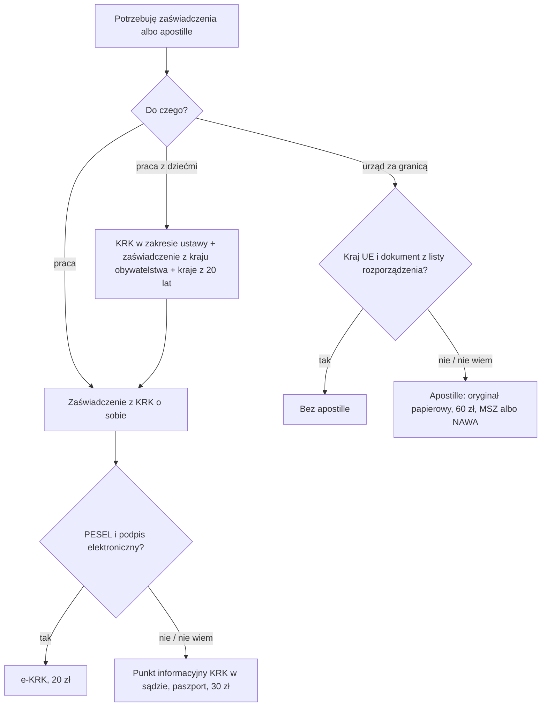

# Map: certificates for other procedures (the KRK certificate, an apostille)

**Status:** a lab map by Claude, 17.10.2026. It is not independent, and nothing in it is built or shown to people. Doc 19 matter 24 (wave 6). Production's registry has no certificate procedure. **Not yet checked by the separate checking agent:** that check comes before anything here is relied on.

**Why it matters:**
- **Any foreigner may get a Polish criminal record certificate about themselves,** with a passport number when there is no PESEL (FACT, KRK art. 7 ust. 1, 19 ust. 3). It costs 30 zł, or 20 zł online (FACT, fee regulation § 3).
- **It shows only what Poland holds,** plus, for an EU citizen, the register of their state (FACT, KRK art. 20 ust. 1d). For a third-country national the EU registers are added only once the EU's ECRIS-TCN system starts, which the Commission expects in 2027 (FACT, KRK art. 20 ust. 1da; Dz.U. 2026 poz. 421 art. 10; COM(2026) 284).
- **Work with children asks a foreigner for more:** the home state's certificate, and those of the states lived in over the last 20 years, or a statement under criminal liability where none exists (FACT, act of 2016 art. 21 ust. 4–8).
- **An apostille comes from the Ministry of Foreign Affairs for most documents, on a paper original, 60 zł** (FACT, government statement of 2005; stamp duty annex part II item 6; PAGES for the other authorities and the paper original). Within the EU many documents need none, but a non-Polish citizen's Polish criminal record certificate is not among them (FACT, Regulation 2016/1191 art. 2 ust. 1 lit. m, art. 4; INFERENCE for the case).

**Sources:** `research/2026-10-17-certificates/sources/` (README there), cited as:
- KRK: the act on the National Criminal Register, consolidated Dz.U. 2024 poz. 276, with Dz.U. 2026 poz. 421;
- FEES: the KRK fee regulation (consolidated Dz.U. 2024 poz. 1339);
- INFO: the KRK information regulation (consolidated Dz.U. 2024 poz. 1817);
- ONLINE: the 2021 regulation on KRK information online (Dz.U. 2021 poz. 728), which still applies;
- CHILD: the act of 2016 on counteracting sexual offences and protecting minors (consolidated Dz.U. 2026 poz. 110);
- HAGUE: the Hague Convention of 1961 (Dz.U. 2005 poz. 938) and the government statement of 2005 (poz. 939);
- EU: Regulation (EU) 2016/1191;
- STAMP: the stamp duty act (consolidated Dz.U. 2025 poz. 1154);
- PAGES: the KRK site of the Ministry of Justice and the MSZ apostille page.

Labels: FACT, INFERENCE, OPEN (OPEN-C1 to C7 in the sources README), PROPOSED.

**Content rules for this matter (PROPOSED):**
- **Never "masz czystą kartotekę".** The app shows what the certificate says, as the person's own document.
- **The document decides, never the passport colour:** the EU rule for criminal records depends on who issued the certificate and to whom (EU art. 2 ust. 1 lit. m). The app asks which state issued it, not the person's language.
- **Other states' certificates are handed off:** the app names the state and the purpose (CHILD art. 21 ust. 4–6), never the foreign office's steps, which are not mapped.
- **No action claimed:** never "zamówiliśmy zaświadczenie" or "apostille nadana".

## 1. Who it is for

| The person says | Route | Basis |
|---|---|---|
| "Pracodawca chce zaświadczenie o niekaralności" | The Polish KRK certificate about oneself; ask the employer which scope (a special provision may set one) | KRK art. 7 ust. 1, 20 ust. 1a (FACT) |
| "Będę pracować z dziećmi (szkoła, przedszkole, trener, opiekunka)" | The Polish certificate in the act's scope, the home state's certificate for work with children, and those of other states of residence in the last 20 years, or the statements | CHILD art. 21 ust. 3–8 (FACT) |
| "Jestem obywatelem Niemiec" | The Polish certificate will also hold the German register's data | KRK art. 20 ust. 1d; INFO § 8 (FACT) |
| "Jestem z Ukrainy / Indii, potrzebuję zaświadczenia z mojego kraju" | Not this route: that state's office or its consul (not mapped). The Polish Bureau does not ask third states for a person | KRK art. 4 ust. 1 pkt 5–5a (FACT); PAGES |
| "Potrzebuję apostille na polskim dokumencie (akt, dyplom, zaświadczenie)" | MSZ for most documents, on a paper original; NAWA for university documents, the education authorities for school documents (PAGES) | HAGUE art. 3–5; statement of 2005 (FACT); OPEN-C3 |
| "Dokument jest dla urzędu w innym kraju UE" | Often no apostille (birth, marriage, residence, citizenship and others); for a criminal record, only a document issued to an EU citizen by their own state | EU art. 2 ust. 1, art. 4 (FACT) |

## 2. The journey (stages C0–C3)

| Stage | Goal | Steps (phone / **off the phone**) | Basis | Where people get lost |
|---|---|---|---|---|
| **C0** What for? | Know which document and which scope | Phone: the purpose (job, work with children, abroad), the state the document is for, the person's citizenship as on the passport | KRK art. 20 ust. 1a; CHILD art. 21; EU art. 2 (FACT) | **CL1:** gets a full certificate when the employer needs the act's scope only, or the other way round (INFERENCE) |
| **C1** The Polish certificate | Hold it | Phone: e-KRK (an account, a qualified, trusted or personal signature, 20 zł through the system's payment). **Off: a paper request at a KRK information point at a court or at the Bureau, with the passport and proof of 30 zł; or by post** | KRK art. 19 ust. 1b, 3, 3a, 19a; INFO § 2, 5; FEES § 3–7; ONLINE § 4, 9 (FACT); PAGES | **CL2:** no PESEL and no qualified signature, so no online route (INFERENCE; OPEN-C6). **CL3:** pays outside the e-KRK payment, which blocks the electronic certificate (PAGES) |
| **C2** Other states' certificates | Complete the file for work with children | **Off: the home state's certificate, and each state of residence in the last 20 years; where none is issued, the statement with the clause** | CHILD art. 21 ust. 4–8 (FACT) | **CL4:** brings only the Polish certificate (FACT that the act asks for more) |
| **C3** The apostille | A document accepted abroad | **Off: the paper original (not a copy, not an ePUAP printout); earlier certification for notarial, court, commercial or medical documents; 60 zł paid before; MSZ in person by appointment, or by post** | HAGUE art. 3–6; STAMP part II item 6 (FACT); PAGES | **CL5:** brings an e-KRK printout (PAGES). **CL6:** asks for an apostille the EU state may not require, or skips one it may (EU art. 2, 4) |

## 3. The critical moments

1. **The employer's start date** (C1, C2): the Polish certificate's waiting time is not set by the act (OPEN-C5); other states' certificates take longer (INFERENCE).
2. **The day ECRIS-TCN starts** (OPEN-C1): from then a third-country national's certificate also holds EU registers' data.

## 4. Scenarios (fictional)

| # | Situation | Stage | The app should | Never |
|---|---|---|---|---|
| CS1 | A Vietnamese citizen with a PESEL and a trusted profile; a new employer asks for a criminal record certificate | C1 | e-KRK, 20 zł; the certificate shows the Polish register (KRK art. 20 ust. 1) | "Masz czystą kartotekę" |
| CS2 | A Ukrainian citizen without a PESEL, hired as a swimming coach for children | C0–C2 | The Polish certificate on paper with the passport number, in the act's scope; the Ukrainian certificate for work with children; any other state of residence in 20 years (CHILD art. 21 ust. 3–5) | "Wystarczy polskie zaświadczenie" |
| CS3 | A German citizen living in Poland | C1 | The Polish certificate also holds the German register's data (KRK art. 20 ust. 1d) | — |
| CS4 | A Filipino nanny admitted by parents who know her personally, to care for their own child | C0 | The act's checks are not required before such an admission (CHILD art. 21 ust. 10, FACT); ust. 10 names admission, not employment, so for an employment contract it is unclear (INFERENCE); the family may still ask | "Musisz mieć zaświadczenie" as a legal duty |
| CS5 | Needs an apostille on a Polish marriage certificate for a US office | C3 | MSZ, the paper original, 60 zł, by appointment or by post (HAGUE; STAMP; PAGES) | "Wydruk z ePUAP wystarczy" |
| CS6 | A Polish birth certificate for an office in Spain | C3 | No apostille: a birth document between EU states (EU art. 2 ust. 1 lit. a, art. 4); the regulation also offers a multilingual form as a translation aid (EU art. 1 ust. 2) | "Potrzebujesz apostille" |
| CS7 | An Indian citizen needs his Polish KRK certificate for an employer in the Netherlands | C3 | Outside EU art. 2 ust. 1 lit. m (not issued by his state of citizenship), so the Netherlands may ask for an apostille (INFERENCE); a paper certificate for MSZ | "W UE apostille nie jest potrzebna" |
| CS8 | A university diploma from a Polish university, for work in Canada | C3 | NAWA issues the apostille on university documents (PAGES; OPEN-C3); the recognition map for the reverse case | — |

## 5. User flow (PROPOSED)

**One case:** "Zaświadczenie lub apostille", with three branches: the Polish certificate, other states' certificates (for work with children), and the apostille.

Intake (each with "Nie wiem"):
1. Do czego potrzebujesz dokumentu? (praca; praca z dziećmi; urząd za granicą; inne)
2. Jakie masz obywatelstwo (według paszportu)? Only to choose the rule (KRK art. 20 ust. 1d; EU art. 2 ust. 1 lit. m), never to guess the person's needs.
3. Czy masz PESEL i profil zaufany albo podpis kwalifikowany?
4. W jakich krajach mieszkałeś w ostatnich 20 latach? (work with children only)
5. Dla jakiego kraju jest dokument? (the apostille only)

Handoffs:
- the KRK Information Bureau or a KRK information point (INFO § 2);
- the MSZ legalisation desk, NAWA, or the education authorities (PAGES);
- another state's office or consul for its certificate (not mapped);
- the e-government map for a PESEL and a trusted profile.

## 6. What production would need (PROPOSED)

- **A procedure in the registry** for the KRK certificate, with the fee, the channels and the scope rule (KRK art. 20 ust. 1a), and the apostille with its authorities as data.
- **Change monitoring:**
  - the ECRIS-TCN start (a Commission decision) and KRK art. 20 ust. 1da;
  - the 2023 online regulation's start (moved four times; now 30.06.2027) and the information regulation's end under Dz.U. 2026 poz. 421 art. 9 (at most 14.04.2027);
  - the stamp duty annex; the MSZ page.

## 7. Validation

- **The independent check:** the separate checking agent, before use, on every FACT in the sources README and in this map.
- **Thresholds** as doc 18 §6.1: 0 critical errors (a certificate presented as clean; "no apostille needed" where one is; a foreigner told the Polish certificate is enough for work with children; an action claimed).
- **Confirmers:** the KRK Bureau; the MSZ legalisation desk; an employer of a children's institution (OPEN-C3, C5, C6).
