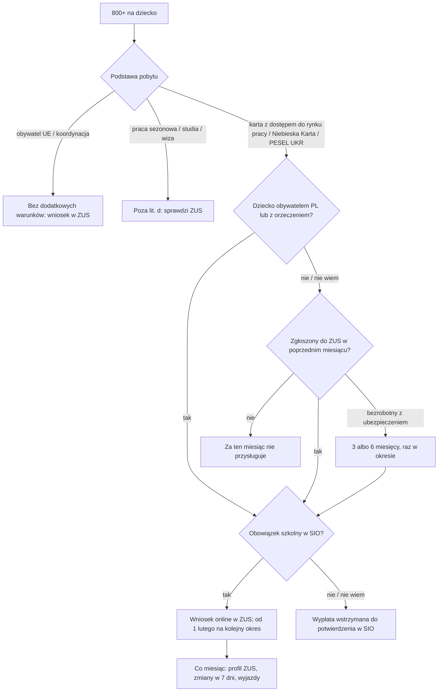

# Map: the child benefit 800+ for foreigners

**Status:** a lab map by Claude, 17.10.2026. It is not independent, and nothing in it is built or shown to people. Doc 19 matter 13 (wave 5). Production's registry has nothing on benefits. **Not yet checked by the separate checking agent:** that check comes before anything here is relied on.

**Why it matters:**
- Since 1.02.2026 most foreigners from outside the EU get 800+ for a month only if they were "aktywne zawodowo" in Poland in the month before, and only while the child meets the school duty, confirmed in the education register (FACT, the 800+ act art. 1 ust. 2a, 2d). The changed rules apply first to the period that began on 1.06.2026 (FACT, Dz.U. 2025 poz. 1301 art. 14).
- ZUS checks this every month and withholds payment when a register does not confirm it (FACT, art. 1 ust. 2f, 21 ust. 1a, 23 ust. 3a; ZUS 22.09.2026).
- Everything happens online and on the ZUS profile, including the letters, which count as delivered 14 days after they are placed there (FACT, art. 13 ust. 5, 13a ust. 5–6).

**Sources:** `research/2026-10-17-benefits/sources/` (README there), cited as:
- PA: the act of 11.02.2016 on state help in raising children, consolidated Dz.U. 2026 poz. 508; and Dz.U. 2025 poz. 1301 art. 14, 29;
- PAGES: ZUS (27.01.2026; 22.09.2026), zielonalinia.gov.pl (28.01.2026), the Ministry of Family (26.03.2026).

Labels: FACT, INFERENCE, HYPOTHESIS, OPEN (OPEN-B1 to B5 in the sources README), PROPOSED.

**Content rules for this matter (PROPOSED):**
- **Never "dostaniesz 800+" or "nie dostaniesz".** ZUS decides month by month. The app names each condition and what the person has told it of each.
- **The status is asked, never inferred** (rule 4): the residence card's annotation, temporary protection, a Blue Card. Citizenship matters only where the act names it: a child who is a Polish citizen is exempt from the work condition (art. 1 ust. 2a).
- **No income or contribution computed.** The 50 % of the minimum wage is quoted; whether a job meets it is ZUS's check (OPEN-B1).
- **The ZUS profile is where letters arrive.** The app says so every time a step depends on a letter.

## 1. Who it is for

By what the person says about their status, never by their language.

| The person says | Route | Basis |
|---|---|---|
| "Mam kartę pobytu z adnotacją 'dostęp do rynku pracy'" (a work permit, a permanent or EU long-term resident card) | 800+ with the work and school conditions, living with the children | PA art. 1 ust. 2 pkt 2 lit. d, 2a, 2d (FACT); the permanent cards: OPEN-B4 |
| "Mam ochronę czasową (PESEL UKR)" | 800+ for those living with family members; from the month of the PESEL UKR; in-person calls within 3 working days; withheld while abroad | Art. 1 ust. 2 pkt 2 lit. ca, 18 ust. 2e, 23 ust. 3b–3g (FACT); the work and school conditions per ZUS (OPEN-B2) |
| "Mam Niebieską Kartę UE" | 800+ with the work and school conditions | Art. 1 ust. 2 pkt 2 lit. c (FACT) |
| "Jestem obywatelem UE" or covered by EU coordination | 800+ without these extra conditions | Art. 1 ust. 2 pkt 2 lit. a (FACT); ZUS 27.01.2026 |
| "Mam pozwolenie na pracę sezonową" / "Studiuję" / "Pracuję na wizie" | Excluded from lit. d | Art. 1 ust. 2 pkt 2 lit. d (FACT); other routes: OPEN-B3 |
| "Moje dziecko jest obywatelem Polski" | The work condition does not apply; the school condition does | Art. 1 ust. 2a, 2d (FACT) |
| "Moje dziecko ma orzeczenie o niepełnosprawności" | The work condition does not apply | Art. 1 ust. 2a (FACT) |

## 2. The journey (stages B0–B6)

| Stage | Goal | Steps (phone / **off the phone**) | Basis | Where people get lost |
|---|---|---|---|---|
| **B0** Can I get it | Know which conditions apply | Phone: the status, the child's citizenship and disability, the work and the school | PA art. 1 ust. 2–3, 2a, 2d (FACT) | **BL1:** a seasonal worker or a student expects it (excluded from lit. d; FACT). **BL2:** thinks the work condition is about income, not insurance (HYPOTHESIS) |
| **B1** Before applying | Have what the form asks for | **Off: a PESEL for the person and the child; a ZUS profile or bank login; the residence document's data; the border-crossing document's data** | Art. 13 ust. 3, 5, 7 (FACT); ZUS 27.01.2026 (PESEL mandatory for applications after 31.01.2026) | **BL3:** no PESEL for the child (PAGES: mandatory) |
| **B2** The child's school | The duty confirmed in SIO | **Off: the child enrolled in a Polish preschool or school; for a deferred duty or a university, the certificate** | Art. 1 ust. 2d–2e, 23 ust. 3a (FACT) | **BL4:** the school has not entered the child in SIO: payment withheld until it does (FACT, art. 23 ust. 3a) |
| **B3** Work activity | Insured in the month before | **Off: an employment contract or a contract of mandate reported to ZUS; a business; or registered unemployed with health insurance (3 or 6 months, once a period)** | Art. 1 ust. 2a–2c, 2 pkt 1a (FACT) | **BL5:** work without being reported to ZUS (illegal or unreported work) counts as no activity (INFERENCE from art. 2 pkt 1a). **BL6:** a contract below 50 % of the minimum wage (FACT that it does not count) |
| **B4** Applying | Filed in the right window | **Off: online to ZUS; next period from 1 February; by 30 April for payment by 30 June; within 3 months of a birth for back pay from the birth** | Art. 13, 18 ust. 2–2a, 21 ust. 3–5c (FACT) | **BL7:** applies late in the period: paid only from the month of the application (FACT, art. 18 ust. 2). **BL8:** a wrong form or missing documents not fixed within 14–30 days: left unexamined (FACT, art. 19) |
| **B5** Each month | Keep the payment | Phone: the ZUS profile's messages. **Off: answer a call; notify changes within 7 days** | Art. 13a ust. 5–6, 20 ust. 1, 21 ust. 1a, 23 (FACT) | **BL9:** does not open the ZUS profile: a call counts as delivered after 14 days (FACT). **BL10:** a trip abroad (PESEL UKR): payment withheld until return (FACT, art. 23 ust. 3f–3g). **BL11:** a job ends: no activity next month (FACT, art. 1 ust. 2a) |
| **B6** Withheld or refused | Get it back, or appeal | **Off: explanations and evidence in the time set; an appeal against a decision** | Art. 13a ust. 4, 23 ust. 1a–3g; an appeal to the President of ZUS under KPA, then the administrative court (art. 28 ust. 1, 3) (FACT) | **BL12:** misses the 3 working days of an in-person call (PESEL UKR): left unexamined or withheld (FACT, art. 23 ust. 3c–3d). **BL13:** an undue benefit to return (FACT, art. 25) |

## 3. The critical moments

1. **The month after a job ends** (BL11): no activity, no benefit for the next month, unless insured as unemployed (3 or 6 months, once a period).
2. **The start of the school year** (BL4): the child's record in SIO decides the payment.
3. **A ZUS call** (BL9, BL12): it arrives only on the ZUS profile.
4. **The application window** (BL7): from 1 February, by 30 April.

## 4. Scenarios (fictional)

| # | Situation | Stage | The app should | Never |
|---|---|---|---|---|
| BS1 | Temporary residence and work permit, two children at a Polish school, full-time job | B0 | Name the conditions (lit. d, work in the month before, school in SIO, living in Poland) and the next step: apply online to ZUS | "Dostaniesz 1600 zł" |
| BS2 | Same, but the job ended last month | B5 | No activity this month means no benefit for next month; registered as unemployed with health insurance: 3 months (or 6 for three children), once a period (art. 1 ust. 2b–2c); the labour office | A computed amount or date |
| BS3 | Seasonal work permit, child here | B0 | Seasonal workers are excluded from lit. d (art. 1 ust. 2 pkt 2 lit. d); other routes are for ZUS to check (OPEN-B3) | "Nie przysługuje" as final |
| BS4 | PESEL UKR, child in a Polish school, mother works on a contract of mandate | B0 | Lit. ca; from the month of the PESEL UKR; ZUS applies the work and school conditions (ZUS 27.01.2026; OPEN-B2) | — |
| BS5 | PESEL UKR, went to Ukraine for two weeks in summer | B5 | Payment is withheld while abroad and resumes from the month it was withheld once back, if the conditions are met (art. 23 ust. 3f–3g) | "Nic się nie stanie" |
| BS6 | ZUS called the person in, PESEL UKR, the letter is from 4 days ago | B6 | The call is for 3 working days; appearing late, the benefit is paid from the month after (art. 23 ust. 3b, 3e); go now | A computed date |
| BS7 | The child is a Polish citizen, the parent is a third-country national and does not work | B0 | The work condition does not apply; the school condition does (art. 1 ust. 2a, 2d) | — |
| BS8 | The child has a disability certificate | B0 | The work condition does not apply (art. 1 ust. 2a) | — |
| BS9 | The child, 6, has a deferred school start | B2 | A deferral is an exception; the certificate may be needed (art. 1 ust. 2d; zielonalinia) | — |
| BS10 | The child is 17 and studies at a Polish university | B2 | The education duty met by studies, confirmed by the university's certificate (art. 1 ust. 2d–2e) | — |
| BS11 | Payment stopped; ZUS profile shows "wstrzymano" | B6 | The most common reasons per ZUS (a border exit without return, no insurance record, no SIO record, data mismatch); explanations and evidence in the time set (ZUS 22.09.2026; art. 23) | "ZUS się pomylił" |
| BS12 | Baby born in Poland 2 months ago | B4 | Filed within 3 months of the birth, the benefit runs from the month of birth (art. 18 ust. 2a); the child's PESEL first | — |
| BS13 | Wants to apply in July for the current period | B4 | Paid from the month of the application; filed in July, decided and paid by 30 September (art. 18 ust. 2, 21 ust. 5b) | Back pay from June |
| BS14 | Works but is not reported to ZUS | B3 | Activity means being insured (art. 2 pkt 1a); unreported work counts as none (INFERENCE); the work map's PIP handoff | Help hiding it |
| BS15 | The other parent abroad gets a child benefit there | B0 | A similar benefit abroad excludes 800+ unless coordination or an agreement says otherwise (art. 8 ust. 1 pkt 4) | — |
| BS16 | ZUS says an amount was paid without the right to it | B6 | It is returned; interest in some cases (art. 25); legal aid for a dispute | — |
| BS17 | Does not read Polish | All | The ZUS form and the letters are in Polish; ZUS's help; an NGO | Machine-translated rules |

## 5. User flow (PROPOSED)

**One case:** "800+ dla dziecka". It links to the PESEL case (the child's PESEL), the e-government case (the login), the work map (activity) and, for PESEL UKR holders, the CUKR and UKR case.

### 5.1 Intake (each with "Nie wiem")

| Order | Question | Options | Why |
|---|---|---|---|
| 1 | Na jakiej podstawie jesteś w Polsce? | Karta pobytu z adnotacją „dostęp do rynku pracy”; Niebieska Karta UE; Ochrona czasowa (PESEL UKR); Obywatelstwo UE; Wiza lub praca sezonowa; Studia; Nie wiem | PA art. 1 ust. 2 pkt 2 |
| 2 | Czy dziecko ma obywatelstwo polskie? | tak; nie; Nie wiem | Art. 1 ust. 2a; asked because the act names it |
| 3 | Czy dziecko ma orzeczenie o niepełnosprawności? | tak; nie; Nie wiem | Art. 1 ust. 2a |
| 4 | Czy w poprzednim miesiącu pracowałeś(-aś) i byłeś(-aś) zgłoszony(-a) do ZUS? | tak; nie, ale jestem zarejestrowany(-a) jako bezrobotny(-a); nie; Nie wiem | Art. 1 ust. 2a–2c |
| 5 | Czy dziecko chodzi do przedszkola lub szkoły w Polsce? | tak; odroczony obowiązek; za młode; studia; nie; Nie wiem | Art. 1 ust. 2d–2e |
| 6 | Czy masz konto na PUE/eZUS? | tak; nie; Nie wiem | Art. 13 ust. 5, 13a ust. 5 |

### 5.2 The levels

0 **Czy to dla mnie** (the conditions, never a verdict) → 1 **Przed wnioskiem** (PESEL, login, documents) → 2 **Szkoła dziecka** → 3 **Praca** → 4 **Wniosek** (the window) → 5 **Co miesiąc** (the ZUS profile, changes, trips) → 6 **Wstrzymanie lub odmowa**.

### 5.3 Each screen

| Screen | Content |
|---|---|
| **Teraz** | "Złóż wniosek w ZUS online", "Sprawdź profil w ZUS", "Odpowiedz na wezwanie: [termin z pisma]". Never "Świadczenie przyznane" |
| **Mapa** | Levels 0–6 |
| **Teczka** | The application's confirmation, each ZUS message, the school or university certificate, the residence document |
| **Kalendarz** | 1 February (applications for the next period), 30 April; the date of each call as written; no computed payment date |
| **Czat** | The conditions with their articles; what changes month by month; "Nie wiem" leads to a check |

### 5.4 Handoffs

| When | To | Basis |
|---|---|---|
| Applying, a call, a decision | ZUS, online | PA art. 10, 13 |
| The child's SIO record | The school or preschool | Art. 1 ust. 2d |
| Registered as unemployed | The county labour office | Art. 1 ust. 2b |
| A refusal, an undue benefit, coordination with another state | Legal aid, an NGO | OPEN-B3 |

### 5.5 The flow, drawn

## 6. What production would need (PROPOSED)

- **A guide** in the registry quoting PA with the 1301 dates and art. 14, and ZUS's pages as the office's practice. Doc 19's wave 5 gate.
- **A monthly checklist, not a verdict:** the conditions ZUS checks each month, shown as the person's own record.
- **Change monitoring:** the act changed three times in a year (Dz.U. 2025 poz. 619 and 1301, 2026 poz. 203).

## 7. Validation

- **The independent check:** the separate checking agent, before use, on every FACT in the sources README and in this map.
- **Moderated tasks** (after the gate): BS2 (my job ended), BS5 (a trip), BS11 (payment stopped).
- **Thresholds** as doc 18 §6.1: 0 critical errors (a "you will get it", a computed amount or date); a correct next action for at least 6 of 8.
- **Confirmers:** ZUS (the monthly check, OPEN-B1, B2); a school's SIO practice; an NGO for BL5 and BL9.
