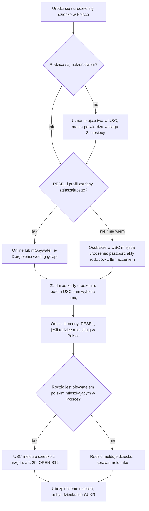

# Map: civil status: a birth, a marriage, a death, a foreign record

**Status:** a lab map by Claude, 17.10.2026. It is not independent, and nothing in it is built or shown to people. Doc 19 matter 14 (wave 4). Production's registry has no guide for it.

**Why now:** three earlier maps meet here.
- **PESEL (wave 1):** at the birth registration, the USC asks for a PESEL for a child of Polish citizens or of foreigners who live in Poland (UEL art. 17). It registers the child's residence itself only for children of Polish citizens (UEL art. 29).
- **Health:** a newborn is confirmed at the clinic on a parent's PESEL for its first 3 months (health map HS12).
- **Residence and CUKR:** the child needs its own residence title. A CUKR card for the child comes only after the mother's.

**Sources:** `research/2026-10-17-civil/sources/` (README there), cited as:
- PASC: the act on civil status records, Dz.U. 2026 poz. 393;
- KRO: the Family and Guardianship Code, Dz.U. 2026 poz. 236;
- PIL: the private international law act, Dz.U. 2023 poz. 503;
- UEL: the act on population records, Dz.U. 2026 poz. 384;
- FA: the foreigners act (art. 160, 195, 202);
- HA: the act on health care benefits (`research/2026-10-17-health/sources/`);
- SA: the special act for Ukrainian citizens, art. 42d (`research/2026-10-17-ukr/sources/`);
- OS: the stamp duty act's annex;
- GOV: the gov.pl pages (birth 31.12.2025, marriage 21.11.2023, death 27.01.2020) and the mObywatel news of 6.03.2026;
- RPO: the Ombudsman's page on marriage certificates.

Labels: FACT, INFERENCE, HYPOTHESIS, OPEN (OPEN-S1 to S12 in the sources README), PROPOSED.

**Content rules for this matter (PROPOSED, from the product rules):**
- **The app never chooses a name, a surname or a law.** It quotes the rules (PASC art. 59; KRO art. 25, 88, 89) and says when a foreign law may apply (PIL art. 48, 55), which is a lawyer's or the USC's call.
- **No computed dates** for the 21-day, 3-day and one-month periods until their counting is settled (OPEN-S11). The rule is quoted with the date the person enters.
- **Grief is not a task list.** A death is a short page with what must happen in 3 days and who does it; nothing is gamified or celebrated, and no progress score is shown.
- **A birth is not a reason for upbeat tone either.** The deadline and its consequence are stated plainly.

## 1. Who it is for

The route depends on the event and on the statuses the act itself names: whether a parent or spouse is a Polish citizen (PASC art. 79, 104 ust. 5; UEL art. 29), whether the parents are married, and the parent's residence title. The person states them; the app never infers them from a name or a language (rule 4).

| The person says | Route | Basis |
|---|---|---|
| "Urodziło nam się dziecko w Polsce" | Report the birth within 21 days of the birth card: in person at the USC of the place of birth, or online | PASC art. 13, 14, 55, 58a (FACT) |
| "Nie jesteśmy małżeństwem" | Recognition of paternity first, if the father's data should be in the record; the mother confirms at once or within three months | PASC art. 61; KRO art. 73 (FACT) |
| "Nie mamy numeru PESEL" | The in-person route; the online one needs a login and, per GOV, e-Doręczenia (INFERENCE) | PASC art. 58a; GOV; e-government map |
| "Mam PESEL UKR / kartę CUKR" | As any parent for the birth; then the child's status: legal stay (production's PESEL guide), CUKR only after the mother's card | SA art. 42d; `maps/cukr-ukr.md` |
| "Chcemy wziąć ślub w Polsce" (one is not a Polish citizen) | The zapewnienie at any USC; the foreigner's document on capacity under their law, or a court exemption; one month's wait | PASC art. 76, 79; KRO art. 4; PIL art. 48 (FACT) |
| "Mój kraj nie wydaje takiego zaświadczenia" | The court exemption (PASC art. 79 ust. 2) | FACT; gov.pl: the court of the place of residence |
| "Nie mam obywatelstwa" / "mam ochronę w Polsce" | Capacity under the law of domicile or habitual residence (PIL art. 3); what the USC asks then is OPEN-S4 | FACT, OPEN |
| "Mam akt urodzenia / ślubu z zagranicy" | Usually no transcription needed for a foreigner; a sworn translation. Transcription is mandatory only for some Polish citizens | PASC art. 31, 104 ust. 5 (FACT); INFERENCE |
| "Zmarła bliska osoba" | The death card to the USC of the place of death within 3 days (24 hours after an infectious disease), by the person entitled to bury | PASC art. 93 (FACT) |
| "Potrzebuję odpisu / zaświadczenia o stanie cywilnym" | At any USC, or online after logging in; fees per OS | PASC art. 44, 45, 49 (FACT) |
| "Rozwiodłem się za granicą" | The ruling is noted after recognition; a refusal points to the court (PASC art. 108). Not mapped further | FACT; says so |
| Name change, divorce in Poland, adoption, the child's citizenship | Other procedures | Says "not covered" |

## 2. The journeys

### 2.1 Birth (stages B0–B5)

| Stage | Goal | Steps (phone / **off the phone**) | Basis | Where people get lost (HYPOTHESIS until interviews, unless marked) |
|---|---|---|---|---|
| **B0** Before the birth (optional) | The father's data can go in the record | **Off: recognition before any USC head, also before the birth** | PASC art. 18, 63 ust. 2 pkt 5; KRO art. 73 | **CL1:** an unmarried father learns too late that without recognition the record holds the mother's surname and a chosen first name as "his" data (FACT, art. 61 ust. 2) |
| **B1** The birth card | The hospital or midwife sends it | **Off: the hospital, within 3 days** | PASC art. 54 ust. 1 | **CL2:** a birth at home: the person who delivered issues the card (GOV); who that is may be unclear (OPEN) |
| **B2** The report | Within 21 days of the card | **Off: in person at the USC of the place of birth (passport or ID), or online (trusted profile or e-ID, and e-Doręczenia per GOV), or mObywatel** | PASC art. 55, 57, 58a; GOV | **CL3:** the 21 days pass, and the USC chooses the name (FACT, art. 55 ust. 2, 56 ust. 2). **CL4:** the online route is blocked without a PESEL or an e-Doręczenia box (INFERENCE). **CL5:** the parents' records and translations are not ready (OPEN-S3) |
| **B3** Name and surname | Choices the USC accepts | Phone: the rules, quoted. **Off: the statement in the protocol or the form** | PASC art. 59; KRO art. 88, 89; PIL art. 16 | **CL6:** a name refused; a decision, appeal within 14 days (FACT). **CL7:** which law sets a foreign child's surname (OPEN-S2) |
| **B4** Documents | The record made, the documents received | **Off: the short copy (free), the PESEL notice if assigned, the registration confirmation if registered** | PASC art. 47, 52; GOV | **CL8:** no PESEL notice, because the parents are not treated as living in Poland (OPEN-S1) |
| **B5** After | The child's next steps | Phone: a "co dalej" card. **Off: the child's residence registration by the parent; the child reported for health insurance; the child's residence permit or CUKR; a passport from the parents' state (not ours)** | UEL art. 29; HA art. 67 ust. 3; FA art. 160 pkt 2, 195; SA art. 42d | **CL9:** the parents assume the office registered the child's address. GOV says "zamelduje je"; UEL art. 29 limits that to children of Polish citizens (FACT, the difference). **CL10:** the child's permit is not started; when it must be (OPEN-S7) |

### 2.2 Marriage (stages M0–M5)

| Stage | Goal | Steps | Basis | Where people get lost |
|---|---|---|---|---|
| **M0** The documents | A complete set | **Off: the capacity document from the foreigner's state (or its consulate), a birth record copy, the end of any earlier marriage, sworn translations** | PASC art. 31, 79 ust. 1; PIL art. 48 | **CL11:** the state issues no such document, or the USC does not accept it (RPO, 2024–2025). **CL12:** apostille or legalisation unclear (OPEN-S6) |
| **M0a** Court exemption (if needed) | The court decides capacity | **Off: an application to the court (gov.pl: of the place of residence)** | PASC art. 79 ust. 2; KRO art. 3 § 2 | **CL13:** the time and cost of the court step, planned too late (OPEN-S4) |
| **M1** The zapewnienie | Filed; a date set | **Off: both in person at the chosen USC with identity documents; stamp duty 84 zł** | PASC art. 15, 76; OS part I item 1 | **CL14:** it is valid 6 months (FACT); a delayed wedding needs a new one |
| **M2** The wait | One month | Phone: the rule. **Off: a written permit for an earlier date, for important reasons (39 zł)** | KRO art. 4; PASC art. 76 ust. 10; OS part III item 1 | **CL15:** a date booked inside the month (INFERENCE) |
| **M3** The ceremony | The statements made | **Off: identity documents of the couple and of two adult witnesses; an interpreter brought by the couple if needed; outside the office for an extra fee** | KRO art. 7 § 1; PASC art. 32 ust. 2, 84, 85 | **CL16:** no interpreter, so no ceremony (INFERENCE from art. 32 ust. 2). **CL17:** the outside-office fee (GOV: 1 000 zł; OPEN-S5) |
| **M4** Surnames | Chosen deliberately | Phone: the options, quoted | KRO art. 25, 88 | **CL18:** no statement: each keeps theirs, and the children get both joined (FACT) |
| **M5** After | The record; what changes elsewhere | **Off: one free short copy.** Phone: links: the residence map (spouse of a Polish citizen, art. 158; finding P5), PESEL data | PASC art. 47, 86 | **CL19:** a refusal: 14 days to the court of the USC's seat (FACT, art. 89) |

### 2.3 Death (stages D0–D2)

| Stage | Goal | Steps | Basis | Where people get lost |
|---|---|---|---|---|
| **D0** The death card | From the doctor who confirmed the death | **Off: the doctor** | PASC art. 92 ust. 2; GOV | — |
| **D1** The report | Within 3 days of the card (24 hours after an infectious disease) | **Off: the person entitled to bury, at the USC of the place of death, with the card and the deceased's identity document** | PASC art. 93, 13 ust. 2; GOV | **CL20:** who is entitled to bury, for a foreigner whose family is abroad (OPEN-S8). **CL21:** the deceased's passport, not an ID card (INFERENCE) |
| **D2** After | Burial and documents | **Off: the short copy (free); the burial; the consulate for moving the body abroad (not ours)** | PASC art. 47; GOV | **CL22:** documents needed abroad (translations, apostille) (OPEN-S6) |

### 2.4 A foreign record

| Stage | Goal | Steps | Basis | Where people get lost |
|---|---|---|---|---|
| **F0** Is transcription needed? | Know before paying | Phone: who must transcribe (PASC art. 104 ust. 5) | FACT; INFERENCE for foreigners | **CL23:** a foreigner pays for a transcription no one asked for, or is told they need one (OPEN-S9) |
| **F1** Transcription (if wanted) | A Polish record | **Off: an application at any USC, the original, a sworn translation; 50 zł for the full copy** | PASC art. 31, 104, 105; OS part II item 1 pkt 6 | **CL24:** refused: a document transcribed in a third state, or doubtful (FACT, art. 107) |

## 3. The critical moments

1. **The first three weeks after a birth** (CL3, CL4): the deadline, the right channel, and the name the parents want.
2. **An unmarried couple before the birth** (CL1): recognition first, if they want the father in the record.
3. **The week after the birth registration** (CL9, CL10): the child's address registration, insurance and residence title. Three other matters start here.
4. **The capacity document for a marriage** (CL11, CL13): it can take months; the court route exists.
5. **The 3 days after a death** (CL20): a short, calm page.

## 4. Scenarios (fictional)

| # | Situation | Stage | The app should | Never |
|---|---|---|---|---|
| CS1 | Both parents foreign, married, both with PESEL and a trusted profile; birth 4 days ago | B2 | The 21-day rule, quoted; the online route (with e-Doręczenia per GOV) or in person; what they will receive | A computed last day |
| CS2 | Both foreign, no PESEL | B2 | In person at the USC of the place of birth, with passports; the parents' records with translations (what exactly: ask the USC, OPEN-S3) | "Zgłoś przez internet" |
| CS3 | Not married; the father wants to be in the record | B0, B2 | Recognition before any USC head (or a court); the mother confirms at once or within three months; then the birth report | "Wystarczy, że ojciec przyjdzie z matką" without recognition |
| CS4 | Day 25, nothing reported | B2 | Say plainly that after 21 days the USC registers the birth itself and chooses the name; contact the USC now | "Nic się nie stało" |
| CS5 | "Czy możemy dać imię z naszego kraju?" | B3 | Yes: foreign names are allowed whatever the parents' nationality; at most two; no diminutives (PASC art. 59) | Judging a name |
| CS6 | The USC refused the chosen name | B3 | A decision; appeal to the voivode within 14 days, through the USC head (GOV) | A guess at the outcome |
| CS7 | "Jakie nazwisko będzie miało dziecko?" Married foreigners with different surnames | B3 | The Polish rule (KRO art. 88); that a foreign law may apply to a foreign child (OPEN-S2); ask the USC | Choosing for them |
| CS8 | After registration: "Czy dziecko jest zameldowane?" | B5 | For a child of Polish citizens living in Poland, yes, ex officio (UEL art. 29; whether one such parent is enough: OPEN-S12). Otherwise check for the confirmation, and if there is none, register the child's residence (the address-registration case) | "Urząd zameldował dziecko automatycznie" |
| CS9 | No PESEL notice for the child | B4 | The USC asks for a PESEL for children of foreigners living in Poland (UEL art. 17); ask the USC why (OPEN-S1); the PESEL application route exists, and a child born in Poland need not appear in person (production's PESEL guide) | "Dziecko nie może dostać PESEL" |
| CS10 | Parents on temporary permits; the newborn has no permit | B5 | FA art. 160 pkt 2: a permit for the child, with the parent's insurance and income as conditions; when to file is OPEN-S7: a lawyer or the voivode's helpline | A deadline |
| CS11 | Parent with a permanent permit; child born in Poland | B5 | A permanent permit for the child (FA art. 195 ust. 1 pkt 1); the usual filing deadline does not apply (art. 202 ust. 3) | — |
| CS12 | Mother with PESEL UKR, applying for CUKR | B5 | The child's CUKR card only after the mother's (SA art. 42d; CUKR map CU8) | Filing for the child first |
| CS13 | Newborn at the clinic, no PESEL yet | B5 | The parent's PESEL works for the first 3 months (HA art. 50 ust. 14); report the child for insurance (health map) | — |
| CS14 | A foreigner and a Polish citizen plan a wedding in 6 weeks | M0–M2 | The documents, the one-month wait from the zapewnienie, the 6-month validity; start with the capacity document now | "Wystarczy paszport" |
| CS15 | The foreigner's state issues no capacity certificate | M0a | The court exemption; gov.pl: the court of the place of residence; time and fee unknown here (OPEN-S4) | A promised date |
| CS16 | The USC rejects a certificate that does not name the other spouse | M0 | The RPO raised exactly this; ask the USC for its written reason; a refusal can go to court within 14 days (art. 89) | "Urząd ma rację" or "Urząd się myli" |
| CS17 | Two foreigners, neither Polish | M0 | The same rules; each person's national law decides capacity (PIL art. 48) | — |
| CS18 | One is stateless, with protection in Poland | M0 | The law of domicile applies (PIL art. 3); what the USC accepts as proof is OPEN-S4; legal aid | — |
| CS19 | "Czy na ślubie potrzebny jest tłumacz?" | M3 | Yes, if either of them or a witness cannot communicate with the USC head; the couple brings one (PASC art. 32 ust. 2) | "Urząd zapewni tłumacza" |
| CS20 | "Jakie nazwisko po ślubie?" | M4 | The three options and the default, quoted (KRO art. 25); the children's surname at the same time (art. 88) | A recommendation |
| CS21 | A foreigner died in a Polish hospital; family abroad | D1 | 3 days from the card; the person entitled to bury reports (who that is: OPEN-S8); the consulate for moving the body | A checklist with a progress score |
| CS22 | "Czy muszę zrobić transkrypcję aktu urodzenia?" (a foreigner) | F0 | Mandatory only for some Polish citizens (PASC art. 104 ust. 5); usually the original with a sworn translation; ask the office that wants the document (OPEN-S9) | "Musisz" |
| CS23 | A Polish citizen born abroad, applying for a Polish ID | F1 | Transcription is mandatory when they have an earlier Polish record and apply for an ID or a PESEL (art. 104 ust. 5); 50 zł for the full copy | — |
| CS24 | A certificate of civil status from March, needed in October | Docs | It is valid 6 months (PASC art. 44 ust. 4); a new one, online free if they can log in (art. 49 ust. 6) | — |
| CS25 | Does not read Polish | All | GOV pages are Polish; an interpreter at the USC for a birth or death report is the USC's to provide (art. 32 ust. 1), for statements the person's (ust. 2); an NGO | Machine-translated rules |

## 5. User flow (PROPOSED)

**Where it appears.**
- **A birth case** ("Urodzenie dziecka"), the main one.
- **A marriage case** ("Ślub w Polsce").
- **A short death page** ("Zgon bliskiej osoby"), with no levels or progress.
- **A reading level** "Dokument z zagranicy" inside the others (transcription, translation).

### 5.1 Entry and intake (birth case)

1. **Entry words:** "urodzenie dziecka", "akt urodzenia", "noworodek", "zgłosić dziecko", "USC".
2. **Intake questions,** each with "Nie wiem":

| Order | Question | Options | Why |
|---|---|---|---|
| 1 | Czy dziecko już się urodziło? | Tak (date); Jeszcze nie | B0 versus B2 |
| 2 | Czy rodzice są małżeństwem? | Tak; Nie; Nie wiem | Recognition (PASC art. 61; KRO art. 73) |
| 3 | (if not married) Czy ojciec uznał już ojcostwo? | Tak; Nie; Nie wiem | B0 |
| 4 | Czy któreś z rodziców ma obywatelstwo polskie? | Tak; Nie; Nie wiem | The act names it: UEL art. 29 (OPEN-S12) |
| 5 | Czy rodzic, który zgłasza, ma PESEL i profil zaufany? | Both; PESEL only; Neither; Nie wiem | The channel (CL4) |
| 6 | Na jakiej podstawie przebywasz w Polsce? (the residence map's options) | as there | B5: the child's title |
| 7 | W jakiej miejscowości urodziło się dziecko? | place (shared) | The USC |

### 5.2 The levels (birth case)

| # | Level | Done when | Notes |
|---|---|---|---|
| 0 | **Przed porodem** (only if not yet born and not married) | The person marks it | Recognition: where, who, the three months, quoted |
| 1 | **Zgłoś urodzenie** | The person marks it reported | The 21 days (quoted); the channel by the intake; in person: passport, the parents' records with translations (OPEN-S3: ask the USC); "Imię i nazwisko" notes placed here |
| 2 | **Co dostaniesz** | Read | The short copy, the PESEL notice, the registration confirmation, each "jeśli…" as GOV puts it |
| 3 | **Co dalej z dzieckiem** | Each linked case opened or marked "nie dotyczy" | Address registration (unless the USC did it under UEL art. 29: the confirmation shows it), insurance (health map), the child's residence title (residence map) or CUKR (CUKR map) |

### 5.3 The marriage case (outline)

Levels: **Dokumenty** (capacity document or the court route; translations) → **Zapewnienie w USC** (84 zł; the date) → **Miesiąc oczekiwania** (the rule; the earlier-date permit) → **Ślub** (witnesses, interpreter) → **Po ślubie** (surnames, the copy, links to residence). Intake: is either a Polish citizen; does the foreigner's state issue the capacity document ("Nie wiem" allowed); planned date.

### 5.4 Each screen

| Screen | Birth | Marriage | Death |
|---|---|---|---|
| **Teraz** | The report until done; then "co dalej". Primary: "Zgłoś w USC" (an address) or "Zgłoś przez internet" (a link), never "Zgłoszę za Ciebie" | The capacity document until it is in hand; then the USC visit | What to do in 3 days, who does it; no primary button but the USC's address |
| **Mapa** | Levels 0–3 | The five levels | None |
| **Teczka** | The birth card is the hospital's; the person keeps the short copy, the PESEL notice, the confirmation | The capacity document, translations, the zapewnienie's date | The death card (to the USC), the short copy |
| **Kalendarz** | The birth date the person enters, with "21 dni od wystawienia karty urodzenia" beside it; no computed date until OPEN-S11 is settled | The zapewnienie date, with "nie wcześniej niż po miesiącu" and "ważne 6 miesięcy"; no computed date | None |
| **Czat** | Names, surnames, documents, from the placed notes; "Nie wiem" for foreign law | Documents and the court route | Short answers; the consulate |

### 5.5 Handoffs (to people, never pretended)

| When | To | Basis |
|---|---|---|
| Documents for the birth report; the name; the surname under foreign law | The USC of the place of birth | PASC art. 13, 14; OPEN-S2, S3 |
| The capacity document | The foreigner's consulate; else the court | PASC art. 79 |
| A refused name | Appeal to the voivode within 14 days | PASC art. 11 ust. 2; GOV |
| A refused marriage | The court of the USC's seat within 14 days | PASC art. 89 |
| Foreign law (surname, recognition, capacity), the child's residence | Legal aid | PIL; FA |
| Moving a body abroad | The consulate | GOV |

### 5.6 The birth flow, drawn

## 6. What production would need (PROPOSED)

- **Guides** for the birth report, for a marriage with a foreigner, and for transcription, quoting PASC, KRO and PIL. Doc 19's wave 4 gate: the owner opens a new registry domain.
- **An event** `birth` with its date, and a deadline `report` (21 days from the birth card, the counting settled first: OPEN-S11).
- **Cross-case links** from the birth case to the address-registration and PESEL cases (wave 1), the health case, the residence and CUKR cases. The engine has `related` procedures; a "this case opens those" link would be new, as the e-government map also proposes.
- **No stored facts** beyond the intake answers (rule 5). A child's name is not stored by the app.

## 7. Validation

- **Moderated tasks** (fictional cases, after doc 19's wave 4 gate):
  1. CS2: can parents without a PESEL say where to go, by when, and what to bring?
  2. CS4: do they understand what happens after 21 days?
  3. CS8: after the registration, do they know whether the child is registered at their address, and what to do if not?
  4. CS14: can a couple say what to get first and how long the wait is?
- **Thresholds** as doc 18 §6.1, for 8 people:
  - **0 critical errors.** Here that includes a computed date, a chosen name or surname, or "the office registered the child" for foreign parents;
  - a correct next action for at least 6 of 8;
  - at most 1 person confident and wrong.
- **Confirmers:** a USC head (OPEN-S1, S3, S9, S10, S11); a family or private international law lawyer (OPEN-S2, S4); a migrant NGO for CL9, CL10, CL11, CL20; the RPO's office for the marriage certificate question.
- **Interviews:** one probe for the Phase 1 guide's "other matters" question: "Czy w Polsce urodziło Ci się dziecko albo brałeś(-aś) ślub? Co było najtrudniejsze?" PROPOSED, for the owner.
