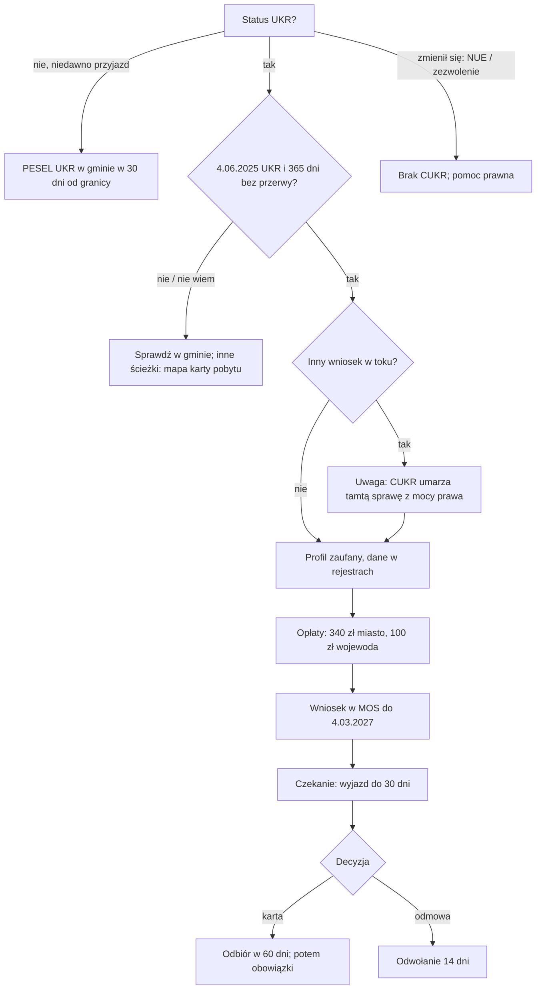

# Map: the UKR status, PESEL UKR and the CUKR card

**Status:** a lab map by Claude, 17.10.2026. It is not independent, and nothing in it is built or shown to people. Wave 3 of doc 19.
- Doc 19 kept wave 3 at sources only, because the rules move fast. The owner asked for this map on 17.10. **It is valid as of 17.10.2026 and must be re-checked against the sources before any use.**
- The CUKR application window closes on 4.03.2027 (special act art. 42x; UdSC).

**Sources:** `research/2026-10-17-ukr/sources/`, cited as:
- PROT: the protection act, consolidated Dz.U. 2026 poz. 862;
- SA: the special act, consolidated Dz.U. 2026 poz. 1293;
- UEL: the act on population records, consolidated Dz.U. 2026 poz. 384, chapter 5a;
- W203: the winding-down act, Dz.U. 2026 poz. 203;
- QA: UdSC's CUKR questions and answers;
- PROC: UdSC's CUKR procedure page.

Labels: FACT (with its source), INFERENCE, HYPOTHESIS, OPEN, PROPOSED.

## 1. Who it is for, by the status the person states

The law ties these rules to Ukrainian citizens and some family members (QA: "obywatele Ukrainy i niektórzy członkowie ich rodzin"). Since 5.03.2026 the UKR status also covers other foreigners under temporary protection (QA). The app never infers the status from nationality or language (rule 4). It asks about the status, which is on the person's PESEL record.

| What the person says | Route |
|---|---|
| "Przyjechałem niedawno z Ukrainy, nie mam PESEL" | PESEL UKR at any municipal office within 30 days of crossing the border (PROT art. 110a; UEL art. 44a) |
| "Mam PESEL UKR" | Living under the status, and the choice about the CUKR card (§2, U3) |
| "Miałem UKR, ale dostałem kartę pobytu (zwykłą)" | The status ended (PROT art. 109b ust. 1 pkt 4); no CUKR (QA). Points to the residence map |
| "Mój status zmienił się na NUE" | The status was changed on 1.09.2026 for people with a PESEL given on a statement who did not confirm their identity by 31.08.2026; their legal stay under art. 106 ended (W203 art. 25). What they can do now is OPEN-C1: a lawyer or NGO |
| "Dziecko urodziło się w Polsce" | The CUKR card only after the mother has one (SA art. 42d; QA) |

## 2. The journey (stages U0–U9)

| Stage | Goal | Steps (phone / **off the phone**) | Basis (FACT) | Where people get lost |
|---|---|---|---|---|
| **U0** Crossing the border | Keep the protection | Phone: record the crossing date. **Off: apply for PESEL UKR at any municipal office** | Within 30 days of crossing, or the protection ends (PROT art. 110a ust. 2, 109b ust. 1 pkt 1) | **UL1:** the 30 days pass |
| **U1** PESEL UKR at the office | Complete register data | **Off: passport, fingerprints, signature specimen; contact data and consent give an automatic trusted profile** | PROT art. 110a, 110c; UEL art. 44a | **UL2:** data left incomplete: later, MOS blocks the CUKR application and does not say why (QA) |
| **U2** Living under the status | Stay legal | Phone: the rules that end the status. **Off: work (the employer notifies the labour office within 7 days)** | Legal stay (PROT art. 106); work without a permit (art. 116); the employer's notice (act on employing foreigners art. 5a, from W203); the status ends after more than 30 days abroad (art. 109b ust. 1 pkt 2) | **UL3:** a trip of more than 30 days ends the status. **UL4:** an identity confirmation was due (W203 art. 25–26; OPEN-C2 for new travel documents) |
| **U3** The choice | Decide between staying on the status, the CUKR card, or an ordinary permit | Phone: the facts side by side, never a recommendation | QA (the comparison); SA art. 42i (a pending ordinary application ends when a CUKR application is filed); W203 art. 45 (some ordinary permits are open to status holders) | **UL5:** filing CUKR while not eligible, after an ordinary case was pending: both are lost (QA warns) |
| **U4** Eligibility | Know whether CUKR is possible | Phone: four questions | UKR on 4.06.2025, on the application day, on the day the card is issued, and unbroken for 365 days; periods do not add up (SA art. 42c; QA) | **UL6:** a past trip broke the status; the 4.06.2025 date was missed (QA examples) |
| **U5** Prerequisites | Be able to file | **Off: a trusted profile, a qualified or a personal signature; register data complete (any municipal office checks it)** | QA; PROT art. 110c | **UL7:** MOS says only "go to the municipal office" (QA) |
| **U6** Fees | Two payments, two payees | **Off: 340 zł stamp duty to the city of the voivode's seat; 100 zł card fee to the voivode** | QA. No exemption: "obowiązkowe dla każdego" (QA) | **UL8:** one transfer, or the wrong payee |
| **U7** Filing | Filed by 4.03.2027 | Phone: the date. **Off: MOS: the form, a photo, both payment proofs; sign; UPO** | SA art. 42f; QA; filed by 4.03.2027, the stay is legal until pickup or a final refusal (SA art. 42x) | **UL9:** paper, e-mail or e-Doręczenia: left unexamined (QA) |
| **U8** Waiting | Stay safe meanwhile | Phone: what changes and what does not | The status stays until pickup; travel up to 30 days (QA); a move is notified to the same voivode (QA); the card "powinno nastąpić w terminie do 180 dni", not estimable now (QA) | **UL10:** a trip of more than 30 days while waiting (INFERENCE from art. 109b) |
| **U9** Pickup and after | Collect within 60 days, then keep the permit | **Off: collect in person.** Phone: the duties | Within 60 days of the office's notice, or the card is cancelled and the fees are lost (SA art. 42r ust. 2). Valid 3 years from issue (art. 42p). Status UKR becomes CUKR, and UKR benefits end (QA). Notify each change of address within 15 working days (art. 42u). The permit is withdrawn after 6 months abroad (art. 42t). Work and business are open (QA). A refusal: appeal within 14 days to the Szef UdSC through the voivode (QA; SA art. 42o ust. 4) | **UL11:** the 60 days pass. **UL12:** loss of collective accommodation is a surprise (QA) |

**The critical moments:**
1. **U3–U4, the choice and eligibility.** An ineligible application can end an ordinary case for nothing.
2. **4.03.2027.** The window closes, and the status ends then on current information (QA, hedged).
3. **U9, the 60 days.** Missing them loses the card and the fees.

## 3. Scenarios (fictional)

| # | Situation | Stage | The app should | Never |
|---|---|---|---|---|
| CU1 | Crossed the border on 10.10.2026, no PESEL | U0 | PESEL UKR at any municipal office by 9.11.2026 (30 days; KPA-style counting to be confirmed: OPEN-C3), with what to bring | "Masz czas" without a date |
| CU2 | UKR since 2022, never left, wants to stay | U3–U7 | The conditions met as stated; the comparison; fees, prerequisites, filing by 4.03.2027 | "Złóż CUKR" as advice |
| CU3 | UKR since 2023; left for 7 months in 2024; back in late 2025 | U4 | Not eligible: on 4.06.2025 there was no status (QA's example). Points to the ordinary routes | "Spróbuj złożyć" |
| CU4 | UKR status, a work permit application pending | U3 | Says that filing CUKR ends that case by law (art. 42i), and to be sure of eligibility first (QA). A lawyer for the choice | A choice made for them |
| CU5 | Got an ordinary permit in 2025 | U3 | No CUKR: the status ended with that permit (QA) | — |
| CU6 | MOS says "zgłoś się do urzędu gminy" | U5 | Any municipal office, with the passport, to complete fingerprints, signature or data (QA) | "Spróbuj później" |
| CU7 | "Ile zapłacę i komu?" | U6 | 340 zł to the city of the voivode's seat, 100 zł to the voivode, before filing; the office's page for the accounts | An account number; a relief |
| CU8 | A child born in Poland in 2023; the mother has no CUKR yet | U4 | The child's application only after the mother's card (art. 42d; QA) | Filing for the child first |
| CU9 | A child who came from Ukraine, the parent has another permit | U4 | The child can apply on its own conditions (QA) | — |
| CU10 | Filed in June, wants to visit family for 6 weeks | U8 | The status still applies while waiting; more than 30 days abroad ends it (QA) | "Możesz jechać" without the limit |
| CU11 | "Kiedy będzie karta?" | U8 | "Do 180 dni" as the UdSC's expectation, with its own caveat; no date | A date |
| CU12 | The office's pickup notice came on 1.12 | U9 | Collect by 30.01.2027 (60 days; counting OPEN-C3); bring the passport | Missing the 60-day warning |
| CU13 | A refusal for an unpaid fee | U9 | The appeal within 14 days; a new application is possible (QA) | Chances of an appeal |
| CU14 | Moved from Kraków to Warsaw after filing | U8 | The same voivode decides; send the new address by post or e-Doręczenia (QA) | "Złóż wniosek ponownie" |
| CU15 | Holding CUKR, moving to a new flat | U9 | Notify the voivode who issued the card within 15 working days (art. 42u) | A computed date |
| CU16 | Holding CUKR, wants a long trip | U9 | A trip of 6 months or more ends the permit (art. 42t; QA "jednorazowo") | — |
| CU17 | Status changed to NUE in September | §1 | Says what happened (W203 art. 25) and hands off: OPEN-C1 | Any route as certain |
| CU18 | "Czy z CUKR mogę pracować?" | U9 | Yes: full access to the labour market; the employer's notice is no longer needed (QA) | — |
| CU19 | Lost the CUKR card | U9 | A paper application for a replacement at the voivode of the current address (QA; the fee as QA states it, to be checked: OPEN-C4) | A MOS step |
| CU20 | A person who reads Ukrainian only | All | The whole flow in Ukrainian, tested (doc 18 R11), before any person sees it | Polish-only content |

## 4. User flow (PROPOSED; nothing is built)

### 4.1 Intake

| Order | Question | Answers | Why |
|---|---|---|---|
| 1 | Czy masz numer PESEL ze statusem UKR? (it shows in mObywatel or on the PESEL confirmation; OPEN-C5 for how the person checks) | yes, no (recently arrived), had it but it changed (CUKR, NUE, a permit), Nie wiem | It routes everything |
| 2 | If no: Kiedy przekroczyłeś(-aś) granicę Polski? | a date, Nie wiem | The 30 days of U0 |
| 3 | If yes: Czy 4 czerwca 2025 r. miałeś(-aś) już status UKR? | yes, no, Nie wiem | Art. 42c pkt 1 |
| 4 | Czy od tamtej pory był okres, gdy Twój status wygasł (na przykład wyjazd na ponad 30 dni)? | no, yes, Nie wiem | The unbroken 365 days |
| 5 | Czy czeka na decyzję Twój inny wniosek o pobyt? | no, yes, Nie wiem | Art. 42i |
| 6 | Dla kogo? Dla siebie, dla dziecka urodzonego w Polsce, dla dziecka, które przyjechało z Ukrainy | — | Art. 42c–42d |
| 7 | Miejscowość | — | The voivode |

"Nie wiem" on 3–5 gives a plan that says what to check and where (the municipal office reads the register), and no eligibility verdict.

### 4.2 Levels

| # | Level | Content | Dates |
|---|---|---|---|
| 0 | Twój status | The answers; the eligibility as "spełniasz warunki, które podałeś(-aś)", never as a guarantee | — |
| 1 | PESEL UKR (new arrivals only) | Any municipal office; what to bring; contact data for the automatic trusted profile | Crossing + 30 days |
| 2 | Wybór (a compare card) | UKR, CUKR and an ordinary permit side by side, from QA and the acts; "Nie wybieram za Ciebie"; legal aid. One line on health care: on UKR, care without insurance only in four groups and in emergencies (PROT art. 112c, from 5.03.2026); with CUKR, the same access as any temporary permit holder (QA). See `maps/health-insurance.md` HS19–HS21 | — |
| 3 | Zanim złożysz | Trusted profile or signature; register data complete (check at the municipal office) | — |
| 4 | Opłaty | 340 zł to the city of the voivode's seat; 100 zł to the voivode; listed, not one transfer | Before filing |
| 5 | Wniosek w MOS | Photo, both proofs, signing, UPO | **4.03.2027**, with reminders 60, 30, 14 and 7 days before |
| 6 | Czekasz na kartę | Travel limit (30 days), a move notified, the 180 days as UdSC's expectation | — |
| 7 | Odbiór karty | In person; what to bring | Notice + 60 days |
| 8 | Z kartą CUKR | Address changes within 15 working days; 6 months abroad; work; the next permit on general rules | — |

### 4.3 Screens

| Screen | What changes from the residence map |
|---|---|
| **Teraz** | Before filing, the current level and the date 4.03.2027 always in view. While waiting, the 30-day travel limit stays visible |
| **Mapa** | The compare card as its own level, which the person marks "przeczytane", not "zrobione" |
| **Teczka** | The photo, both payment proofs, the UPO |
| **Kalendarz** | The 30 days after crossing (U0), the 4.03.2027 window, the 60 days after the pickup notice |
| **Czat** | It answers "czy mogę wyjechać", "czy mogę pracować" and "co z ośrodkiem" from QA, with the source; anything else gets "Nie wiem" and a handoff |

### 4.4 The flow, drawn

## 5. What a blueprint would need (PROPOSED; needs a production guide first)

- **A procedure in production's registry for the CUKR card.** Today the registry has the UKR notes only inside the PESEL and residence guides.
- **Facts:** `ukr.status` (UKR, none, CUKR, NUE, permit, unknown), `ukr.on_2025_06_04`, `ukr.unbroken`, `ukr.pending_application`, `ukr.for` (self, child born in Poland, child arrived), `ukr.border_crossed` (date).
- **Deadlines:**
  - `pesel-ukr` (30 days from the crossing);
  - `cukr-window` (a fixed date, 4.03.2027, from SA art. 42x);
  - `pickup` (60 days from an event `pickup_notice`).
- **The compare level as a reading level** (a new kind: it is read, not done).

## 6. Upkeep and validation

- **Volatility.** In 2026 the rules moved across three acts, and four later entry dates are pending (W203 art. 54). A weekly check is decision D3 in the overnight report. Re-check this map before any use after 17.10.2026.
- **Confirmers:**
  - a migration lawyer (every rule);
  - UdSC or a voivode (the fee payees, pickup, timelines);
  - an NGO serving Ukrainian newcomers (UL1–UL12 and the language).
- **Moderated test:** in Ukrainian, on CU2, CU3 and CU4, with the doc 18 §6.1 thresholds. A wrong eligibility verdict, or a missing art. 42i warning, is a critical error.

## 7. Open

| Id | Question |
|---|---|
| OPEN-C1 | What a person whose status became NUE can do now |
| OPEN-C2 | The identity confirmation after a new travel document (W203 art. 26): how the app would know, and whether it should ask |
| OPEN-C3 | How the 30 and 60 days are counted (the day of the event, closed days) |
| OPEN-C4 | The replacement fee and its relief for a lost card (QA states 200 zł; the regulation is not in our sources) |
| OPEN-C5 | How a person checks their own status (mObywatel, a certificate); not in our sources |
| OPEN-C6 | Whether the special act's art. 100d suspension applies to CUKR card cases; not stated |
| OPEN-C7 | The EU Council decision and its end date (OPEN-U1 in the sources README) |
