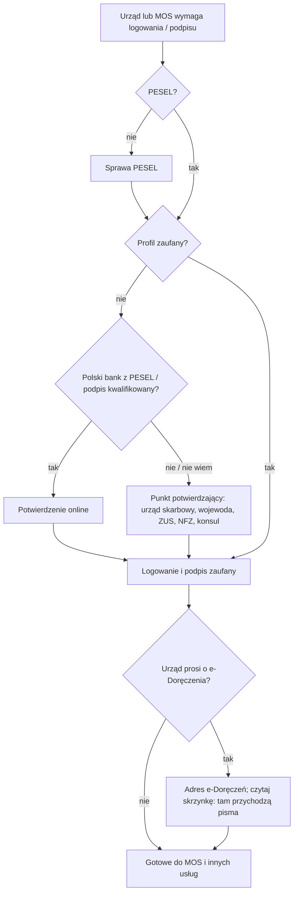

# Map: e-government access: PESEL, the trusted profile, e-Doręczenia

**Status:** a lab map by Claude, 17.10.2026. It is not independent, and nothing in it is built or shown to people. Doc 19 matter 10 (wave 4). Production's registry has no guide for it yet, so the app could only link to it from other cases.

**Why now:** the residence work found that this matter is the bridge between wave 1 (PESEL) and wave 2 (the residence card).
- The MOS account asks for a PESEL (art. 225b) and needs a trusted profile (UdSC QA 2).
- The Mazowiecki office runs cases through e-Doręczenia and starts its steps with "Uzyskaj numer PESEL".
- The trusted profile itself holds a PESEL.

**Sources:** `research/2026-10-17-egov/sources/` (README there), cited as:
- INF: the act on informatization, Dz.U. 2025 poz. 1703;
- ED: the act on electronic deliveries, Dz.U. 2024 poz. 1045 with 1841;
- GOV: the gov.pl pages.

Labels: FACT, INFERENCE, HYPOTHESIS, OPEN, PROPOSED.

## 1. Who it is for

Anyone who must use a public online service:
- MOS for the residence card;
- e-Doręczenia letters from a voivode;
- PUE ZUS, e-Urząd Skarbowy, the patient account IKP (GOV lists these).

The route differs by what the person already has, never by nationality (rule 4):

| The person has | Route |
|---|---|
| No PESEL | PESEL first (the PESEL case). No trusted profile is possible without it (INF art. 20ad, INFERENCE) |
| A PESEL, no profile | Confirm a trusted profile: a confirmation point in person, a bank's e-ID if the bank holds the PESEL, or a qualified signature (INF art. 20c) |
| A PESEL UKR | Possibly an automatic trusted profile from the PESEL UKR application; otherwise at any municipal office (protection act art. 110c) |
| A trusted profile | Sign and log in; optionally an e-Doręczenia address |
| A business in CEIDG or KRS | An e-Doręczenia address is mandatory (ED art. 9) |

## 2. The journey (stages E0–E5)

| Stage | Goal | Steps (phone / **off the phone**) | Basis | Where people get lost |
|---|---|---|---|---|
| **E0** The need | Know why the profile is needed | Phone: which service asks for it (MOS, an office, ZUS) | GOV; UdSC QA 2; Mazowiecki page | **EL1:** learns of the need on the day of a deadline (HYPOTHESIS; high harm for MOS) |
| **E1** PESEL | Have the number | **Off: the PESEL case** (registration or application; in person for non-EU since 1.01.2026) | INF art. 20ad ust. 1 (FACT); PESEL guide | **EL2:** expects a profile without a PESEL (INFERENCE from public questions Q8) |
| **E2** Confirm the profile | A working profile | **Off: a confirmation point (consul, tax office, voivode, ZUS, NFZ, approved banks or post) with an identity document; or online with a bank's e-ID or a qualified signature** | INF art. 20c ust. 1–3 (FACT) | **EL3:** GOV says "założysz … w kilka chwil", but the quick online routes need a Polish ID card (video, personal profile) or a bank that holds the PESEL (INFERENCE). **EL4:** which document a point accepts (OPEN-E1) |
| **E3** Use it | Log in; sign | Phone: what signing means | A trusted signature equals a handwritten one (INF art. 20ae ust. 2, FACT) | **EL5:** giving the login to a helper; UdSC forbids sharing it (QA 5) |
| **E4** e-Doręczenia (optional, or required by an office's practice) | An address in the database, and reading the box | **Off: apply online (gov.pl or the designated operator) with the PESEL; activate the box** | ED art. 10, 14, 15 (FACT) | **EL6: once the address is in the database, public bodies deliver there** (ED art. 7 ust. 1, 4). An unread box means missed calls and deadlines (INFERENCE, high harm). **EL7:** a business that must have one and does not (ED art. 9) |
| **E5** Keep it | Still valid when needed | Phone: the expiry date, once the regulation is read (OPEN-E2). **Off: extend it** | INF art. 20c ust. 1a | **EL8:** maintenance windows near a deadline. GOV announced outages for the night of 17/18.10.2026 (FACT, the page). PROPOSED: treat an announced outage like a closed day under doc 18's D7 rule, with a reminder before it |

## 3. Scenarios (fictional)

| # | Situation | The app should | Never |
|---|---|---|---|
| EG1 | No PESEL, needs MOS in 3 weeks | Start the PESEL case now; then a confirmation point; name the voivode's help with the MOS account (art. 225b ust. 4) | "Profil zaufany założysz w kilka minut" |
| EG2 | Has a PESEL and a Polish bank account | The bank route may work if the bank confirms the PESEL (INF art. 20c ust. 1 pkt 3); otherwise a confirmation point | Naming a bank as certain |
| EG3 | Has a PESEL, no Polish bank | A confirmation point in person: which offices act as one (INF art. 20c ust. 2); bring an identity document (OPEN-E1) | A video route as available |
| EG4 | EU citizen with a national eID | Logging in with a notified eID where the service accepts it (INF art. 20a ust. 1 pkt 2). An e-Doręczenia address possible with the EU identifier (ED art. 14) | — |
| EG5 | PESEL UKR, no profile | The automatic profile if the application had contact data; otherwise any municipal office (protection act art. 110c) | — |
| EG6 | "Urząd wojewódzki prosi o e-Doręczenia" (Mazowiecki) | The steps from the office's page (PESEL, profile, address); that letters will then arrive there; check the box | "Nie musisz" |
| EG7 | Has an e-Doręczenia address, "nie dostałem żadnego listu" | Explain that public bodies deliver to the address (ED art. 4); check the box; a missed delivery may have legal effect (OPEN: when it counts as delivered) | "Na pewno nic nie przyszło" |
| EG8 | A sole trader in CEIDG | An address is required (ED art. 9 ust. 1 pkt 9) | — |
| EG9 | "Może kolega zaloguje się za mnie?" | No: the login is personal; a helper may sit beside (QA 5) | Help sharing a login |
| EG10 | A deadline on 18.10, and an outage that night | Do it before; name the announced outage with its source | — |
| EG11 | Does not read Polish | GOV pages are Polish; an NGO or the office's help | Machine-translated rules |
| EG12 | Profile expired | Extend it at a point or with the methods of art. 20c ust. 1a; when it expires is OPEN-E2 | A computed expiry |

## 4. User flow (PROPOSED)

**Where it appears.** Not as a case of its own at first. It is a **prerequisite level** inside the residence and CUKR cases ("Zanim zaczniesz"), and a "co dalej" card at the end of the PESEL case.

### 4.1 The prerequisite level, in other cases

| Element | Content |
|---|---|
| Title | Zanim zaczniesz: PESEL i profil zaufany |
| Questions (each with "Nie wiem") | Czy masz PESEL? Czy masz profil zaufany (albo podpis kwalifikowany)? Czy urząd prosi Cię o adres do e-Doręczeń? |
| Tasks | PESEL (a link to the PESEL case, which opens it if needed); confirm the trusted profile (the ways, as a list with the basis); e-Doręczenia (when the office asks, or the person wants it) |
| Placed notes | "Profil zaufany zawiera numer PESEL" (INF art. 20ad), quoted; "Wpis adresu … jest równoznaczny z żądaniem doręczania korespondencji … na ten adres" (ED art. 7), quoted, on the e-Doręczenia task |
| Done when | The person marks it; the app cannot check a profile |
| Primary action | "Otwórz sprawę PESEL" while there is no PESEL; else "Punkty potwierdzające" (a link to the official list, once collected: OPEN-E4) |

### 4.2 After the PESEL case

When the PESEL case is done, a card: "Do czego jeszcze przyda się PESEL: profil zaufany, MOS, e-Doręczenia". It is a link to this level, never a new obligation stated as fact.

### 4.3 The flow, drawn

## 5. What production would need (PROPOSED)

- **A guide** (procedure) for the trusted profile and one for e-Doręczenia, in the registry, quoting INF and ED. Doc 19's wave 4 gate: the owner opens a new registry domain.
- **A cross-case dependency:** the residence and CUKR blueprints point to the PESEL case and to this level. The engine has related procedures (`related`, `seeProcedures`); a "prerequisite" link between cases would be new.
- **No facts stored** about the profile beyond yes, no and "Nie wiem" (rule 5: no personal data on servers).

## 6. Validation

- **Confirmers:** a tax office or a voivode acting as a confirmation point (OPEN-E1, EL3); the Ministry's helpline for e-Doręczenia (OPEN-E3); an NGO for EL1 and EL5.
- **Interviews:** add one probe to the Phase 1 guide's "other matters" question: "Czy zakładałeś(-aś) profil zaufany? Gdzie i co było potrzebne?" This is decision D4 in the overnight report.
