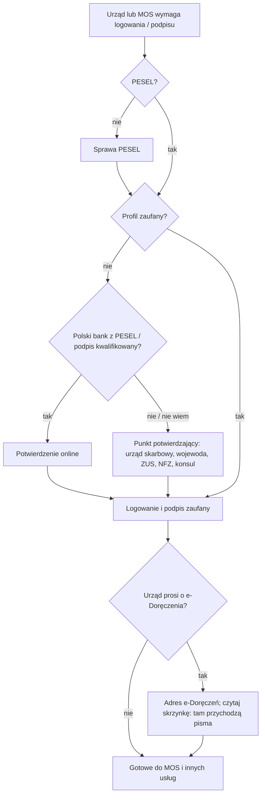

# Map: e-government access: PESEL, the trusted profile, e-Doręczenia

**Status:** a lab map by Claude, 17.10.2026. It is not independent, and nothing in it is built or shown to people. Doc 19 matter 10 (wave 4). Production's registry has no guide for it yet, so the app could only link to it from other cases. Checked by the separate checking agent on 17.10.2026, at the owner's request (`research/2026-10-17-egov/sources/CHECK.md`); the corrections are changed in the lab, not independently verified.

**Why now:** the residence work found that this matter is the bridge between wave 1 (PESEL) and wave 2 (the residence card).
- The MOS account asks for a PESEL (art. 225b ust. 3 pkt 6). Logging in needs one of the means of INF art. 20a ust. 1 (art. 225b ust. 2): a trusted profile is one of them, not the only one. UdSC's QA 2 says "Osoby te muszą posiadać profil zaufany"; the act does not say so, and QA 3 on the same page speaks of "wybranej przez Ciebie metody uwierzytelnienia".
- The Mazowiecki office asks for an e-Doręczenia address for cases filed through MOS (its page of 20.04.2026, written before MOS opened on 27.04.2026, in the future tense), and starts its steps with "Uzyskaj numer PESEL".
- The trusted profile itself holds a PESEL.

**Sources:** `research/2026-10-17-egov/sources/` (README there), cited as:
- INF: the act on informatization, consolidated Dz.U. 2026 poz. 1241 (it replaced 2025 poz. 1703; the articles cited here read the same in both);
- ED: the act on electronic deliveries, consolidated Dz.U. 2026 poz. 3 (it replaced 2024 poz. 1045 and includes 1841), with 2026 poz. 507;
- REG: the trusted profile regulation, consolidated Dz.U. 2023 poz. 2551, as amended;
- UEL: the act on population records, consolidated Dz.U. 2026 poz. 384;
- GOV: the gov.pl pages;
- other provisions added after the check: `other-acts-egov-extract.txt`.

Labels: FACT, INFERENCE, HYPOTHESIS, OPEN, PROPOSED.

## 1. Who it is for

Anyone who must use a public online service:
- MOS for temporary, permanent and long-term-resident permit applications (act on foreigners art. 225a ust. 1); a parent sets up the account for a minor (art. 225b ust. 1 pkt 2);
- e-Doręczenia letters from a voivode;
- PUE ZUS, e-Urząd Skarbowy, the patient account IKP (GOV lists these).

A trusted profile is only for a person with full or limited legal capacity (INF art. 3 pkt 14). The route differs by what the person already has, never by nationality (rule 4):

| The person has | Route |
|---|---|
| No PESEL | PESEL first (the PESEL case). No trusted profile is possible without it (INF art. 20ad ust. 1, every route of art. 20c ust. 1; REG § 4 ust. 2 "posiadającej numer PESEL"; INFERENCE) |
| A PESEL, no profile | Confirm a trusted profile: a confirmation point in person; online with a qualified signature whose certificate holds the PESEL; a bank's e-ID that confirms the PESEL, where the minister approved the bank (art. 20c ust. 8); with a Polish ID card, also the personal profile or the video route (INF art. 20c ust. 1, 20cb; REG § 6 ust. 4). The online application is deleted if not confirmed within 30 days (REG § 3 ust. 2) |
| A PESEL UKR | Possibly an automatic trusted profile from the PESEL UKR application; otherwise at any municipal office (protection act art. 110c) |
| A trusted profile | Sign and log in; optionally an e-Doręczenia address |
| A business in CEIDG or KRS | An e-Doręczenia address is mandatory (ED art. 9 ust. 1 pkt 8–9): KRS from 1.01.2025 (art. 166 pkt 5 with the communiqué Dz.U. 2024 poz. 1078); CEIDG from 1.10.2026 (art. 166 pkt 9), and earlier entries had to have one by 30.09.2026 (art. 152 ust. 3) |

## 2. The journey (stages E0–E5)

| Stage | Goal | Steps (phone / **off the phone**) | Basis | Where people get lost |
|---|---|---|---|---|
| **E0** The need | Know why the profile is needed | Phone: which service asks for it (MOS, an office, ZUS) | GOV; UdSC QA 2; Mazowiecki page | **EL1:** learns of the need on the day of a deadline (HYPOTHESIS; high harm for MOS) |
| **E1** PESEL | Have the number | **Off: the PESEL case** (registration or application). Since 1.01.2026, in person for a foreigner who is not an EU, EFTA-EEA or Swiss citizen, a UK Withdrawal Agreement beneficiary, or a family member of one: for the PESEL application, except children born in Poland (UEL art. 18 ust. 1a), and for registering without a PESEL (art. 40 ust. 3, whose exceptions are the people named in art. 41 ust. 1–2a, among them some family members of Polish citizens, and the same UK beneficiaries) | INF art. 20ad ust. 1 (FACT); UEL art. 18 ust. 1a, 40 ust. 3 (Dz.U. 2025 poz. 1301 art. 6, 29 pkt 1); PESEL guide | **EL2:** expects a profile without a PESEL (INFERENCE from `research/2026-10-16-service/PUBLIC-QUESTIONS.md` Q8) |
| **E2** Confirm the profile | A working profile | **Off: a confirmation point (consul, tax office, voivode, ZUS, NFZ, approved banks or post) with an identity document; or online with a bank's e-ID or a qualified signature** | INF art. 20c ust. 1–3 (FACT); an application filed online first is deleted after 30 days unconfirmed (REG § 3 ust. 2); NFZ-authorised primary-care staff confirm only their own patients (art. 20c ust. 2b) | **EL3:** GOV says "założysz … w kilka chwil", but the quick online routes need a Polish ID card (video, personal profile), a bank that confirms the PESEL, or a qualified signature (INFERENCE, from ID card act art. 6 ust. 1 and REG § 6 ust. 4). **EL4:** which document a point accepts: any that identifies a person who has a PESEL (REG § 4 ust. 2; § 12 ust. 1 pkt 4 foresees one without the number); each point's practice is OPEN-E1 |
| **E3** Use it | Log in; sign | Phone: what signing means | A trusted signature equals a handwritten one, unless a law says otherwise, if made while the profile is valid (INF art. 20ae ust. 1–2, FACT) | **EL5:** giving the login to a helper; UdSC forbids sharing it (QA 5) |
| **E4** e-Doręczenia (optional for a private person, ED art. 10; an office may ask for it) | An address in the database, and reading the box | **Off: apply online (gov.pl or the designated operator) with the PESEL; activate the box after logging in (art. 19 ust. 4)** | ED art. 10, 14, 15, 19 ust. 4 (FACT) | **EL6: once the address is in the database, public bodies deliver there** (ED art. 4 ust. 1, 7 ust. 1; KPA art. 39 § 1), with the exceptions of art. 6. A letter not opened counts as delivered on the day after 14 days from its arrival (art. 41 ust. 1 pkt 3, 42 ust. 2). An unread box means missed calls and deadlines (INFERENCE, high harm). Since 1.01.2026 an ePUAP box no longer counts as delivery to or from a person (art. 147 ust. 2–3). **EL7:** a business that must have one and does not (ED art. 9) |
| **E5** Keep it | Still valid when needed | Phone: the expiry date, which the profile itself shows (REG § 10 ust. 1 pkt 4). **Off: extend it before it lapses** | Valid 3 years, extendable by 3 (REG § 11 ust. 1); extended in the system with a trusted profile, the personal profile or a qualified signature, or at a point (§ 11 ust. 2; INF art. 20c ust. 1a); it loses validity when its period ends (§ 13 ust. 1 pkt 2) | **EL8:** maintenance windows near a deadline. GOV announced that the trusted profile, the national node and signing "mogą wystąpić czasowe niedostępności" on the night of 17/18.10.2026, 20:00–07:00; the e-Doręczenia page names a planned break on 17.10, 23:00–00:00, and Poczta Polska's on 18.10, 15:00–20:00 (FACT, the pages). PROPOSED: treat an announced outage like a closed day under doc 18's D7 rule, as a warning with a reminder before it. The check found no act that moves a deadline for such an outage; the only outage rule found is MOS's own (act on foreigners art. 225c) |

## 3. Scenarios (fictional)

| # | Situation | The app should | Never |
|---|---|---|---|
| EG1 | No PESEL, needs MOS in 3 weeks | Start the PESEL case now; then a confirmation point; name the voivode's help with the MOS account (art. 225b ust. 4) | "Profil zaufany założysz w kilka minut" |
| EG2 | Has a PESEL and a Polish bank account | The bank route may work if the bank confirms the PESEL (INF art. 20c ust. 1 pkt 3); otherwise a confirmation point | Naming a bank as certain |
| EG3 | Has a PESEL, no Polish bank, no Polish ID card | A confirmation point in person: which offices act as one (INF art. 20c ust. 2); bring an identity document that identifies them (REG § 4 ust. 2; each point's practice OPEN-E1); or a qualified signature whose certificate holds the PESEL | A video route as available |
| EG4 | EU citizen with a national eID | Logging in with a notified eID where the service accepts it (INF art. 20a ust. 1 pkt 2). An e-Doręczenia address possible with the EU identifier (ED art. 14) | — |
| EG5 | PESEL UKR, no profile | The automatic profile if the application had contact data; otherwise any municipal office (protection act art. 110c) | — |
| EG6 | "Urząd wojewódzki prosi o e-Doręczenia" (Mazowiecki) | The steps from the office's page (PESEL, profile, address); that the law makes the address optional for a private person (ED art. 10) and the office asks for it; that once it is entered, letters will arrive there (art. 7 ust. 1); check the box | A flat "Musisz" or "Nie musisz" |
| EG7 | Has an e-Doręczenia address, "nie dostałem żadnego listu" | Explain that public bodies deliver to the address (ED art. 4 ust. 1); check the box; a letter not opened counts as delivered on the day after 14 days from its arrival (art. 41 ust. 1 pkt 3, 42 ust. 2) | "Na pewno nic nie przyszło" |
| EG8 | A sole trader in CEIDG | An address is required (ED art. 9 ust. 1 pkt 9, from 1.10.2026; entries made earlier had to have one by 30.09.2026, art. 152 ust. 3) | — |
| EG9 | "Może kolega zaloguje się za mnie?" | No: the login is personal (REG § 9 pkt 1; for MOS, QA 5); a helper may sit beside | Help sharing a login |
| EG10 | A deadline on Sunday 18.10, with outages announced the night before and that afternoon | Do it before; name the announced outage with its source. A KPA deadline that ends on a Sunday runs to Monday 19.10 (KPA art. 57 § 4); a deadline under another act follows that act | The outage as an extension |
| EG11 | Does not read Polish | GOV pages are Polish; an NGO or the office's help | Machine-translated rules |
| EG12 | Profile expired | It lost validity when its period ended (REG § 13 ust. 1 pkt 2), so it is confirmed again, at a point or online (INFERENCE: the regulation lets only a holder of a profile extend it, § 11 ust. 2). Next time, extend it before the date the profile shows | A computed expiry |

## 4. User flow (PROPOSED)

**Where it appears.** Not as a case of its own at first. It is a **prerequisite level** inside the residence and CUKR cases ("Zanim zaczniesz"), and a "co dalej" card at the end of the PESEL case.

### 4.1 The prerequisite level, in other cases

| Element | Content |
|---|---|
| Title | Zanim zaczniesz: PESEL i profil zaufany |
| Questions (each with "Nie wiem") | Czy masz PESEL? Czy masz profil zaufany (albo podpis kwalifikowany)? Czy urząd prosi Cię o adres do e-Doręczeń? |
| Tasks | PESEL (a link to the PESEL case, which opens it if needed); confirm the trusted profile (the ways, as a list with the basis); e-Doręczenia (when the office asks, or the person wants it) |
| Placed notes | "Profil zaufany zawiera dane identyfikujące osobę fizyczną obejmujące: … numer PESEL" (INF art. 20ad ust. 1), quoted; "Wpis adresu … jest równoznaczny z żądaniem doręczania korespondencji … na ten adres" (ED art. 7), quoted, on the e-Doręczenia task |
| Done when | The person marks it; the app cannot check a profile |
| Primary action | "Otwórz sprawę PESEL" while there is no PESEL; else "Punkty potwierdzające" (a link to the official list, once collected: OPEN-E5) |

### 4.2 After the PESEL case

When the PESEL case is done, a card: "Do czego jeszcze przyda się PESEL: profil zaufany, MOS, e-Doręczenia". It is a link to this level, never a new obligation stated as fact.

### 4.3 The flow, drawn

## 5. What production would need (PROPOSED)

- **A guide** (procedure) for the trusted profile and one for e-Doręczenia, in the registry, quoting INF and ED. Doc 19's wave 4 gate: the owner opens a new registry domain.
- **A cross-case dependency:** the residence and CUKR blueprints point to the PESEL case and to this level. The engine has related procedures (`related`, `seeProcedures`); a "prerequisite" link between cases would be new.
- **No facts stored** about the profile beyond yes, no and "Nie wiem" (rule 5: no personal data on servers).

## 6. Validation

- **Confirmers:** a tax office or a voivode acting as a confirmation point (OPEN-E1, EL3); the Ministry's helpline for e-Doręczenia (OPEN-E3); an NGO for EL1 and EL5.
- **Interviews:** add one probe to the Phase 1 guide's "other matters" question: "Czy zakładałeś(-aś) profil zaufany? Gdzie i co było potrzebne?" This is decision D4 in the overnight report.
