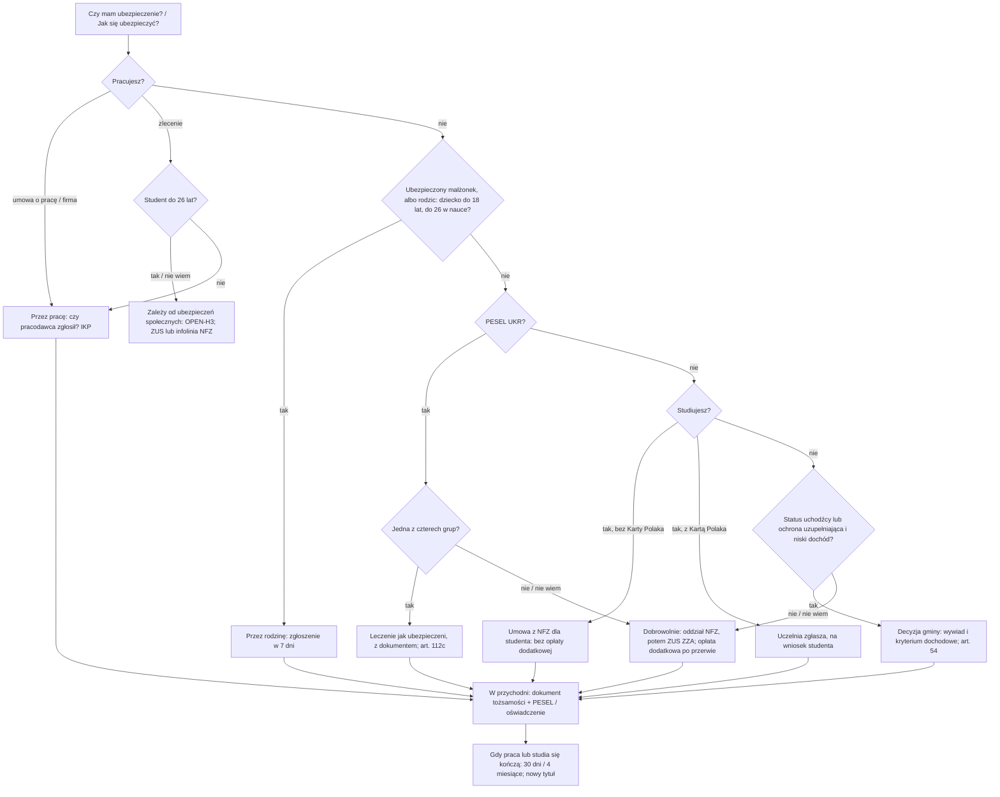

# Map: health insurance: NFZ, ZUS and the voluntary NFZ agreement

**Status:** a lab map by Claude, 17.10.2026. It is not independent, and nothing in it is built or shown to people. Doc 19 matter 11 (wave 4). Production's registry has no guide for it, only the NFZ as an institution. So the app could link to it from other cases, and nothing more, until production adds a guide.

**Why now:** the residence work found that insurance is a condition of the permits people apply for. The CUKR work found that the rules for UKR status holders changed on 5.03.2026.
- **Work:** insurance under the act, or an insurer's cover. Insurance that the person will have through that work also counts.
- **Study and family reunification:** insurance under the act, or an insurer's cover.
- **UKR status holders:** since 5.03.2026, care without insurance is limited to four groups and emergencies (PROT art. 112c). The earlier rule (special act art. 37) was removed from the health act (W203 art. 7); what it gave is not collected here.

**Sources:** `research/2026-10-17-health/sources/` (README there), cited as:
- HA: the act on health care benefits, Dz.U. 2025 poz. 1461, with the changes of 2025 poz. 1083, 2026 poz. 203 and 791;
- PROT: the protection act, art. 112c (Dz.U. 2026 poz. 862);
- W203: the act winding down the special act for Ukrainians, Dz.U. 2026 poz. 203;
- FA: the foreigners act (art. 114, 144, 159);
- NFZ: the NFZ page "Ubezpieczenie w NFZ" (17.10.2026);
- PAC: the archival pacjent.gov.pl article (a lead only);
- QA: UdSC's CUKR questions and answers.

Labels: FACT, INFERENCE, HYPOTHESIS, OPEN (OPEN-H1 to H11 in the sources README), PROPOSED.

**Content rules for this matter (PROPOSED, from the product rules):**
- **No amounts.** The voluntary contribution depends on the average wage of the quarter, and the students' base differs between the NFZ page and the act (OPEN-H1). The app names the basis and sends the person to the NFZ branch. It never computes a contribution or an entry fee.
- **No promises about care.** The app never says "masz ubezpieczenie" or "nie zapłacisz". It cannot see eWUŚ. It explains how the person checks (IKP, the clinic, the helpline), and what the rule says.
- **No computed dates** for the 30-day, 14-day and 7-day periods until their counting is settled (OPEN-H10). The rule is quoted; the person enters the date the office or ZUS gives.

## 1. Who it is for

Anyone living in Poland who needs public health care or must prove insurance for a permit. The route depends on the person's work, study, family and residence title, which the person states. It never depends on nationality or language (rule 4). Where the act itself names a status (EU citizenship, the Karta Polaka, PESEL UKR), the app asks about that status; it does not infer it.

| The person says | Route | Basis |
|---|---|---|
| "Pracuję na umowę o pracę" | Insured through work; the employer reports them to ZUS. Check that the report happened | HA art. 3 ust. 1a, 66 ust. 1 pkt 1 lit. a, 74 (FACT); NFZ: a missing report is the most common problem |
| "Pracuję na zlecenie" (or another civil contract) | Insured through it when social insurance applies to that contract. When it does is not collected (OPEN-H3); a student under 26 is the case to check | HA art. 66 ust. 1 pkt 1 lit. e (FACT); PAC (lead) |
| "Mam własną firmę" | Reports themselves to ZUS (or through CEIDG) | HA art. 66 ust. 1 pkt 1 lit. c, 74 ust. 1 and 3 (FACT); NFZ |
| "Studiuję" (no Karta Polaka, not an EU citizen) | A voluntary NFZ agreement, with the lower base and no entry fee, unless an employment contract or a family member covers them | HA art. 3 ust. 2 pkt 1, 66 ust. 1 pkt 20, 68 ust. 4 pkt 3, ust. 9 (FACT) |
| "Studiuję i mam Kartę Polaka" | The university reports them, on request (PAC: "tylko na Twój wniosek") | HA art. 3 ust. 1 pkt 3a, 66 ust. 1 pkt 20 (FACT) |
| "Mój mąż / moja żona / rodzic pracuje" | A family member, reported by that person within 7 days. A partner who is not a spouse is not a family member | HA art. 5 pkt 3, 3 ust. 2 pkt 6, 67 ust. 3 (FACT); NFZ: "ale nie konkubenci" |
| "Nie pracuję, mam zezwolenie na pobyt" | Not insured by the permit. A voluntary NFZ agreement if they live in Poland; an entry fee after a gap of 3 months or more | HA art. 3 ust. 1 pkt 2 (closing words), 68 ust. 1, 7–8 (FACT); INFERENCE in the README |
| "Mam status uchodźcy albo ochronę uzupełniającą" (or a family permit under FA art. 159 ust. 1 pkt 1 lit. c or d), not insured, low income | The municipality's decision confirming the right, after a family interview and the income test (the income threshold, social assistance act art. 8, not collected) | HA art. 2 ust. 1 pkt 2, art. 54 (FACT) |
| "Skończyła mi się praca" / "Skończyłem studia" | The right ends 30 days after the insurance ends; 4 months after a degree. Then a new title or a voluntary agreement | HA art. 67 ust. 4–5, 69 ust. 4 (FACT) |
| "Mam PESEL UKR" | Care without insurance only in four groups, and in a sudden threat to health. Otherwise through work, family or a voluntary agreement | PROT art. 112c (FACT, from 5.03.2026) |
| "Mam kartę CUKR" | Like any temporary permit holder | QA (FACT); INFERENCE in the README |
| "Jestem ubezpieczony w innym kraju UE" | The EHIC for a stay; for living here, the NFZ's poświadczenie (OPEN-H8) | HA art. 52–53 (FACT) |
| "Mam zezwolenie na krótki pobyt (art. 181)" | Insured only through work | HA art. 3 ust. 1 pkt 2, ust. 1a (FACT) |
| An asylum applicant | Insured if working or voluntary (HA art. 3 ust. 1 pkt 2b). Their care under the protection act is not collected | Not covered here: says so and points to UdSC |
| A visitor on a tourist visa or visa-free, not working | Not insured (HA art. 4). Private travel insurance is the person's matter | Says so; no product advice |

## 2. The journey (stages H0–H6), with steps off the phone

| Stage | Goal | Steps (phone / **off the phone**) | Basis | Where people get lost (HYPOTHESIS until interviews, unless marked) |
|---|---|---|---|---|
| **H0** Am I covered? | Know one's own route | Phone: the intake (§5.1). **Off: check in IKP (needs a trusted profile, so a PESEL) or ask at the clinic** | HA art. 3, 50 ust. 3; NFZ (IKP) | **HL1:** believes a permit or a job means cover. The NFZ page names a missing report as the most common cause (FACT, NFZ). **HL2:** cannot check without a PESEL and a profile (INFERENCE: e-government map) |
| **H1** Through work | The employer has reported them | Phone: what to ask the employer. **Off: the employer files ZUS ZUA or ZZA; the person may ask for a confirmation** | HA art. 66 ust. 1 pkt 1, 67 ust. 1–2, 74; NFZ (the documents) | **HL3:** the contract type is not what they think (a civil contract, a student under 26; OPEN-H3). **HL4:** a new job, and the family is not reported again (FACT, NFZ) |
| **H2** The family | Each family member reported | Phone: who counts as family. **Off: tell the payer within 7 days; ZUS ZCNA** | HA art. 5 pkt 3, 67 ust. 3, 3a | **HL5:** a partner who is not a spouse (FACT: not family). **HL6:** a child over 18 who left school (FACT: to 26 only while in education) |
| **H3** Voluntary agreement | Cover from a chosen date | **Off: the NFZ branch: application, two copies of the agreement, identity document, proof of the last insurance. Then ZUS: ZZA, and ZCNA for family.** Phone: the order of steps, the entry fee bands, the monthly payment as the person's own task | HA art. 68 ust. 1, 3–9, 11; NFZ | **HL7:** stops after the NFZ step, before ZUS (INFERENCE from the page's order). **HL8:** one month of unbroken arrears ends the cover (FACT, art. 68 ust. 5). **HL9:** an entry fee they did not expect; a waiver or up to 12 instalments exists (FACT, ust. 11) |
| **H4** At the clinic | Care without a bill | **Off: show identity; the clinic checks eWUŚ by PESEL. If it fails: another document or the written statement.** Phone: what to bring, what the statement says | HA art. 50 ust. 2–3, 6–8 | **HL10:** no PESEL, so no eWUŚ check (INFERENCE). **HL11:** signs the statement without the right and is billed (FACT, art. 50 ust. 16). **HL12:** the residence card is not on the act's identity list (INFERENCE; OPEN-H6) |
| **H4e** An emergency | Care first; the paperwork after | **Off: care is given; then a document or the statement within 14 days, or 7 days after a hospital stay** | HA art. 50 ust. 11 | **HL13:** misses the period and is billed (FACT, the rule; how often is HYPOTHESIS) |
| **H5** Changes and endings | No gap | Phone: the rule for each ending. **Off: a new title (a job, family) or a voluntary agreement** | HA art. 67 ust. 4–5, 69 ust. 3–4, 68 ust. 12 | **HL14:** a gap of 3 months or more makes a later agreement cost an entry fee (FACT); bills in the gap (INFERENCE) |
| **H6** For a residence permit | The insurance condition met | Phone: which condition the purpose has. **Off: the NFZ agreement or the employer's report, or a private insurer's cover** | FA art. 114 ust. 1 pkt 1 and 4a, 144 ust. 1 pkt 2 lit. a, 159 ust. 1 pkt 2 lit. a | **HL15:** a student applies with neither the agreement nor private cover. **HL16:** a private policy the voivode does not accept (OPEN-H7) |

**For PESEL UKR holders (stage H-U), across H0 to H4:**
- **The four groups, from 5.03.2026 (FACT, PROT art. 112c):**
  - victims of torture or rape, with a UdSC certificate;
  - children under 18;
  - residents of collective accommodation, with a certificate;
  - people in pregnancy, birth or the postnatal period, with a document.
- **What they show:** an identity document and the PESEL UKR (ust. 4). Some treatments are excluded (ust. 1).
- **Everyone else with PESEL UKR:** emergency care only (ust. 3), unless insured.
- **Hospital treatment begun before 5.03.2026** under the old rule may continue until discharge, and not past 4.03.2027 (W203 art. 22).
- **UHL1:** an adult who is not working expects care without insurance (HYPOTHESIS, high harm).
- **UHL2:** taking the CUKR card ends the four groups (INFERENCE from QA); the person does not know it.

## 3. The critical moments

1. **The first job:** was the person reported? Without IKP access, they cannot see it themselves (HL1, HL2).
2. **The end of a job or of studies:** 30 days, or 4 months after a degree. Then a gap begins (HL14).
3. **A student's first weeks:** the voluntary agreement before any need, and before the permit application (HL15).
4. **Pregnancy and a newborn:** who reports the child, and the first 3 months on a parent's PESEL (HA art. 50 ust. 14). This links to the civil status map (`maps/civil-status.md`, CS12 and CS13).
5. **PESEL UKR since 5.03.2026,** and the choice of the CUKR card (UHL1, UHL2).
6. **"eWUŚ na czerwono" at the clinic:** the statement, and its risk (HL11).

## 4. Scenarios (fictional)

| # | Situation | Stage | The app should | Never |
|---|---|---|---|---|
| HS1 | Works on an employment contract for 2 months; the clinic's system does not confirm | H1, H4 | Explain the most common cause (no report, NFZ); ask the employer for the report (ZUS ZUA or ZZA); at the clinic, a document or the statement | "Na pewno jesteś ubezpieczony" |
| HS2 | Student, not from the EU, no Karta Polaka, not working | H3, H6 | The voluntary NFZ agreement; no entry fee for students (art. 68 ust. 9); the base is set by the act (the amount from the NFZ branch, OPEN-H1); the study permit's insurance condition | "Uczelnia Cię zgłosi"; an amount |
| HS3 | Student with the Karta Polaka | H1 | The university reports them on request; ask at the dean's office (PAC, a lead; the act: art. 66 ust. 1 pkt 20) | "Musisz ubezpieczyć się sam" |
| HS4 | Student, 22, on a civil contract, asks "czy zleceniodawca mnie ubezpiecza?" | H1 | It depends on social insurance for that contract, which the app has not collected (OPEN-H3); the voluntary agreement otherwise; ask ZUS or the NFZ helpline | A yes or a no |
| HS5 | Student who worked on an employment contract over the summer | H5 | After the job, they must be reported again (NFZ) or keep their voluntary agreement | — |
| HS6 | Just graduated | H5 | The right ends 4 months after the degree (art. 67 ust. 5); then a job, family or a voluntary agreement | A computed end date |
| HS7 | Lost a job last week | H5 | The right ends 30 days after the insurance ends (art. 67 ust. 4); register a new title or a voluntary agreement in time; registration as unemployed is another title (art. 66 ust. 1 pkt 24), not mapped | "Masz jeszcze miesiąc" as a computed date |
| HS8 | On unpaid leave | H5 | The right ends 30 days after the leave begins (art. 69 ust. 3); voluntary insurance is open to an employee on unpaid leave (art. 68 ust. 1) | — |
| HS9 | Partner works; "czy może mnie zgłosić?"; not married | H2 | No: only a spouse counts (art. 5 pkt 3; NFZ). Their own title or a voluntary agreement | "Partner może Cię zgłosić" |
| HS10 | Married; the spouse works; a child of 4 | H2 | The spouse tells the employer within 7 days; the employer reports both (art. 67 ust. 3) | — |
| HS11 | A 20-year-old child who has left school | H2 | A child counts to 26 only while in education (art. 5 pkt 3 lit. a); otherwise their own title | — |
| HS12 | Newborn, no PESEL yet | H2, H4 | Up to 3 months, the clinic uses the PESEL of the person who must report the child (art. 50 ust. 14); report the child as family; the civil status matter for the birth certificate and the PESEL | — |
| HS13 | Not working, has a temporary permit, wants cover | H3 | The voluntary agreement if they live in Poland (art. 68 ust. 1; what NFZ requires: OPEN-H2); the order NFZ then ZUS; the entry fee bands, never the amount | "Masz ubezpieczenie dzięki karcie pobytu" |
| HS14 | Had no insurance for 3 years; wants a voluntary agreement | H3 | The entry fee band for that gap (100% of the base, art. 68 ust. 8 pkt 3) as the rule; the waiver or up to 12 instalments on request (ust. 11) | An amount |
| HS15 | Pays the voluntary contribution, missed a payment | H3 | The cover ends after one month of unbroken arrears (art. 68 ust. 5); pay now; ask the NFZ branch (the payment date: OPEN-H11) | "Nic się nie stanie" |
| HS16 | At the clinic, no PESEL | H4 | eWUŚ needs a PESEL (INFERENCE); show the NFZ agreement and payment proof or the employer's document; the statement as the last resort, with its risk | "Bez PESEL nie dostaniesz leczenia" |
| HS17 | "Czy mogę podpisać oświadczenie?" while unsure of the right | H4 | Explain the clause and the risk (art. 50 ust. 7, 16): they may be billed unless they were justifiably mistaken; first check (IKP, the helpline) | Advising to sign |
| HS18 | After an emergency hospital stay, uninsured status unclear | H4e | Show a document or make the statement within 7 days after discharge (art. 50 ust. 11); if the cause was a missing report, reporting within 30 days removes the charge (ust. 18a) | A computed date |
| HS19 | PESEL UKR, an adult, not working, not in collective accommodation | H-U | Since 5.03.2026, care without insurance only in a sudden threat to health (PROT art. 112c ust. 3); work or a voluntary agreement insures (HA art. 3 ust. 1 pkt 2a) | "Jako osoba z Ukrainy masz bezpłatne leczenie" |
| HS20 | PESEL UKR, pregnant | H-U | One of the four groups (art. 112c ust. 1 pkt 4): bring a document confirming the pregnancy (ust. 4) | — |
| HS21 | PESEL UKR, choosing the CUKR card | H-U, CUKR U3 | On the compare card: with CUKR, health care as for any permit holder (QA); the four groups no longer apply (INFERENCE) | A recommendation |
| HS22 | Applying for a work permit; the job will insure them | H6 | Insurance through that work counts (FA art. 114 ust. 4a) | "Najpierw kup prywatne ubezpieczenie" |
| HS23 | A voivode's letter asks for proof of insurance (study) | H6 | The NFZ agreement with ZUS ZZA, or an insurer's cover (FA art. 144 ust. 1 pkt 2 lit. a); what voivodes accept as private cover: OPEN-H7 | Naming an insurer |
| HS24 | EU citizen, working in Poland | H1 | Insured through work, like anyone working here (HA art. 3 ust. 1 pkt 1 with art. 66); the coordination questions are OPEN-H8 | — |
| HS25 | "Nie wiem, czy jestem ubezpieczony" and has no PESEL | H0 | The intake; the clinic or the NFZ helpline 800 190 590 (NFZ); the PESEL case for IKP later | A guess |
| HS26 | Does not read Polish | All | The NFZ helpline; an NGO; the NFZ's pages are Polish (and some Ukrainian, OPEN-H5) | Machine-translated rules |
| HS27 | Subsidiary protection, not working, low income | H0 | The municipality's decision (art. 2 ust. 1 pkt 2, art. 54): an application to the municipality where they live, the family interview, the income test; or a job or a voluntary agreement | "Masz prawo do leczenia" before the decision |

## 5. User flow (PROPOSED)

**Where it appears.**
- **As a case of its own** ("Ubezpieczenie zdrowotne"), for "czy mam ubezpieczenie", "jak się ubezpieczyć" and "w przychodni mnie nie widzi".
- **As a linked task** inside other cases. In the residence case, the insurance condition (work, study, family). In the CUKR compare card, the health care line. In the PESEL case's "co dalej" card, IKP.

### 5.1 Entry and intake

1. **Entry words:** "ubezpieczenie zdrowotne", "NFZ", "eWUŚ", "lekarz nie chce przyjąć", "dobrowolne ubezpieczenie", "ZUS ZZA".
2. **For whom:** self or someone else (shared).
3. **Intake questions,** each with "Nie wiem":

| Order | Question | Options | Why |
|---|---|---|---|
| 1 | Z czym przychodzisz? | Czy mam ubezpieczenie; Jak się ubezpieczyć; W przychodni system mnie nie widzi; Potrzebuję do karty pobytu; Chodzi o kogoś z rodziny | The first level |
| 2 | Czy pracujesz w Polsce? Na jakiej podstawie? | Umowa o pracę; Zlecenie lub inna umowa cywilna; Własna firma; Nie pracuję; Nie wiem | Mandatory insurance (art. 66 ust. 1 pkt 1) |
| 3 | Czy studiujesz w Polsce? | Tak; Nie | The student route (art. 3 ust. 2 pkt 1, ust. 1 pkt 3a) |
| 3a | (if studying) Czy masz Kartę Polaka lub potwierdzenie polskiego pochodzenia? | Tak; Nie | Who reports them |
| 4 | Czy Twój małżonek lub rodzic jest ubezpieczony w Polsce? | Małżonek; Rodzic; Nie; Nie wiem | The family route (art. 5 pkt 3) |
| 5 | Na jakiej podstawie przebywasz w Polsce? | Wiza w celu pracy; Zezwolenie na pobyt czasowy; Pobyt stały lub rezydent UE; PESEL UKR; Karta CUKR; Ochrona międzynarodowa; Obywatel UE, EOG lub Szwajcarii; Inna wiza lub ruch bezwizowy; Nie wiem | Art. 3 ust. 1 and PROT art. 112c; never inferred from language |
| 6 | Czy masz numer PESEL? | Tak; Nie; Nie wiem (reused from the PESEL case if open) | eWUŚ and IKP |
| 7 | (voluntary route only) Jak długo nie było Cię w ubezpieczeniu? | Mniej niż 3 miesiące; 3–12 miesięcy; 1–2 lata; 2–5 lat; 5–10 lat; Ponad 10 lat; Nigdy nie byłem(-am); Nie wiem | The entry fee band (art. 68 ust. 8); a student skips it (ust. 9) |

**Answers that route away:** asylum applicant; tourist not working; EU coordination (OPEN-H8). Each gets a short answer and a handoff, never a plan.

**"Nigdy nie byłem(-am)" (question 7):** the gap since when is not settled; art. 68 ust. 10 counts earlier periods outside insurance. The app shows the bands and sends the person to the NFZ branch.

### 5.2 The map (levels)

| # | Level | Done when | Notes |
|---|---|---|---|
| 0 | **Twoja droga do ubezpieczenia** (a reading level) | The person marks it read | The route from the intake, with the basis quoted. "Nie wybieram za Ciebie" where there is a choice (for example, a job offer or a voluntary agreement) |
| 1 | **Zanim zaczniesz: PESEL i IKP** | The person marks it | The e-government prerequisite level, reused (`maps/e-government-access.md` §4.1). Optional: it is needed to check oneself in IKP |
| 2a | **Przez pracę** | The person confirms the report | Tasks: ask the employer for the report; check IKP. Placed note: art. 67 ust. 1–2, quoted |
| 2b | **Dobrowolnie w NFZ** | The person marks the agreement signed and ZUS ZZA filed | Tasks: the NFZ branch (what to bring, from the NFZ page); ZUS ZZA; ZUS ZCNA for family. Notes: the entry fee band (quoted), the waiver and instalments, "po upływie miesiąca nieprzerwanej zaległości" (quoted). No amounts |
| 2c | **Przez rodzinę** | The family member says the payer was told | The 7 days (art. 67 ust. 3), who counts (art. 5 pkt 3), quoted |
| 2u | **PESEL UKR: Twoje prawo do leczenia** | Read | The four groups and the emergency rule (art. 112c), quoted; then the routes 2a to 2c |
| 3 | **W przychodni** | Read | What to show (art. 50 ust. 2); the statement and its risk (ust. 6–7, 16), quoted; emergencies (ust. 11) |
| 4 | **Gdy coś się kończy** | Read, and a date entered by the person | Job end, graduation, unpaid leave; quoted; a reminder on the date the person enters, never a computed one (OPEN-H10) |
| 5 | **Do karty pobytu** (only when the residence case is open) | The person marks it | The condition for the purpose (FA art. 114, 144, 159), quoted; insurance through the job counts (art. 114 ust. 4a) |

### 5.3 Each screen

| Screen | Content |
|---|---|
| **Teraz** | The current level's one next step. Primary action: "Zapytaj pracodawcę o zgłoszenie" (2a), "Oddział NFZ: co zabrać" (2b), "Infolinia NFZ 800 190 590" when unsure. Never "Ubezpiecz mnie" or "Sprawdzę za Ciebie" |
| **Mapa** | The levels in words; off-phone steps marked as the person's |
| **Teczka** | What the person keeps: the agreement (two copies, one theirs), ZUS ZZA confirmation, payment proofs, the employer's confirmation. The app stores only that they have them (rule 5) |
| **Kalendarz** | The person's own dates: the contribution payment day they choose (a monthly reminder); the end date of a job or studies they enter, with the rule beside it. No date the app computes (OPEN-H10, OPEN-H11) |
| **Czat** | Answers from the placed notes; "Nie wiem" as an answer; the helpline for one's own data, which the app cannot see |

### 5.4 Handoffs (to people, never pretended)

| When | To | Basis |
|---|---|---|
| eWUŚ questions; one's own data | NFZ helpline 800 190 590 (abroad +48 22 125 66 00) | NFZ (FACT) |
| The voluntary agreement | The NFZ voivodeship branch | HA art. 68 ust. 1; NFZ |
| Reports, ZZA, ZCNA | ZUS, or the employer | NFZ |
| The municipality's decision (art. 54) | The municipality where the person lives (its social assistance) | HA (FACT) |
| A bill for care, or the NFZ's decision on costs | Legal aid. The decision can be challenged in the administrative court (art. 50 ust. 18) | HA (FACT) |
| PESEL UKR certificates (art. 112c ust. 4) | The Szef UdSC for the torture or rape certificate (FACT); who issues the accommodation certificate is OPEN-H5 | PROT |

### 5.5 The flow, drawn

## 6. What production would need (PROPOSED)

- **A guide** in the registry for the voluntary NFZ agreement and for confirming one's right at a clinic. It would quote HA art. 3, 50, 67 and 68, and PROT art. 112c. Doc 19's wave 4 gate: the owner opens a new registry domain.
- **An office record** for the NFZ voivodeship branches (the institution exists; the branches do not).
- **Reading levels** (0, 2u, 3, 4), the same new kind the CUKR map proposes for its compare card.
- **A cross-case link:** the residence blueprint's insurance condition points to this case's level 5. The PESEL case's "co dalej" card names IKP.
- **No stored facts** about the person's insurance beyond the intake answers (rule 5).

## 7. Validation

- **Moderated tasks** (fictional cases, after doc 19's wave 4 gate):
  1. HS2: can a student say where to go, in which order (NFZ, then ZUS), and that no entry fee applies?
  2. HS7: after a job ends, do they know there is a limit and what to do before it?
  3. HS17: do they understand the statement's risk before signing it?
  4. HS19: does a PESEL UKR holder understand what changed on 5.03.2026?
- **Thresholds** as doc 18 §6.1, for 8 people:
  - **0 critical errors.** Here that includes a stated amount, a promise of cover, or advice to sign the statement;
  - a correct next action for at least 6 of 8;
  - at most 1 person confident and wrong.
- **Confirmers:** an NFZ branch (OPEN-H1, H2, H4, H6, H11); ZUS for the contract and reporting rules (OPEN-H3); a lawyer or NGO adviser for PESEL UKR (OPEN-H5) and for the billing rules (OPEN-H9, H10).
- **Interviews:** the Phase 1 guide's "other matters" question can carry one probe: "Czy kiedyś przychodnia nie potwierdziła Twojego ubezpieczenia? Co wtedy zrobiłeś(-aś)?" It is PROPOSED, for the owner (like decision D4 in the overnight report).
