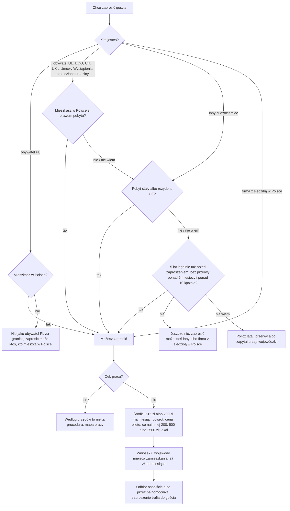

# Map: inviting a foreigner to Poland (zaproszenie)

**Status:** a lab map by Claude, 17.10.2026. It is not independent, and nothing in it is built or shown to people. Doc 19 matter 23 (wave 6). Production's registry has no invitation procedure. **Checked by the separate checking agent on 17.10.2026** (`research/2026-10-17-invitation/sources/CHECK.md`); its corrections are changed in the lab, after each provision was re-read, and not independently verified.

**Why it matters:**
- **The person using the app is often the inviter,** someone living in Poland who wants a parent or a friend to visit. Not everyone may invite (FACT, UoC art. 49 ust. 2–3):
  - a Polish citizen living in Poland;
  - an EU, EEA, Swiss or Withdrawal Agreement UK citizen, or such a person's family member, living in Poland with a right of residence or permanent residence;
  - a foreigner with 5 years' legal and unbroken stay right before the invitation (no break over 6 months, breaks at most 10 months in all, with exceptions: art. 195 ust. 4), or with permanent residence or EU long-term residence;
  - a legal person or organisation seated in Poland.
- **The inviter promises** to cover the guest's stay, treatment, the return and the costs of a return decision (FACT, art. 51 ust. 2 pkt 3).
  - Those who bore stay or treatment costs in their statutory duties may sue the inviter (FACT, art. 56).
  - The costs of an enforced return decision are not sued for: a Border Guard decision sets them and may name the inviter, under conditions (FACT, art. 336–337).
- **The procedure is simplified** (FACT, UoC art. 55b; KPA art. 163d, 163e § 1). The evidence is what the inviter files with the application plus what the office can establish from its own data. If new circumstances matter and would lengthen the case, it continues outside the simplified procedure. A complete file the first time matters.
- **An invitation is proof of means, not a visa or a work permit** (FACT, art. 49 ust. 1, 51 ust. 2 pkt 7).

**Sources:** `research/2026-10-17-invitation/sources/` (README there), cited as:
- UoC: art. 49–57, 195 ust. 4, 336–337;
- KPA: art. 35 § 3a–5, 65, 163b–163g;
- REG: the 2023 regulation on forms and funds;
- FEES: the stamp duty act, art. 9, annex part I item 28 and part IV;
- SPEC: the special act on Ukrainian citizens, art. 100d;
- PAGES: two voivode offices.

Labels: FACT, INFERENCE, HYPOTHESIS, ASSUMPTION, OPEN (OPEN-I1 to I4 in the sources README), PROPOSED.

**Content rules for this matter (PROPOSED):**
- **Never "z zaproszeniem dostaniesz wizę".** The consul decides the visa.
- **The amounts are the regulation's minimums,** shown with the person's own numbers as the person's computation; the office decides.
- **Never "nic ci nie grozi" or "na pewno zapłacisz"** about a return decision's costs: a Border Guard decision sets them, under the conditions of art. 337.
- **No action claimed:** never "wpisaliśmy zaproszenie".

## 1. Who it is for

| The person says | Route | Basis |
|---|---|---|
| "Mieszkam w Polsce 6 lat i chcę zaprosić mamę" | May invite if the 6 years were legal and unbroken right before (no break over 6 months, at most 10 in all, with exceptions); at least 200 zł a month for a parent, plus the return | UoC art. 49 ust. 2 pkt 2, ust. 3; art. 195 ust. 4; REG § 4–5 (FACT); OPEN-I2 |
| "Mam kartę pobytu czasowego od 2 lat" | The card's age does not decide: the app asks for the whole legal stay and its breaks. Under 5 years, with no permanent or long-term residence: not yet | UoC art. 49 ust. 2 pkt 2, ust. 3 (FACT); INFERENCE on the question to ask |
| "Jestem obywatelem Niemiec, mieszkam w Polsce" | May invite, with a right of residence | UoC art. 49 ust. 2 pkt 1 (FACT) |
| "Jestem żoną obywatela Francji, mieszkam w Polsce" | May invite as an EU citizen's family member living in Poland with a right of residence, whatever her own citizenship | UoC art. 49 ust. 2 pkt 1 (FACT) |
| "Jestem Polakiem, ale mieszkam w Niemczech" | Not as a Polish citizen living abroad; someone living in Poland, or a company seated there, may invite instead | UoC art. 49 ust. 2 pkt 1, 3 (FACT) |
| "Chcę zaprosić kogoś do pracy" | Not this route, per the offices; the work map | PAGES (ZP); the act only requires the form to say it is not a work document (UoC art. 51 ust. 2 pkt 7, FACT) |
| "Chcę unieważnić zaproszenie" | A request to the voivode who made the entry, at least 7 days before its validity starts | UoC art. 52 ust. 1a, 2 (FACT) |

## 2. The journey (stages I0–I3)

| Stage | Goal | Steps (phone / **off the phone**) | Basis | Where people get lost |
|---|---|---|---|---|
| **I0** May I invite? | Know before paying | Phone: citizenship and right of residence, or the residence permit; where the inviter lives; the whole legal stay and its breaks; the guest's relation and dates | UoC art. 49 ust. 2–3; art. 195 ust. 4 (FACT) | **IL1:** counts the years on the current card, not the whole legal stay, or forgets the breaks (HYPOTHESIS) |
| **I1** The money and the housing | A complete file | **Off:** the form; proof of means (515 zł a month per person, or 200 zł for close family; the return: the ticket's price, at least 200, 500 or 2500 zł); title to the flat, or a document confirming accommodation elsewhere; 27 zł | UoC art. 53; REG § 3–5; FEES (FACT). A paid booking, the owner's consent, the statement's age: PAGES | **IL2:** files without what the office asks for (HYPOTHESIS); the evidence is what is filed plus the office's own data (FACT, KPA art. 163e § 1) |
| **I2** Filing | Entered in the register | **Off:** at the voivode's office of the place of residence (its booking rules). Promptly, at most one month; delays caused by the inviter are not counted | UoC art. 51 ust. 3; KPA art. 35 § 3a, § 5 (FACT); SPEC art. 100d ust. 1 suspends no invitation (FACT); PAGES | **IL3:** files in another voivodeship (HYPOTHESIS); that office forwards it (KPA art. 65 § 1, FACT), at the cost of time |
| **I3** Collecting and passing it on | The guest has the invitation | **Off:** collect in person (WM, PAGES) or by a proxy with a special power of attorney (UoC art. 55, FACT). The power costs 17 zł unless exempt, for example when given to a spouse, parent, child or sibling (FEES part IV, FACT). Pass it to the guest (INFERENCE: the guest presents it, art. 49 ust. 1) | UoC art. 55; FEES part IV | **IL4:** the guest applies for a visa after the invitation's dates (INFERENCE; validity at most 1 year, art. 51 ust. 1) |

**If the entry is refused:** the 27 zł can be refunded on the payer's request (INFERENCE from FEES art. 9 ust. 1 pkt 1; since 1.10.2026 within 2 months, without a decision, FACT).

## 3. Scenarios (fictional)

| # | Situation | Stage | The app should | Never |
|---|---|---|---|---|
| IS1 | Permanent residence holder invites her father from Uzbekistan for 3 months | I0–I3 | May invite (art. 49 ust. 2 pkt 2). At least 600 zł (3 × 200 zł, REG § 4), plus the ticket's price, at least 2500 zł (§ 5 pkt 3). ASSUMPTION: Uzbekistan is not a neighbour, an EU or EFTA-EEA state, or Switzerland (no official text fetched). OPEN-I2 on § 3 | "Dostanie wizę" |
| IS2 | Temporary permit for 3 years, wants to invite a friend | I0 | Asks for the whole legal stay and its breaks; under 5 years, not yet (art. 49 ust. 2 pkt 2, ust. 3). A Polish citizen living in Poland, or a company seated there, may invite instead (pkt 1, 3) | "Nie możesz" from the card's age alone |
| IS3 | A Polish citizen living in Poland invites a Ukrainian colleague for a 2-week visit | I1 | 515 zł reduced in proportion to the days, for the inviter and the guest each (REG § 3 ust. 1–2): about 240 zł each, 481 zł in all, if the office divides by 30 (OPEN-I4). The return: the ticket's price, at least 200 zł (§ 5 pkt 1; Ukraine borders Poland: the border agreement, Dz.U. 1994 poz. 267, in force per the Sejm API on 17.10.2026) | — |
| IS4 | The guest's plans changed | — | Annul on request to the voivode who made the entry, at least 7 days before the start (art. 52 ust. 1a, 2) | — |
| IS5 | The guest stayed and needed hospital care | — | The inviter promised to cover treatment (art. 51 ust. 2 pkt 3); a body that bore the costs in its statutory duties may sue (art. 56); legal aid | — |
| IS6 | The guest overstayed and got a return decision | — | If it is enforced, a Border Guard decision sets its costs and may name the inviter (art. 336 ust. 1–2, 337 ust. 2). Not after help with a voluntary return (art. 336 ust. 1a); the employer pays if the decision was for work without a permit (art. 337 ust. 4). The return-decision map; legal aid | "Nic ci nie grozi"; "zapłacisz na pewno" |

## 4. User flow (PROPOSED)

**One case:** "Zaproszenie dla gościa", with a small calculator that shows REG's minimums for the person's dates and relation, labelled as the person's computation.

Intake (each with "Nie wiem"):
- the inviter's citizenship and right of residence, or residence permit;
- where the inviter lives;
- the whole legal stay in Poland and its breaks;
- the guest's relation (close family or not) and country (neighbour, EU, other);
- the dates;
- where the guest will sleep.

Handoffs:
- the voivode's office of the place of residence (UoC art. 51 ust. 3);
- a consul for the visa (not mapped);
- the Border Guard for a costs decision, and the return-decision map (art. 336–337);
- legal aid if sued (art. 56).

## 5. Validation

- **The independent check:** done on 17.10.2026 (`CHECK.md`); run again after any change to its facts.
- **Thresholds** as doc 18 §6.1: 0 critical errors (an inviter told they may invite when they may not; a visa promised; an action claimed).
- **Confirmers:** a voivode's office (OPEN-I1, I2, I4).
