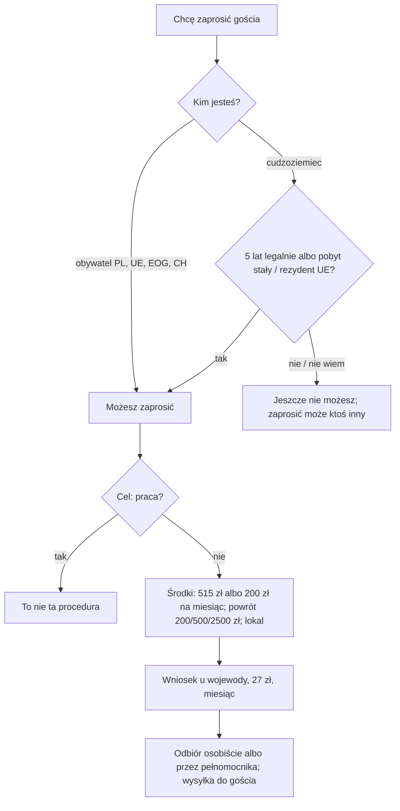

# Map: inviting a foreigner to Poland (zaproszenie)

**Status:** a lab map by Claude, 17.10.2026. It is not independent, and nothing in it is built or shown to people. Doc 19 matter 23 (wave 6). Production's registry has no invitation procedure. **Not yet checked by the separate checking agent:** that check comes before anything here is relied on.

**Why it matters:**
- **The person using the app is often the inviter,** a foreigner living in Poland who wants a parent or a friend to visit. Only some foreigners may invite: those with 5 years' legal and unbroken stay, or permanent residence or EU long-term residence (FACT, UoC art. 49 ust. 2 pkt 2).
- The inviter promises to cover the guest's stay, treatment, the return and even the costs of a return decision, and can be sued for them (FACT, art. 51 ust. 2 pkt 3, art. 56).
- The procedure is simplified: what is not filed with the application does not count later (FACT, UoC art. 55b; KPA art. 163c § 4, 163e). A complete file the first time matters.
- An invitation is proof of means, not a visa or a work permit (FACT, art. 49 ust. 1, 51 ust. 2 pkt 7).

**Sources:** `research/2026-10-17-invitation/sources/` (README there), cited as UoC (art. 49–57), KPA (art. 163b–163g), REG (the 2023 regulation on forms and funds), FEES (the stamp duty act) and PAGES (two voivode offices).

Labels: FACT, INFERENCE, OPEN (OPEN-I1 to I3 in the sources README), PROPOSED.

**Content rules for this matter (PROPOSED):**
- **Never "z zaproszeniem dostaniesz wizę".** The consul decides the visa.
- **The amounts are the regulation's minimums,** shown with the person's own numbers as the person's computation; the office decides.
- **No action claimed:** never "wpisaliśmy zaproszenie".

## 1. Who it is for

| The person says | Route | Basis |
|---|---|---|
| "Mieszkam w Polsce 6 lat i chcę zaprosić mamę" | May invite (5 years' legal, unbroken stay); 200 zł a month for a parent plus the return | UoC art. 49 ust. 2 pkt 2; REG § 4–5 (FACT) |
| "Mam kartę pobytu czasowego od 2 lat" | May not invite yet, unless permanent or long-term residence | UoC art. 49 ust. 2 pkt 2 (FACT) |
| "Jestem obywatelem Niemiec, mieszkam w Polsce" | May invite, with a right of residence | UoC art. 49 ust. 2 pkt 1 (FACT) |
| "Chcę zaprosić kogoś do pracy" | Not this route; the work map | UoC art. 51 ust. 2 pkt 7 (FACT); PAGES |
| "Chcę unieważnić zaproszenie" | A request at least 7 days before its validity starts | UoC art. 52 ust. 2 (FACT) |

## 2. The journey (stages I0–I3)

| Stage | Goal | Steps (phone / **off the phone**) | Basis | Where people get lost |
|---|---|---|---|---|
| **I0** May I invite? | Know before paying | Phone: status, years in Poland, the guest's relation and dates | UoC art. 49 ust. 2 (FACT) | **IL1:** counts years on a temporary permit as enough when they are under 5 (FACT) |
| **I1** The money and the housing | A complete file | **Off: the form; proof of means (515 zł a month per person, or 200 zł for close family; the return at least 200, 500 or 2500 zł); title to the flat or the owner's consent, or a paid booking; 27 zł** | UoC art. 53; REG § 3–5; FEES (FACT); bank statement's age, owner's consent: PAGES | **IL2:** files without the owner's consent; in the simplified procedure only formal gaps are asked for (FACT, KPA art. 163e; PAGES) |
| **I2** Filing | Entered in the register | **Off: at the voivode's office of the place of residence (its booking rules); one month** | UoC art. 51 ust. 3; KPA art. 35 (FACT); PAGES | **IL3:** files in another voivodeship (FACT, art. 51 ust. 3) |
| **I3** Collecting and sending | The guest has the original | **Off: collect in person or by a proxy with a special power of attorney; send it to the guest for the visa** | UoC art. 55 (FACT) | **IL4:** the guest applies for a visa after the invitation's dates (INFERENCE; validity at most 1 year, art. 51 ust. 1) |

## 3. Scenarios (fictional)

| # | Situation | Stage | The app should | Never |
|---|---|---|---|---|
| IS1 | Permanent residence holder invites her father from Uzbekistan for 3 months | I0–I3 | May invite; at least 600 zł (3 × 200 zł, REG § 4) plus at least 2500 zł for the return (§ 5); OPEN-I2 on § 3 | "Dostanie wizę" |
| IS2 | Temporary permit for 3 years, wants to invite a friend | I0 | Not yet (art. 49 ust. 2 pkt 2); a Polish friend or a company may invite instead | — |
| IS3 | A Polish citizen invites a Ukrainian colleague for a 2-week visit | I1 | 515 zł a month, pro rata for 2 weeks, for each person (REG § 3 ust. 2); the return at least 200 zł (§ 5 pkt 1, Ukraine borders Poland) | — |
| IS4 | The guest's plans changed | — | Annul on request at least 7 days before the start (art. 52 ust. 2) | — |
| IS5 | The guest stayed and needed hospital care | — | The inviter promised to cover treatment (art. 51 ust. 2 pkt 3) and may be sued (art. 56); legal aid | — |

## 4. User flow (PROPOSED)

**One case:** "Zaproszenie dla gościa", with a small calculator that shows REG's minimums for the person's dates and relation, labelled as the person's computation.

Intake (each with "Nie wiem"): the inviter's status and years in Poland; the guest's relation (close family or not) and country (neighbour, EU, other); the dates; where the guest will sleep.

Handoffs: the voivode's office of the place of residence (UoC art. 51 ust. 3); a consul for the visa (not mapped); legal aid if sued (art. 56).

## 5. Validation

- **The independent check:** the separate checking agent, before use, on every FACT in the sources README and in this map.
- **Thresholds** as doc 18 §6.1: 0 critical errors (an inviter told they may invite when they may not; a visa promised; an action claimed).
- **Confirmers:** a voivode's office (OPEN-I1, I2).
