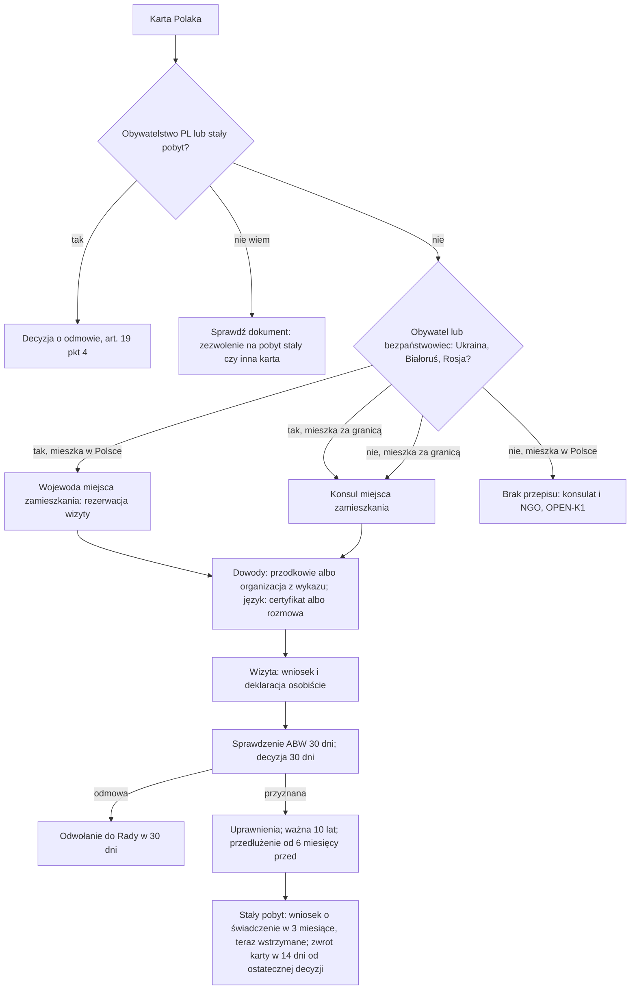

# Map: the Karta Polaka

**Status:** a lab map by Claude, 17.10.2026. It is not independent, and nothing in it is built or shown to people. Doc 19 matter 18 (wave 5). Production's registry has no Karta Polaka procedure. **Checked by the separate checking agent on 17.10.2026** (`research/2026-10-17-karta-polaka/sources/CHECK.md`); the corrections are changed in the lab, not independently verified.

**Why it matters:**
- The Karta Polaka confirms belonging to the Polish Nation. It is not citizenship, not a residence title and not a travel document (FACT, KP art. 3, 7).
- In Poland, citizens of Ukraine, Belarus and Russia, and persons stateless in those states, may apply to a voivode (FACT, REG § 1–2): the one for their place of residence in Poland, else of stay (INFERENCE from KPA art. 21 § 1 pkt 3, since the KPA applies, KP art. 4 ust. 1). Otherwise the consul for the place of residence decides (FACT, KP art. 12 ust. 2); for someone else who lives in Poland, no text says (OPEN-K1).
- It is free, it needs a declaration made in person, and the language is assessed in an interview when there is no certificate or Polish school certificate (FACT, KP art. 2 ust. 1 pkt 2, 12 ust. 3, 13 ust. 7–8).
- It opens work without a permit for a holder staying on a visa of the work act's list, on a legal stay while a case is pending, or visa-free (FACT, the work act art. 3 ust. 3, 5 pkt 1), a route to permanent residence and a settlement benefit (FACT, KP art. 6, 8a). **The settlement benefit is on hold:** applications filed from 15.01.2026 are not examined until the budget act secures funds (FACT, KP art. 24c ust. 2; the interior minister's notice of 14.01.2026). The card is returned within 14 days of the permanent residence decision becoming final, before the residence card is issued, and lapses when that document is issued (FACT, KP art. 20 ust. 1a, 3; UoC art. 229 ust. 7).

**Sources:** `research/2026-10-17-karta-polaka/sources/` (README there), cited as:
- KP: the Karta Polaka act, consolidated Dz.U. 2026 poz. 76;
- REG: the regulation designating the voivodes, consolidated Dz.U. 2022 poz. 2522;
- KPA: the administrative procedure code, Dz.U. 2025 poz. 1691;
- FORM: the application form regulation, Dz.U. 2016 poz. 1382;
- NOTICE: the interior minister's notice of 14.01.2026 stopping the benefit's examination;
- PAGES: the voivodes of Opole (26.03.2026), Mazovia (no date), Podlasie (16.05.2024 and the current page), Świętokrzyskie (on the benefit's stop), and the foreign ministry (18.07.2022).

Labels: FACT, INFERENCE, HYPOTHESIS, OPEN (OPEN-K1 to K4 in the sources README), PROPOSED.

**Content rules for this matter (PROPOSED):**
- **The declaration of nationality is the person's own.** The app never suggests whether someone "is Polish". It explains the conditions and the evidence the act names.
- **Language is not citizenship** (rule 4): speaking Polish is one condition the office assesses; the app never infers eligibility from the language of the chat.
- **Never "dostaniesz Kartę Polaka".** The consul or the voivode decides, after a security check.
- **No ancestry research in the app.** The app lists the kinds of evidence (KP art. 13 ust. 3); archives and translations are for the person, with an NGO or a lawyer.

## 1. Who it is for

| The person says | Route | Basis |
|---|---|---|
| "Jestem obywatelem Ukrainy (Białorusi, Rosji)" or "bezpaństwowcem w jednym z tych państw", in Poland | A voivode, by the place of residence in Poland (INFERENCE, KPA art. 21); or the consul, if the residence is still abroad | REG § 1–2; KP art. 12 ust. 2 (FACT) |
| "Jestem obywatelem innego państwa" (for example Kazakhstan, Lithuania) | The consul for the place of residence; if the person lives in Poland, no text says (OPEN-K1) | KP art. 12 ust. 2, 13 ust. 1 pkt 4 (FACT) |
| "Mam polskie obywatelstwo" or "zezwolenie na pobyt stały" | Refused by decision. An EU long-term resident permit is not a refusal ground. "Karta stałego pobytu" is an EU citizen's family member's card, not this permit: ask which document it is | KP art. 19 pkt 4; the act on the entry of EU citizens art. 48 ust. 2 (FACT) |
| "Mam Kartę Polaka i chcę zamieszkać na stałe" | The permanent residence route; the settlement benefit, on hold for applications filed from 15.01.2026 | KP art. 8a, 24c ust. 2; NOTICE; `maps/permanent-residence.md` (FACT) |
| "Moje dziecko" | On the parents' application if they hold the card; consent from 16 | KP art. 16 (FACT) |

## 2. The journey (stages K0–K6)

| Stage | Goal | Steps (phone / **off the phone**) | Basis | Where people get lost |
|---|---|---|---|---|
| **K0** Can I apply | Know the conditions and the office | Phone: citizenship, residence in Poland, ancestry known, Polish | KP art. 2, 12; REG (FACT) | **KL1:** a holder of a permanent residence permit applies: refused (FACT, art. 19 pkt 4). **KL2:** a person from another state, living in Poland, expects a voivode: only for citizens of Ukraine, Belarus, Russia and persons stateless there (FACT, REG § 2) |
| **K1** The evidence | Gather the proof of Polish ancestry or involvement | **Off: civil status records, baptism records, school certificates, military or deportation records; or an organisation's certificate (3 years); sworn translations; apostilles where the office asks** | KP art. 13 ust. 3–4 (FACT); translations and apostilles: Opole's page, for documents from foreign archives "obligatoryjne" (PAGES) | **KL3:** an organisation not on the list of M.P. 2025 poz. 264, which names organisations in 49 states and none in Poland (FACT); that only listed ones count is INFERENCE from "uprawnionych" (art. 13 ust. 4) |
| **K2** The language | Show basic Polish | **Off: the Polish certificate, or a Polish school certificate; or the interview** | KP art. 13 ust. 7–8 (FACT) | **KL4:** expects a written test; the act names an interview (FACT) |
| **K3** The visit | File in person and sign the declaration | **Off: book a visit with the voivode (online booking or a registration window); bring the form filled in in Polish, a photo 35 x 45 mm from the last 6 months, a copy of the ID; the originals as the office asks** | KP art. 2 ust. 1 pkt 2, 14; FORM (FACT); the originals and booking: PAGES | **KL5:** registration windows close in days (Podlasie 2024 and 12–14.01.2026), and some offices have stopped booking for now (Opole's online booking is suspended; Podlasie takes no registrations) (PAGES). **KL6:** one application per visit at some offices (Opole; PAGES) |
| **K4** The decision | Know the outcome | Phone: the letter. **Off: wait for the security check (30 days from the application's entry in the register) and the decision (30 days after)** | KP art. 19a (FACT) | **KL7:** practice may be slower (OPEN-K3); after the time limit, a ponaglenie to the Council (FACT, KPA art. 37 § 1, 3; KP art. 9 ust. 3) |
| **K5** Using it | Use the rights | **Off: show the card with an ID for studies, education and health care; work without a permit on the stay bases of the work act; a national visa without a consular fee** | KP art. 5, 6, 18 ust. 3 (FACT); the work act art. 3 ust. 3, 5 pkt 1 (`research/2026-10-17-work/sources/`, `research/2026-10-16-residence/sources/`) | **KL8:** treats the card as a residence title (FACT that it is not, art. 7 ust. 2) |
| **K6** Renewal, loss, settling | Keep or replace it | **Off: renew within 6 months before expiry; a duplicate if lost; return it to the voivode of the place of stay within 14 days of the permanent residence decision becoming final; the residence card comes after** | KP art. 17, 18 ust. 4, 20 ust. 1a, 3; UoC art. 229 ust. 7 (FACT) | **KL9:** a minor's card ends a year after coming of age unless, after coming of age and at least 3 months before that end, the holder applies (FACT, art. 17 ust. 3–4) |

## 3. The critical moments

1. **The office's booking opens** (KL5): visits are rationed (PAGES).
2. **A refusal** (K4): 30 days to appeal, through the same office, to the Council (KP art. 21).
3. **Six months before expiry** (K6): renewal opens (not for a card granted at 65 or more, valid indefinitely, nor for a minor's card, which has its own rule: art. 17 ust. 2a, 4).
4. **Applying for permanent residence** (K6): within 3 months, the settlement benefit application, which is on hold now (NOTICE); within 14 days of the decision becoming final, the card goes back, then the residence card is issued, and the Karta Polaka lapses.

## 4. Scenarios (fictional)

| # | Situation | Stage | The app should | Never |
|---|---|---|---|---|
| KS1 | A Ukrainian citizen living in Kraków, grandmother was Polish, speaks some Polish | K0 | The Małopolska voivode, as the one for the place of residence (INFERENCE, KPA art. 21; OPEN-K1); the evidence of the grandmother's nationality; the declaration in person; an interview if no certificate (REG; KP art. 2, 13) | "Jesteś Polakiem" |
| KS2 | A Kazakh citizen working in Poland on a permit | K0 | Not a voivode (REG § 2). The consul is the one for the place of residence (KP art. 12 ust. 2): if the residence is now in Poland, no text names the office (OPEN-K1); say so, and point to the consulate and an NGO | "Złóż w urzędzie wojewódzkim"; "Złóż w Kazachstanie" as a certainty |
| KS3 | Holds a permanent residence permit and wants the Karta Polaka | K0 | A refusal decision (art. 19 pkt 4) | — |
| KS4 | No documents of ancestry, active in a Polish association for 4 years | K1 | An organisation's certificate covering the last 3 years (art. 2 ust. 1 pkt 3); from an organisation on the list, which has none in Poland (art. 13 ust. 4; M.P. 2025 poz. 264; that only listed ones count is INFERENCE) | Naming an organisation for them |
| KS5 | The voivode's online booking shows no dates | K3 | The office's own page for booking rules (Opole's is suspended now); the consul is an alternative only for someone whose residence is abroad (art. 12 ust. 2; OPEN-K4) | A promised date |
| KS6 | Refused for "insufficient Polish" | K4 | Appeal to the Council within 30 days, through the voivode (art. 21); a certificate could support a new application (art. 13 ust. 7) | "Odwołanie na pewno wygra" |
| KS7 | Holder, 17, card expires a year after turning 18 | K6 | After turning 18, and at least 3 months before the card's end, apply for renewal and sign the declaration (art. 17 ust. 4) | A computed date |
| KS8 | Holder applies for permanent residence on the card's ground | K6 | The settlement benefit within 3 months of that application, to the same voivode (art. 8a ust. 2–3), but applications filed from 15.01.2026 are not examined until funds return; they are accepted and taken in order (NOTICE; PAGES). The card goes back within 14 days of the decision becoming final, before the residence card is issued, and lapses when it is issued (art. 20 ust. 1a, 3; UoC art. 229 ust. 7) | An amount computed; a promised payment |
| KS9 | Holder wants to work | K5 | Without a permit only when staying on a visa of the work act's list, on a legal stay while a case is pending, or visa-free (art. 6 ust. 1 pkt 1; the work act art. 3 ust. 3, 5 pkt 1); otherwise the work map | "Karta Polaka zawsze wystarczy" |
| KS10 | Holder had an accident in Poland | K5 | Emergency health care, financed by the state budget, unless EU coordination covers the person or an international agreement gives better terms (art. 6 ust. 1 pkt 5, ust. 4, 8) | "Leczenie jest darmowe zawsze" |
| KS11 | Lost the card | K6 | A duplicate from the consul or the voivode (art. 18 ust. 4) | — |
| KS12 | Both parents hold the card, child of 10 | K0 | On the parents' application (art. 16 ust. 1 pkt 1) | — |
| KS13 | Got Polish citizenship | K6 | The card lapses on the day the citizenship document is issued; return it within 14 days of its delivery (art. 20 ust. 1a, 3 pkt 1) | — |
| KS14 | Does not read Polish well | All | The form is filled in in Polish (FORM); the interview assesses Polish; the app explains in the person's language | Machine-translated rules |

## 5. User flow (PROPOSED)

**One case:** "Karta Polaka". It links to the permanent residence case, the work map, and the health insurance map.

### 5.1 Intake (each with "Nie wiem")

| Order | Question | Options | Why |
|---|---|---|---|
| 1 | Jakie masz obywatelstwo? | Ukraina; Białoruś; Rosja; inne; bezpaństwowiec w Ukrainie, Białorusi lub Rosji; inny bezpaństwowiec; Nie wiem | REG § 2 |
| 2 | Gdzie teraz mieszkasz? | w Polsce; za granicą; Nie wiem | KP art. 12 ust. 2 |
| 3 | Czy masz zezwolenie na pobyt stały lub polskie obywatelstwo? | tak; nie; mam inną kartę; Nie wiem | KP art. 19 pkt 4 |
| 4 | Co możesz pokazać? | dokumenty przodków; zaświadczenie organizacji; decyzję o polskim pochodzeniu; nic jeszcze; Nie wiem | KP art. 2 ust. 1 pkt 3, ust. 3; art. 13 ust. 3 |
| 5 | Czy masz certyfikat z polskiego albo polską szkołę? | tak; nie; Nie wiem | KP art. 13 ust. 7–8 |

### 5.2 The levels

0 **Czy mogę** → 1 **Dowody** → 2 **Język** → 3 **Wizyta** → 4 **Decyzja** → 5 **Uprawnienia** → 6 **Przedłużenie, utrata, osiedlenie**.

### 5.3 Each screen

| Screen | Content |
|---|---|
| **Teraz** | "Sprawdź rezerwację wizyt w urzędzie wojewódzkim", "Zbierz dokumenty przodków". Never "Karta przyznana" before the decision |
| **Mapa** | Levels 0–6 |
| **Teczka** | The application, the evidence with translations, the decision, the card's dates |
| **Kalendarz** | The visit as booked; 30 days from a decision's delivery; 6 months before expiry |
| **Czat** | The conditions, the rights and the limits, with their articles |

### 5.4 Handoffs

| When | To | Basis |
|---|---|---|
| Applying in Poland (Ukraine, Belarus, Russia) | A voivode | REG § 1–2 |
| Applying abroad | The consul | KP art. 12 ust. 2 |
| A refusal or an annulment | The Council for Polish Affairs Abroad, through the office | KP art. 21 |
| Settling | The voivode (permanent residence, the benefit); a benefit decision's appeal to the interior minister | KP art. 8a, 8b ust. 4; `maps/permanent-residence.md` |
| Ancestry evidence, translations | An NGO or a lawyer | INFERENCE |

### 5.5 The flow, drawn

## 6. What production would need (PROPOSED)

- **A guide** in the registry quoting KP art. 2, 6, 12–21 and REG, and each voivode's booking page as practice. Doc 19's wave 5 gate.
- **Change monitoring:** the regulation designating the voivodes changed in 2021 and 2022; the list of organisations in 2020 and 2025; the benefit's stop follows each year's budget act and the minister's notices (KP art. 24c ust. 2, 5).

## 7. Validation

- **The independent check, done on 17.10.2026:** the separate checking agent read every FACT in the sources README and in this map against the acts and pages; each provision and page behind a correction was re-read here (`research/2026-10-17-karta-polaka/sources/CHECK.md`). It is a second reading by the same kind of tool, not a lawyer's review.
- **Moderated tasks** (after the gate): KS1 (a Ukrainian citizen in Poland), KS2 (another citizen), KS8 (settling).
- **Thresholds** as doc 18 §6.1: 0 critical errors (a verdict on nationality, a wrong office, a promised card); a correct next action for at least 6 of 8.
- **Confirmers:** a voivode's office; a Polonia organisation; an NGO (OPEN-K1, K3).
