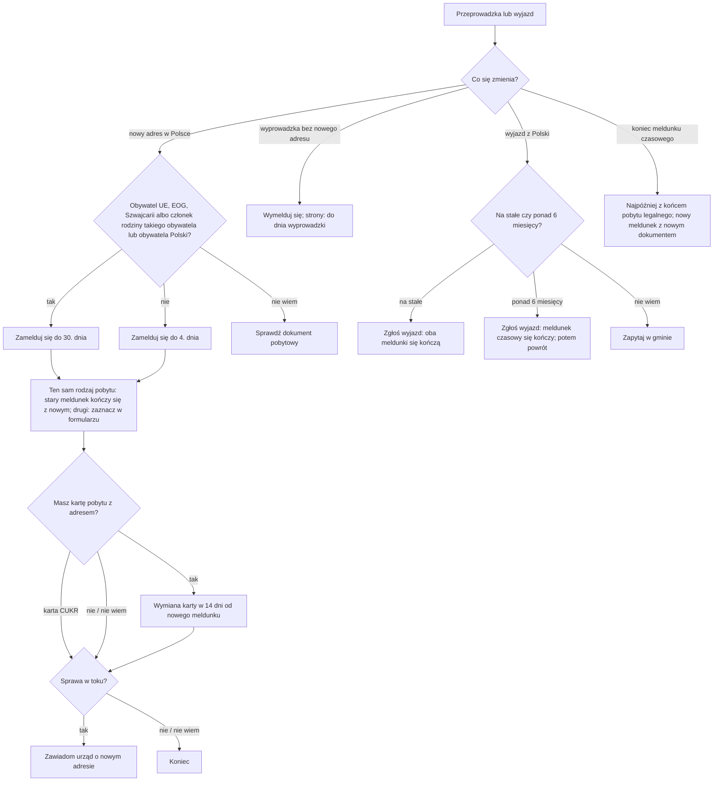

# Map: moving, deregistering and leaving Poland, for a foreigner

**Status:** a lab map by Claude, 17.10.2026. It is not independent, and nothing in it is built or shown to people. Doc 19 matter 19 (wave 6; the follow-up to wave 1's address registration, doc 18's journey stage S9). Production's registry covers registering, not moving or deregistering. **Checked by the separate checking agent on 17.10.2026;** its findings were re-read and applied (`research/2026-10-17-moving/sources/CHECK.md`). The corrections are changed in the lab; not independently verified.

**Why it matters:**
- A foreigner who moves registers at the new address by the fourth day, or by the 30th for EU, EEA and Swiss citizens, their family members and a Polish citizen's family member of the EU entry act (FACT, UEL art. 41 ust. 1–3). Registering there can deregister from the old address on the same form: automatically for the same kind of stay, and for the other kind only if its box is ticked (FACT, art. 33 ust. 3, 34 ust. 3; the forms regulation). A non-EU foreigner who does not meet the registration duty is liable to a fine, unless a family member of an EU, EEA or Swiss citizen (FACT, art. 59 ust. 1–2).
- The residence card shows the registered address, so a move means exchanging the card within 14 days, for the card fee (FACT, UoC art. 244 ust. 1 pkt 3, 241 pkt 1, 230 ust. 1, 235 ust. 1; INFERENCE that every registered move triggers it, counted from the new registration). **Not a CUKR card:** it shows no registered address (FACT, SA art. 42m pkt 3, from 4.05.2026), nor a card without an address under UoC art. 244 ust. 4.
- Moving during a residence case: the voivode must be told of the new address, or letters to the old one count as delivered (FACT, KPA art. 41), and a time limit can pass unseen (INFERENCE).
- A temporary registration cannot outlast the legal stay (FACT, UEL art. 41 ust. 4), so it ends with the visa or permit at the latest and has to be renewed after a new one (INFERENCE).
- Leaving Poland for good, or for more than 6 months, has its own report, by the day of leaving (FACT, art. 36).

**Sources:** `research/2026-10-17-moving/sources/` (README there), cited as:
- UEL: the act on population records, consolidated Dz.U. 2026 poz. 384, with art. 43 ust. 3 and 5 from 27.04.2026;
- UoC: the act on foreigners (the residence card, `research/2026-10-16-residence/sources/`; art. 108, 244 ust. 4 and 245 ust. 3–4 in `other-acts-moving-extract.txt`);
- SA: the special act on aid to Ukrainian citizens, art. 42m and 42q (the CUKR card);
- FORMS: the forms regulation, consolidated Dz.U. 2022 poz. 2070;
- KPA: the administrative procedure code, Dz.U. 2025 poz. 1691, art. 41;
- PAGES: gov.pl (deregistering, departure, return, registering for foreigners; 2024–2026) and Warszawa 19115 (07.07.2026).

Labels: FACT, INFERENCE, HYPOTHESIS, OPEN (OPEN-M1 to M4 in the sources README), PROPOSED.

**Content rules for this matter (PROPOSED):**
- **Registration is not a residence title** (UEL art. 28 ust. 4): the app never says that a registration, or its end, changes the right to stay.
- **Never a computed date as a promise.** The app shows the act's limits (the fourth day, 14 days, the day of leaving) from the date the person gives, labelled as the person's date.
- **The citizenship is asked only to pick the rule** (30 days or the fourth day): rule 4 still holds; the app asks for the document, never infers it from language.
- **No action claimed:** the app never says "wymeldowaliśmy Cię".

## 1. Who it is for

| The person says | Route | Basis |
|---|---|---|
| "Przeprowadzam się w Polsce" | Register at the new address (the old one ends with it); the card's exchange; a pending case: notify | UEL art. 33 ust. 3, 41; UoC art. 230, 241, 244; KPA art. 41 (FACT) |
| "Wyprowadzam się, ale nie mam nowego adresu" | Deregister; the pages say by the day of moving out | UEL art. 33 ust. 1 (FACT; the act names no day); the day: PAGES |
| "Wyjeżdżam z Polski na stałe" | Report the departure; it ends both registrations | UEL art. 36 ust. 1 (FACT) |
| "Wyjeżdżam na ponad 6 miesięcy i wrócę" | Report the departure and, later, the return | UEL art. 36 ust. 2 (FACT) |
| "Mój meldunek czasowy się kończy" | It ends on its date; to stay registered, register again, within the legal stay | UEL art. 41 ust. 4 (FACT); the end without a step: INFERENCE and PAGES |
| "Lokator wyprowadził się i się nie wymeldował" (an owner) | Ask the municipality for a deregistration decision | UEL art. 35 (FACT) |
| A stay in Poland of 30 days or less | No duty | UEL art. 42 ust. 2 (FACT: it counts the stay in Poland, not at one address) |

## 2. The journey (stages M0–M5)

| Stage | Goal | Steps (phone / **off the phone**) | Basis | Where people get lost |
|---|---|---|---|---|
| **M0** What changes | Know which duties a move brings | Phone: the citizenship group (EU or not), the residence document, a pending case, a car | UEL art. 40–41 (FACT) | **ML1:** a non-EU foreigner thinks the 30 days apply to them; the act gives the fourth day (FACT, art. 41 ust. 3) |
| **M1** Registering at the new address | Registered in time | **Off: the form, the title to the flat or the owner's confirmation, the right-to-stay document; in person without a PESEL (INFERENCE on art. 40 ust. 3's reading)** | UEL art. 28, 40 ust. 3, 41, 43 ust. 3, 5 (FACT); registering itself: production's registry | **ML2:** waits until the old registration is cancelled; the registration form does it, automatically for the same kind of stay and by a ticked box for the other kind (FACT, art. 33 ust. 3, 34 ust. 3; FORMS) |
| **M2** The residence card | A card with the new address | **Off: an application to exchange the card within 14 days, to the voivode of the place of stay; the card fee.** Not for a CUKR card (no address) | UoC art. 230 ust. 1, 235 ust. 1, 241 pkt 1, 244 ust. 1 pkt 3 and ust. 4, 245 ust. 3; SA art. 42m pkt 3 (FACT) | **ML3:** keeps the old card; its data no longer match (INFERENCE on the consequence). **ML7:** a CUKR holder exchanges a card that shows no address (FACT that it shows none) |
| **M3** A pending case and other records | Letters reach the person | **Off: a notice of the new address to the voivode (or another office) in each pending case (the act sets no form; in writing is PROPOSED, to keep proof); a car's certificate within 30 days** | KPA art. 41; road traffic act art. 78 ust. 2 pkt 2 (FACT) | **ML4:** a decision sent to the old address counts as delivered (FACT, KPA art. 41 § 2) |
| **M4** The end of a temporary registration | Stay registered when needed | Phone: the declared end. **Off: register again within the legal stay; after a new permit, with its document** | UEL art. 28 ust. 3, 41 ust. 4, 43 ust. 3 (FACT) | **ML5:** reads the end of the registration as the end of the right to stay (FACT that registration is records only, art. 28 ust. 4) |
| **M5** Leaving Poland | Report it | **Off: by the day of leaving: a departure for good (both registrations end), or for more than 6 months (the temporary registration ends; later, the return)** | UEL art. 36 (FACT); the temporary registration's end on a >6-month departure: FORMS (FACT) | **ML6:** the return's deadline (the pages: 30 days; neither the act nor the form gives one, OPEN-M2) |

## 3. The critical moments

1. **The fourth day after moving in** (ML1), for a non-EU foreigner: the new registration.
2. **14 days after the new registration:** the card's exchange (M2), except a CUKR card.
3. **A move during a residence case** (ML4): the notice to the voivode, before any letter is sent.
4. **The day of leaving Poland** (M5): the report.

## 4. Scenarios (fictional)

| # | Situation | Stage | The app should | Never |
|---|---|---|---|---|
| MS1 | A Ukrainian citizen with a temporary permit for work moves from Kraków to Wrocław | M1–M2 | Register in Wrocław by the fourth day (art. 41 ust. 3); the form deregisters from Kraków for the same kind of stay (art. 34 ust. 3; FORMS); ask which card: a card from a permit shows the address, so its exchange within 14 days in Wrocław (UoC art. 230, 241, 245 ust. 3); a CUKR card shows none, so no exchange (SA art. 42m) | "Masz 30 dni"; an exchange of a CUKR card |
| MS2 | A German citizen moves within Warsaw | M1 | Register at the new address by the 30th day (art. 41 ust. 1); the act on foreigners and its card rules do not apply to EU citizens (UoC art. 2 pkt 2); their own documents are not read here | The fourth-day rule |
| MS3 | Waiting for a permit decision, moves flat | M3 | Register at the new address with one of the documents art. 43 ust. 3 lists for a stay while an application is pending (a travel document, among others); notify the voivode of the new address (KPA art. 41; in writing, PROPOSED) | "Urząd sam się dowie" |
| MS4 | Temporary registration ends next month with the visa; a permit application was filed in time | M4 | Registration cannot outlast the legal stay (art. 41 ust. 4); after the date, register again on the basis of the pending application (art. 43 ust. 3), if it had no formal defects (or they were made good in time) and the case is not suspended at the person's request (UoC art. 108 ust. 1–2); the voivode's certificate of filing, since 27.04.2026 | "Meldunek przedłuża się sam" |
| MS5 | Leaves Poland for good | M5 | Report the departure by the day of leaving; both registrations end (art. 36 ust. 1, 3); the residence matters (card, permit) are the residence case's | — |
| MS6 | Goes home for 8 months and will come back | M5 | Report the departure by the day of leaving; the temporary registration ends with it (FORMS); report the return later (art. 36 ust. 2); the return's deadline is OPEN-M2 | A computed date |
| MS7 | The landlord says the tenant left without deregistering | — | The landlord may ask the municipality for a decision (art. 35); the app does not act for the landlord | — |
| MS8 | A family member died | — | Reporting the death at the civil status office replaces deregistration (art. 38) | — |
| MS9 | Arrived in Poland two weeks ago and will leave in three more; stays with friends in Gdańsk | M0 | No duty: the whole stay in Poland is 30 days or less (art. 42 ust. 2) | — |
| MS9a | A non-EU foreigner living in Kraków stays 3 weeks with friends in Gdańsk | M0 | On the act's words, a temporary-stay registration from the fourth day (art. 41 ust. 3; art. 42 ust. 2 counts the whole stay in Poland); the pages speak of over 3 months, so the app says to ask the municipality (OPEN-M5) | "Do 30 dni nie musisz" |
| MS10 | No PESEL, wants to deregister online | M1 | The act allows online deregistering with a qualified, trusted or personal signature, once the e-delivery proof is received (art. 33 ust. 2 pkt 2), but the trusted profile needs a PESEL (informatization act art. 20c ust. 1); at the office, with a passport or an ID card shown (art. 33 ust. 2 pkt 1; OPEN-M4) | "Zrobisz to w aplikacji" |
| MS11 | Did not register at the new flat for two months | M1 | Register now; the fine exists for a non-EU foreigner who is not an EU, EEA or Swiss citizen's family member (art. 59 ust. 1–2); the app does not estimate it | A computed fine |
| MS12 | Needs proof of the deregistration | — | On request from the municipality; in Warsaw 17 zł (PAGES); online data from the PESEL register (PAGES) | — |

## 5. User flow (PROPOSED)

**One case:** "Przeprowadzka i wymeldowanie". It links to the address registration case (production), the residence case (the card, a pending case), the vehicles map, and the e-government map (the trusted profile, e-Doręczenia).

### 5.1 Intake (each with "Nie wiem")

| Order | Question | Options | Why |
|---|---|---|---|
| 1 | Co się zmienia? | przeprowadzam się w Polsce; wyprowadzam się bez nowego adresu; wyjeżdżam z Polski; kończy mi się meldunek; Nie wiem | UEL art. 33, 36, 41 |
| 2 | Jaki masz dokument pobytowy? | paszport UE lub EFTA; karta pobytu; karta CUKR; wiza; czekam na decyzję; inny; Nie wiem | UEL art. 41, 43 ust. 3; SA art. 42m |
| 2a | Czy jesteś członkiem rodziny obywatela UE, EOG, Szwajcarii albo Polski? | tak; nie; Nie wiem | UEL art. 41 ust. 2–2a, 59 ust. 2 |
| 3 | Czy czekasz na decyzję w jakiejś sprawie (pobyt, praca, inne)? | tak; nie; Nie wiem | KPA art. 41 |
| 4 | Kiedy się wprowadzasz albo wyjeżdżasz? | a date; Nie wiem | Art. 36, 41 |
| 5 | Czy masz numer PESEL i profil zaufany? | tak; tylko PESEL; nie; Nie wiem | UEL art. 40 ust. 3; online services |

### 5.2 The levels

0 **Co się zmienia** → 1 **Nowy adres** → 2 **Karta pobytu** → 3 **Sprawy w toku** → 4 **Koniec meldunku** → 5 **Wyjazd**.

### 5.3 Each screen

| Screen | Content |
|---|---|
| **Teraz** | "Zamelduj się w nowym miejscu (do 4. dnia)" or "(do 30. dnia)", "Zaznacz w formularzu wymeldowanie z drugiego miejsca, jeśli chcesz", "Złóż wniosek o wymianę karty (14 dni)" (not for a CUKR card), "Zawiadom urząd o nowym adresie". Never "Wymeldowano" |
| **Mapa** | Levels 0–5 |
| **Teczka** | The registration confirmation, the card exchange application, the notices to offices |
| **Kalendarz** | The move-in date and the fourth or 30th day; 14 days for the card from the new registration; the declared end of a temporary registration; the day of leaving |
| **Czat** | The rule for the person's group, with its article |

### 5.4 Handoffs

| When | To | Basis |
|---|---|---|
| Registering, deregistering, a departure, a return | The municipality (in Warsaw, any district office) | UEL art. 28 ust. 1, 33 ust. 2, 36 ust. 3; PAGES |
| The card's exchange | The voivode of the place of stay (a CUKR card: the same, though a move does not require it); for a humanitarian stay, the Border Guard | UoC art. 230, 245 ust. 3–4; SA art. 42q |
| A pending case's address | The authority running the case | KPA art. 41 |
| A car's changed data | The starosta | Road traffic act art. 78 ust. 2 |
| A fine notice, a deregistration decision against the person | Legal aid | INFERENCE |

### 5.5 The flow, drawn

## 6. What production would need (PROPOSED)

- **A guide** in the registry for deregistering and a departure, next to the existing registration procedure, quoting UEL art. 33, 35, 36, 41 and 59, and the card's exchange from the residence registry. Doc 19's gate for this matter.
- **Change monitoring:**
  - UEL changed in 2025 and 2026 (Dz.U. 2025 poz. 1006, 1176, 1191, 1216, 1301 and 1794; 2026 poz. 203, all in the 2026 consolidated text; 2024 poz. 854 art. 7 from 4.05.2026; 2026 poz. 1206 from 11.01.2027);
  - the forms regulation (Dz.U. 2022 poz. 2070) predates those changes;
  - the special act's CUKR card (art. 42m);
  - the online services moved to e-Doręczenia on 1.01.2026 (PAGES; the e-delivery act art. 147 ust. 2).

## 7. Validation

- **The independent check:** done on 17.10.2026 (`research/2026-10-17-moving/sources/CHECK.md`); repeat after any change to the facts.
- **Moderated tasks** (after the gate): MS1 (a move on a temporary permit), MS3 (a move during a case), MS5 (leaving for good).
- **Thresholds** as doc 18 §6.1: 0 critical errors (a wrong deadline for the person's group, a registration presented as a right to stay, an action claimed); a correct next action for at least 6 of 8.
- **Confirmers:** a municipality's registration office; a voivode's office on the card's exchange; an NGO (OPEN-M2, M4, M5).
