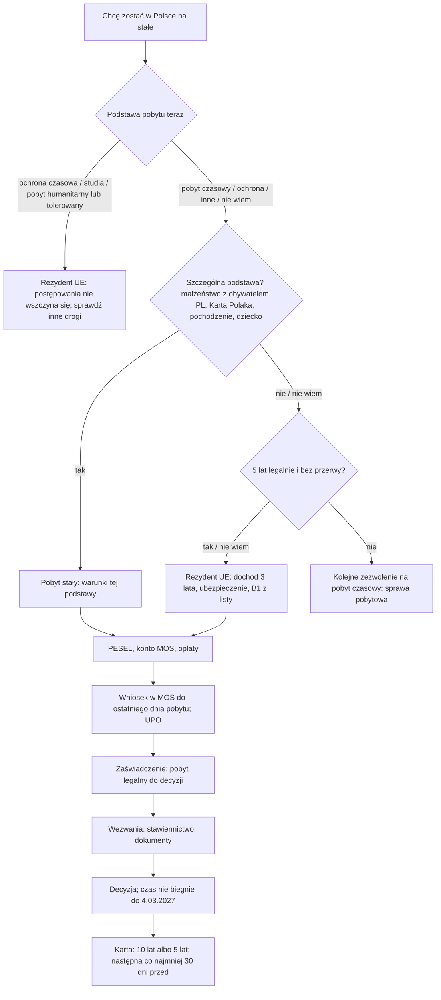

# Map: permanent residence and the EU long-term resident permit

**Status:** a lab map by Claude, 17.10.2026. It is not independent, and nothing in it is built or shown to people. Doc 19 matter 8 (wave 5). Production's registry has nothing on it; its residence guide covers the temporary permit only. Checked by the separate checking agent on 17.10.2026 (`research/2026-10-17-permanent/sources/CHECK.md`); the corrections are changed in the lab, not independently verified.

**Why it matters:**
- After years on temporary permits, these two permits end the cycle of renewals: both are granted "na czas nieoznaczony" (FACT, UoC art. 195 ust. 1, 211 ust. 1).
- The card is not indefinite. It is valid 10 years for a permanent permit and 5 years for an EU long-term resident permit, and the next card is applied for at least 30 days before it expires (FACT, art. 243, 230 ust. 2).
- Since 27.04.2026 both are filed only online, through MOS, by the last day of the legal stay; a paper application is left unexamined (FACT, art. 202 ust. 1, 203c, 218a ust. 1, 219c).
- Until 4.03.2027 the voivode's time limits for both do not run (FACT, the special act art. 100d).

**Sources:** `research/2026-10-17-permanent/sources/` (README there), cited as:
- UoC: the act on foreigners, consolidated Dz.U. 2025 poz. 1079, as changed by Dz.U. 2025 poz. 1794 (the permit articles from 27.04.2026; its card points 42–46 from 1.04.2026) and 2026 poz. 203 (from 5.03.2026);
- REG: the application regulations Dz.U. 2026 poz. 488 (permanent) and 487 (EU long-term resident); the list of B1 documents, Dz.U. 2023 poz. 1076; the social assistance income criteria, Dz.U. 2024 poz. 1044;
- OS: the stamp duty act, annex part III ust. 3–4; the card fee regulation Dz.U. 2022 poz. 1583; SA: the special act art. 100d (all three in `research/2026-10-16-residence/sources/`);
- PAGES: the Podlaski voivode's pages (the EU long-term resident permit; a spouse of a Polish citizen; a Karta Polaka holder; a child) and the Mazowiecki voivode's MOS page.

Labels: FACT, INFERENCE, HYPOTHESIS, OPEN (OPEN-P1 to P5 in the sources README), PROPOSED.

**Content rules for this matter (PROPOSED):**
- **Never "kwalifikujesz się".** The app lists the conditions and what the person has told it of each. The voivode decides; "Nie wiem" on any condition leads to a check, not a verdict.
- **No computed eligibility date.** The app may list the stays and breaks the person records, with the act's limits (6 months, 10 months in all) beside them. It never says "5 lat minie …", because what counts is the voivode's reading (art. 212 ust. 1–2; OPEN-P2).
- **The ground is asked, never inferred** from nationality or language (rule 4). A Karta Polaka, a marriage to a Polish citizen or a protection status is a document or a fact the person states. Citizenship is asked only for the UK route of art. 195 ust. 1 pkt 10.
- **Amounts only from the acts:** 640 zł stamp duty (with its exemptions), 100 zł card fee (with its exemptions and the 50 % relief), and the income criteria of 1010 zł and 823 zł, each with its source and date. The app never says whether the person's income is enough.
- **The voivode's pages are quoted as one office's practice,** and where they differ from the act (photos, signing), the act is what the app says.

## 1. Who it is for

By what the person says about their status, never by their language.

| The person says | Route | Basis |
|---|---|---|
| "Mieszkam w Polsce legalnie od ponad 5 lat" (on temporary permits) | The EU long-term resident permit: 5 years legal and unbroken, income, insurance, Polish B1 | UoC art. 211 ust. 1 (FACT) |
| "Mam żonę / męża z obywatelstwem polskim" | The permanent permit after 3 years of marriage and 2 years of unbroken stay on a temporary permit for that marriage (or as a refugee, subsidiary or humanitarian holder) | Art. 195 ust. 1 pkt 4 (FACT) |
| "Mam ważną Kartę Polaka" | The permanent permit, with the intention to settle; no stamp duty; the card is issued after the Karta Polaka is returned. The Karta Polaka loses validity by law when the permit's document is issued, and goes back to the voivode within 14 days of the final decision | Art. 195 ust. 1 pkt 9, 229 ust. 7; OS annex part III ust. 3; the Karta Polaka act art. 20 ust. 1a, 3 pkt 2 (FACT) |
| "Mam polskie pochodzenie" | The permanent permit, with the intention to settle; Polish origin under the repatriation act | Art. 195 ust. 1 pkt 3, ust. 2 (FACT) |
| "Moje dziecko urodziło się w Polsce, mam pobyt stały / rezydenta UE" | The permanent permit for the child; the last-day rule does not apply | Art. 195 ust. 1 pkt 1, 202 ust. 3, 196 ust. 3 (FACT) |
| "Jestem dzieckiem obywatela polskiego" (under their parental authority) | The permanent permit, for a child "pozostającym pod jego władzą rodzicielską"; not for an adult child on this ground | Art. 195 ust. 1 pkt 2 (FACT) |
| "Mam status uchodźcy / ochronę uzupełniającą / pobyt humanitarny od 5 lat" | The permanent permit after 5 years of unbroken stay on that basis | Art. 195 ust. 1 pkt 6 lit. a (FACT) |
| "Pracuję w zawodzie pożądanym od 4 lat" (art. 114 ust. 1a) | The permanent permit after 4 years, with a stable and regular income | Art. 195 ust. 1 pkt 6 lit. c (FACT) |
| "Mam ochronę czasową (PESEL UKR)" | Not the EU long-term resident permit while on it: the case is not started | Art. 213 ust. 1 pkt 1 lit. e (FACT); whether the time counts later is OPEN-P3 |
| "Studiuję" | Not the EU long-term resident permit while staying for studies; half of a study stay can count later | Art. 213 ust. 1 pkt 1 lit. c, 212 ust. 1 pkt 3 (FACT); OPEN-P2 |
| "Jestem obywatelem UE" | Not this act's permits | UoC art. 2 pkt 2; the act on EU citizens (out of scope) |

## 2. The journey (stages P0–P8)

| Stage | Goal | Steps (phone / **off the phone**) | Basis | Where people get lost |
|---|---|---|---|---|
| **P0** Which permit | Know which permit fits, if any | Phone: the grounds side by side, never a choice made for the person | UoC art. 195 ust. 1, 211 ust. 1 (FACT) | **PL1:** a spouse applies for the permanent permit on a temporary permit for another purpose (the 2 years must be on the marriage permit; FACT, art. 195 ust. 1 pkt 4). **PL2:** confuses the two permits (HYPOTHESIS) |
| **P1** The years | Know whether the stay is long and unbroken enough | Phone: record the stays and breaks; the act's limits beside them | Art. 195 ust. 4, 212 ust. 1–4 (FACT) | **PL3:** a break over 6 months, or over 10 months in all, breaks the stay unless it is one of the exceptions (FACT). **PL4:** counts study years in full (only half count; FACT, art. 212 ust. 1 pkt 3; OPEN-P2) |
| **P2** The conditions (EU long-term resident) | Have proof of each | **Off: income for 3 years; insurance; a B1 document from the list** | Art. 211 ust. 1–4; REG 2023/1076; REG 2024/1044 (FACT) | **PL5:** a language course certificate that is not on the list (FACT, the list is closed). **PL6:** a post-secondary school certificate: one obtained by 30.06.2025 counted only in cases started from 1.07.2025 to 30.06.2026 (FACT, 2025/622 art. 30 ust. 2–3) |
| **P3** Before filing | Be able to file | **Off: a PESEL and a MOS account; pay the 640 zł stamp duty, due on filing, unless exempt (four grounds, or a poverty certificate). The 100 zł card fee comes before the card is issued, with exemptions and a 50 % relief** | Art. 225b; OS art. 6, 7 pkt 5, annex part III ust. 3–4; UoC art. 235–237; card fee regulation § 2 (FACT); `maps/e-government-access.md` | **PL7:** no PESEL, so no MOS account (INFERENCE from art. 225b ust. 3 pkt 6) |
| **P4** Filing | Filed in time | **Off: the form in MOS; a photo (JPG); every page of the travel document; for the EU long-term resident the title to the flat; sign with a trusted signature (podpis zaufany) or a qualified signature; keep the UPO** | Art. 202 ust. 1, 203c, 203d, 218a, 219a, 219c, 219d; REG 488 § 4–5, 487 § 4–5 (FACT) | **PL8:** files after the last day of the legal stay, or on paper (FACT: refused to start, or left unexamined). **PL9:** a loan-for-use agreement for the flat from a friend (does not count; FACT, art. 219a ust. 2). **PL10:** follows a page that asks for three paper photos (PAGES; the act asks for one file) |
| **P5** The certificate | Know the stay is legal while waiting | Phone: the certificate from MOS, saved in the Teczka | Art. 206 ust. 1–9, 222a (FACT) | **PL11:** the application had a formal defect not fixed in time, so no certificate and no legal stay from it (FACT, art. 206 ust. 1) |
| **P6** Calls | Answer each call | **Off: appear in person (at least 7 days' notice) for fingerprints, the signature and the travel document; deliver documents (at least 14 days). For a child under 6, or someone a specialist's certificate says cannot come, a call to the parent or for copies instead** | Art. 203e, 203f, 203h, 203i, 219e, 219f, 219h, 219i (FACT) | **PL12:** misses the in-person call: the case is discontinued (art. 203i, with its exceptions in ust. 2), and the stamp duty paid with an application filed from 5.03.2026 is not refunded (FACT, art. 207b; 2026/203 art. 29) |
| **P7** Waiting | Wait without losing the case | Phone: the act's 6 months, and that they do not run until 4.03.2027 | Art. 210, 222d; SA art. 100d (FACT) | **PL13:** a ponaglenie expecting an answer (SA art. 100d ust. 3–4: it has no effect until 4.03.2027; FACT). **PL14:** suspends the case at their own request: the legal stay of art. 206 ust. 1 pkt 2 stops (FACT, art. 206 ust. 2) |
| **P8** Decision, card, keeping it | Have the card, and keep it valid | **Off: collect the card.** Phone: the card's expiry and "następna karta co najmniej 30 dni przed" | Art. 229 ust. 2, 230, 243; appeal to the Head of UdSC: KPA art. 129, UoC art. 22 ust. 2, 210 ust. 3 (FACT) | **PL15:** thinks the card never expires (HYPOTHESIS; FACT that it does, art. 243). **PL16:** a long stay abroad is a ground for withdrawal ("cofa się"): for the permanent permit more than 6 years outside Poland; for the EU long-term resident permit more than 6 years outside Poland or 12 months in a row outside the EU (FACT, art. 199 ust. 1 pkt 5, 215 ust. 1 pkt 3–4) |

## 3. The critical moments

1. **The last day of the legal stay** (PL8). The application must be in MOS and signed by then, and it counts as filed only with the UPO (art. 203d ust. 5). An outage of MOS that day moves the deadline to the 3rd working day after the fix (art. 225c).
2. **The in-person call** (PL12). A missed call ends the case, and for an application filed from 5.03.2026 the 640 zł is lost.
3. **The years and the breaks** (PL3, PL4). The most common reason a person expects a permit the act does not give (HYPOTHESIS, until interviews).
4. **The card's expiry** (PL15). The permit stays, the card does not; the next card at least 30 days before.

## 4. Scenarios (fictional)

| # | Situation | Stage | The app should | Never |
|---|---|---|---|---|
| PS1 | 6 years on temporary work permits, steady job, wants "kartę stałą" | P0 | Explain the two permits: the EU long-term resident permit fits the 5 years with income, insurance and B1 (art. 211); the permanent permit needs one of the grounds of art. 195 | "Po 5 latach dostajesz pobyt stały" |
| PS2 | Married to a Polish citizen for 4 years, on a temporary permit for the marriage for 2.5 years | P0 | The permanent permit's two conditions, both stated; the voivode checks the marriage is genuine (art. 195 ust. 1 pkt 4, 205) | "Kwalifikujesz się" |
| PS3 | Married to a Polish citizen for 4 years, but on a work permit for the last 2 years | P0 | The 2 years must be on a permit for the marriage, or as a refugee, subsidiary or humanitarian holder (art. 195 ust. 1 pkt 4); the EU long-term resident permit may fit instead | A route as certain |
| PS4 | Has a valid Karta Polaka, lives in Poland on a visa | P0 | The permanent permit with the intention to settle; no stamp duty; the card is issued after the Karta Polaka is returned (art. 195 ust. 1 pkt 9, 229 ust. 7); the Karta Polaka loses validity once the permit's document is issued (Karta Polaka act art. 20 ust. 1a) | Hiding the return of the Karta Polaka |
| PS5 | Studied 3 years in Poland, then 3 years on a work permit | P1 | Half of the study stay can count, so the years may not be enough; how the two rules fit is for the voivode or a lawyer (art. 212 ust. 1 pkt 3, ust. 2 pkt 3; OPEN-P2) | "Masz 6 lat" |
| PS6 | A 7-month trip home during the 5 years | P1 | A break over 6 months breaks the stay unless it is one of the exceptions, such as work abroad for a Polish employer (art. 212 ust. 3–4) | "Przerwa się nie liczy" |
| PS7 | B1 course certificate from a private language school | P2 | Only the list counts: the state certificate, ECL, TELC, a certificate from an approved university or one exempt from approval after a Polish-as-a-foreign-language course, a sworn translator's certificate (REG 2023/1076) | "Każdy certyfikat B1 wystarczy" |
| PS8 | Net income 950 zł a month, alone | P2 | The criterion is income higher than 1010 zł for a person alone (art. 140 ust. 2; REG 2024/1044), held for 3 years; the voivode assesses it | "Masz za mały dochód" or "wystarczy" |
| PS9 | Lives with a friend who signs a loan-for-use agreement for the room | P4 | It does not count unless the lender is close family; a lease or another title (art. 219a ust. 2) | — |
| PS10 | The temporary permit ends on Friday, the MOS account is not set up | P3–P4 | File by Friday; the voivode helps with filing (art. 203d ust. 6, 225b ust. 4); a PESEL (INFERENCE from art. 225b ust. 3 pkt 6) and a login are needed first (e-government case) | "Złożymy wniosek za Ciebie" |
| PS11 | MOS did not work on the last day | P4 | The 3rd working day after the fix, announced by UdSC, and it counts as filed on the outage's first day (art. 225c) | A computed date |
| PS12 | Filed, no certificate after two weeks | P5 | Check MOS; a formal defect may be the reason; the stay is legal by law only for a complete application filed during a legal stay, and the certificate confirms it (art. 206 ust. 1) | "Pobyt jest legalny" while a formal defect is unfixed |
| PS13 | A call to appear on a date the person cannot make | P6 | The call's date matters; contact the office before it; a missed call discontinues the case (art. 203i) | "Możesz nie przyjść" |
| PS14 | 8 months since filing, no decision | P7 | The 6 months do not run until 4.03.2027 (SA art. 100d); a ponaglenie has no effect until then; legal aid | "Złóż ponaglenie, to przyspieszy" |
| PS15 | Refused; asks if the 640 zł comes back | P8 | No, for an application filed from 5.03.2026 (art. 207b, 223a; 2026/203 art. 29); a refund that is due is paid from 1.10.2026 only on request (OS art. 9 ust. 2). The appeal within 14 days to the Head of UdSC through the voivode (KPA art. 129; UoC art. 22 ust. 2) | Chances of an appeal |
| PS16 | Permanent card issued in 2016 | P8 | It was valid 10 years; the next card is applied for at least 30 days before expiry (art. 243, 230 ust. 2); the date is the one on the card | "Pobyt stały jest bezterminowy, karta też" |
| PS17 | EU long-term resident, offered a 14-month job in Canada | P8 | 12 months in a row outside the EU is a ground for withdrawal (art. 215 ust. 1 pkt 4); a lawyer before deciding | "Nic się nie stanie" |
| PS18 | Temporary protection (PESEL UKR) for 4 years, asks about the EU long-term resident permit | P0 | Not while on temporary protection (art. 213 ust. 1 pkt 1 lit. e); whether the time counts later is open (OPEN-P3); after protection ends, 30 days of legal stay to leave, unless an application was filed after the legal stay ended (art. 299 ust. 6a, 7); the CUKR and residence cases | A route as certain |
| PS19 | A child born in Poland; both parents have permanent permits | P0 | The child's permanent permit; the last-day rule does not apply (art. 202 ust. 3); a parent files and signs (art. 203d ust. 3) | — |
| PS20 | Does not read Polish | All | The decision is in Polish (the Polish language act art. 5 ust. 1); the MOS form's language could not be checked (OPEN-P1); the voivode's help with filing; an NGO | Machine-translated rules |

## 5. User flow (PROPOSED)

**One case:** "Pobyt stały albo rezydent długoterminowy UE". It links to the residence case (the temporary permit that precedes it), the e-government case (PESEL, the login), the health case (insurance, for the EU long-term resident) and the work map (free access once granted).

### 5.1 Intake (each with "Nie wiem")

| Order | Question | Options | Why |
|---|---|---|---|
| 1 | Na jakiej podstawie jesteś teraz w Polsce? | Zezwolenie na pobyt czasowy (cel); Ochrona międzynarodowa lub pobyt humanitarny; Pobyt tolerowany; Ochrona czasowa (PESEL UKR); Wiza; Inne; Nie wiem | Art. 196, 213 (refusal to start) |
| 2 | Czy coś z tego dotyczy Ciebie? | Małżeństwo z obywatelem polskim; Karta Polaka; Polskie pochodzenie; Rodzic z pobytem stałym lub rezydenta UE (dziecko); Rodzic obywatel polski (dziecko); Żadne; Nie wiem | Art. 195 ust. 1 |
| 3 | Jak długo mieszkasz w Polsce legalnie, bez dłuższych wyjazdów? | under 5 years; 5 years or more; Nie wiem | Art. 211 ust. 1; asked as the person sees it, never computed |
| 4 | Czy wyjazdy za granicę trwały kiedyś dłużej niż 6 miesięcy naraz? | yes; no; Nie wiem | Art. 195 ust. 4, 212 ust. 3 |
| 5 | (EU long-term resident) Czy masz jeden z dokumentów potwierdzających znajomość polskiego? | the list; nie; Nie wiem | Art. 211 ust. 3; REG 2023/1076 |
| 6 | Do kiedy jest ważny Twój obecny pobyt? | a date from the document; Nie wiem | Art. 202 ust. 1, 218a ust. 1 |

### 5.2 The levels

0 **Która droga** (the grounds, never a choice made for the person) → 1 **Lata i przerwy** (recorded, not computed) → 2 **Warunki** (EU long-term resident: income, insurance, Polish) → 3 **Przed złożeniem** (PESEL, MOS, fees) → 4 **Wniosek w MOS** (by the last day; UPO) → 5 **Zaświadczenie** → 6 **Wezwania** → 7 **Czekanie** → 8 **Karta i potem** (the card, its expiry, trips abroad).

### 5.3 Each screen

| Screen | Content |
|---|---|
| **Teraz** | The level's next step: "Złóż wniosek w MOS do [data z dokumentu]", "Zapisz UPO", "Stawiennictwo: [data z wezwania]". Never "Wniosek złożony" before the UPO, never "Zezwolenie udzielone" |
| **Mapa** | Levels 0–8 |
| **Teczka** | The UPO, the filing certificate, each call, the payment confirmations, the B1 document, the flat's title, income documents |
| **Kalendarz** | The last day of the legal stay (as written on the document); each call's date (as written); the card's expiry with "następna karta co najmniej 30 dni przed"; no computed eligibility date |
| **Czat** | The conditions with their articles; what the person recorded; "Nie wiem" leads to a check |

### 5.4 Handoffs

| When | To | Basis |
|---|---|---|
| Filing, a call, the decision | The voivode of the place of stay (MOS) | UoC art. 201, 218 |
| Help with the application | The voivode's help with filing and with the account | Art. 203d ust. 6, 219d ust. 6, 225b ust. 4 |
| A refusal, a withdrawal, a long trip, the years in doubt | A lawyer or free legal aid | OPEN-P2, P3 |
| PESEL, a login | The e-government case | `maps/e-government-access.md` |
| Insurance | The health case | `maps/health-insurance.md` |

### 5.5 The flow, drawn

## 6. What production would need (PROPOSED)

- **Two guides** in the registry (the permanent permit and the EU long-term resident permit), quoting UoC with the 1794 changes and their date, the two application regulations, the B1 list and the income criteria. Doc 19's wave 5 gate: the owner opens the matter.
- **A grounds table, not free text,** for art. 195 ust. 1, each with its article and the facts it needs, so the engine says which fact is unknown.
- **A record of stays and breaks** kept on the device (rule 5), with the act's limits shown beside it and no computed verdict.
- **Change monitoring:** the income criteria are re-verified every 3 years and apply from 1 January of the next year (the social assistance act art. 9 ust. 1, 8a); the next regular set would apply from 1.01.2028 (INFERENCE). MOS's pages are not reachable from the lab (OPEN-P1).

## 7. Validation

- **The independent check: run on 17.10.2026** (`research/2026-10-17-permanent/sources/CHECK.md`). Main corrections: the no-refund rule covers only applications filed from 5.03.2026; the fee exemptions and relief; the Karta Polaka's loss of validity; the child of a Polish citizen must be under their parental authority; the replacement calls for a child under 6 or an ill person. It is a second reading by the same kind of tool, not a lawyer's review.
- **Moderated tasks** (after doc 19's wave 5 gate): PS1 (which permit), PS5 (do my years count), PS16 (when is my next card due).
- **Thresholds** as doc 18 §6.1, for 8 people: 0 critical errors (a "you qualify", a computed eligibility date, a filing step shown as done before the UPO); a correct next action for at least 6 of 8.
- **Confirmers:** a voivode's foreigners department (the years, the calls, the pages' photo rule); a migrant NGO or free legal aid (PL3, PL15, PL16).
