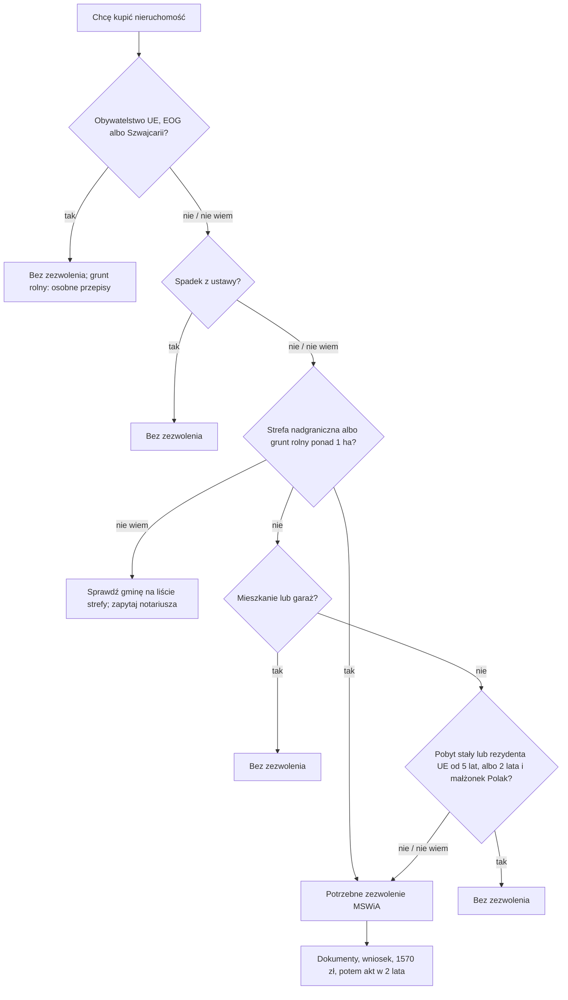

# Map: buying real estate in Poland as a foreigner

**Status:** a lab map by Claude, 17.10.2026. It is not independent, and nothing in it is built or shown to people. Doc 19 matter 21 (wave 6). Production's registry has no procedure for this. **Not yet checked by the separate checking agent:** that check comes before anything here is relied on.

**Why it matters:**
- A purchase that needed the interior minister's permit and did not have it is void (FACT, REA art. 6 ust. 1). The notary may not draw up the deed without the permit (FACT, art. 5), so the person learns late, after a preliminary contract and a deposit.
- **A flat needs no permit, except in the border zone** (FACT, REA art. 8 ust. 1 pkt 1 and ust. 3). On the 2005 list, the zone includes Gdańsk, Gdynia, Sopot, Szczecin and Świnoujście (FACT from the regulation, read by a character table; OPEN-R2). A non-EEA buyer of a flat there needs a permit (INFERENCE).
- Citizens and entrepreneurs of the EEA and Switzerland need no permit (FACT, art. 8 ust. 2); the act's temporary exceptions for them ended in 2009 and 2016 (INFERENCE from the accession date).
- The permit takes months: the act gives the defence minister 14 days to object, extendable to 2 months (FACT, art. 1 ust. 1a); the ministry's page speaks of 2–4 months or more (PAGES). It costs 1570 zł, and the promesa 98 zł (FACT, the stamp duty act).

**Sources:** `research/2026-10-17-real-estate/sources/` (README there), cited as:
- REA: the act of 24.03.1920 on the acquisition of real estate by foreigners, consolidated Dz.U. 2017 poz. 2278, with Dz.U. 2026 poz. 1099 from 19.11.2026;
- BORDER: the border act art. 12 and the 2005 list of the zone's municipalities;
- REG: the MSWiA regulation of 20.06.2012 (the application and its documents);
- FEES: the stamp duty act;
- KPA: the administrative procedure code (time limits, reconsideration);
- PAGES: MSWiA's permit page (01.10.2026) and its FAQ (27.06.2022).

Labels: FACT, INFERENCE, OPEN (OPEN-R1 to R6 in the sources README), PROPOSED.

**Content rules for this matter (PROPOSED):**
- **The first question is "Czy potrzebuję zezwolenia?", before any contract.** The app never says a purchase is fine until the property type, the place (border zone) and the person's status are known; "Nie wiem" on any of them leads to "zapytaj notariusza przed umową", not to a guess.
- **Citizenship is asked only for the EEA rule** (art. 8 ust. 2), by the document; the residence status by the permit's name and date (art. 8 ust. 1 pkt 2–3). Never inferred from language (rule 4).
- **No legal advice on contracts, taxes or prices.** The app names the notary and the ministry; matter 12 (taxes) is set aside.
- **No action claimed:** never "złożyliśmy wniosek do MSWiA".

## 1. Who it is for

| The person says | Route | Basis |
|---|---|---|
| "Jestem obywatelem UE, Norwegii, Islandii, Liechtensteinu albo Szwajcarii" | No permit, for any property; agricultural land under the agricultural act (OPEN-R1) | REA art. 8 ust. 2 (FACT) |
| "Chcę kupić mieszkanie" (non-EEA) | No permit, unless the flat is in the border zone; then a permit | REA art. 8 ust. 1 pkt 1, ust. 3; BORDER (FACT) |
| "Chcę kupić mieszkanie w Gdańsku / Szczecinie" (non-EEA) | A permit: these cities are on the zone's list | REA art. 8 ust. 3; BORDER list (FACT from the transcription; INFERENCE for the person) |
| "Mam pobyt stały od 6 lat i chcę kupić dom" | No permit, outside the border zone and unless it is agricultural land over 1 ha | REA art. 8 ust. 1 pkt 2, ust. 3 (FACT; OPEN-R3 on "nieprzerwanie") |
| "Mam pobyt stały od 3 lat, żona/mąż jest Polką/Polakiem" | No permit for joint property, with the same limits | REA art. 8 ust. 1 pkt 3, ust. 3 (FACT) |
| "Mam kartę pobytu czasowego i chcę kupić dom" | A permit; the temporary permit is a tie with Poland, except the two the act excludes | REA art. 1, 1a ust. 2 pkt 3 (FACT) |
| "Odziedziczyłem mieszkanie po ojcu" | No permit when the heir is a statutory heir | REA art. 7 ust. 2 (FACT) |
| "Dostałem dom w testamencie od znajomego" | A permit applied for within 2 years of the death, else the property passes to the statutory heirs | REA art. 7 ust. 3 (FACT) |
| "Rodzice sprzedają mi działkę" | No permit if the buyer is the seller's statutory heir and the seller has owned it 5 years; not in the border zone | REA art. 8 ust. 1 pkt 4, ust. 3 (FACT) |
| "Jestem z Wielkiej Brytanii" | The ministry: a permit, unless a Withdrawal Agreement beneficiary | PAGES (OPEN-R5) |
| "Kupuję udziały w spółce, która ma grunt" | A permit in some cases | REA art. 3e (FACT); not mapped further |

## 2. The journey (stages R0–R5)

| Stage | Goal | Steps (phone / **off the phone**) | Basis | Where people get lost |
|---|---|---|---|---|
| **R0** Do I need a permit? | Know before signing anything | Phone: the property type (flat, garage, house, plot, agricultural land), the municipality, the person's citizenship and residence permit with its date | REA art. 1, 8; BORDER (FACT) | **RL1:** buys a flat in Gdańsk thinking flats are free (INFERENCE from the list). **RL2:** counts the 5 years from arrival, not from the permanent residence permit (FACT, art. 8 ust. 1 pkt 2) |
| **R1** The seller and the documents | An application that can be decided | **Off: the seller's written will to sell (a preliminary contract will do, PAGES); the land register extract; for land, the land registry extract with the map and the zoning extract (each within 6 months); the identity document; proof of ties; proof of the money** | REG § 2–3 (FACT); PAGES | **RL3:** documents older than 6 months (FACT, REG § 3 ust. 1 pkt 2). **RL4:** foreign documents without a sworn translation (PAGES) |
| **R2** The application | Filed with the fee | **Off: a written application (no form) to MSWiA, in person, by post or by e-Doręczenia; 1570 zł (or 98 zł for a promesa) paid to Warsaw's tax service centre** | REA art. 1a ust. 3; FEES (FACT); channels and payment: PAGES | **RL5:** files by e-mail (not accepted, PAGES) or by ePUAP (INFERENCE that it no longer counts as registered e-delivery) |
| **R3** Waiting | Answer the ministry | Phone: the case's letters (e-delivery or hybrid, PAGES); a reminder to keep the seller's will current | KPA art. 35; REA art. 1 ust. 1a, 3b (FACT) | **RL6:** the seller sells to someone else; the case is discontinued (FACT, art. 3b), and the fee can be refunded (PAGES) |
| **R4** The permit | Buy within its validity | **Off: the notarial deed within 2 years, with the permit (and proof of any special conditions)** | REA art. 3 ust. 2, 5 (FACT) | **RL7:** lets the 2 years pass (FACT, art. 3 ust. 2) |
| **R5** After the deed | Nothing for the buyer to report | The notary sends the deed to the ministry within 7 days; from 19.11.2026 through the repository, for a fee | REA art. 8a (FACT); Dz.U. 2026 poz. 1099 | — |

## 3. The critical moments

1. **Before signing a preliminary contract** (R0): whether a permit is needed. A void purchase is the worst outcome.
2. **The 6 months' age of the property documents** (R1).
3. **2 years from the permit's issue** (R4); **1 year** for a promesa.
4. **2 years from the death,** for a non-statutory heir under a will (art. 7 ust. 3).

## 4. Scenarios (fictional)

| # | Situation | Stage | The app should | Never |
|---|---|---|---|---|
| RS1 | A Ukrainian citizen with a temporary permit for work buys a flat in Kraków | R0 | No permit: a flat outside the border zone (art. 8 ust. 1 pkt 1); Kraków is not on the 2005 list (FACT from the transcription) | "Potrzebujesz zezwolenia MSWiA" |
| RS2 | The same person buys a flat in Gdańsk | R0–R4 | A permit (art. 8 ust. 3; Gdańsk on the list); the temporary permit is a tie (art. 1a ust. 2 pkt 3); 1570 zł; months of waiting; sign the deed only with the permit | "Mieszkania nie wymagają zezwolenia" |
| RS3 | A German citizen buys a house by the sea in Świnoujście | R0 | No permit (art. 8 ust. 2) | The border-zone rule |
| RS4 | An Indian citizen with permanent residence since 2019 buys a house near Warsaw | R0 | No permit: more than 5 years since the grant (art. 8 ust. 1 pkt 2), outside the zone, not agricultural over 1 ha; "nieprzerwanie" is OPEN-R3 | — |
| RS5 | Permanent residence since 2023 (3 years), buys a plot near Poznań | R0–R4 | A permit: fewer than 5 years; ties: the permanent residence permit (art. 1a ust. 2 pkt 3 lit. b); up to 0.5 ha for living (art. 1a ust. 5) | "Masz pobyt stały, więc nie musisz" |
| RS6 | A Belarusian citizen married to a Pole for 4 years, permanent residence for 3, buys a flat in Szczecin with the spouse | R0 | Joint property, at least 2 years since the permit (art. 8 ust. 1 pkt 3), but Szczecin is in the border zone, so the exemption does not apply (art. 8 ust. 3): a permit | — |
| RS7 | A Georgian citizen on a visa wants a plot to build a house | R0 | A permit, and ties with Poland must be shown; a visa is not among the listed ties (art. 1a ust. 2); "w szczególności" leaves room, so the app says the ministry decides (INFERENCE) | "Nie możesz kupić" |
| RS8 | Inherits a flat from a Polish parent | — | No permit (art. 7 ust. 2) | — |
| RS9 | Left a house in a friend's will | — | A permit applied for within 2 years of the death, else the house passes to the statutory heirs (art. 7 ust. 3) | A missed date |
| RS10 | The seller withdrew while the case was running | R3 | Ask the ministry to discontinue (art. 3b); the fee refund is the page's (PAGES) | — |
| RS11 | A developer's flat in Sopot, data not final | R2 | A promesa (art. 3d; 98 zł), then the permit when the data are known (PAGES) | "Promesa wystarczy do zakupu" |
| RS12 | A UK citizen living in Poland since 2018 buys a flat in Gdynia | R0 | The ministry's page exempts Withdrawal Agreement beneficiaries; the basis is OPEN-R5, so the app says to confirm with the ministry or a notary | A FACT label |

## 5. User flow (PROPOSED)

**One case:** "Zakup nieruchomości". It links to the residence cases (the permit and its date) and the civil status map (marriage, inheritance).

### 5.1 Intake (each with "Nie wiem")

| Order | Question | Options | Why |
|---|---|---|---|
| 1 | Co chcesz kupić? | mieszkanie; garaż; dom lub działkę; grunt rolny; udziały w spółce; Nie wiem | REA art. 8 ust. 1, 3e |
| 2 | W jakiej gminie? | a municipality; Nie wiem | REA art. 8 ust. 3; BORDER |
| 3 | Jakie masz obywatelstwo (dokument)? | UE, EOG lub Szwajcaria; Wielka Brytania; inne; Nie wiem | REA art. 8 ust. 2 |
| 4 | Jakie masz zezwolenie na pobyt i od kiedy? | pobyt stały (data); rezydent UE (data); pobyt czasowy; wiza lub ruch bezwizowy; Nie wiem | REA art. 1a ust. 2, 8 ust. 1 pkt 2–3 |
| 5 | Czy kupujesz z małżonkiem, który jest obywatelem Polski? | tak; nie; Nie wiem | REA art. 8 ust. 1 pkt 3 |
| 6 | Czy to spadek albo zakup od rodzica? | spadek z ustawy; testament; od rodzica; nie; Nie wiem | REA art. 7, 8 ust. 1 pkt 4 |

### 5.2 The levels

0 **Czy potrzebuję zezwolenia** → 1 **Dokumenty** → 2 **Wniosek** → 3 **Czekanie** → 4 **Akt notarialny**.

### 5.3 Each screen

| Screen | Content |
|---|---|
| **Teraz** | "Sprawdź, czy potrzebujesz zezwolenia, zanim podpiszesz umowę", "Zbierz dokumenty (nie starsze niż 6 miesięcy)", "Złóż wniosek do MSWiA". Never "Zezwolenie wydane" |
| **Mapa** | Levels 0–4 |
| **Teczka** | The seller's statement, the property documents with their dates, proof of ties, the fee receipt, the permit |
| **Kalendarz** | Each document's 6 months; the permit's 2 years; the promesa's 1 year; a will's 2 years |
| **Czat** | The rule for the person's case, with its article |

### 5.4 Handoffs

| When | To | Basis |
|---|---|---|
| The permit, the promesa, a discontinuance | MSWiA, Department of Permits and Licences | REA art. 1; PAGES |
| The contract and the deed | A notary | REA art. 5 |
| Agricultural land | The agricultural act's body (OPEN-R1) | REA art. 1a ust. 6 |
| A refusal | A lawyer: reconsideration, then the administrative court | KPA art. 127 § 3 |

### 5.5 The flow, drawn

## 6. What production would need (PROPOSED)

- **A procedure in the registry** with REA art. 1, 1a, 3, 3d, 5–8, the fees, and the border zone's list as data (after OPEN-R2 is closed). Doc 19's gate for this matter.
- **Change monitoring:** Dz.U. 2026 poz. 1099 from 19.11.2026 (the notary's repository and its fee, OPEN-R6); the border zone list; the stamp duty rates.

## 7. Validation

- **The independent check:** the separate checking agent, before use, on every FACT in the sources README and in this map.
- **Moderated tasks** (after the gate): RS2 (a flat in Gdańsk), RS5 (a plot with 3 years of permanent residence), RS9 (a will).
- **Thresholds** as doc 18 §6.1:
  - 0 critical errors: "no permit needed" where one is; a flat in the border zone treated as free; an action claimed;
  - a correct next action for at least 6 of 8.
- **Confirmers:** a notary; MSWiA's department; a municipality on the border zone (OPEN-R2, R3, R4, R5).
