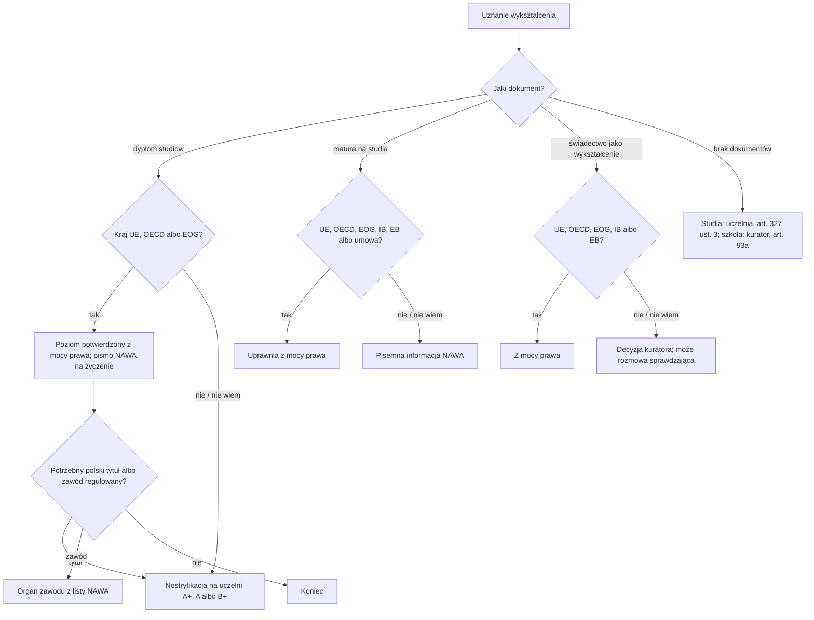

# Map: recognition of a foreign diploma or school certificate

**Status:** a lab map by Claude, 17.10.2026. It is not independent, and nothing in it is built or shown to people. Doc 19 matter 22 (wave 6). Production's registry has no recognition procedure. **Not yet checked by the separate checking agent:** that check comes before anything here is relied on.

**Why it matters:**
- **Where the diploma is from decides the route.** A diploma from the EU, OECD or EFTA-EEA confirms a level of education in Poland by law (FACT, PSWN art. 326 ust. 1). Others need an international agreement or nostrification at a university (FACT, art. 327 ust. 1). People pay for nostrification (up to 50 % of a professor's salary, art. 327 ust. 6) when a free NAWA letter might have served (INFERENCE).
- **A level of education is not a Polish title.** The title ("magister") needs an agreement or nostrification (FACT, art. 327 ust. 1–2; PAGES).
- **School certificates changed on 1.07.2025.** For university admission, PSWN art. 326a and NAWA's information now apply (FACT). For proof of education, the school superintendent decides (FACT, USO art. 93 ust. 3, 93b).
- **Refugees, people under protection, and others without documents** can have their education confirmed: studies under PSWN art. 327 ust. 3 (from 5.03.2026), schooling under USO art. 93a (FACT).

**Sources:** `research/2026-10-17-recognition/sources/` (README there), cited as:
- PSWN: Prawo o szkolnictwie wyższym i nauce, consolidated Dz.U. 2024 poz. 1571, with art. 326a from 1.07.2025 and art. 327 ust. 3 from 5.03.2026;
- USO: the act on the education system, consolidated Dz.U. 2025 poz. 881 (art. 93–93h as worded from 1.07.2025);
- REG-2018: the nostrification regulation;
- REG-2025: the school certificates regulation (from 1.01.2026);
- PAGES: NAWA.

Labels: FACT, INFERENCE, OPEN (OPEN-Q1 to Q5 in the sources README), PROPOSED.

**Content rules for this matter (PROPOSED):**
- **The country of the school decides, never the person's nationality** (rule 4): the app asks where the diploma was issued, by the document.
- **The app says which body decides** (NAWA, a university, the school superintendent, a professional body) and never promises an outcome; nostrification "może" end with exams (REG-2018 § 5).
- **Regulated professions are a handoff:** the app names the body from NAWA's list and goes no further (OPEN-Q1).
- **No action claimed:** never "Twój dyplom został uznany".

## 1. Who it is for

| The person says | Route | Basis |
|---|---|---|
| "Mam dyplom z Niemiec / USA i szukam pracy" | Confirms the level by law; NAWA's free letter if an employer asks | PSWN art. 326 ust. 1, 4 (FACT); the letter free: PAGES; OECD membership: OPEN-Q2 |
| "Mam dyplom z Ukrainy / Białorusi / Indii" | An agreement, else nostrification at a university with category A+, A or B+ | PSWN art. 327 ust. 1, 4 (FACT); agreements: OPEN-Q3 |
| "Potrzebuję polskiego tytułu magistra" | Nostrification (or an agreement) even for an EU diploma | PSWN art. 327 ust. 1–2 (FACT); PAGES |
| "Chcę iść na studia w Polsce, mam maturę z zagranicy" | EU/OECD/EEA, IB, EB or an agreement: by law; else NAWA's written information | PSWN art. 326a (FACT) |
| "Potrzebuję potwierdzenia wykształcenia średniego (praca, szkoła policealna)" | EU/OECD/EEA, IB, EB: by law; else the school superintendent's decision | USO art. 93 ust. 1, 3 (FACT) |
| "Uciekłem z kraju, nie mam dokumentów" | Studies: the confirmation procedure at a university; school: the superintendent, with a check interview, free for these applicants | PSWN art. 327 ust. 3; USO art. 93a, 93d, 93g ust. 3 (FACT) |
| "Jestem lekarzem / pielęgniarką" | The professional body (NAWA's list); first the diploma | PAGES (OPEN-Q1) |

## 2. The journey (stages Q0–Q4)

| Stage | Goal | Steps (phone / **off the phone**) | Basis | Where people get lost |
|---|---|---|---|---|
| **Q0** What for? | Pick the right body | Phone: the purpose (job, title, studies, school, profession), the country of the school, the level | PSWN art. 326–327, 326a; USO art. 93 (FACT) | **QL1:** pays for nostrification when the level is confirmed by law (INFERENCE). **QL2:** asks the school superintendent about university admission; that moved to NAWA on 1.07.2025 (FACT) |
| **Q1** NAWA's letter (optional) | Written information for an employer or a university | Phone: the SYRENA system: the diploma, the transcript, the admission document, translations, ID; free; electronic | PSWN art. 326 ust. 4, 326a ust. 4 (FACT); channel, fee, languages: PAGES | **QL3:** sends paper; not returned (PAGES) |
| **Q2** Nostrification | A certificate of equivalence | **Off: an application to a chosen university with category A+, A or B+ in the discipline; the diploma, the course documents, the admission document, a statement of birth; translations on request; the fee within the time set (at least 14 days)** | PSWN art. 327 ust. 4–6; REG-2018 § 2–4, 7 (FACT) | **QL4:** picks a university without the category; it refuses for lack of competence (FACT, art. 327 ust. 7). **QL5:** reads the 90 days as fixed; translation, exam and practice time is not counted (FACT, REG-2018 § 6 ust. 2) |
| **Q3** School certificate | A decision recognising the education | **Off: an application to the school superintendent of the place of residence; the legalised original or an apostilled copy; a course record if needed; a Polish translation by a sworn translator, a consul or the state's mission; maybe a check interview (fee: members' pay, 200 zł each, 3 to 5 members)** | USO art. 93 ust. 3, 93b–93g; REG-2025 § 2, 4, 6, 9 (FACT) | **QL6:** an unlegalised certificate (FACT, REG-2025 § 2). **QL7:** misses the interview without 3 days' notice; no refund (FACT, § 10 ust. 4) |
| **Q4** Without documents | Confirmation of the education or studies | **Off: the applicant's statement and whatever documents exist; for a non-Polish citizen, the residence document; an interview** | USO art. 93a, 93d ust. 2; REG-2025 § 3; PSWN art. 327 ust. 3 (FACT) | — |

## 3. The critical moments

1. **Before paying for nostrification** (Q0): whether the level is already confirmed by law.
2. **The superintendent's interview date** (Q3): cancel at least 3 days ahead.
3. **Each formal-gap deadline,** at least 14 days (REG-2018 § 3).

## 4. Scenarios (fictional)

| # | Situation | Stage | The app should | Never |
|---|---|---|---|---|
| QS1 | A German master's diploma; a Polish employer asks for proof | Q0–Q1 | It confirms second-cycle level by law (art. 326 ust. 1 pkt 2); NAWA's free letter if the employer wants paper (PAGES) | "Musisz nostryfikować" |
| QS2 | A Ukrainian engineer's diploma; wants the Polish title | Q2 | An agreement or nostrification (art. 327 ust. 1); a university with the right category; up to 90 days plus exams (REG-2018 § 6) | A promised outcome |
| QS3 | A US bachelor's degree of 4 years | Q0 | First-cycle level by law, if the USA is an OECD member (OPEN-Q2) and the 3-year rule fits (art. 326 ust. 1 pkt 1) | — |
| QS4 | A Belarusian school-leaving certificate; applying to a Polish university | Q1 | Not EU/OECD: if it opens university in Belarus, it does in Poland (art. 326a ust. 3); NAWA's written information (ust. 4); for a denounced agreement, ust. 6 | "Idź do kuratorium" |
| QS5 | A Georgian vocational certificate; a job asks for secondary education | Q3 | The school superintendent of the place of residence decides (USO art. 93 ust. 3, 93b); legalisation or apostille; a sworn translation (REG-2025 § 2, 4) | — |
| QS6 | A refugee from Sudan without documents, wants to finish a Polish school | Q4 | Confirmation by the superintendent under art. 93a, an interview, free (art. 93g ust. 3 pkt 1) | — |
| QS7 | A person under temporary protection, studies finished in Kharkiv, no diploma | Q4 | The confirmation procedure at a university (PSWN art. 327 ust. 3, from 5.03.2026) | — |
| QS8 | A Filipino nurse | — | The diploma first, then the nurses' chamber (NAWA's list; OPEN-Q1) | Any promise about the licence |
| QS9 | Nostrification refused for lack of competence | Q2 | A complaint is possible; no fee (art. 327 ust. 7); or another university with the category | — |
| QS10 | An IB diploma | Q0 | It gives the right to apply for studies (art. 326a ust. 1 pkt 2) and confirms secondary education (USO art. 93 ust. 1 pkt 2) | — |

## 5. User flow (PROPOSED)

**One case:** "Uznanie dyplomu lub świadectwa". It links to the school map (children), the work map (a job), and the Karta Polaka map (a Polish school certificate as proof of language).

### 5.1 Intake (each with "Nie wiem")

| Order | Question | Options | Why |
|---|---|---|---|
| 1 | Do czego potrzebujesz uznania? | praca; polski tytuł; studia; szkoła lub kurs; zawód regulowany; Nie wiem | PSWN art. 326–327, 326a; USO art. 93 |
| 2 | Jaki to dokument? | dyplom ukończenia studiów; stopień naukowy; świadectwo szkolne (matura); inne; brak dokumentu; Nie wiem | PSWN art. 326–328; USO art. 93a |
| 3 | W jakim kraju wydano dokument? | a country; Nie wiem | PSWN art. 326 ust. 1, 326a ust. 1; USO art. 93 ust. 1 |
| 4 | Gdzie mieszkasz w Polsce (województwo)? | a voivodeship; Nie wiem | USO art. 93b |

### 5.2 The levels

0 **Po co** → 1 **Czy uznane z mocy prawa** → 2 **Pismo NAWA** → 3 **Nostryfikacja albo kuratorium** → 4 **Zaświadczenie lub decyzja**.

### 5.3 Each screen

| Screen | Content |
|---|---|
| **Teraz** | "Sprawdź, czy dyplom jest uznany z mocy prawa", "Złóż wniosek o informację w NAWA (bezpłatnie)", "Wybierz uczelnię z kategorią A+, A albo B+". Never "Uznano" |
| **Mapa** | Levels 0–4 |
| **Teczka** | The diploma, transcripts, translations, the legalisation or apostille, NAWA's letter, the certificate or decision |
| **Kalendarz** | The formal-gap deadlines; the 90 days with their exclusions; the interview date and the 3 days before it |
| **Czat** | The route for the person's document, with its article |

### 5.4 Handoffs

| When | To | Basis |
|---|---|---|
| Written information on a diploma or a school-leaving certificate | NAWA (SYRENA) | PSWN art. 326 ust. 4, 326a ust. 4; PAGES |
| Nostrification; confirmation without a diploma | A university with the category | PSWN art. 327 ust. 3–4 |
| A school certificate; confirmation without documents | The school superintendent of the place of residence | USO art. 93b |
| A regulated profession | The profession's body (NAWA's list) | PAGES; OPEN-Q1 |

### 5.5 The flow, drawn

## 6. What production would need (PROPOSED)

- **A procedure in the registry** with PSWN art. 326–327, 326a and USO art. 93–93g as data, and the EU, OECD and EFTA-EEA member lists as dated data (OPEN-Q2). Doc 19's gate for this matter.
- **Change monitoring:** PSWN and USO changed on 1.07.2025 and 5.03.2026; the school certificates regulation is new (1.01.2026); NAWA's system and its rules (PAGES).

## 7. Validation

- **The independent check:** the separate checking agent, before use, on every FACT in the sources README and in this map.
- **Moderated tasks** (after the gate): QS1 (an EU diploma for a job), QS2 (nostrification), QS6 (no documents).
- **Thresholds** as doc 18 §6.1:
  - 0 critical errors: nostrification sent as required for an EU diploma's level; a level presented as a title; a promised outcome; an action claimed;
  - a correct next action for at least 6 of 8.
- **Confirmers:** NAWA; a university's nostrification office; a school superintendent's office (OPEN-Q2, Q3, Q4).
