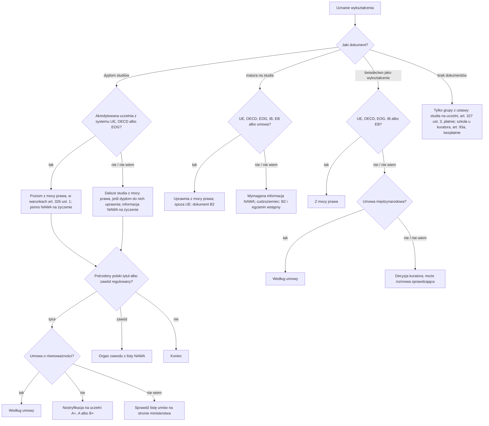

# Map: recognition of a foreign diploma or school certificate

**Status:** a lab map by Claude, 17.10.2026. It is not independent, and nothing in it is built or shown to people. Doc 19 matter 22 (wave 6). Production's registry has no recognition procedure. **Checked by the separate checking agent on 17.10.2026** (`research/2026-10-17-recognition/sources/CHECK.md`); the corrections were made in the lab after re-reading each provision, and are not independently verified.

**Why it matters:**
- **Where the diploma is from decides the route.** A diploma from an accredited university in the EU, OECD or EFTA-EEA confirms a level of education in Poland by law, within the conditions of PSWN art. 326 ust. 1 and the exclusions of ust. 3 (FACT). For a Polish diploma and title, any foreign diploma, an EU one too, needs an international agreement on equivalence or nostrification at a university (FACT, art. 327 ust. 1). People pay for nostrification (at most 50 % of a professor's salary, today 4825 zł, art. 327 ust. 6) when a free NAWA letter might have served (INFERENCE).
- **A level of education is not a Polish title.** The title ("magister") needs an agreement or nostrification (FACT, art. 327 ust. 1–2; PAGES).
- **University admission with a foreign certificate changed on 1.07.2025.** A certificate outside PSWN art. 326a ust. 1 counts only with NAWA's written information, which is then required, not optional (FACT, art. 69 ust. 2 pkt 4). Foreigners also need a language document of at least B2, and with such a certificate an entrance exam (FACT, art. 70 ust. 5a–5e, 323 ust. 1a–1d). For proof of education, the school superintendent decides (FACT, USO art. 93 ust. 3, 93b). A superintendent's decision on the right to apply for studies issued by 30.06.2025, or later in a case begun by then, may still be shown (FACT, Dz.U. 2025 poz. 622 art. 12 ust. 2–3).
- **People in the groups the acts name, who cannot produce or authenticate their documents** (refugees, protection, some permits, a denounced agreement, people harmed by war or disaster), can have their education confirmed: studies under PSWN art. 327 ust. 3 (in its wording from 5.03.2026), for a fee; schooling under USO art. 93a, free (FACT; the fee for studies: INFERENCE from art. 327 ust. 6 and REG-2018 § 14).

**Sources:** `research/2026-10-17-recognition/sources/` (README there), cited as:
- PSWN: Prawo o szkolnictwie wyższym i nauce, consolidated Dz.U. 2024 poz. 1571, with art. 69, 70, 323 and 326a as changed from 1.07.2025 and art. 327 ust. 3 from 5.03.2026;
- USO: the act on the education system, consolidated Dz.U. 2025 poz. 881 (art. 93–93h as worded from 1.07.2025);
- REG-2018: the nostrification regulation (also the procedure without a diploma);
- REG-2025: the regulation of the Minister of Education on school certificates (from 1.01.2026);
- PO: Prawo oświatowe (art. 165 ust. 5a); NURSES: the nursing act (art. 35a);
- PAGES: NAWA, and the ministry's page on recognition agreements.

Labels: FACT, INFERENCE, OPEN (OPEN-Q1 to Q7 in the sources README), PROPOSED.

**Content rules for this matter (PROPOSED):**
- **The country of the school decides, never the person's nationality** (rule 4): the app asks where the diploma was issued, by the document. Citizenship is asked only for the B2 rule of university admission (art. 70 ust. 5a), by the passport.
- **The app says which body decides** (NAWA, a university, the school superintendent, a professional body) and never promises an outcome; nostrification "może" end with exams (REG-2018 § 5).
- **Regulated professions are a handoff:** the app names the body from NAWA's list, and for a nurse or midwife says that the act has its own route (NURSES art. 35a), and goes no further (OPEN-Q1, Q7).
- **No action claimed:** never "Twój dyplom został uznany".

## 1. Who it is for

| The person says | Route | Basis |
|---|---|---|
| "Mam dyplom z Niemiec / USA i szukam pracy" | Confirms the level by law, if the conditions of art. 326 ust. 1 fit and ust. 3 does not exclude it; NAWA's free letter if an employer asks | PSWN art. 326 ust. 1, 3, 4 (FACT); the letter free: PAGES; OECD membership: OPEN-Q2 |
| "Mam dyplom z Ukrainy / Białorusi / Indii" | Further study by law if the diploma opens it at home; NAWA's information on request. For a Polish diploma and title: an agreement on equivalence, else nostrification at a university with category A+, A or B+ | PSWN art. 326 ust. 2, 4, art. 327 ust. 1, 4 (FACT); the ministry's page: Ukraine's 2005 agreement gives academic recognition only, Belarus's lost force on 3.11.2023 (PAGES; OPEN-Q3) |
| "Potrzebuję polskiego tytułu magistra" | Nostrification (or an agreement) even for an EU diploma | PSWN art. 327 ust. 1–2 (FACT); PAGES |
| "Chcę iść na studia w Polsce, mam maturę z zagranicy" | EU/OECD/EEA, IB, EB or an agreement: by law, and a non-EU foreigner shows a B2 language document. Any other certificate: NAWA's written information is required, and a foreigner also shows B2 and passes an entrance exam | PSWN art. 69 ust. 2 pkt 4, 70 ust. 5a–5e, 323 ust. 1a–1b, 326a (FACT) |
| "Mam decyzję kuratora o uznaniu świadectwa" | It may be shown in admission if issued by 30.06.2025, or later in a case begun by then; NAWA's page says any decision, which is broader | Dz.U. 2025 poz. 622 art. 12 ust. 2–3 (FACT); PAGES |
| "Potrzebuję potwierdzenia wykształcenia średniego (praca, szkoła policealna)" | EU/OECD/EEA, IB, EB: by law; an agreement may apply; else the school superintendent's decision. A post-secondary school for a non-Polish citizen also needs a Polish certificate of at least B1 | USO art. 93 ust. 1–3; PO art. 165 ust. 5a (FACT) |
| "Uciekłem z kraju, nie mam dokumentów" | Only for the groups the acts name, and when producing or authenticating the documents meets obstacles hard to remove. Studies: the confirmation procedure at a university, for a fee. School: the superintendent, with an interview unless the documents show the level, free | PSWN art. 327 ust. 3; REG-2018 § 9–14; USO art. 93a, 93d ust. 2, 93g ust. 3 pkt 1 (FACT); the fee for studies: INFERENCE |
| "Jestem lekarzem / pielęgniarką" | The professional body (NAWA's list). A nurse or midwife from outside the EU: also the act's own route, the minister of health's consent for a set scope, period and place of work, then the right to practise from the regional council after a B1 document. A doctor: not read | PAGES; NURSES art. 35a ust. 1, 3, 28 (FACT); OPEN-Q1, Q7 |

## 2. The journey (stages Q0–Q4)

| Stage | Goal | Steps (phone / **off the phone**) | Basis | Where people get lost |
|---|---|---|---|---|
| **Q0** What for? | Pick the right body | Phone: the purpose (job, title, studies, school, profession), the country of the school, the level | PSWN art. 326–327, 326a; USO art. 93 (FACT) | **QL1:** pays for nostrification when the level is confirmed by law (INFERENCE). **QL2:** asks the school superintendent about university admission; that moved to NAWA's information on 1.07.2025 (FACT) |
| **Q1** NAWA's information and admission | Written information; for studies, everything the admission asks | Phone: the SYRENA system: the document, the transcript, the earlier certificate, translations, ID; free; electronic. For admission as a foreigner: a language document of at least B2, and the entrance exam where the university holds one | PSWN art. 69 ust. 2 pkt 4, 70 ust. 5a–5g, 323 ust. 1a–1d, 326 ust. 4, 326a ust. 4 (FACT); channel, fee, languages: PAGES | **QL3:** treats NAWA's information as optional for admission; with a certificate outside art. 326a ust. 1 it is required (FACT). **QL3a:** sends paper; not returned (PAGES) |
| **Q2** Nostrification | A certificate of equivalence | **Off: an application to a chosen university with category A+, A or B+ in the discipline; the diploma, the course documents, the admission document, a statement of birth; ordinary translations on request, sworn ones in particularly justified cases; the fee within the time set (at least 14 days)** | PSWN art. 327 ust. 4–6; REG-2018 § 2–4, 7 (FACT) | **QL4:** picks a university without the category; it refuses for lack of competence (FACT, art. 327 ust. 7). **QL5:** reads the 90 days as fixed; translation, exam and practice time is not counted (FACT, REG-2018 § 6 ust. 2) |
| **Q3** School certificate | A decision recognising the education | **Off: an application to the school superintendent of the place of residence (without residence in Poland, of the seat of the institution); the original or a duplicate legalised by the Polish consul, the issuing state's education authority or its accredited mission, or, from a Hague Convention state, the original or a notarised copy with an apostille; a course record if needed; a translation by a sworn translator (Polish, or registered in an EU, EFTA-EEA or OECD state), the consul or the mission, or another reliable one if that is very hard; maybe a check interview (fee: 200 zł per paid member and the translator's pay; 3 to 5 persons including the chair, OPEN-Q6)** | USO art. 93 ust. 3, 93b–93g; REG-2025 § 2, 4, 6, 9 (FACT) | **QL6:** an unlegalised certificate (FACT, REG-2025 § 2). **QL7:** misses the interview without notifying at least 3 days ahead; no refund (FACT, § 10 ust. 4) |
| **Q4** Without documents | Confirmation of the education or studies | **Off. Studies: an application to a university with the category, the documents that exist, the status document, a statement of completion and of birth; maybe exams or practice; 90 days; a fee. School: the applicant's statement and any documents, for a non-Polish citizen the residence document; an interview unless the documents show the level** | PSWN art. 327 ust. 3–6; REG-2018 § 9–14; USO art. 93a, 93d ust. 2; REG-2025 § 3 (FACT) | **QL8:** expects the university route to be free, like the superintendent's (INFERENCE) |

## 3. The critical moments

1. **Before paying for nostrification** (Q0): whether the level is already confirmed by law.
2. **The university's admission dates** (Q1): NAWA's information, the B2 document and the entrance exam must fit them (the university publishes them, PSWN art. 70 ust. 5g).
3. **The superintendent's interview date** (Q3): notify at least 3 days ahead if it cannot happen.
4. **Each formal-gap deadline,** at least 14 days (REG-2018 § 3, § 10).

## 4. Scenarios (fictional)

| # | Situation | Stage | The app should | Never |
|---|---|---|---|---|
| QS1 | A German master's diploma; a Polish employer asks for proof | Q0–Q1 | It confirms second-cycle level by law (art. 326 ust. 1 pkt 2), unless ust. 3 excludes it; NAWA's free letter if the employer wants paper (PAGES) | "Musisz nostryfikować" |
| QS2 | A Ukrainian engineer's diploma of 2015; wants the Polish title | Q2 | Nostrification (art. 327 ust. 1): the ministry's page says the 2005 agreement gives academic recognition only (PAGES); a university with the right category; up to 90 days plus exams (REG-2018 § 6); at most 4825 zł | A promised outcome |
| QS3 | A US bachelor's degree of 4 years | Q0 | First-cycle level by law, if the USA is an OECD member (OPEN-Q2) and the 3-year rule fits (art. 326 ust. 1 pkt 1) | — |
| QS4 | A Belarusian school-leaving certificate; applying to a Polish university | Q1 | Not EU/OECD: if it opens university in Belarus, it gives the right in Poland (art. 326a ust. 3), but admission requires NAWA's written information (art. 69 ust. 2 pkt 4), a B2 language document and an entrance exam (art. 70 ust. 5b); ust. 6 only with obstacles to the documents (USO art. 93a pkt 1a) | "Informacja NAWA nie jest potrzebna"; "Idź do kuratorium" |
| QS5 | A Georgian vocational certificate; a job asks for secondary education | Q3 | The school superintendent of the place of residence decides (USO art. 93 ust. 3, 93b); legalisation or an apostilled copy; a sworn translation (REG-2025 § 2, 4) | — |
| QS6 | A refugee from Sudan without documents, wants to finish a Polish school | Q4 | Confirmation by the superintendent under art. 93a; an interview unless the documents show the level (art. 93d ust. 2); free (art. 93g ust. 3 pkt 1) | — |
| QS7 | A person under temporary protection, studies finished in Kharkiv, no diploma | Q4 | The confirmation procedure at a university (PSWN art. 327 ust. 3, from 5.03.2026); a fee; 90 days, not counting exams or practice (REG-2018 § 13–14) | "To bezpłatne" |
| QS8 | A Filipino nurse | — | Two routes, both handed off: recognition and the nurses' chamber (NAWA's list), or the act's own route through the minister of health's consent for a set scope, period and place of work, then the right to practise after a B1 document (NURSES art. 35a) | Any promise about the licence |
| QS9 | Nostrification refused for lack of competence | Q2 | A complaint is possible; no fee (art. 327 ust. 7); or another university with the category | — |
| QS10 | An IB diploma | Q0 | It gives the right to apply for studies (art. 326a ust. 1 pkt 2), with the B2 check for a non-EU foreigner (art. 70 ust. 5a), and confirms secondary education (USO art. 93 ust. 1 pkt 2) | — |

## 5. User flow (PROPOSED)

**One case:** "Uznanie dyplomu lub świadectwa". It links to the school map (children), the work map (a job), and the Karta Polaka map (a Polish school certificate as proof of language).

### 5.1 Intake (each with "Nie wiem")

| Order | Question | Options | Why |
|---|---|---|---|
| 1 | Do czego potrzebujesz uznania? | praca; polski tytuł; studia; szkoła lub kurs; zawód regulowany; Nie wiem | PSWN art. 326–327, 326a; USO art. 93 |
| 2 | Jaki to dokument? | dyplom ukończenia studiów; stopień naukowy; świadectwo szkolne (matura); decyzja kuratora o uznaniu świadectwa; inne; brak dokumentu; Nie wiem | PSWN art. 326–328; USO art. 93a; Dz.U. 2025 poz. 622 art. 12 |
| 3 | W jakim kraju wydano dokument? | a country; Nie wiem | PSWN art. 326 ust. 1, 326a ust. 1; USO art. 93 ust. 1 |
| 4 | Gdzie mieszkasz w Polsce (województwo)? | a voivodeship; nie mieszkam w Polsce; Nie wiem | USO art. 93b ust. 1 |
| 5 | Na studia: czy masz obywatelstwo państwa UE (według paszportu)? | tak; nie; Nie wiem | PSWN art. 70 ust. 5a, 5c (only for the B2 rule) |

### 5.2 The levels

0 **Po co** → 1 **Czy uznane z mocy prawa** → 2 **Informacja NAWA** → 3 **Nostryfikacja albo kuratorium** → 4 **Zaświadczenie lub decyzja**.

### 5.3 Each screen

| Screen | Content |
|---|---|
| **Teraz** | "Sprawdź, czy dyplom jest uznany z mocy prawa", "Złóż wniosek o informację w NAWA (bezpłatnie)", "Na studia: przygotuj dokument językowy B2", "Wybierz uczelnię z kategorią A+, A albo B+". Never "Uznano" |
| **Mapa** | Levels 0–4 |
| **Teczka** | The diploma, transcripts, translations, the legalisation or apostille, NAWA's information, the language document, the certificate or decision |
| **Kalendarz** | The admission dates the university publishes; the formal-gap deadlines; the 90 days with their exclusions; the interview date and the 3 days before it |
| **Czat** | The route for the person's document, with its article |

### 5.4 Handoffs

| When | To | Basis |
|---|---|---|
| Written information on a diploma or a school-leaving certificate | NAWA (SYRENA) | PSWN art. 326 ust. 4, 326a ust. 4; PAGES |
| University admission | The university's admissions office (its rules: B2, NAWA, the entrance exam) | PSWN art. 70 ust. 5g |
| Nostrification; confirmation without a diploma | A university with the category | PSWN art. 327 ust. 3–4 |
| A school certificate; confirmation without documents | The school superintendent of the place of residence | USO art. 93b |
| A nurse or midwife | The minister of health; the regional council of nurses and midwives | NURSES art. 35a |
| Another regulated profession | The profession's body (NAWA's list) | PAGES; OPEN-Q1 |

### 5.5 The flow, drawn

## 6. What production would need (PROPOSED)

- **A procedure in the registry** with PSWN art. 69, 70, 323, 326–327 and 326a, USO art. 93–93g and PO art. 165 ust. 5a as data, and the EU, OECD and EFTA-EEA member lists as dated data (OPEN-Q2). Doc 19's gate for this matter.
- **Change monitoring:** PSWN and USO changed on 1.07.2025, PSWN art. 327 ust. 3 again on 5.03.2026; the school certificates regulation is new (1.01.2026); the professor's salary regulation (the nostrification maximum); the ministry's agreements page; NAWA's system and its rules (PAGES).

## 7. Validation

- **The independent check:** the separate checking agent, before use, on every FACT in the sources README and in this map.
- **Moderated tasks** (after the gate): QS1 (an EU diploma for a job), QS2 (nostrification), QS4 (admission with a non-EU certificate), QS6 (no documents).
- **Thresholds** as doc 18 §6.1:
  - 0 critical errors: nostrification sent as required for an EU diploma's level; a level presented as a title; NAWA's information presented as optional for admission with a certificate outside art. 326a ust. 1; a promised outcome; an action claimed;
  - a correct next action for at least 6 of 8.
- **Confirmers:** NAWA; a university's admissions and nostrification offices; a school superintendent's office (OPEN-Q2, Q3, Q4, Q6).
