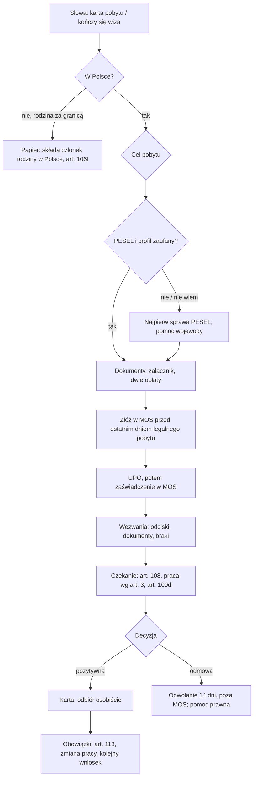

# Map: temporary residence permit and the residence card

**Status:** a lab map by Claude, 17.10.2026. It is not independent, and nothing in it is built or shown to people. Wave 2 of doc 19. Its facts and those of the draft reference were checked by the separate checking agent on 17.10.2026, at the owner's request (`research/2026-10-16-residence/sources/CHECK.md`); the corrections are changed in the lab, not independently verified.
- **Content rules** come from the draft reference (`audit/2026-10-16-residence/RESIDENCE-REFERENCE-DRAFT.md`, cited as REF §n or RCn) and its sources. No rule here is new. Each new step or screen is labelled **PROPOSED**.
- **What exists today** is the engine's blueprint `blueprints/residence-card.yaml`, production's guide, and the five restrictions in the prototype (`audit/2026-10-16-residence/COMPARISON.md`).
- **Building any proposal** is a change after Phase 1. It needs the owner's decision and, for content, production's guide.

Labels: FACT (with its source), INFERENCE, HYPOTHESIS (to test with people), OPEN, PROPOSED (a design not yet built).

## 1. Who it is for

| Group, by the status the person states (never by nationality, rule 4) | Route | Covered here |
|---|---|---|
| A foreigner in Poland who wants a temporary permit for work, study, family, traineeship, business, seasonal work or a short stay | MOS (REF §1) | Yes for work, study and family; business, seasonal work and short stay only for the channel and the fee (RC12–RC15, OPEN-R15) |
| A family member in Poland applying for a person abroad (art. 159, 160 pkt 1, 3, 4, 6) | Paper, art. 106l (RC4) | Yes |
| A UKR status holder who wants to stay | The CUKR card is a separate procedure (`maps/cukr-ukr.md`). A pending ordinary application ends when a CUKR application is filed (special act art. 42i, FACT). A UKR status holder may also apply for an ordinary permit under art. 114, 127, 142, 158 ust. 1 or 159 ust. 1, with special rules (no call to appear, fingerprints taken from the PESEL register; Dz.U. 2026 poz. 203 art. 45, FACT) | Points there; names both routes, never chooses |
| An EU, EEA or Swiss citizen, or their family member; some spouses of Polish citizens who come back from living in another EU, EEA, Swiss or UK state; UK citizens under the Withdrawal Agreement | Not this act (UOC art. 2 pkt 2–4, with the act on EU citizens art. 2 pkt 4 lit. b, FACT; production's guide `eu-citizens-and-families`) | Says so and stops |
| Permanent residence, EU long-term residence, intra-company transfer, the Blue Card | Other procedures | Says "not covered" |

## 2. The journey (stages R0–R11), with steps off the phone

| Stage | The person's goal | Steps (on the phone / **off the phone**) | Basis | Where people get lost |
|---|---|---|---|---|
| **R0** Before | Know a permit is needed, and by when | Phone: name the purpose and the last day of legal stay. **Off: find that day (visa, visa-free stay, earlier permit)** | REF §3: file by the last day of legal stay (art. 105 ust. 1) | **RL1:** registration is taken for a residence permit (PUBLIC-QUESTIONS Q1, HYPOTHESIS). **RL2:** the last day of legal stay is unknown or miscounted (HYPOTHESIS; the app cannot compute it: OPEN) |
| **R1** Prerequisites | Be able to use MOS | Phone: see the chain. **Off: get a PESEL (the PESEL case); set up a way to log in (a trusted profile, per QA 2); the Mazowiecki office asks for an e-Doręczenia address** | The MOS account asks for PESEL (art. 225b ust. 3 pkt 6); QA 2 says a trusted profile, while the act accepts the methods of the informatization act art. 20a ust. 1 (art. 225b ust. 2); Mazowiecki's steps start with PESEL (FACT) | **RL3:** no PESEL or trusted profile, found out at the last minute (INFERENCE, high harm; COMPARISON D2, P2) |
| **R2** Purpose and conditions | Know the fee, the attachment and the conditions | Phone: answer the purpose question; see the conditions named (insurance, means) | REF §2, RC1–RC15 | **RL4:** the wrong purpose (a spouse of a Polish citizen choosing "reunification"; COMPARISON D14) |
| **R3** The third party's attachment | Get the employer's, university's or organiser's part signed | Phone: what to ask for. **Off: give their e-mail in MOS; they fill and sign within 30 days** | Art. 106c ust. 3, 106d ust. 4; QA 30, 32 (FACT) | **RL5:** the employer is slow, or the link expires (UdSC warns; FACT that it is a risk, HYPOTHESIS how often) |
| **R4** Fees | Two transfers, two proofs | Phone: amounts and the voivode's page. **Off: two bank transfers to two accounts** | REF §2; FEES (FACT) | **RL6:** one transfer, the wrong account, or a total that adds up alternatives (COMPARISON D21) |
| **R5** Fill in and sign in MOS | A complete application | Phone: the checklist (Teczka). **Off: in MOS: Polish form, photo to spec, every passport page, 5 years of travel; sign** | REF §1; QA 23–26, 57 | **RL7:** the photo or a file is rejected; travel dates (QA 57); the form is in Polish only (QA, FACT) |
| **R6** Filed | Proof of filing, then the certificate | Phone: record the filing date. **Off: download the UPO; later the certificate in MOS** | Art. 106d ust. 6, 108 ust. 1 pkt 1 (FACT) | **RL8:** the UPO is taken for the certificate, or the person waits for an e-mail that never comes (QA 35, FACT) |
| **R7** Calls | Appear, send documents, fix defects, pay | Phone: record a call and its deadline. **Off: read the letter (post or e-Doręczenia); go to the office; send documents** | Art. 106e, 106f, 106i; KPA art. 64, 261 (FACT) | **RL9:** missing the call to appear (or to give fingerprints) ends the case (art. 106i ust. 1, with the exceptions of ust. 2), and the stamp duty is not refunded (art. 113c). Other calls have their own effect: formal defects, the application left unexamined (KPA art. 64 § 2); an unpaid fee, returned (KPA art. 261); documents under art. 106f, the 60 days start when the deadline lapses (art. 112a ust. 2 pkt 3). How calls arrive is OPEN-R8; Mazowiecki asks for an e-Doręczenia box, and without one an office delivers on paper (e-delivery act art. 4–5, FACT) |
| **R8** Waiting | Know what is safe meanwhile | Phone: legal stay with its conditions; work rules; "Nie wiem" for travel | Art. 108; act on employing foreigners art. 3; special act art. 100d (FACT) | **RL10:** travel risk (OPEN-R7). **RL11:** work stopped for nothing, or continued without a basis (REF §4). Expecting a 60-day decision while art. 100d applies |
| **R9** Decision | Receive it and act | Phone: record the delivery date and outcome. **Off: collect the letter** | QA 51; KPA art. 127–129 | **RL12:** a refusal's 14 days to appeal pass by (KPA art. 129 § 2; COMPARISON D9) |
| **R10** The card | Collect it | Phone: what to bring. **Off: go in person with the passport** | Art. 229, 248 (FACT) | **RL13:** after reunification from abroad the first card is on application, not automatic (art. 229 ust. 4) |
| **R11** Living with it | Keep the permit | Phone: the duties. **Off: notify the end of the purpose; change the permit for a new job; apply again before expiry** | Art. 113, 120, 121, 123, 105 (FACT) | **RL14:** the job ends and the 15 working days pass. On a single permit the notice is in writing (art. 121 ust. 1); the employer notifies too (ust. 4); a timely notice protects the permit for 30 days (art. 123); without it a change of the permit is refused (art. 120 ust. 4 pkt 6) (COMPARISON D16) |

**The critical moments**, where design and testing effort goes first:
1. **R1, the prerequisites.** Nothing else works without them, and they are another case (PESEL).
2. **R0 and R7, the dates.** The app cannot know them unless the person types them.
3. **R9, a refusal.** The shortest deadline in the journey, and the app is silent today.

## 3. Scenarios (fictional), to design and test against

REF RC1–RC15 give the content each plan must hold. These flow scenarios add the situation the person is in when they open the app. Each names the stage, what the app should do (PROPOSED where it does not today), and what it must never say.

| # | Situation | Stage | The app should | Never |
|---|---|---|---|---|
| FS1 | "Dostałem pracę w Warszawie, wiza kończy się 30.11" (RC1). Lives in Warsaw (the office follows the place of stay, art. 104 ust. 1); has PESEL and a trusted profile | R0–R5 | Plan: prerequisites done; the attachment first (it takes longest); fees 440 zł (to the city) + 100 zł (to the voivode); file well before 30.11. PROPOSED: reminders on the legal-stay date | A decision date; "złożyliśmy" |
| FS2 | The same, **without PESEL**, 12 days left | R1 | Start with the chain: PESEL (the PESEL case, in person for non-EU: population register act art. 18 ust. 1a), a way to log in (QA 2 says a trusted profile; the act accepts the methods of the informatization act art. 20a ust. 1), then MOS. Say plainly that it may not fit in 12 days, and point to the voivode's help (art. 106d ust. 7, 225b ust. 4) and free legal aid | "Konto w MOS założysz w kilka minut" |
| FS3 | "Nie wiem, kiedy kończy się mój legalny pobyt" | R0 | "Nie wiem" accepted. Explain that the date drives everything; the voivode's information line or an NGO can help find it. No reminder is set | A computed end of legal stay |
| FS4 | A student in Kraków (RC2) | R2–R5 | 340 zł; the card 100 zł, or 50 zł with the relief (the relief note in full; the proof is a certificate of study, card fee regulation § 4 pkt 2); the university's attachment | A fixed 50 zł |
| FS5 | A spouse of a Polish citizen, in Poland (RC3) | R2 | First ask whether the Polish spouse came back from living in another EU, EEA, Swiss or UK state: then the act does not apply (UOC art. 2 pkt 3). Otherwise MOS, 340 + 100 zł, no third-party attachment. PROPOSED: a separate purpose option, not "reunification" | "Połączenie z rodziną" as their label |
| FS6 | "Żona jest na Ukrainie, chcę złożyć dla niej wniosek" (RC4) | R2–R10 | Paper, filed by the person in Poland, with the consent form and four photos (application regulation § 5); no art. 105 deadline; the card on application later, with fingerprints then (art. 246 ust. 1 pkt 1, 247) | A MOS step |
| FS7 | The employer has not signed, 5 days left | R3 | Say what MOS does (blocks filing without it, QA 32), that the employer has the link for 30 days, and to contact them now. Name the voivode's help | "Złóż bez załącznika" |
| FS8 | MOS down on the last day, repaired Monday 30.11 | R5 | The art. 225c rule and the date, 3.12.2026; the UdSC announcements page | Moving the last day of legal stay |
| FS9 | The last day is a Sunday (RC5) | R0 | PROPOSED, a safety margin, not a deadline: file by Friday; the last day itself does not move (art. 105 ust. 1; OPEN-R4) | "Masz czas do poniedziałku" |
| FS10 | "Dostałem pismo, mam przyjść na odciski" | R7 | Record the call and its date; what to bring (passport); missing it ends the case (art. 106i), and the stamp duty is not refunded (art. 113c). PROPOSED: a call event and reminder | A date not in the letter |
| FS11 | "Urząd chce dokumentów w 14 dni" | R7 | KPA counting from the delivery date; originals for attached scans (art. 106f) | A deadline counted from the letter's date |
| FS12 | "Czekam 4 miesiące, chcę przyspieszyć" (RC8) | R8 | Art. 100d first, in full; free legal aid as the main action; the ponaglenie as described, not offered as the fix (prototype restriction, done) | "Decyzja powinna już być" |
| FS13 | "Czy mogę pracować, zanim dostanę decyzję?" | R8 | It depends on the basis just before filing (act on employing foreigners art. 3); their own case to the voivode or a lawyer | "Możesz" or "nie możesz" |
| FS14 | "Czy mogę wyjechać na święta?" | R8 | "Nie wiem, nasze źródła tego nie rozstrzygają", and where to ask | Any yes or no |
| FS15 | Decision refused, delivered 27.10 (RC9) | R9 | PROPOSED: the appeal step: 14 days, to the Szef UdSC through the voivode, outside MOS. Today: the refusal note and free legal aid (restriction, done) | The chances of an appeal; a drafted appeal |
| FS16 | Granted; "kiedy odbiorę kartę?" (RC10) | R10 | Ex officio (or on application after reunification from abroad); in person with the passport; the office notifies (Mazowiecki asks for an e-Doręczenia box; otherwise by post) | A pickup date |
| FS17 | "Straciłem pracę, mam kartę do 2028" (RC11) | R11 | PROPOSED: on a single permit, notify the voivode in writing within 15 working days (art. 121 ust. 1), now; a timely notice protects the permit for 30 days (art. 123); a lawyer for what follows | "Twoje zezwolenie wygasło" |
| FS18 | A short stay for a court summons (RC15) | R2 | One stamp duty: 85 zł for that reason, 340 zł for others; not both (restriction, done) | "525 zł" |
| FS19 | A sole trader (RC13) | R3 | No employer's attachment. PROPOSED: the condition on that document (finding P10) | "Poproś pracodawcę o załącznik" |
| FS20 | An HR person filing for an employee ("dla pracownika") | R1–R5 | The plan in the third person; the employee files and signs in their own MOS account; the HR person cannot (QA 5) | "Złóż za niego" |
| FS21 | A parent for a child under 6 | R5–R10 | The parent files and signs; no call to appear for the child; the child does not collect the card under 13 (art. 106h, 248); the office calls the parent to show the child's passport, with at least 7 days (art. 106h ust. 2) | Fingerprints from the child |
| FS22 | Filed on paper before 27.04.2026, still waiting | R8 | If the application reached the office before 27.04.2026 (KPA art. 61 § 3; the posting date does not count), the case goes on under the old rules (art. 12 of the amendment, QA 53); art. 100d applies too | "Złóż wniosek ponownie w MOS" |
| FS23 | Holds a UKR status, asks for a "zwykła karta pobytu" | R0 | Name both routes: an ordinary permit with the special rules of Dz.U. 2026 poz. 203 art. 45, or the CUKR card (the CUKR map); a CUKR application ends a pending ordinary application (art. 42i). No advice on which to choose | A recommendation |
| FS24 | Purpose unknown | R2 | Every fee and attachment shown as "sprawdź"; the purpose question stays open | A guessed purpose |

## 4. User flow

### 4.1 Entry and intake

1. **Entry.** Words that open the case: "karta pobytu", "pobyt czasowy", "zezwolenie na pobyt" (today). PROPOSED: "kończy mi się wiza", "dostałem pracę w Polsce", "przedłużyć pobyt". Waiting phrases go to the waiting answer first (today).
2. **For whom.** Self or someone else (today, shared with other cases).
3. **Intake questions,** each with "Nie wiem" and why it is asked:

| Order | Question | Fact | Today | Why |
|---|---|---|---|---|
| 1 | Czy ta osoba jest teraz w Polsce? | PROPOSED `pobyt_czasowy.in_poland` (yes, no, unknown) | Folded into the purpose options | It splits MOS from the art. 106l paper route |
| 2 | W jakim celu? | `pobyt_czasowy.purpose` | Yes | Fee, attachment, channel |
| 3 | Do kiedy możesz legalnie przebywać w Polsce? (a date or "Nie wiem") | PROPOSED `pobyt_czasowy.legal_stay_end` | No (finding P1) | The filing deadline and its reminders |
| 4 | Czy masz numer PESEL? | PROPOSED, reusing the PESEL case's answer if open | No (P2) | The MOS account asks for it |
| 5 | Czy masz profil zaufany albo podpis kwalifikowany? | PROPOSED `pobyt_czasowy.signature` | No | Signing and the account |
| 6 | W jakiej miejscowości mieszkasz? | place (shared) | Yes | The voivode |

4. **The plan card.** The levels in §4.2, with the approval as today.

### 4.2 The map (levels), today and PROPOSED

| # | Level | Today | PROPOSED change |
|---|---|---|---|
| 0 | Cel pobytu | Yes | — |
| 1 | **Zanim zaczniesz**: PESEL, trusted profile, e-Doręczenia where the office asks | No | New. It links to the PESEL case when that is open, and is done when the person says so |
| 2 | Dokumenty | Yes | The attachment shown only for purposes that have one (P6, P10) |
| 3 | Opłaty | Yes | Alternatives listed, not summed (done in the prototype) |
| 4 | Załącznik od pracodawcy, uczelni lub organizatora | Yes | Hidden when the purpose has none |
| 5 | Złożenie wniosku | Yes | The filing deadline from the legal-stay date, with reminders at 14, 7 and 3 days and on the last working day before it |
| 6 | Zaświadczenie o złożeniu | Yes | — |
| 7 | Wezwanie z urzędu | Yes | A call event (kind, delivery date, days), with its deadline counted under KPA art. 57 |
| 8 | Czekasz na decyzję | Yes | The art. 100d note placed here while it applies |
| 9a | Karta pobytu (granted) | Yes | After reunification from abroad the card no longer waits on a conditional call (changed in the lab's engine, COMPARISON D25) |
| 9b | **Po odmowie** (refused) | No | New: the appeal: 14 days from delivery, to the Szef UdSC through the voivode, outside MOS; free legal aid |
| 10 | **Po otrzymaniu karty** | No | New: notify the end of the purpose (art. 113), or a lost job on a single permit in writing (art. 121, 123); a new job may need a change (art. 120); the next application before the permit ends |

### 4.3 Each screen, at each stage

| Screen | R0–R1 | R2–R5 | R6–R8 | R9–R11 |
|---|---|---|---|---|
| **Teraz** | The chain of prerequisites. Primary: "Sprawa PESEL" if PESEL is missing | The current level's tasks. Primary: the attachment while unsigned, else the fees, else "Złóż w MOS" (a link to MOS, never "złożę za Ciebie") | The certificate, then "Zapisz wezwanie". The legal-stay note in full | The decision: card pickup, or the appeal step |
| **Mapa** | Every level with a state in words; off-phone steps as the person's | The same | Waiting levels marked "czekasz na urząd" | After-decision levels |
| **Teczka** | — | Photo spec, every passport page, both payment proofs, the attachment (by purpose) | The UPO and the certificate as records the person adds (PROPOSED) | The decision, the card |
| **Kalendarz** | The legal-stay date (PROPOSED) | The same, with its reminders | Call deadlines (PROPOSED) | The appeal deadline; 15 working days after a job ends, in writing on a single permit (art. 121; PROPOSED, no computed date until OPEN-R5 is settled) |
| **Czat** | "Nie wiem" everywhere; the voivode's help named | Fees, documents, office answers (today) | The waiting answer (today, restricted) | Refusal and card answers |

### 4.4 Handoffs (to people, never pretended)

| When | To | Basis |
|---|---|---|
| No PESEL or trusted profile, little time | The voivode's help with the account and the application | Art. 106d ust. 7, 225b ust. 4 (FACT) |
| A refusal; a delay while art. 100d applies; one's own work or travel question | Free legal aid (the registry's handoff) | Production's guide, `handoff` |
| Case status | The voivode's line (Mazowiecki: Migrant Contact Center) | UWMAZ (FACT) |

### 4.5 The flow, drawn

## 5. What the blueprint would need (PROPOSED; for production's guide and the engine, after Phase 1)

| Change | Kind | Rows it answers |
|---|---|---|
| Fact `pobyt_czasowy.legal_stay_end` (a date, "Nie wiem" allowed) and deadline `filing` (latest: that date, counting `plain`, no move off closed days; reminders on the last working day before) | Fact, deadline | D1, P1 |
| Level `prerequisites` with the PESEL and signature tasks, and a link to the PESEL case | Level | D2, P2 |
| The Polish statement of `legal-stay-while-pending` and `card-fee-relief` as whole sentences | Registry text | D5, P3 |
| Event `call_delivered` (kind: appear, documents, defects, fee; days) and its deadline | Event, deadline | D6 |
| Level `after-refusal` with deadline `appeal` (14 days from `decision_delivered` refused, KPA counting) | Level, deadline | D9, P4 |
| A purpose option for a Polish citizen's spouse; conditions on the attachment documents | Fact, condition | D14, D15, P5, P6, P10 |
| A condition (the reason) on the two short-stay stamp duties | Condition | D21, P11 |
| Level `after-card` with art. 113 and art. 120 notes | Level | D16, P7 |
| A note on work while waiting (act on employing foreigners art. 3) | Note | D17, P9 |

## 6. What to test with people, and who confirms

- **Moderated tasks** (fictional cases, after the wave 2 gate in doc 19):
  1. FS2: does the person understand that PESEL comes first, and what they do today?
  2. FS1: can they say what to pay, to whom, and how many transfers?
  3. FS10: can they record a call and say when they must appear?
  4. FS15: after a refusal, do they know there is a short deadline and where to get help?
- **Thresholds** as doc 18 §6.1, for 8 people:
  - **0 critical errors.** Here that includes a missing prerequisite, a wrong filing deadline, or a summed alternative fee;
  - a correct next action for at least 6 of 8;
  - at most 1 person confident and wrong.
- **Confirmers:** a migration lawyer for every rule (R5); a voivode's office for the calls, the card pickup and the help offered; an NGO adviser for RL1–RL14.

## 7. Open, and restricted until settled

All of REF §7 (OPEN-R1 to OPEN-R15). In the prototype today:
- the scope note;
- the full legal-stay note;
- the waiting answer led by art. 100d;
- the refusal note;
- fees not summed.

None of the PROPOSED items is built.
