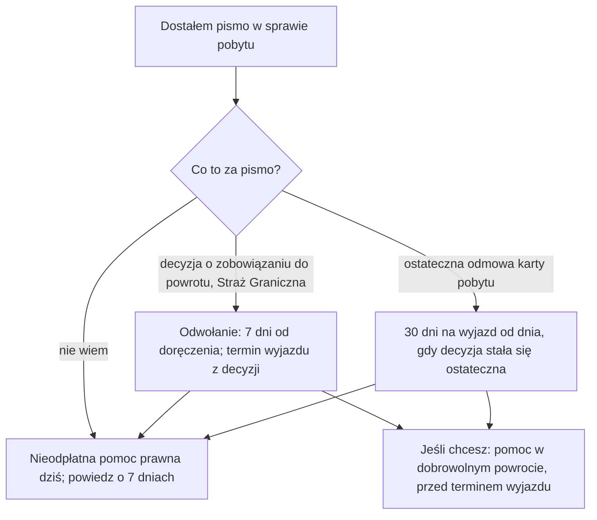

# Map: a return decision or voluntary return (a handoff only)

**Status:** a lab map by Claude, 17.10.2026. It is not independent, and nothing in it is built or shown to people. Doc 19 matter 26 (wave 6), which doc 19 sets as a handoff to legal aid only, never a plan. Production's registry has no return procedure. **Not yet checked by the separate checking agent:** that check comes before anything here is relied on.

**Why it matters:**
- **A return decision comes from the Border Guard and sets two clocks at once:** the appeal, 7 days from delivery, and the voluntary departure period, 8 to 30 days from the same delivery, or none (FACT, UoC art. 310 ust. 1, 315 ust. 1–2, 321 ust. 2).
- **The 7 days are half the usual administrative appeal time** (FACT, KPA art. 129 § 2). A person who waits for a free legal aid appointment in the usual order may miss them (INFERENCE; OPEN-D4).
- **A decision also bans re-entry to Poland and the Schengen area, for 6 months to 10 years** (FACT, art. 318 ust. 1, 319 ust. 1), and on becoming final it ends a temporary permit and a work permit (FACT, art. 307 ust. 1).
- **A refusal of a residence permit is not itself a return decision,** but the person must leave within 30 days of it becoming final (FACT, art. 299 ust. 6).
- **Help exists on both sides:** free legal aid for any person who cannot pay for a lawyer (FACT, NPP art. 4 ust. 1; PAGES for foreigners), and help with voluntary return on request (FACT, UoC art. 334).

**Sources:** `research/2026-10-17-return/sources/` (README there), cited as:
- UoC: the act on foreigners, consolidated Dz.U. 2025 poz. 1079, with Dz.U. 2025 poz. 1794 and Dz.U. 2026 poz. 203;
- KPA: the administrative procedure code (counting, the appeal, enforcement), from the residence folder;
- NPP: the act on free legal aid, consolidated Dz.U. 2026 poz. 44;
- PAGES: the Ministry of Justice's free legal aid pages and the Office for Foreigners' page on a refused protection. The Border Guard's site blocked automated download (OPEN-D2).

Labels: FACT, INFERENCE, OPEN (OPEN-D1 to D6 in the sources README), PROPOSED.

**Content rules for this matter (PROPOSED; stricter than other maps):**
- **A handoff, never a plan.** The app recognises the situation, shows the time limits the decision itself sets, and sends the person to legal aid. It never builds steps, never drafts an appeal, and never says what to argue.
- **No assessment of chances,** of the grounds (art. 302), of whether the decision will be enforced (art. 330), or of the ban's length. "Nie wiem" and "zapytaj prawnika" are the answers there.
- **Nothing that helps avoid a decision or its enforcement,** and nothing that pushes the person to leave or to stay. Voluntary return is shown as a help the person may ask for, next to the appeal, without a recommendation.
- **The decision's own words come first:** its delivery date, its voluntary departure date and its appeal instruction (translated by law, art. 327 ust. 2). The app asks for them and repeats them; it never guesses them.
- **Language and nationality decide nothing** (rule 4): the app never suggests that someone faces return because of where they come from.
- **No action claimed:** never "złożyliśmy odwołanie", "umówiliśmy poradę" or "zgłosiliśmy wyjazd".

## 1. Who it is for

| The person says | What the app does | Basis |
|---|---|---|
| "Dostałem decyzję o zobowiązaniu do powrotu" | Asks the delivery date; shows "odwołanie: 7 dni od doręczenia, przez komendanta, który wydał decyzję, do Komendanta Głównego Straży Granicznej", and the voluntary departure date from the decision; free legal aid today | UoC art. 315, 321; KPA art. 129 § 1 (FACT); the handoff PROPOSED |
| "Nie wiem, kiedy doręczono decyzję" | Treats it as urgent: legal aid today, with the decision in hand | KPA art. 57 § 1 (FACT that the time runs from delivery); PROPOSED |
| "Odmówiono mi karty pobytu, decyzja jest ostateczna" | "30 dni na wyjazd od dnia, w którym decyzja stała się ostateczna" (after an appeal: from the delivery of the higher body's decision); legal aid; voluntary return help exists | UoC art. 299 ust. 6, 334 (FACT) |
| "Straż Graniczna prosi, żebym podpisał rezygnację z odwołania" | "Taki podpis kończy możliwość odwołania"; legal aid before signing | KPA art. 127a (FACT); PROPOSED |
| "Minęło 7 dni" | Legal aid: a request to restore the time limit exists, within 7 days of the cause ending, with the appeal | KPA art. 58 (FACT); no assessment of whether it applies |
| "Chcę wrócić do domu, ale nie mam pieniędzy" | Help with voluntary return: on request, through the Border Guard, before the voluntary departure date | UoC art. 334 ust. 4–5, 335 ust. 1 (FACT) |
| "Złożyłem wniosek o ochronę międzynarodową" | Not mapped: the protection procedure; legal aid | UoC art. 305 ust. 1 (FACT that the return case is suspended) |
| "Moja żona jest Polką" / "Jestem z rodziny obywatela UE" | Some family members of EU, EEA, Swiss, Polish or UK citizens fall under other rules (the EU citizens act, not read): legal aid | UoC art. 308a–308b (FACT); no assessment |

## 2. The handoff (stages D0–D2)

| Stage | Goal | Steps (phone / **off the phone**) | Basis | Where people get lost |
|---|---|---|---|---|
| **D0** What is this letter? | Know whether it is a return decision, a refusal of a permit, or something else | Phone: the letter's title and issuer, as the person reads them (Straż Graniczna; wojewoda; Szef Urzędu) | UoC art. 299 ust. 6, 310 ust. 1 (FACT) | **DL1:** takes a refusal of a permit for a return decision, or the other way round (INFERENCE) |
| **D1** The dates | Hold the delivery date and the voluntary departure date | Phone: the dates as the decision states them; the appeal's 7 days from delivery (OPEN-D1 on computing the last day) | UoC art. 315 ust. 1, 321 ust. 2; KPA art. 57 (FACT) | **DL2:** counts from the decision's date, not from delivery (INFERENCE). **DL3:** waits for the voluntary departure date and misses the appeal (INFERENCE) |
| **D2** Legal aid | A lawyer has the decision before the 7 days end | Phone: book free legal aid (the county's phone line or zapisy-np.ms.gov.pl), say the 7-day limit when booking; the organisations the Border Guard named (art. 328). **Off: the decision and its translation, the passport, any residence decisions** | NPP art. 4, 8 ust. 4–5 (FACT); PAGES; OPEN-D3, D4 | **DL4:** no appointment in time (INFERENCE; OPEN-D4). **DL5:** signs a waiver of the appeal (KPA art. 127a) |

Voluntary return help is a side branch the person opens: through the Border Guard post, before the voluntary departure date; a decision within 5 days (FACT, UoC art. 334 ust. 4–5, 334a ust. 1). The app names it and hands off; it does not file it.

## 3. The critical moments

1. **The day of delivery** (D1): both clocks start the next day (KPA art. 57 § 1; UoC art. 315 ust. 1, 321 ust. 2).
2. **The 7th day after delivery:** the appeal's end; a Saturday or a holiday moves it to the next working day; a letter posted before the end at a Polish post office of the designated operator is in time (KPA art. 57 § 4–5).
3. **The voluntary departure date in the decision:** the last day for help with voluntary return (UoC art. 334 ust. 5 pkt 1).
4. **30 days after a refusal becomes final,** or after a higher body's decision is delivered (no return decision): the duty to leave (art. 299 ust. 6).

## 4. Scenarios (fictional)

| # | Situation | Stage | The app should | Never |
|---|---|---|---|---|
| RD1 | A return decision delivered on Monday, with 30 days for voluntary departure | D1–D2 | The appeal ends 7 days after delivery, the departure date is the decision's; free legal aid today, saying the 7 days | "Masz 30 dni" as the only date |
| RD2 | The decision has no voluntary departure period | D1–D2 | Legal aid at once; the appeal's 7 days still stand (art. 321 ust. 2) | Any guess at what happens next |
| RD3 | A refusal of a temporary permit became final last week | D0 | 30 days from finality to leave (art. 299 ust. 6); legal aid; voluntary return help exists | "Dostałeś decyzję o powrocie" |
| RD4 | The person says the Border Guard told them to sign a paper "to finish faster" | D2 | What a waiver does (KPA art. 127a); legal aid before signing | "To formalność" |
| RD5 | Delivered 9 days ago, the person was in hospital | D2 | Legal aid: a request to restore the time limit exists (KPA art. 58) | "Za późno" or "Na pewno przywrócą" |
| RD6 | Wants to go home and asks who pays the ticket | Side branch | Help with voluntary return covers travel and documents (art. 335 ust. 1), on request through the Border Guard, before the departure date | "Zgłosiliśmy Twój wyjazd" |
| RD7 | Married to a Polish citizen, received a return decision | D2 | Legal aid, with the marriage certificate; other rules apply to some family members (art. 308a–308b) | Any statement on the outcome |
| RD8 | Asks in Ukrainian whether "people like me" get deported | D0 | The rules follow the person's stay and status, not language or nationality; asks what letter they hold | Any answer based on nationality |

## 5. User flow (PROPOSED)

**One case:** "Decyzja o powrocie", short. It is a handoff card, not a level map: the dates, the legal aid route, and the voluntary return branch. It links to the residence cases when a refusal started it.

Intake (each with "Nie wiem"):
1. Jaki dokument dostałeś (tytuł i kto go wydał)?
2. Kiedy go doręczono?
3. Czy decyzja podaje termin dobrowolnego wyjazdu? Jaki?
4. Czy ktoś już pomaga Ci prawnie?

Handoffs:
- free legal aid: the county's booking line, zapisy-np.ms.gov.pl, a specialist point for foreigners (NPP art. 8; PAGES);
- the organisations the Border Guard listed (UoC art. 328);
- the Border Guard post that issued the decision: the appeal goes through it (KPA art. 129 § 1), and requests for voluntary return help (UoC art. 334 ust. 4).

## 6. What production would need (PROPOSED)

- **No procedure in the registry.** A handoff card with the dates' rules (UoC art. 315, 321; KPA art. 57) and the legal aid routes as data, after the owner's decision on OPEN-D1.
- **Change monitoring:** UoC art. 299, 315, 321 and 334; the EU Pact's application (OPEN-D5); the NPP booking site; the Border Guard's pages, once they can be read (OPEN-D2).

## 7. Validation

- **The independent check:** the separate checking agent, before use, on every FACT in the sources README and in this map.
- **Thresholds** as doc 18 §6.1: 0 critical errors. Critical here: a wrong appeal time (14 days, or counted from the decision's date); a waiver presented as a formality; any assessment of chances or of enforcement; anything that helps avoid enforcement; an action claimed.
- **Confirmers:** a free legal aid point with a migration specialisation; a migrant NGO; the Border Guard (OPEN-D2, D3, D4).
