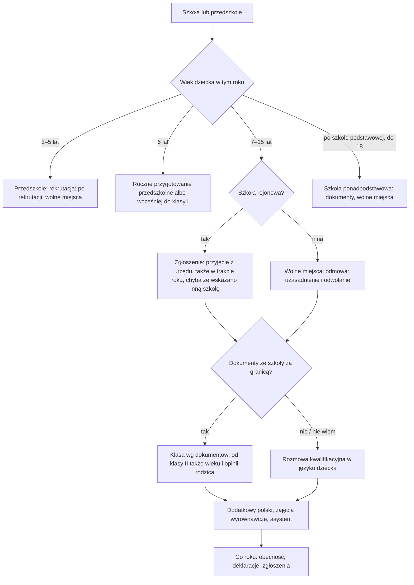

# Map: school and preschool for a child from abroad

**Status:** a lab map by Claude, 17.10.2026. It is not independent, and nothing in it is built or shown to people. Doc 19 matter 16 (wave 5). Production's registry has nothing on schools. **Checked by the separate checking agent on 17.10.2026** (`research/2026-10-17-school/sources/CHECK.md`); the corrections are changed in the lab, not independently verified.

**Why it matters:**
- A child from abroad attends a public preschool and school "na warunkach dotyczących obywateli polskich", whatever the family's residence status (FACT, Prawo oświatowe art. 165 ust. 1–2). Status matters only for adult schools, second-stage vocational and post-secondary schools, art schools, institutions and vocational courses (FACT, art. 165 ust. 3–5).
- The district primary school admits the child by law, during the year too, and places it by its foreign documents (from grade II also its age and the parent's opinion), or by an interview when there are no documents (FACT, art. 130 ust. 2, 5; the regulation § 4, 11, 12). The exception: where admitting pupils who need Polish requires organisational changes, the local government may name another school, and admission by law does not apply (FACT, art. 166 ust. 1–3).
- Preschool and other schools go through recruitment on dates set by the end of January: by the running body for preschools and grade I, by the education superintendent for upper-secondary schools (FACT, art. 154 ust. 1). A late arrival meets places already filled (INFERENCE).
- The special rules for Ukrainian children mostly ended on 31.08.2026, in the special act and in the regulation of 21.03.2022 (FACT, the special act art. 51–57; Dz.U. 2026 poz. 203 art. 49 ust. 2); the Minister's letter of 29.06.2026 says they join the general system. Some remain. One lets a head, by decision, remove from the list a child who does not live in the municipality and has unexcused absence on at least 50 % of the days over two months (FACT, art. 55c).
- For the foreigners of the 800+ act art. 1 ust. 2 pkt 2 lit. c–f, 800+ is paid only while the preschool, school or education duty is confirmed in the education register, with exceptions for the child's age, a deferral or studies (FACT, Dz.U. 2026 poz. 508 art. 1 ust. 2d, 23 ust. 3a; `maps/child-benefit-800.md`).

**Sources:** `research/2026-10-17-school/sources/` (README there), cited as:
- PO: Prawo oświatowe, consolidated Dz.U. 2026 poz. 820;
- REG: the regulation of 23.08.2017 on educating foreigners and Polish citizens schooled abroad, consolidated Dz.U. 2023 poz. 2301, amended by Dz.U. 2026 poz. 1139 (from 12.09.2026);
- UA: the special act on help for Ukrainian citizens, consolidated Dz.U. 2026 poz. 1293;
- SO: the system of education act, consolidated Dz.U. 2025 poz. 881, with art. 44q ust. 1a, 3b as added by Dz.U. 2026 poz. 203 art. 2;
- PAGES: the Ministry of Education (08.01.2025; 18.06.2024), both outdated on some points; the Minister's letter of 29.06.2026 (via the Opole superintendent, 6.07.2026).

Labels: FACT, INFERENCE, HYPOTHESIS, OPEN (OPEN-S1 to S7 in the sources README), PROPOSED.

**Content rules for this matter (PROPOSED):**
- **Never "dziecko nie może iść do szkoły" because of the family's status.** For children the act sets no status condition. The status question appears only for adults, post-secondary schools and vocational courses.
- **No computed recruitment dates.** The running body (the superintendent for upper-secondary schools) sets them by the end of January. The app says so and asks the person to check the municipality's or the school's page, then stores the dates the person enters.
- **The class is the head's decision.** The app explains on what it rests (the documents, the age, the parent's opinion, an interview) and never names a class.
- **"Nie wiem" on documents is normal.** The regulation provides for a child without them.

## 1. Who it is for

By the child's age and what the family says, never by its language.

| The person says | Route | Basis |
|---|---|---|
| "Dziecko ma 3–5 lat" | Preschool: a right, and the municipality must offer a place; by recruitment | PO art. 31 ust. 6–10, 131 (FACT) |
| "Dziecko ma 6 lat" (in the calendar year) | The compulsory preschool year; or grade I early, on conditions | PO art. 31 ust. 4–5, 36 ust. 1–3 (FACT) |
| "Dziecko ma 7–15 lat" | Primary school: the district school admits by law, unless another school is named under art. 166 | PO art. 35 ust. 2, 130 ust. 5, 166; REG § 4–5 (FACT) |
| "Dziecko skończyło szkołę podstawową, ma mniej niż 18 lat" | The education duty: an upper-secondary school, if it has places | PO art. 35 ust. 1, 36 ust. 9; REG § 6 (FACT) |
| "Uczyło się w szkole ukraińskiej online" | The Polish duty applies (INFERENCE); school abroad counts only as art. 36 ust. 10 says, with a notice to the district school by 30 September for the school duty and the preschool year | PO art. 33 ust. 1 pkt 3, 36 ust. 10, 40 ust. 1 pkt 4 (FACT); whether online schooling counts: OPEN-S7 |
| "Mam 18 lat i chcę się uczyć" | Adult or post-secondary schools: free for the listed groups, otherwise a scholarship or a fee; a B1 certificate for post-secondary | PO art. 165 ust. 3–5a (FACT) |
| "Jesteśmy obywatelami polskimi, wróciliśmy z zagranicy" | The same placement rules, and the extra Polish | REG § 2 pkt 2; PO art. 165 ust. 9 (FACT) |

## 2. The journey (stages S0–S6)

| Stage | Goal | Steps (phone / **off the phone**) | Basis | Where people get lost |
|---|---|---|---|---|
| **S0** Which school or preschool | Know the duty and the district school | Phone: the child's age and the address. **Off: the municipality's page or office for the district school** | PO art. 31, 35, 39 ust. 5–5aa (FACT) | **SL1:** thinks a status or a PESEL is needed first (the act asks for neither: INFERENCE). **SL2:** the district school is set by the municipal council's resolution, by locality and, in towns, by street; districts set before 25.04.2026 remain (FACT, art. 39 ust. 5aa; Dz.U. 2026 poz. 504 art. 6) |
| **S1** The papers | Have what helps the placement | **Off: the foreign school certificate or a confirmation of attendance; or a written statement of the years of schooling; the child's passport or PESEL** | REG § 2 pkt 3; PO art. 150 ust. 1 pkt 1, 151 ust. 1 pkt 1 (FACT) | **SL3:** waits for a translation or a recognition: a recognition is required only for second-stage vocational and post-secondary schools (FACT, REG § 6 pkt 3–4); the regulation names no translation (INFERENCE that none is required); MEN 08.01.2025 (PAGES) |
| **S2** Enrolment | The child admitted | **Off: notification to the district school (with a statement of the address); or an application in recruitment, naming at most three public preschools or schools in order of preference, unless the running body allows more; during the year, to the head** | PO art. 130 ust. 2, 5, 133, 149–151, 156 ust. 1–2; REG § 3–4 (FACT) | **SL4:** arrives after the recruitment for preschool: a place depends on free places; the municipality's written duty to name a place covers children reported in the recruitment (FACT, art. 31 ust. 10), so for a later arrival only its general task remains (FACT, art. 31 ust. 8–9). **SL5:** a non-district school says no: the reasons and the appeal (FACT, REG § 13–15) |
| **S3** The class | A class that fits | **Off: the head places the child; an interview if there are no documents, in a foreign language the child speaks if the child does not know Polish** | REG § 4 ust. 2, 11, 12 (FACT) | **SL6:** the parent's opinion counts from grade II, as one element (FACT, § 11) |
| **S4** Help with Polish | Lessons and support started | **Off: ask the school about extra Polish (organised by the running body: at least 2 hours, for at most 24 months), catch-up classes, an assistant, a preparatory class** | PO art. 165 ust. 7–13; REG § 16–19 (FACT) | **SL7:** a page says the extra Polish has no time limit, or 4 hours (PAGES; the act: 24 months, at least 2 hours) |
| **S5** Each school year | Keep the duty met | **Off: regular attendance; a declaration to continue preschool each year; the notice of schooling abroad by 30 September** | PO art. 33 ust. 1, 40 ust. 1, 42, 153 ust. 2 (FACT) | **SL8:** a long trip: 50 % unexcused absence in a month is non-fulfilment, enforced (FACT, art. 42); for a Ukrainian child not living in the municipality, two months can mean removal from the list (FACT, UA art. 55c). **SL9:** 800+ withheld when the register does not confirm the duty (`maps/child-benefit-800.md`) |
| **S6** The end of primary school | Finish it | **Off: positive grades (for a non-citizen, from the classes taken in Poland) and the eighth-grade exam, unless exempt; ask for the accommodations for limited Polish** | SO art. 44q ust. 1, 1a, 3, 3b, 44zw, 44zx, 44zz ust. 2, 44zzr ust. 7, 9 (FACT) | **SL10:** expects to finish without the exam: without an exemption, the pupil repeats the last class (FACT) |

## 3. The critical moments

1. **Arrival in the middle of the year** (SL4): the district school admits by law; preschool depends on free places.
2. **January** (S2): the running body (for upper-secondary schools, the superintendent) publishes the dates, and the running body the criteria, for the next school year.
3. **A refusal** (SL5): 3 days at each step in recruitment; under the regulation 7 days to ask for reasons, 5 for them, 7 to appeal, 7 for the decision; then the administrative court.
4. **A long absence** (SL8): a trip abroad of a month or more.
5. **The child turns 7, or 6** (S0): the school duty, or the preschool year, starts with that calendar year's school year.

## 4. Scenarios (fictional)

| # | Situation | Stage | The app should | Never |
|---|---|---|---|---|
| SS1 | A family arrives in November with a child of 9, no PESEL yet | S2 | The district school admits the child by law during the year; a passport number replaces the PESEL in the notification (PO art. 130 ust. 2, 151 ust. 1 pkt 1; REG § 4 ust. 2 pkt 1) | "Najpierw PESEL" |
| SS2 | Same, with no school documents | S3 | Without documents, an interview decides the class, in a foreign language the child speaks if the child does not know Polish (REG § 12). A parent's written statement of the years of schooling only complements a school document confirming attendance (REG § 2 pkt 3 lit. b) | A class named by the app |
| SS3 | A child of 4, arrival in March | S2 | Preschool by recruitment on dates set by the end of January; arriving after it, a place depends on free places, and during the year the head decides (PO art. 130 ust. 2, 131, 154; REG § 3 ust. 2). The written duty to name a place covers children reported in the recruitment (art. 31 ust. 10); the municipality's general task stays (art. 31 ust. 8–9) | "Na pewno będzie miejsce" |
| SS4 | A child of 6 in the calendar year | S0 | The compulsory preschool year, or grade I early with a year of preschool or a counselling centre's opinion (PO art. 31 ust. 4–5, 36 ust. 1–3) | — |
| SS5 | The parents want another school than the district one | S2 | Possible if it has free places; a refusal can be explained and appealed (REG § 4, 13–15) | — |
| SS6 | The school refuses, says the class is full (non-district school) | S2 | Ask for reasons within 7 days; reasons in 5; appeal to the committee within 7; decided in 7; then the court (REG § 13–15). The district school must admit (§ 4 ust. 2 pkt 1), unless another school is named under PO art. 166 (ust. 3) | A computed deadline date |
| SS7 | The child does not speak Polish | S4 | Extra Polish organised by the running body (at least 2 hours, at most 24 months), catch-up classes (12 months), an assistant speaking the language (12 months), maybe a preparatory class (PO art. 165 ust. 7–13; REG § 16–19) | "Szkoła musi utworzyć oddział przygotowawczy" (it may: art. 165 ust. 11) |
| SS8 | A Ukrainian child who started extra Polish in 2023 | S4 | 24 months by the general rule; the special act gives 36 months to those who "zgodnie z ust. 1" started in 2022/2023 or 2023/2024, and that paragraph has no end date; how it reads after 31.08.2026 is OPEN-S2; the Minister's letter names 24 months | A stated end date |
| SS9 | A child of 16 who finished school abroad | S0 | The education duty to 18: an upper-secondary school on the documents, if it has places (PO art. 35 ust. 1; REG § 6) | — |
| SS10 | A young person of 19 wants a post-secondary school | S0 | Status matters here; a B1 certificate is a condition (PO art. 165 ust. 3, 5, 5a; REG § 6 pkt 4 lit. g) | — |
| SS11 | The family goes abroad for six weeks in spring | S5 | Unexcused absence on at least 50 % of the days in a month is non-fulfilment (PO art. 42); for a Ukrainian child not living in the municipality, such absence over two months can lead to removal by decision (UA art. 55c); the school's rules on excusing absence | "Nic się nie stanie" |
| SS12 | The child attends a Ukrainian online school only | S0 | The Polish duty applies (INFERENCE); school abroad counts under art. 36 ust. 10, with a notice by 30 September (PO art. 36 ust. 10, 40 ust. 1 pkt 4); the 2022 exemption for final Ukrainian classes ended, and whether online schooling counts is OPEN-S7; for 800+, the register decides (`maps/child-benefit-800.md`) | A ruling on the online school |
| SS13 | A pupil of grade VIII from abroad | S6 | Finishing needs the eighth-grade exam unless exempt (SO art. 44q ust. 1, 44zw, 44zx, 44zz ust. 2); for a non-citizen the grades from the classes taken in Poland count (art. 44q ust. 1a); otherwise the last class is repeated (ust. 3b). Adapted conditions and separate sheets for limited Polish, on the teachers' council's opinion (art. 44zzr ust. 7, 9) | — |
| SS14 | A preschool place for a child of 5 is far from home | S2 | For a child reported in the recruitment, the municipality names a place when its preschools are full (PO art. 31 ust. 10–11). For a child of 5, or in the preschool year, beyond 3 km it gives free transport with care, or refunds the child's and the carer's fares if the parents take the child (art. 32 ust. 3, 5); for a child of 3 or 4 the act names no distance | "Gmina nie musi nic zapewnić" |
| SS15 | A Polish citizen child returns from abroad | S3 | The same placement rules and extra Polish for at most 24 months (REG § 2 pkt 2; PO art. 165 ust. 9) | — |
| SS16 | Does not read Polish | All | The forms are the school's or the municipality's; for a child who does not know Polish, the interview is held in a foreign language the child speaks (REG § 12 ust. 4); the app explains in the person's language without translating the law | Machine-translated rules |

## 5. User flow (PROPOSED)

**One case:** "Szkoła lub przedszkole dla dziecka". It links to the address registration case (the address), the PESEL case, and, for families getting 800+, the 800+ case.

### 5.1 Intake (each with "Nie wiem")

| Order | Question | Options | Why |
|---|---|---|---|
| 1 | W którym roku urodziło się dziecko? | the year; Nie wiem | PO art. 31, 35 (the calendar year counts) |
| 2 | Gdzie mieszkacie (gmina, ulica)? | free text; Nie wiem | PO art. 131 ust. 1, 133 ust. 1; the district school |
| 3 | Czy dziecko chodziło do szkoły lub przedszkola za granicą? | tak, mam dokumenty; tak, bez dokumentów; nie; Nie wiem | REG § 2 pkt 3, 12 |
| 4 | Czy dziecko mówi po polsku? | tak; trochę; nie; Nie wiem | PO art. 165 ust. 7 |
| 5 | Do której szkoły chcecie się zapisać? | rejonowa; inna; Nie wiem | REG § 4 |
| 6 | Czy dziecko jest obywatelem Ukrainy i przyjechało z Ukrainy od 24.02.2022 w związku z wojną? | tak; nie; Nie wiem | UA art. 55c; asked because the act names it |

### 5.2 The levels

0 **Która szkoła** → 1 **Dokumenty** → 2 **Zapis** → 3 **Klasa** → 4 **Pomoc w nauce** → 5 **Co roku** → 6 **Koniec szkoły podstawowej**.

### 5.3 Each screen

| Screen | Content |
|---|---|
| **Teraz** | "Zgłoś dziecko do szkoły rejonowej", "Sprawdź terminy rekrutacji", "Zapytaj w szkole o dodatkowy polski". Never "Dziecko przyjęte" before the school says so |
| **Mapa** | Levels 0–6 |
| **Teczka** | The foreign certificate, the statement of the years of schooling, the notification or application, any refusal and its reasons |
| **Kalendarz** | The recruitment dates the person enters from the running body's or the superintendent's notice; the deadlines written on a refusal; 30 September (notice of schooling abroad) |
| **Czat** | The duty, the terms, the help at school, with their articles |

### 5.4 Handoffs

| When | To | Basis |
|---|---|---|
| Which is the district school; preschool places | The municipality | PO art. 31 ust. 10, 39 ust. 5 |
| Enrolment, the class | The head of the school | PO art. 130 ust. 2; REG § 4, 11 |
| Polish lessons, catch-up classes | The school's running body, through the head | PO art. 165 ust. 7, 10; REG § 17 ust. 1, 3 |
| A deferral or an early start | A counselling centre ("poradnia psychologiczno-pedagogiczna") | PO art. 36 ust. 2, 6 |
| A refusal | The appeal committee or the head, then the administrative court | PO art. 158 ust. 8–9; REG § 15 |
| Another school named for language learners | The running local government; the education superintendent only when it cannot name one | PO art. 166 ust. 1–2 |

### 5.5 The flow, drawn

## 6. What production would need (PROPOSED)

- **A guide** in the registry quoting PO art. 165, the regulation as amended by Dz.U. 2026 poz. 1139, and SO art. 44q. Doc 19's wave 5 gate.
- **Local dates as the person's own entries:** the running body or the superintendent sets them each year (PO art. 154 ust. 1).
- **Change monitoring:** Dz.U. 2026 poz. 203 art. 14 (a core curriculum for extra Polish, from 1.09.2027), and Dz.U. 2026 poz. 1123 (preschool from 2.5 years, from 2027 and 2028; preschool staffing, art. 13, from 1.01.2028).

## 7. Validation

- **The independent check, done on 17.10.2026:** the separate checking agent read every FACT in the sources README and in this map against the acts and pages; each provision behind a correction was re-read here (`research/2026-10-17-school/sources/CHECK.md`). It is a second reading by the same kind of tool, not an education lawyer's review.
- **Moderated tasks** (after the gate): SS1 (arrival in November), SS3 (preschool in March), SS6 (a refusal).
- **Thresholds** as doc 18 §6.1: 0 critical errors (a status condition for a child, a named class, a computed date); a correct next action for at least 6 of 8.
- **Confirmers:** a school head; a municipality's education department; an NGO working with migrant families (OPEN-S2, S7).
