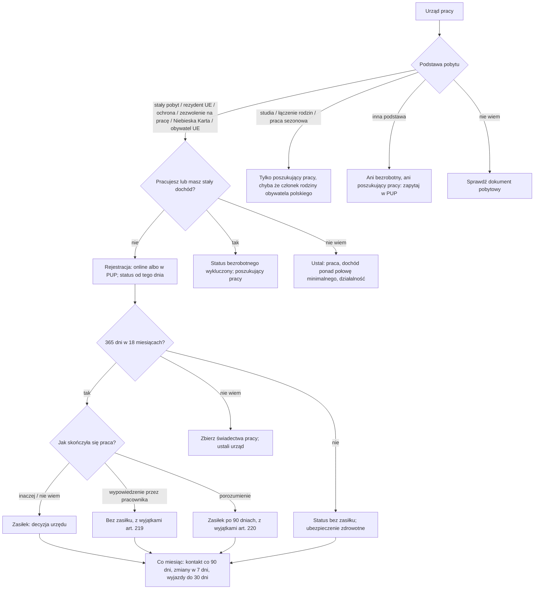

# Map: registering as unemployed, for a foreigner

**Status:** a lab map by Claude, 17.10.2026. It is not independent, and nothing in it is built or shown to people. Doc 19 matter 17 (wave 5). Production's registry has nothing on labour offices. **Checked by the separate checking agent on 17.10.2026** (`research/2026-10-17-unemployment/sources/CHECK.md`); the corrections are changed in the lab, not independently verified.

**Why it matters:**
- Whether a foreigner may register as unemployed depends on the residence title, which the act lists one by one (FACT, the labour market act art. 2 pkt 1 with art. 1 ust. 3). A permit for studies or family reunification, or seasonal work, allows only registering as a job seeker (FACT, art. 2 pkt 1 leaves out lit. m and o; art. 2 pkt 24), unless the person is also a Polish citizen's family member with a temporary permit (FACT, art. 1 ust. 3 pkt 5).
- Registration takes effect on the day of a complete online application or of the visit (FACT, art. 61 ust. 1). The benefit runs from that day, if the 365 days of work in 18 months are there, except after a notice by the worker or for the delays of art. 220 (FACT, art. 218 ust. 1, 219, 220).
- The status is lost by the starosta's decision, for reasons that are easy to miss: no contact for 90 days, a trip abroad not notified or longer than 30 days (FACT, art. 65 ust. 1, 38 ust. 1 pkt 14 lit. b, 229). A change not reported within 7 days is not a removal ground in itself, but a benefit paid after the right ended must be repaid if the person had been told of it (FACT, art. 62, 246 ust. 2 pkt 1).
- It touches other matters. For 800+, the benefit counts as activity, for the foreigners whom the 800+ act asks to be active (FACT, the 800+ act art. 1 ust. 2a–2c, 2 pkt 1a lit. b; `maps/child-benefit-800.md`). For a permit tied to a job, the residence rules on a lost job apply on their own (INFERENCE: the labour market act says nothing on residence; `maps/residence-temporary.md`, FS17).

**Sources:** `research/2026-10-17-unemployment/sources/` (README there), cited as:
- RP: the labour market act of 20.03.2025, Dz.U. 2025 poz. 620, with Dz.U. 2025 poz. 1794 art. 10, 12, 14 and Dz.U. 2026 poz. 507 art. 11;
- MP: M.P. 2026 poz. 268 (the benefit's amounts from 1.06.2026);
- KPA: the administrative procedure code, Dz.U. 2025 poz. 1691, art. 129–130 (the appeal);
- PAGES: the ministry's portal psz.praca.gov.pl (2025–2026); gov.pl (24.01.2020, outdated).

Labels: FACT, INFERENCE, HYPOTHESIS, OPEN (OPEN-U1 to U4 in the sources README), PROPOSED.

**Content rules for this matter (PROPOSED):**
- **The status is asked, never inferred** (rule 4): the residence card's type or the visa's purpose decides, not citizenship or language.
- **Never "dostaniesz zasiłek".** Whether the 365 days are met is the office's finding. The app shows the condition and what the person has told it.
- **The amount is quoted, never computed.** The act's amounts and their date (M.P. 2026 poz. 268); the person's own amount is the office's decision.
- **No advice on residence from this case.** A lost job and a residence permit go to the residence case.

## 1. Who it is for

By the residence title the person states, never by their language.

| The person says | Route | Basis |
|---|---|---|
| "Mam kartę stałego pobytu / rezydenta długoterminowego UE" | May register as unemployed | RP art. 1 ust. 3 pkt 2 lit. e–f, 2 pkt 1 (FACT) |
| "Mam ochronę czasową" | May register as unemployed | Lit. j (FACT). Ask about temporary protection, not the PESEL: Ukrainians staying legally without it exist (Dz.U. 2026 poz. 203 art. 41), and lit. j does not name them; they go by their own title (INFERENCE) |
| "Mam status uchodźcy / ochronę uzupełniającą / pobyt humanitarny / tolerowany" | May register as unemployed | Lit. g–i (FACT) |
| "Złożyłem wniosek o ochronę międzynarodową i mam zaświadczenie" | May register as unemployed | Lit. k (FACT) |
| "Mam zezwolenie na pobyt i pracę" (single permit) or "Niebieską Kartę" or "wizę w celu pracy" | May register as unemployed | Lit. l, n (FACT) |
| "Mam zezwolenie na pobyt w celu studiów / łączenia rodzin / badań" | Job seeker only, unless pkt 5 below applies | Lit. m; art. 2 pkt 24 (FACT) |
| "Jestem w Polsce do pracy sezonowej" (a seasonal work visa, a permit under UoC art. 185a, or visa-free stay with a seasonal work application entered in the register) | Job seeker only | Lit. o; art. 2 pkt 24 (FACT). A seasonal work visa is lit. o, not a "work visa" of lit. n (FACT, lit. o names UoC art. 60 ust. 1 pkt 5a) |
| "Jestem członkiem rodziny obywatela polskiego" | May register as unemployed, on the conditions of pkt 5 or 6 | Art. 1 ust. 3 pkt 5–6 (FACT) |
| "Jestem obywatelem UE" | May register as unemployed | Lit. a (FACT) |
| Another title, not listed in art. 1 ust. 3 (for example a permit under UoC art. 142 or 186 ust. 1 pkt 6) | Neither status; say so and point to the office | Art. 2 pkt 1, 24 start from art. 1 ust. 3 (INFERENCE) |
| "Nie wiem" | Look at the residence document together; no route until the title is known | PROPOSED |

## 2. The journey (stages U0–U6)

| Stage | Goal | Steps (phone / **off the phone**) | Basis | Where people get lost |
|---|---|---|---|---|
| **U0** Can I register | Know the route | Phone: the residence title, work and income now, age | RP art. 1 ust. 3, 2 pkt 1, 24, 42 (FACT) | **UL1:** a student or a family-reunification permit holder expects the unemployed status: job seeker only (FACT). **UL2:** an income above half the minimum wage is a steady income (FACT, art. 2 pkt 42 lit. d) |
| **U1** The papers | Have what the office needs | **Off: the identity document; school certificates; work certificates; for online, scans; the residence document** | RP art. 55 ust. 3, 5–6 (FACT); the residence document: INFERENCE (the act asks for the status, ust. 3 pkt 24, and the documents needed for the rights, ust. 5 pkt 2) | **UL3:** thinks a PESEL or a "meldunek" is required (INFERENCE that neither is) |
| **U2** Registering | Registered from the right day | **Off: online on praca.gov.pl with a qualified, trusted or personal signature; or in person at the PUP of the place of residence** | RP art. 44 ust. 3, 55 ust. 2, 61 ust. 1 (FACT) | **UL4:** waits weeks after the job ends: the benefit runs only from registration (FACT, art. 218 ust. 1). **UL5:** reads the 2020 gov.pl page (outdated); the psz page "Utrata statusu" is also wrong on a suspended business (sources README) |
| **U3** The benefit | Know whether it is due | **Off: the work certificates for 365 days in 18 months** | RP art. 218–220, 224–225; MP (FACT) | **UL6:** quit by notice: no benefit, except for a move or a termination under the Labour Code art. 55 § 1 or § 1¹, and unless the last job is not the basis of the right (FACT, art. 219). **UL7:** ended by agreement: the benefit only after 90 days, with exceptions, and the benefit's period is shorter by those days (FACT, art. 220, 225 ust. 3) |
| **U4** Each month | Keep the status | Phone: the account's messages. **Off: contact at least once in 90 days; changes, income and a job within 7 days; a sick note within 2 and 7 days** | RP art. 45, 62, 65, 67, 231, 232, 239 (FACT) | **UL8:** with an individual account, letters on it count as delivered after 14 days (FACT, art. 45 ust. 1, 3). **UL9:** no contact for 90 days: removal for 90 days (FACT, art. 65 ust. 1 pkt 11) |
| **U5** Travel | Not lose the status | **Off: notify the PUP before a trip; at most 30 days a calendar year** | RP art. 65 ust. 1 pkt 10, 229 (FACT) | **UL10:** a visit home of five weeks: removal for 90 days (FACT) |
| **U6** A removal or a refusal | Appeal | **Off: an appeal to the voivode against the starosta's decision, filed through the starosta within 14 days of delivery; with an individual account, through the account. In a decision on periods abroad, the marshal decides and the minister for social security hears the appeal. The removal applies at once** | RP art. 31, 34 ust. 2, 35 ust. 1, 38 ust. 2, 44 ust. 1; KPA art. 129 § 1–2 (FACT) | **UL11:** expects the appeal to stop the removal (FACT that it does not, art. 38 ust. 2; KPA art. 130 § 3 pkt 2) |

## 3. The critical moments

1. **The day after the job ends** (UL4): registration starts the status and the benefit.
2. **A lost job on a work-tied permit:** the residence rules have their own time limits (`maps/residence-temporary.md`, FS17).
3. **Every 90 days** (UL9): a contact with the office.
4. **A trip abroad** (UL10): notify first; at most 30 days a year.
5. **A new job** (U4): notify within 7 days.

## 4. Scenarios (fictional)

| # | Situation | Stage | The app should | Never |
|---|---|---|---|---|
| US1 | A single-permit holder lost the job yesterday | U0 | May register as unemployed (lit. n); register now, as the benefit runs from that day (art. 61, 218); for the permit, the residence case (FS17) | "Status bezrobotnego chroni zezwolenie" |
| US2 | A student on a study permit finished a part-time job | U0 | Job seeker only (lit. m; art. 2 pkt 24); the forms of help, without the education loan and the training stipend (art. 72 ust. 1 pkt 2) | "Zarejestruj się jako bezrobotny" |
| US3 | Has temporary protection, worked 14 months on a contract of employment at the minimum wage | U3 | May register (lit. j); the 365-day condition is the office's finding on the documents (art. 218 ust. 1) | "Dostaniesz 1783,90 zł"; inferring protection from a PESEL UKR |
| US4 | Quit by notice to look for a better job | U3 | Registration is possible; the benefit is not due after a notice by the worker, except for a move or a termination under the Labour Code art. 55 § 1 or § 1¹, and unless the last job is not the basis of the right (art. 219) | A computed amount |
| US5 | The contract ended by agreement | U3 | The benefit after 90 days, unless the agreement was for a move, bankruptcy, liquidation or redundancy (art. 220 ust. 1 pkt 5, ust. 2 pkt 3); the benefit's period is shorter by those days (art. 225 ust. 3) | — |
| US6 | Wants to go home for a month at Christmas | U5 | Notify the PUP first; at most 30 days in the calendar year; no benefit for those days (art. 229); longer or not notified: removal for 90 days (art. 65 ust. 1 pkt 10) | "Nikt nie sprawdzi" |
| US7 | Has no PESEL | U1 | The application takes the date and place of birth and an identity document (art. 55 ust. 3 pkt 3); whether the online form works without one is OPEN-U1 | "Najpierw PESEL" |
| US8 | Works 10 hours a week for cash | U0 | Doing paid work excludes the status (art. 2 pkt 1); the work map for legal work | Help hiding it |
| US9 | Got a letter on the praca.gov.pl account 10 days ago | U4 | It counts as delivered when opened or after 14 days (art. 45 ust. 3); read it and act within its own time limit | A computed date |
| US10 | Removed for no contact | U6 | An appeal to the voivode, through the starosta within 14 days, through the account if there is one (art. 31, 44 ust. 1; KPA art. 129); the removal applies at once (art. 38 ust. 2); registering again after the 90 days (art. 65 ust. 1 pkt 11) | — |
| US11 | Has a family-reunification permit, wife of a worker | U0 | Job seeker only (lit. m) | — |
| US12 | A Polish citizen's husband, temporary permit | U0 | May register as unemployed (art. 1 ust. 3 pkt 5) | — |
| US13 | Fell ill during unemployment | U4 | Notify within 2 days of the sick note, deliver it within 7, or later with the starosta's consent (art. 239 ust. 2–3); 180 days of illness end the status (art. 65 ust. 1 pkt 7), but not for a pregnancy-related illness, unless the woman asks (art. 66 ust. 1) | — |
| US14 | Gets 800+ and lost the job | U3 | The unemployment benefit counts as activity for 800+; without it, 3 or 6 months once a period; only for the foreigners whom the 800+ act asks to be active (`maps/child-benefit-800.md`; the 800+ act art. 1 ust. 2a–2c) | — |
| US15 | Worked in Germany before Poland | U3 | Periods abroad in the EU may count by the coordination rules: the starosta decides on the Polish periods, the voivodeship labour office checks the periods abroad, and the marshal of the voivodeship decides (art. 222 ust. 1–3, 35 ust. 1; OPEN-U2); an appeal against the marshal goes to the minister for social security (art. 34 ust. 2) | A statement that they count |
| US17 | Registered before 1.06.2025 and still registered | U4 | The 3 years count from 1.06.2025 (art. 433 ust. 7); a benefit granted under the old act keeps its amount and period (art. 436 ust. 1) | — |
| US16 | Does not read Polish | All | The forms and letters are the office's; the app explains in the person's language without translating the law | Machine-translated rules |

## 5. User flow (PROPOSED)

**One case:** "Rejestracja w urzędzie pracy". It links to the residence case (a lost job on a permit), the work map (legal work), the 800+ case, and the e-government case (the trusted profile).

### 5.1 Intake (each with "Nie wiem")

| Order | Question | Options | Why |
|---|---|---|---|
| 1 | Na jakiej podstawie jesteś w Polsce? | the titles of §1; Nie wiem | RP art. 1 ust. 3 |
| 2 | Czy teraz pracujesz lub masz inny dochód? | nie; tak; Nie wiem | Art. 2 pkt 1, 42 |
| 3 | Kiedy skończyła się ostatnia praca i jak (wypowiedzenie, porozumienie, koniec umowy)? | the date; the way; Nie wiem | Art. 218–220 |
| 4 | Ile dni pracy lub innych okresów (na przykład zasiłku chorobowego) masz w ostatnich 18 miesiącach? Czy część była za granicą? | a number of days; abroad: tak / nie; Nie wiem | Art. 218 ust. 1–2 counts 365 days and other periods; periods abroad may count (art. 35, 222) |
| 5 | Czy masz profil zaufany lub e-dowód? | tak; nie; Nie wiem | Art. 44 ust. 3 |

### 5.2 The levels

0 **Czy mogę się zarejestrować** → 1 **Dokumenty** → 2 **Rejestracja** → 3 **Zasiłek** → 4 **Co miesiąc** → 5 **Wyjazdy** → 6 **Odwołanie**.

### 5.3 Each screen

| Screen | Content |
|---|---|
| **Teraz** | "Zarejestruj się w PUP", "Odezwij się do urzędu (co 90 dni)", "Zgłoś zmianę (7 dni)". Never "Zasiłek przyznany" before the decision |
| **Mapa** | Levels 0–6 |
| **Teczka** | The registration confirmation, work certificates, each decision |
| **Kalendarz** | The registration date; the last contact and the 90-day mark; trips; the time limits written in letters |
| **Czat** | The route by title, the conditions of the benefit, with their articles |

### 5.4 Handoffs

| When | To | Basis |
|---|---|---|
| Registering, the benefit, a form of help | The PUP of the place of residence | RP art. 55 ust. 2 |
| A decision to appeal | The voivode, through the starosta (through the account, if there is one) | RP art. 31, 44 ust. 1; KPA art. 129 § 1–2 |
| A lost job on a work-tied permit | The residence case; the voivode | `maps/residence-temporary.md` |
| Periods of work in another EU state | The PUP first; then the voivodeship labour office and the marshal of the voivodeship; an appeal to the minister for social security | RP art. 222, 35 ust. 1, 34 ust. 2 |

### 5.5 The flow, drawn

## 6. What production would need (PROPOSED)

- **A guide** in the registry quoting RP art. 1 ust. 3 and 2 pkt 1 by title, with the yearly amounts from Monitor Polski. Doc 19's wave 5 gate.
- **Change monitoring:** the act has no consolidated text yet; it changed in 2025 and 2026 (Dz.U. 2025 poz. 1746, 1794; 2026 poz. 451, 507, 734), and Dz.U. 2026 poz. 1123 art. 26 changes it from 1.01.2028 (art. 153–156, 172, 182, 292, none quoted here). Its amounts change every 1 June, unless prices did not rise (art. 228 ust. 1).

## 7. Validation

- **The independent check, done on 17.10.2026:** the separate checking agent read every FACT in the sources README and in this map against the acts and pages; each provision behind a correction was re-read here (`research/2026-10-17-unemployment/sources/CHECK.md`). It is a second reading by the same kind of tool, not a labour lawyer's review.
- **Moderated tasks** (after the gate): US1 (a lost job on a single permit), US2 (a student), US6 (a trip home).
- **Thresholds** as doc 18 §6.1: 0 critical errors (a wrong route for a title, a promised benefit, a computed amount or date); a correct next action for at least 6 of 8.
- **Confirmers:** a PUP; an NGO advising migrant workers (OPEN-U1, U4).
