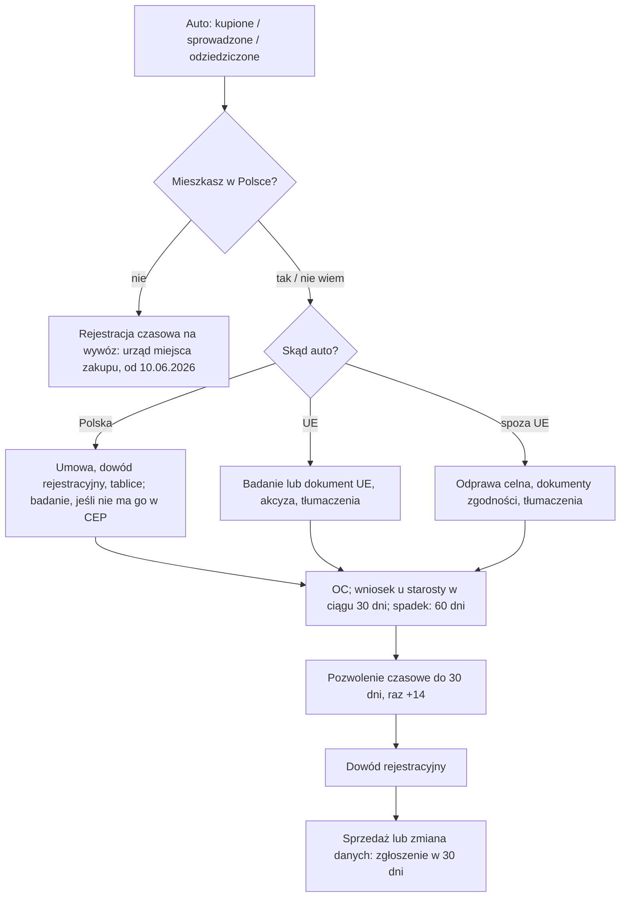

# Map: a vehicle and the driving licence: registering, plates, a sale, a foreign licence

**Status:** a lab map by Claude, 17.10.2026. It is not independent, and nothing in it is built or shown to people. Doc 19 matter 15 (wave 4). Production's registry has nothing on it. At the owner's request, every FACT is being checked against the official texts by a separate checking agent; **until its result is recorded in §7, treat every FACT here as unchecked.**

**Why it matters:** the deadlines are short and the penalties fixed.
- 30 days to register a vehicle; 500 zł if late, 1 000 zł after 180 days.
- 30 days to report a sale; 250 zł if late.
- A licence from outside the EU is valid for 6 months from the start of the stay.
- Both procedures ask for a place of residence, and in practice an address registration. That is wave 1 again.

**Sources:** `research/2026-10-17-vehicles/sources/` (README there), cited as:
- PRD: the road traffic act, Dz.U. 2024 poz. 1251, with Dz.U. 2025 poz. 1734 by its dates;
- AVD: the act on vehicle drivers, Dz.U. 2025 poz. 1226, with Dz.U. 2025 poz. 1676 by its dates;
- FEES: the fee regulations Dz.U. 2025 poz. 553 and 953;
- LDR: the licence documents regulation, Dz.U. 2025 poz. 1073;
- GOV: the gov.pl pages (registration 07.04.2025, sale 14.01.2026, certificate 19.01.2022, licence 10.08.2023).

Labels: FACT, INFERENCE, HYPOTHESIS, OPEN (OPEN-V1 to V10 in the sources README), PROPOSED.

**Content rules for this matter (PROPOSED):**
- **Fees listed, never added up.** The offices add a records fee (OPEN-V3), so a total would be wrong.
- **No computed dates** for the 30-day and six-month periods until their start is settled: for the six months the start itself is OPEN-V5; for the 30 days the counting is as in the PESEL case, to be confirmed. The rule is quoted; the person enters the date.
- **No advice on buying a car,** on insurers, or on excise amounts. The app explains the office's steps.
- **Stale official pages are named as such.** The registration page's COVID note about 60 days is not repeated (FACT: the act says 30 days).

## 1. Who it is for

| The person says | Route | Basis |
|---|---|---|
| "Kupiłem auto w Polsce" | Register it within 30 days at the starosta of one's residence; the plates may be kept with a statement | PRD art. 73 ust. 1, 1a, 73aa (FACT) |
| "Sprowadzam auto z UE" | 30 days from bringing it; the inspection, the excise document, translations | PRD art. 72, 73aa (FACT); excise steps OPEN-V2 |
| "Sprowadzam auto spoza UE" | 30 days from the customs release; the customs clearance | PRD art. 72 ust. 1 pkt 6, 73aa (FACT) |
| "Sprzedałem auto" | Notify within 30 days; the buyer registers | PRD art. 78 ust. 2 pkt 1 (FACT) |
| "Przeprowadziłem się" | Notify within 30 days if the certificate's data change; whether a new registration is needed is OPEN-V6 | PRD art. 78 ust. 2 pkt 2 (FACT) |
| "Odziedziczyłem auto" | 60 days from the ruling or deed | PRD art. 73aa ust. 2 (FACT) |
| "Nie mieszkam w Polsce, kupiłem tu auto" | A temporary registration to take it abroad, at the office of the purchase | PRD art. 74 ust. 1b (FACT, from 10.06.2026) |
| "Mam prawo jazdy z UE" | Valid; no exchange needed (GOV); an expired one can be exchanged | AVD art. 4, 14 ust. 2a (FACT); no time limit (INFERENCE) |
| "Mam prawo jazdy spoza UE" | Valid for 6 months from the start of stay if it is a convention licence; then exchange it | AVD art. 5 ust. 4, 14 (FACT) |
| "Mam międzynarodowe prawo jazdy" | Not exchangeable (GOV); it goes with the national licence | AVD art. 5 ust. 3; GOV |
| "Moje prawo jazdy nie jest z konwencji" | Not valid for driving in Poland (INFERENCE: not in art. 4); an exchange with the theory exam and a translation | AVD art. 4, 14 ust. 1 |
| "Chcę jeździć na taksówce / w przewozie osób" | Not covered (OPEN-V7) | Says so |

## 2. The journeys

### 2.1 A vehicle (stages V0–V5)

| Stage | Goal | Steps (phone / **off the phone**) | Basis | Where people get lost (HYPOTHESIS unless marked) |
|---|---|---|---|---|
| **V0** Before | Know the route and the clock | Phone: which case (bought here, from the EU, from outside), the 30 days, the residence question | PRD art. 73 ust. 1, 73aa | **VL1:** no place of residence or address registration, so the office is unclear (INFERENCE; OPEN-V1) |
| **V1** Documents | A complete set | **Off: the contract or invoice; the old registration certificate and plates; the inspection; for imports, the conformity documents, the customs clearance or the excise document; sworn translations; OC insurance (GOV)** | PRD art. 72; GOV | **VL2:** the excise step for an EU car missed (OPEN-V2). **VL3:** translations missing; the EU certificate needs none for its codes (FACT, GOV) |
| **V2** The application | Filed within 30 days | **Off: the starosta (city office; in Warsaw the district office), in person, by post, or the office's e-box; from 18.01.2027 online** | PRD art. 73, 73aa; GOV | **VL4:** day 31; 500 zł (FACT). **VL5:** the stale "60 dni" note on GOV (FACT, the page) |
| **V3** Temporary registration | Drive legally meanwhile | **Off: the temporary permit and plates, for up to 30 days; once +14 days** | PRD art. 74 ust. 2–3 | **VL6:** the 30 days end before the certificate; go back for the 14 days (FACT, GOV) |
| **V4** The certificate | Pick it up | **Off: the decision and the certificate** | PRD art. 74 ust. 2f | — |
| **V5** Later | No penalties later | Phone: the sale and data rules. **Off: notify a sale or a change within 30 days** | PRD art. 78 ust. 2 | **VL7:** the seller does not report the sale; 250 zł (FACT). **VL8:** a move, and no notice (FACT, the duty) |

### 2.2 The licence (stages L0–L4)

| Stage | Goal | Steps | Basis | Where people get lost |
|---|---|---|---|---|
| **L0** Can I drive? | Know whether the licence is valid here, and until when | Phone: three questions (issued where; is it a convention licence; when the stay began) | AVD art. 4, 5 ust. 4 | **LL1:** a non-convention licence used as if valid (INFERENCE). **LL2:** the six months pass unnoticed (HYPOTHESIS, high harm: driving without a valid licence) |
| **L1** The documents | A complete set | **Off: the application, a photograph, the passport and the residence document, the address registration (GOV), a copy of the licence with a sworn translation (none for the EU model), the fee 100 zł** | LDR § 14 ust. 1 pkt 5; FEES; GOV | **LL3:** no address registration; GOV: "zapytaj w urzędzie gminy" (FACT, the page) |
| **L2** The application | Filed at the starosta of residence | **Off: in person or by post** (GOV) | AVD art. 14; GOV | **LL4:** the residence condition (185 days and the statement from 3.09.2026) not met (FACT, AVD art. 11 ust. 1 pkt 5, 1a) |
| **L3** Confirmation and exam | The data confirmed; the theory exam if required | **Off: the office asks the issuing state or its embassy (weeks, GOV); the person may bring the embassy's confirmation; the theory exam at the WORD if the licence is not on the 1968 model** | LDR § 14 ust. 8–10; AVD art. 14 ust. 1 | **LL5:** weeks of waiting, possibly past the six months (INFERENCE). **LL6:** data that cannot be confirmed: no exchange (FACT, art. 14 ust. 2e) |
| **L4** Pickup | The Polish licence | **Off: hand in the foreign licence; up to 9 working days after the confirmation and the fee (GOV)** | AVD art. 14 ust. 1; GOV | **LL7:** a refusal: appeal to the SKO within 14 days (GOV) |

## 3. The critical moments

1. **The day a car is bought or brought in** (VL1, VL4): the 30 days start.
2. **The day a car is sold** (VL7): the seller's notice, not the buyer's.
3. **The first months of a stay with a non-EU licence** (LL2, LL5): the six months, and the confirmation that can take weeks.
4. **No address registration** (VL1, LL3): both procedures stall. The PESEL and registration case comes first.

## 4. Scenarios (fictional)

| # | Situation | Stage | The app should | Never |
|---|---|---|---|---|
| VS1 | Bought a used car from a private seller in Poland yesterday | V0–V2 | 30 days, the starosta of residence, the documents, keeping the plates with the statement, OC first (GOV) | A computed last day; "Masz 60 dni" |
| VS2 | Bringing a car from Germany | V1 | The inspection or the EU certificate showing it; the excise document (the steps: OPEN-V2); translations, not of the EU codes | An excise amount |
| VS3 | Bringing a car from Ukraine | V1 | The customs clearance, the conformity or approval documents, the foreign registration document, translations; 30 days from the customs release | "Najpierw zarejestruj, potem odprawa" |
| VS4 | Day 40, not registered | V2 | The rule and the penalty (500 zł; 1 000 zł after 180 days), plainly; register now; the penalty is the starosta's decision | "Nic się nie stanie" |
| VS5 | Registered, the temporary permit ends tomorrow, no certificate yet | V3 | Ask the office for the one 14-day extension (PRD art. 74 ust. 3) | — |
| VS6 | Sold a car, the buyer has not registered it | V5 | The seller's 30-day notice, online or at the office; what the buyer does is the buyer's duty | "Kupujący to zgłosi" |
| VS7 | Moved from Kraków to Warsaw | V5 | The 30-day notice of changed data; whether a new registration is needed is OPEN-V6; ask the office | A certain answer |
| VS8 | Lives in Poland on a visa, no address registration, wants to register a car | V0 | Residence is the condition; what the office accepts is OPEN-V1; the address-registration case | "Bez meldunku nie zarejestrujesz" |
| VS9 | A tourist who bought a car to drive home | V0 | A temporary registration for export at the office of the purchase (from 10.06.2026) | A full registration |
| VS10 | Inherited a car | V0 | 60 days from the ruling or the deed | 30 days |
| VS11 | "Ile to kosztuje?" | V2 | The items from the fee regulation, each with its amount; offices add a records fee | A total |
| VS12 | Ukrainian licence, arrived 3 months ago | L0 | If it is a 1968-convention licence, valid for 6 months from the start of stay (when that is: OPEN-V5); start the exchange now, as confirmation takes weeks | "Masz jeszcze 3 miesiące" as a date |
| VS13 | A licence from a state outside both conventions | L0 | Not on the list of valid licences (AVD art. 4; INFERENCE: not valid here); the exchange needs the theory exam and a translation | "Możesz jeździć 6 miesięcy" |
| VS14 | German licence, living here for years | L0 | Valid; no exchange needed (GOV) | "Musisz wymienić" |
| VS15 | Only an international licence | L0 | It goes with the national licence; it cannot be exchanged (GOV) | — |
| VS16 | Exchange started, waiting 5 weeks for the confirmation | L3 | The office asks the issuing state or embassy; the person may bring the embassy's confirmation (LDR § 14 ust. 9–10) | A promised date |
| VS17 | Lives in Poland 4 months a year | L2 | The licence needs residence, mainly 185 days a year (AVD art. 11 ust. 1 pkt 5); ask the office | A yes |
| VS18 | Exchange refused | L4 | A decision; appeal to the SKO within 14 days (GOV) | — |
| VS19 | Wants to drive for a ride-hailing app | L0 | Not covered (OPEN-V7); ask the office or a lawyer | A rule |
| VS20 | Does not read Polish | All | GOV pages are Polish; translations of documents are the person's (sworn translator); an NGO | Machine-translated rules |

## 5. User flow (PROPOSED)

**Two cases:** "Samochód: rejestracja i sprzedaż" and "Prawo jazdy z zagranicy". Each links to the address-registration and PESEL cases when residence is unclear.

### 5.1 Intake

**Vehicle case** (each with "Nie wiem"):

| Order | Question | Options | Why |
|---|---|---|---|
| 1 | Co chcesz zrobić? | Zarejestrować auto; Zgłosić sprzedaż; Zgłosić zmianę danych (np. adresu); Wywieźć auto za granicę | The route |
| 2 | Skąd jest auto? | Kupione w Polsce; Sprowadzone z UE; Sprowadzone spoza UE; Odziedziczone | The documents, the clock |
| 3 | Kiedy je kupiłeś(-aś), sprowadziłeś(-aś) albo odprawiłeś(-aś)? | a date; Nie wiem | The 30 days (quoted, not computed) |
| 4 | Czy mieszkasz w Polsce i masz meldunek? | Tak, z meldunkiem; Mieszkam, bez meldunku; Nie mieszkam w Polsce; Nie wiem | The office; OPEN-V1 |
| 5 | Czy auto ma ważne OC? | Tak; Nie; Nie wiem | GOV's first step |

**Licence case:**

| Order | Question | Options | Why |
|---|---|---|---|
| 1 | Gdzie wydano Twoje prawo jazdy? | W UE, EOG lub Szwajcarii; Poza UE; Nie wiem | AVD art. 4 |
| 2 | (outside the EU) Czy to prawo jazdy według konwencji wiedeńskiej lub genewskiej? | Tak; Nie; Nie wiem (the app shows how to check, from the document itself: PROPOSED, once sourced) | AVD art. 4 ust. 1 pkt 2, 14 ust. 1 |
| 3 | Kiedy zaczął się Twój pobyt w Polsce? | a date; Nie wiem | Art. 5 ust. 4 (OPEN-V5) |
| 4 | Ile dni w roku mieszkasz w Polsce? | 185 lub więcej; Mniej; Nie wiem | AVD art. 11 ust. 1 pkt 5 |
| 5 | Czy masz meldunek? | Tak; Nie; Nie wiem | GOV's list; OPEN-V1 |

### 5.2 The levels

**Vehicle:** 0 **Twoja droga** (reading) → 1 **Dokumenty** (by origin; translations; OC) → 2 **Wniosek w ciągu 30 dni** (the office; the rule and the penalty, quoted) → 3 **Pozwolenie czasowe** (30 days, +14) → 4 **Dowód rejestracyjny** → 5 **Później: sprzedaż i zmiany** (30 days each).

**Licence:** 0 **Czy możesz jeździć** (reading: valid or not, and the six-month rule quoted) → 1 **Dokumenty do wymiany** → 2 **Wniosek** → 3 **Potwierdzenie i egzamin** (waiting, with "it can take weeks") → 4 **Odbiór**.

### 5.3 Each screen

| Screen | Vehicle | Licence |
|---|---|---|
| **Teraz** | The current level's next step. Primary: "Wydział komunikacji: adres" or "Zgłoś zbycie przez internet" (a link). Never "Zarejestruję za Ciebie" | The validity answer first; then the documents; "Starostwo: adres" |
| **Mapa** | Levels 0–5 | Levels 0–4 |
| **Teczka** | What the person keeps: the contract, the old certificate, the inspection, the customs or excise document, the translations, the temporary permit | The application copy, the translation, the embassy confirmation |
| **Kalendarz** | The purchase or import date the person enters, with "30 dni" beside it; the temporary permit's end as stated on the permit | The start of stay the person enters, with "6 miesięcy" beside it; no computed date (OPEN-V5) |
| **Czat** | Documents, fees (listed), penalties; "Nie wiem" for excise | Validity, exchange, exam |

### 5.4 Handoffs

| When | To | Basis |
|---|---|---|
| Registration, a sale, changed data, the licence | The starosta: the city office, or in Warsaw the district office | PRD art. 73; GOV |
| Excise, customs | The tax office; the customs office (OPEN-V2) | PRD art. 72 ust. 1 pkt 6, 6a |
| The theory exam | The WORD (regional exam centre) | GOV |
| The licence's data | The issuing state's embassy | LDR § 14 ust. 8–10 |
| A refusal | The SKO, within 14 days | GOV |

### 5.5 The vehicle flow, drawn

## 6. What production would need (PROPOSED)

- **Two guides** in the registry (vehicle registration and notices; the foreign licence), quoting PRD, AVD and the regulations. Doc 19's wave 4 gate: the owner opens a new registry domain, and the starosta offices as institutions.
- **Deadlines** `register` (30 days, 60 for an inheritance) and `sale_notice` (30 days), and a validity window for the licence (six months from a start date the person states), each with its counting settled first.
- **A link** to the address-registration case when residence is unclear (OPEN-V1).
- **Change monitoring:** PRD changed twice in 2025 and changes again on 18.01.2027. The two source tools run before each use.

## 7. Validation

- **The independent check (the owner's request, 17.10.2026): in progress.** A separate agent (`.claude/agents/official-fact-checker.md`) re-reads every FACT in the sources README and in this map against the official texts it downloads itself. Its findings and what changes will be recorded in `research/2026-10-17-vehicles/sources/CHECK.md`. It is a second reading by the same kind of tool, not an expert's review.
- **Moderated tasks** (after doc 19's wave 4 gate): VS1 (what to bring and by when), VS6 (who reports a sale), VS12 (until when the licence is valid, and what to do now).
- **Thresholds** as doc 18 §6.1, for 8 people: 0 critical errors (a computed date, a summed fee, "60 dni", or a licence called valid when it is not); a correct next action for at least 6 of 8; at most 1 person confident and wrong.
- **Confirmers:** a starosta's vehicle and licence department (OPEN-V1, V3, V6, V8, V9); a customs or tax office (OPEN-V2); a migrant NGO for VL1 and LL3.
