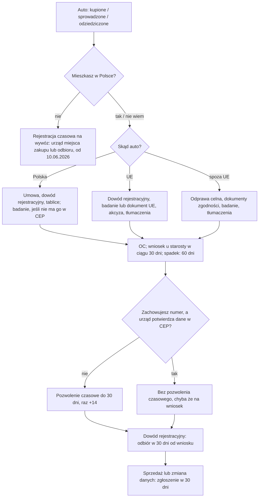

# Map: a vehicle and the driving licence: registering, plates, a sale, a foreign licence

**Status:** a lab map by Claude, 17.10.2026. It is not independent, and nothing in it is built or shown to people. Doc 19 matter 15 (wave 4). Production's registry has nothing on it. At the owner's request, every FACT was checked on 17.10.2026 against the official texts by a separate checking agent; its verdicts and the corrections made here are in `research/2026-10-17-vehicles/sources/CHECK.md` (summary in §7). The corrections were changed in the lab; not independently verified. No expert has reviewed this map.

**Why it matters:** the deadlines are short and the penalties are set amounts.
- 30 days to register a vehicle; 500 zł if late, 1 000 zł after 180 days. The office cannot waive them with a warning.
- 30 days to report a sale; 250 zł if late.
- A convention licence from outside the EU, EEA and Switzerland lets its holder drive a motor vehicle for 6 months from the start of the stay.
- Both procedures turn on a place of residence. Offices may ask for an address registration (INFERENCE; OPEN-V1). That is wave 1 again.

**Sources:** `research/2026-10-17-vehicles/sources/` (README there), cited as:
- PRD: the road traffic act, Dz.U. 2024 poz. 1251, with Dz.U. 2025 poz. 1734 by its dates;
- AVD: the act on vehicle drivers, Dz.U. 2025 poz. 1226, with Dz.U. 2025 poz. 1676 by its dates;
- FEES: the fee regulations Dz.U. 2025 poz. 553 and 953;
- LDR: the licence documents regulation, Dz.U. 2025 poz. 1073, with Dz.U. 2026 poz. 1162;
- RR: the vehicle registration regulation, Dz.U. 2024 poz. 1709, with Dz.U. 2026 poz. 891;
- KPA: the Code of Administrative Procedure, Dz.U. 2025 poz. 1691, art. 189d–189f;
- GOV: the gov.pl pages (registration 07.04.2025, sale 14.01.2026, certificate 19.01.2022, licence 10.08.2023).

Labels: FACT, INFERENCE, HYPOTHESIS, OPEN (OPEN-V1 to V12 in the sources README), PROPOSED.

**Content rules for this matter (PROPOSED):**
- **Fees listed, never added up.** The offices add a records fee (OPEN-V3), so a total would be wrong.
- **No computed dates** for the 30-day and six-month periods until their start is settled: for the six months the start itself is OPEN-V5; for the 30 days the counting is as in the PESEL case, to be confirmed. The rule is quoted; the person enters the date.
- **No advice on buying a car,** on insurers, or on excise amounts. The app explains the office's steps.
- **Stale official pages are named as such.** The registration page's COVID note about 60 days is not repeated. FACT: the act says 30 days, and the COVID extension ended when the epidemic threat was lifted on 1.07.2023 (COVID act art. 31ia; Dz.U. 2023 poz. 1118 § 1).

## 1. Who it is for

| The person says | Route | Basis |
|---|---|---|
| "Kupiłem auto w Polsce" | Register it within 30 days at the starosta of one's residence; the number and plates may be kept with a statement. No duty if the car is sold on before the 30 days end | PRD art. 73 ust. 1, 1a, 73aa ust. 1, 7 (FACT) |
| "Sprowadzam auto z UE" | 30 days from bringing it; the previous registration certificate, the inspection or the EU document showing it, the conformity document where required, the excise document, translations | PRD art. 72 ust. 1, 73aa (FACT); excise steps OPEN-V2 |
| "Sprowadzam auto spoza UE" | 30 days from the customs release; the customs clearance (it may be filed after the temporary registration, before the certificate) | PRD art. 72 ust. 1 pkt 6, 73aa, 74 ust. 2a (FACT) |
| "Sprzedałem auto" | Notify within 30 days; the buyer registers | PRD art. 78 ust. 2 pkt 1 (FACT) |
| "Przeprowadziłem się" | Notify within 30 days if the certificate's data change; whether a new registration is needed is OPEN-V6 | PRD art. 78 ust. 2 pkt 2 (FACT) |
| "Odziedziczyłem auto" | 60 days from the final ruling or the deed | PRD art. 73aa ust. 2 (FACT) |
| "Nie mieszkam w Polsce, kupiłem tu auto" | A temporary registration to take it abroad, at the office of the place of purchase or pickup | PRD art. 74 ust. 1b (FACT, from 10.06.2026) |
| "Mam prawo jazdy z UE" | Valid while the licence is valid, unless it was retained or the rights withdrawn in an EU, EEA or Swiss state; no exchange needed (GOV); an expired one can be exchanged by a resident | AVD art. 4 ust. 3, 5 ust. 6, 14 ust. 2a (FACT) |
| "Mam prawo jazdy spoza UE" | If it is a 1949 international licence or a 1968 national or international licence: valid for a motor vehicle (not a moped) for 6 months from the start of stay; then exchange it. A treaty licence: as the treaty says | AVD art. 5 ust. 4, 5a, 14 (FACT) |
| "Mam międzynarodowe prawo jazdy" | Not exchangeable (GOV). Whether a foreign one is valid only with the national licence is OPEN-V12 | GOV; AVD art. 4 ust. 1 pkt 2 lit. a, b |
| "Moje prawo jazdy nie jest z konwencji" | Not on the list of valid licences (INFERENCE: not in art. 4, unless a treaty covers it); an exchange with the theory exam and a translation (FACT) | AVD art. 4, 14 ust. 1 |
| "Mam status uchodźcy / ochronę uzupełniającą / pobyt humanitarny lub tolerowany" | Exchange without the confirmation of the licence's data | LDR § 14 ust. 12 pkt 1 (FACT) |
| "Chcę jeździć na taksówce / w przewozie osób" | Not covered (OPEN-V7) | Says so |

## 2. The journeys

### 2.1 A vehicle (stages V0–V5)

| Stage | Goal | Steps (phone / **off the phone**) | Basis | Where people get lost (HYPOTHESIS unless marked) |
|---|---|---|---|---|
| **V0** Before | Know the route and the clock | Phone: which case (bought here, from the EU, from outside), the 30 days, the residence question | PRD art. 73 ust. 1, 73aa | **VL1:** no place of residence or address registration, so the office is unclear (INFERENCE; OPEN-V1) |
| **V1** Documents | A complete set | **Off: the contract or invoice; the old registration certificate and plates; the inspection; for imports, the conformity documents, the customs clearance or the excise document; sworn translations; OC insurance (GOV)** | PRD art. 72; RR § 5; GOV | **VL2:** the excise step for an EU car missed (OPEN-V2). **VL3:** translations missing; the EU certificate needs none for its codes (FACT, RR § 5 ust. 2) |
| **V2** The application | Filed within 30 days | **Off: the starosta (city office; in Warsaw the district office), in person, by post, or electronically through the office's e-Doręczenia address (since 4.07.2026); from 18.01.2027 online** | PRD art. 73, 73aa; RR § 20, 23; GOV | **VL4:** day 31; 500 zł (FACT). **VL5:** the stale "60 dni" note on GOV (FACT, the page) |
| **V3** Temporary registration | Drive legally meanwhile | **Off: usually the temporary permit and plates, for up to 30 days; once +14 days. Not when the number is kept and the office can annotate the old certificate: then a permit only on request** | PRD art. 74 ust. 2–3, 2d, 2g; RR § 18 ust. 3 | **VL6:** the 30 days end before the certificate; go back for the 14 days (FACT, GOV) |
| **V4** The certificate | Pick it up | **Off: the decision and the certificate, within 30 days of filing** | PRD art. 74 ust. 2f | — |
| **V5** Later | No penalties later | Phone: the sale and data rules. **Off: notify a sale or a change within 30 days** | PRD art. 78 ust. 2 | **VL7:** the seller does not report the sale; 250 zł (FACT). **VL8:** a move, and no notice (FACT, the duty) |

### 2.2 The licence (stages L0–L4)

| Stage | Goal | Steps | Basis | Where people get lost |
|---|---|---|---|---|
| **L0** Can I drive? | Know whether the licence is valid here, and until when | Phone: four questions (issued where; national or international; on the 1968 model or not; when the stay began) | AVD art. 4, 5 ust. 4, 6 | **LL1:** a non-convention licence used as if valid (INFERENCE). **LL2:** the six months pass unnoticed (HYPOTHESIS, high harm: driving without a valid licence) |
| **L1** The documents | A complete set | **Off: the application, a photograph, a copy of the licence with a sworn translation (none for the EU model), the fee 100 zł; the statement of residence; for a foreigner, a copy of the residence card, visa or other right-of-stay document, or a certificate of at least six months of study. GOV also lists an address registration** | LDR § 14 ust. 1 pkt 5, ust. 4; FEES; GOV | **LL3:** the office follows GOV's list and asks for an address registration the person lacks (HYPOTHESIS; the regulation names right-of-stay documents: FACT) |
| **L2** The application | Filed at the starosta of residence | **Off: in person or by post** (GOV) | AVD art. 14; GOV | **LL4:** the residence condition (mainly 185 days a year) not met; since 3.09.2026 it must be met, and declared, by the day of pickup or mailing (FACT, AVD art. 11 ust. 1 pkt 5, 1a) |
| **L3** Confirmation and exam | The data confirmed; the theory exam if required | **Off: the office asks the issuing state or its embassy, or uses that state's portal (weeks, GOV); the person may bring the embassy's confirmation; none is needed in the cases of LDR § 14 ust. 12; the theory exam at the WORD if the licence is not on the 1968 model** | LDR § 14 ust. 8–12; AVD art. 14 ust. 1 | **LL5:** weeks of waiting, possibly past the six months (INFERENCE). **LL6:** data that cannot be confirmed: no exchange (FACT, art. 14 ust. 2e) |
| **L4** Pickup | The Polish licence | **Off: hand in the foreign licence; up to 9 working days after the confirmation and the fee (GOV). A category B licence from an exchange may start a probation period (from 3.03.2026)** | AVD art. 14 ust. 1, 91 ust. 3 pkt 3; GOV | **LL7:** a refusal: appeal to the SKO within 14 days (GOV) |

## 3. The critical moments

1. **The day a car is bought or brought in** (VL1, VL4): the 30 days start.
2. **The day a car is sold** (VL7): the seller's notice, not the buyer's.
3. **The first months of a stay with a non-EU licence** (LL2, LL5): the six months, and the confirmation that can take weeks.
4. **No address registration** (VL1, LL3): both procedures may stall. The PESEL and registration case comes first.

## 4. Scenarios (fictional)

| # | Situation | Stage | The app should | Never |
|---|---|---|---|---|
| VS1 | Bought a used car from a private seller in Poland yesterday | V0–V2 | 30 days, the starosta of residence, the documents, keeping the number and plates with the statement, OC first (GOV) | A computed last day; "Masz 60 dni" |
| VS2 | Bringing a car from Germany | V1 | The previous registration certificate; the inspection or the EU certificate showing it; the conformity document where required; the excise document (the steps: OPEN-V2); translations, not of the EU codes | An excise amount |
| VS3 | Bringing a car from Ukraine | V1 | The customs clearance (it may follow the temporary registration, but comes before the certificate), the conformity or approval documents, the foreign registration document, a Polish inspection certificate (the act names only EU documents as an alternative), translations; 30 days from the customs release | "Dokument celny nie jest potrzebny" |
| VS4 | Day 40, not registered | V2 | The rule and the penalty (500 zł; 1 000 zł after 180 days), plainly; register now; the penalty is the starosta's decision, and the office cannot waive it with a warning (PRD art. 140n ust. 6) | "Nic się nie stanie"; "Urząd na pewno odstąpi od kary" |
| VS5 | Registered, the temporary permit ends tomorrow, no certificate yet | V3 | Ask the office for the one 14-day extension (PRD art. 74 ust. 3) | — |
| VS6 | Sold a car, the buyer has not registered it | V5 | The seller's 30-day notice, online or at the office; what the buyer does is the buyer's duty | "Kupujący to zgłosi" |
| VS7 | Moved from Kraków to Warsaw | V5 | The 30-day notice of changed data; whether a new registration is needed is OPEN-V6; ask the office | A certain answer |
| VS8 | Lives in Poland on a visa, no address registration, wants to register a car | V0 | The act names the office of residence (INFERENCE: residence is needed); what the office accepts is OPEN-V1; the address-registration case | "Bez meldunku nie zarejestrujesz" |
| VS9 | A tourist who bought a car to drive home | V0 | A temporary registration for export at the office of the place of purchase or pickup (from 10.06.2026) | A full registration |
| VS10 | Inherited a car | V0 | 60 days from the final ruling or the deed | 30 days |
| VS11 | "Ile to kosztuje?" | V2 | The items from the fee regulation, each with its amount; offices add a records fee | A total |
| VS12 | Ukrainian licence, arrived 3 months ago | L0 | If it is a 1968-convention licence, valid for a motor vehicle for 6 months from the start of stay (when that is: OPEN-V5); start the exchange now, as confirmation takes weeks. No confirmation is needed with refugee status, asylum, subsidiary protection, a humanitarian or tolerated stay (temporary protection is not among them), or for a licence from a state with an armed conflict on its territory when the driver shows past or present work as a driver for a road transport firm in Poland (which states count: OPEN-V11) | "Masz jeszcze 3 miesiące" as a date; "Z ochroną czasową nie potrzebujesz potwierdzenia" |
| VS13 | A licence from a state outside both conventions | L0 | Not on the list of valid licences (AVD art. 4; INFERENCE: not valid here, unless a treaty covers it); the exchange needs the theory exam and a translation | "Możesz jeździć 6 miesięcy" |
| VS14 | German licence, living here for years | L0 | Valid while it is valid (AVD art. 5 ust. 6), unless retained or withdrawn in an EU, EEA or Swiss state (art. 4 ust. 3); no exchange needed (GOV) | "Musisz wymienić" |
| VS15 | Only an international licence | L0 | It cannot be exchanged (GOV); whether it is valid without the national licence is OPEN-V12; bring both | "Wystarczy samo międzynarodowe" |
| VS16 | Exchange started, waiting 5 weeks for the confirmation | L3 | The office asks the issuing state or embassy; the person may bring the embassy's confirmation (LDR § 14 ust. 8–10) | A promised date |
| VS17 | Lives in Poland 4 months a year | L2 | The licence needs residence, mainly 185 days a year (AVD art. 11 ust. 1 pkt 5); ask the office | A yes |
| VS18 | Exchange refused | L4 | A decision; appeal to the SKO within 14 days (GOV) | — |
| VS19 | Wants to drive for a ride-hailing app | L0 | Not covered (OPEN-V7); ask the office or a lawyer | A rule |
| VS20 | Does not read Polish | All | GOV pages are Polish; translations of documents are the person's (sworn translator); an NGO | Machine-translated rules |
| VS21 | Has subsidiary protection; exchanging a licence from outside the EU | L3 | No confirmation of the licence's data is needed (LDR § 14 ust. 12 pkt 1); the other exchange rules apply | "Czekaj na potwierdzenie z ambasady" |

## 5. User flow (PROPOSED)

**Two cases:** "Samochód: rejestracja i sprzedaż" and "Prawo jazdy z zagranicy". Each links to the address-registration and PESEL cases when residence is unclear.

### 5.1 Intake

**Vehicle case** (each with "Nie wiem"):

| Order | Question | Options | Why |
|---|---|---|---|
| 1 | Co chcesz zrobić? | Zarejestrować auto; Zgłosić sprzedaż; Zgłosić zmianę danych (np. adresu); Wywieźć auto za granicę | The route |
| 2 | Skąd jest auto? | Kupione w Polsce; Sprowadzone z UE; Sprowadzone spoza UE; Odziedziczone | The documents, the clock |
| 3 | Kiedy je kupiłeś(-aś), sprowadziłeś(-aś) albo odprawiłeś(-aś)? | a date; Nie wiem | The 30 days (quoted, not computed) |
| 4 | Czy mieszkasz w Polsce i masz meldunek? | Tak, z meldunkiem; Mieszkam, bez meldunku; Nie mieszkam w Polsce; Nie wiem | The office; OPEN-V1 |
| 5 | Czy auto ma ważne OC? | Tak; Nie; Nie wiem | GOV's first step |

**Licence case:**

| Order | Question | Options | Why |
|---|---|---|---|
| 1 | Gdzie wydano Twoje prawo jazdy? | W UE, EOG lub Szwajcarii; Poza UE; Nie wiem | AVD art. 4 |
| 2 | (outside the EU) Jaki to dokument? | Krajowe prawo jazdy; Międzynarodowe prawo jazdy; Nie wiem | AVD art. 4 ust. 1 pkt 2 lit. a, b |
| 3 | (a national licence) Czy jest wydane według wzoru konwencji wiedeńskiej z 1968 r.? | Tak; Nie; Nie wiem (the app shows how to check, from the document itself: PROPOSED, once sourced) | AVD art. 4 ust. 1 pkt 2 lit. b, 14 ust. 1 |
| 4 | Kiedy zaczął się Twój pobyt w Polsce? | a date; Nie wiem | Art. 5 ust. 4 (OPEN-V5) |
| 5 | Ile dni w roku mieszkasz w Polsce? | 185 lub więcej; Mniej; Nie wiem | AVD art. 11 ust. 1 pkt 5 |
| 6 | Jaki masz dokument pobytowy? | Kartę pobytu; Wizę; Inny dokument prawa pobytu; Zaświadczenie o studiach; Nie wiem | LDR § 14 ust. 4 |
| 7 | Czy masz w Polsce status uchodźcy, azyl, ochronę uzupełniającą albo zgodę na pobyt humanitarny lub tolerowany? | Tak; Nie; Nie wiem | LDR § 14 ust. 12 pkt 1 |
| 8 | Czy masz meldunek? | Tak; Nie; Nie wiem | GOV's list; OPEN-V1 |

### 5.2 The levels

**Vehicle:** 0 **Twoja droga** (reading) → 1 **Dokumenty** (by origin; translations; OC) → 2 **Wniosek w ciągu 30 dni** (the office; the rule and the penalty, quoted) → 3 **Pozwolenie czasowe** (usually; 30 days, +14) → 4 **Dowód rejestracyjny** (within 30 days of filing) → 5 **Później: sprzedaż i zmiany** (30 days each).

**Licence:** 0 **Czy możesz jeździć** (reading: valid or not, and the six-month rule quoted) → 1 **Dokumenty do wymiany** → 2 **Wniosek** → 3 **Potwierdzenie i egzamin** (waiting, with "it can take weeks", or no confirmation in the § 14 ust. 12 cases) → 4 **Odbiór**.

### 5.3 Each screen

| Screen | Vehicle | Licence |
|---|---|---|
| **Teraz** | The current level's next step. Primary: "Wydział komunikacji: adres" or "Zgłoś zbycie przez internet" (a link). Never "Zarejestruję za Ciebie" | The validity answer first; then the documents; "Starostwo: adres" |
| **Mapa** | Levels 0–5 | Levels 0–4 |
| **Teczka** | What the person keeps: the contract, the old certificate, the inspection, the customs or excise document, the translations, the temporary permit | The application copy, the translation, the residence document copy, the embassy confirmation |
| **Kalendarz** | The purchase or import date the person enters, with "30 dni" beside it; the temporary permit's end as stated on the permit | The start of stay the person enters, with "6 miesięcy" beside it; no computed date (OPEN-V5) |
| **Czat** | Documents, fees (listed), penalties; "Nie wiem" for excise | Validity, exchange, exam |

### 5.4 Handoffs

| When | To | Basis |
|---|---|---|
| Registration, a sale, changed data, the licence | The starosta: the city office, or in Warsaw the district office | PRD art. 73; GOV |
| An electronic registration application (since 4.07.2026) | The office's e-Doręczenia address | RR § 20 |
| Excise, customs | The tax office; the customs office (OPEN-V2) | PRD art. 72 ust. 1 pkt 6, 6a |
| The theory exam | The WORD (regional exam centre) | GOV |
| The licence's data | The issuing state's embassy | LDR § 14 ust. 8–10 |
| A refusal | The SKO, within 14 days | GOV |

### 5.5 The vehicle flow, drawn

## 6. What production would need (PROPOSED)

- **Two guides** in the registry (vehicle registration and notices; the foreign licence), quoting PRD, AVD and the regulations. Doc 19's wave 4 gate: the owner opens a new registry domain, and the starosta offices as institutions.
- **Deadlines** `register` (30 days, 60 for an inheritance) and `sale_notice` (30 days), and a validity window for the licence (six months from a start date the person states), each with its counting settled first.
- **A link** to the address-registration case when residence is unclear (OPEN-V1).
- **Change monitoring:** PRD was amended in 2025 by Dz.U. poz. 820, 1006, 1676, 1734, 1843 and 1872, and in 2026 by poz. 180, 875 and 1073 (FACT, `tools/sources/amendments.mjs`). Parts still to come: 18.01.2027 (1734, online registration); the API gives 1.01.2027 for 875 and 11.05.2027 for 2026/1073, which touch no article cited here. LDR's exchange code changes on 1.01.2027 (1162 § 1 pkt 5). The source tools run before each use.

## 7. Validation

- **The independent check (the owner's request, 17.10.2026): done once; corrections applied.** A separate agent (`.claude/agents/official-fact-checker.md`) re-read every FACT in the sources README and in this map against the official texts it downloaded itself. Of the 31 claims in the sources README (25 rows and 6 differences), 25 were confirmed (10 of them with something to add or cite), 5 partly true (a missing condition, exception or date) and 1 partly true and outdated; of the 6 extract headers, 5 were confirmed and 1 wrong (the licence documents regulation). Of the 31 map rows or row groups, 16 were confirmed, 11 partly true, 1 partly true or wrong (the licence intake question on the conventions), 1 wrong (the change-monitoring line), 1 outdated (the LDR source line) and 1 an inference without its label. The lab re-read the texts behind each correction before making it; details in `research/2026-10-17-vehicles/sources/CHECK.md`. It is a second reading by the same kind of tool, not an expert's review.
- **Moderated tasks** (after doc 19's wave 4 gate): VS1 (what to bring and by when), VS6 (who reports a sale), VS12 (until when the licence is valid, and what to do now).
- **Thresholds** as doc 18 §6.1, for 8 people: 0 critical errors (a computed date, a summed fee, "60 dni", or a licence called valid when it is not); a correct next action for at least 6 of 8; at most 1 person confident and wrong.
- **Confirmers:** a starosta's vehicle and licence department (OPEN-V1, V3, V6, V8, V9, V11); a customs or tax office (OPEN-V2); a migrant NGO for VL1 and LL3.
