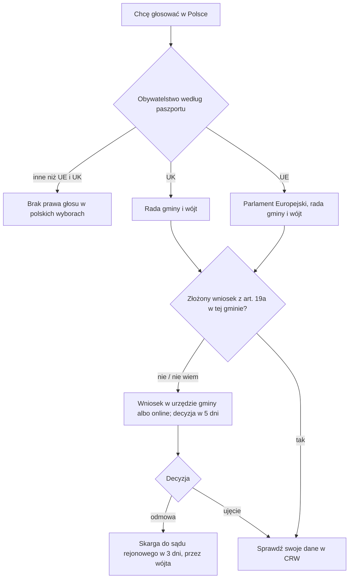

# Map: EU citizens in the register of voters

**Status:** a lab map by Claude, 17.10.2026. It is not independent, and nothing in it is built or shown to people. Doc 19 matter 25 (wave 6). Production's registry has no voter procedure. **Not yet checked by the separate checking agent:** that check comes before anything here is relied on.

**Why it matters:**
- **An EU citizen living in Poland may vote in the European Parliament elections and for the gmina council and wójt;** a UK citizen in the local ones only (FACT, Code art. 10 § 1).
- **It is not automatic:** EU and UK citizens get into the register only on their own application to the gmina office (FACT, Code art. 19a § 1), unlike Polish citizens, who are entered by their registered address (FACT, art. 19 § 2).
- **The decision takes up to 5 days,** and the list for an election follows the register as it stands on the 3rd day before (FACT, Code art. 20 § 1, 26 § 9). A late application can miss an election (INFERENCE).
- **Free, online or at the office;** without a PESEL the application still works and the gmina asks for one (FACT, Code art. 19a § 4–5; UEL art. 17 ust. 1 pkt 2a).

**Sources:** `research/2026-10-17-voters/sources/` (README there), cited as Code (the Electoral Code, consolidated Dz.U. 2026 poz. 1261), 497 (Dz.U. 2023 poz. 497), UEL (the act on population records) and PAGES (gov.pl).

Labels: FACT, INFERENCE, OPEN (OPEN-V1 to V4 in the sources README), PROPOSED.

**Content rules for this matter (PROPOSED):**
- **Citizenship is the rule itself here** (Code art. 10), so the app asks for it, by the passport; it never infers it from language or name (rule 4).
- **No political content:** the app names the elections and the steps, never parties, candidates or advice on how to vote.
- **No action claimed:** never "jesteś wpisany do rejestru"; the person checks it themselves (Code art. 36).

## 1. Who it is for

| The person says | Route | Basis |
|---|---|---|
| "Jestem obywatelem Hiszpanii, mieszkam w Polsce na stałe" | May vote for the European Parliament and the gmina council and wójt, after an application to the gmina | Code art. 10 § 1 pkt 2, 3 lit. a, 4; 19a (FACT) |
| "Jestem obywatelem Wielkiej Brytanii" | The gmina council and wójt only, after an application | Code art. 10 § 1 pkt 3 lit. a, 4; 19a (FACT) |
| "Jestem z Ukrainy z kartą stałego pobytu" | No vote in Polish elections | Code art. 10 (FACT) |
| "Jestem żoną obywatela Francji, sama mam obywatelstwo Indii" | No vote: the right follows the person's own citizenship | Code art. 10 (INFERENCE that family membership does not count) |
| "Chcę kandydować do rady gminy" | A voter for the council may stand, unless banned at home | Code art. 11 § 1 pkt 5, § 3 (FACT); nomination rules not mapped |
| "Przeprowadziłem się do innej gminy" | A new application there | Code art. 18a § 3 pkt 7, 19a § 1 (INFERENCE) |
| "Byłem dopisany dawno temu, nie mam PESEL" | A new art. 19a application | 497 art. 14 (FACT) |

## 2. The journey (stages V0–V3)

| Stage | Goal | Steps (phone / **off the phone**) | Basis | Where people get lost |
|---|---|---|---|---|
| **V0** May I vote? | Know which elections | Phone: citizenship by passport; permanent residence in the gmina | Code art. 10 (FACT); PAGES | **VL1:** thinks a residence card gives a vote (FACT that it does not) |
| **V1** The application | Entered in part B | Phone: online with a trusted profile or a qualified signature (the page also asks for an e-Doręczenia address). **Off: the form at the gmina office, with the passport** | Code art. 19a § 2–5 (FACT); PAGES; OPEN-V2 | **VL2:** assumes the residence registration did it (FACT, art. 19a § 1 asks for an application) |
| **V2** The decision | Entered, or a complaint | Phone: the decision within 5 days (12 with a discrepancy); a refusal: the complaint to the district court within 3 days, through the wójt | Code art. 19a § 9, 20 (FACT) | **VL3:** misses the 3 days (FACT) |
| **V3** Before an election | On the list | Phone: check online, or ask the wójt by the 5th day before; at the polling station, an identity document | Code art. 26 § 9, 36, 52 § 1 (FACT) | **VL4:** applies days before the election (INFERENCE from art. 20 and 26 § 9) |

## 3. The critical moments

1. **The 3rd day before an election** (V3): the list follows the register as it stands then (FACT, art. 26 § 9).
2. **The 5th day before an election:** the last day to ask the wójt for one's data (FACT, art. 36 § 6).
3. **3 days after a refusal** (V2): the complaint to the court (FACT, art. 20 § 4).

## 4. Scenarios (fictional)

| # | Situation | Stage | The app should | Never |
|---|---|---|---|---|
| VS1 | An Italian citizen, registered for permanent stay in Kraków for 3 years, never applied | V0–V1 | Not yet on the list; an art. 19a application to the Kraków office; 5 days | "Jesteś wpisany automatycznie" |
| VS2 | A UK citizen asks about the European Parliament elections | V0 | No: local elections only (art. 10 § 1) | — |
| VS3 | A Czech citizen without a PESEL | V1 | Paper application with the passport and the extra data; the gmina then asks for a PESEL (art. 19a § 4; UEL art. 17 ust. 1 pkt 2a) | "Najpierw zdobądź PESEL" as a condition |
| VS4 | Refused because the office doubts the address | V2 | The complaint to the district court within 3 days, through the wójt (art. 20 § 4) | Legal advice beyond the steps |
| VS5 | Moved from Gdańsk to Sopot | V1 | A new application in Sopot (INFERENCE) | — |
| VS6 | A Ukrainian citizen with permanent residence asks to vote for the wójt | V0 | No vote (art. 10) | Any suggestion that a permit gives one |

## 5. User flow (PROPOSED)

**One case:** "Głosowanie w Polsce (obywatel UE)", short, with a reminder before each election the person can vote in, once the dates are known (OPEN-V4).

Intake (each with "Nie wiem"): citizenship by passport (EU, UK, other); the gmina of permanent residence; whether the person already applied, and when; PESEL and a trusted profile.

Handoffs: the gmina office (the application, a complaint); the district court (a refusal); the e-government map (PESEL, trusted profile).

## 6. What production would need (PROPOSED)

- **A small procedure in the registry:** art. 19a's application, the 5-day decision, the complaint, with the elections each citizenship opens.
- **Change monitoring:** election orders (dates); the Code's amendments to art. 10, 19a, 20 and 26; the gov.pl service page.

## 7. Validation

- **The independent check:** the separate checking agent, before use, on every FACT in the sources README and in this map.
- **Thresholds** as doc 18 §6.1: 0 critical errors (a vote promised to someone who has none; "entered automatically"; political content; an action claimed).
- **Confirmers:** a gmina office's voter register desk (OPEN-V2, V3).
