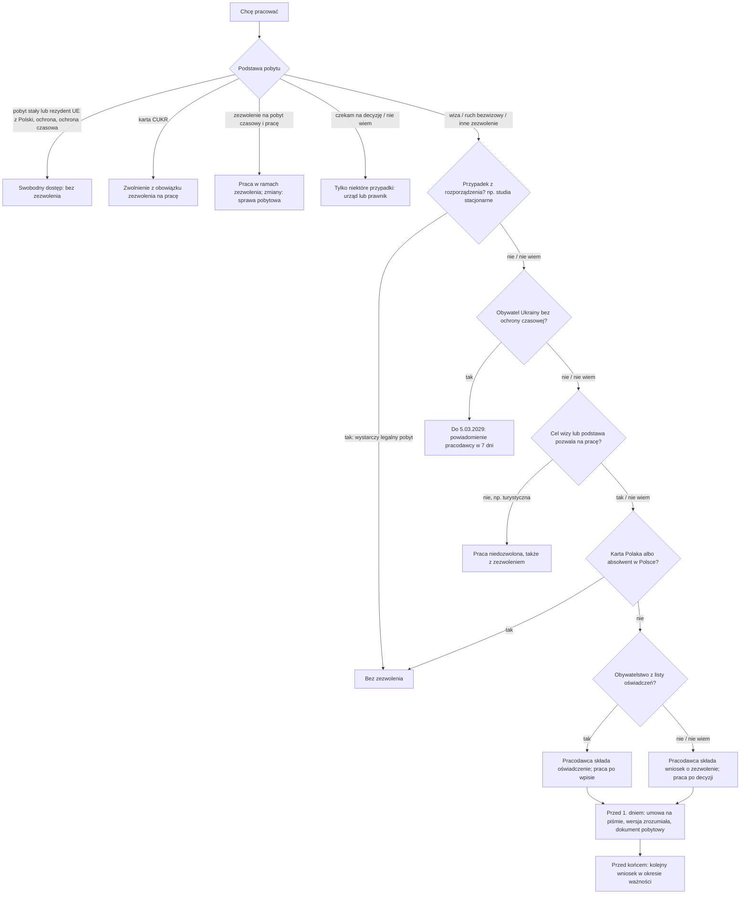

# Map: work: may I work here, on what basis, and what my employer must do

**Status:** a lab map by Claude, 17.10.2026. It is not independent, and nothing in it is built or shown to people. Doc 19 matter 9 (wave 5). Production's registry has nothing on it. Every FACT was checked against the official texts by the separate checking agent (`.claude/agents/official-fact-checker.md`) on 17.10.2026, at the owner's request; the corrections are in §7 and `research/2026-10-17-work/sources/CHECK.md`. They are changed in the lab; not independently verified.

**Why it matters:**
- Work on a permit or a declaration needs two things at once: a stay that allows work, and the permit or declaration (INFERENCE from the work act art. 2 pkt 3 and art. 3 ust. 3). The regulation's cases need only a legal stay (FACT, art. 3 ust. 6), and so do Ukrainian citizens for now (FACT, Dz.U. 2026 poz. 203 art. 41).
- The person cannot apply for a work permit or a declaration: the employer does, and is the only party (FACT, WA art. 8, 12, 61, 67). What the person can do is check what the employer must hand over and do.
- Working illegally costs the person a fine of at least 1 000 zł (FACT, WA art. 84 ust. 2; at most 5 000 zł, INFERENCE from the Petty Offences Code art. 24 § 1 and 48); working without the required permit or declaration leads to a return decision (FACT, FA art. 302 ust. 1 pkt 4: "wydaje się"). Coming to work on a permit or declaration and not working can count against a later one (FACT, art. 13 ust. 1 pkt 10, 65 ust. 1 pkt 3).
- Demanding money from a foreigner for arranging a permit is an offence of the one who demands it (FACT, art. 84 ust. 4).

**Sources:** `research/2026-10-17-work/sources/` (README there), cited as:
- WA: the act on entrusting work to foreigners, Dz.U. 2025 poz. 621, with its four amendments by their dates and the transitional rules of Dz.U. 2026 poz. 203 art. 40–41 and 2025 poz. 1794 art. 12, 14;
- REG: the regulations 2025/1617 (declaration states), 2025/1620 (work without a permit), 2025/1622 (fees), 2026/1072 (visa-free stays), 2026/1086 (the visa requirement for work entries);
- FA: the foreigners act, art. 60 (visa purposes), 116 and 302; PA: the protection act, art. 34, 35 and 116; SA: the special act, art. 42v (the CUKR card); the Petty Offences Code art. 24 and 48; the act of 15.06.2012 art. 4 (unpaid wages);
- PAGES: biznes.gov.pl (the declaration; the changes of 1.06.2025), one voivode's permit page, the PIP's advice pages, zielonalinia.gov.pl (the rule for Ukrainian citizens).

Labels: FACT, INFERENCE, HYPOTHESIS, OPEN (OPEN-W1 to W9 in the sources README; W10 closed), PROPOSED.

**Content rules for this matter (PROPOSED):**
- **Never "możesz pracować" from one answer.** The app names both conditions and what it knows of each; "Nie wiem" on either leads to a check, not a verdict.
- **Citizenship is asked, never inferred.** The declaration route, the visa-free rules and the Ukrainian transitional rule depend on citizenship by law (REG 2025/1617, 2026/1072, 2026/1086; 2026/203 art. 41). The app asks for it only where the route depends on it, and never takes it from the interface language or the person's name (CLAUDE.md rule 4).
- **No wage amounts.** The act refers to the minimum wage, which is not collected (OPEN-W6). Fees are named as the employer's, with their amounts, never as the person's cost.
- **No judgement of an employer or a dispute.** The app lists the employer's duties and hands off to the PIP or a lawyer.
- **No computed dates.** The 7-day and 2-month notices are the employer's; the person's own periods (24 months, 9 months) are quoted, not counted.

## 1. Who it is for

By what the person says about their status, never by their language.

| The person says | Route | Basis |
|---|---|---|
| "Mam kartę pobytu stałego" / "rezydenta długoterminowego UE" | Free access; no permit, if the permit was granted in Poland. Another Schengen state's card: a permit or declaration | WA art. 3 ust. 1 pkt 6–7, ust. 3 pkt 5 (FACT) |
| "Mam status uchodźcy / ochronę uzupełniającą / zgodę na pobyt humanitarny lub tolerowany" | Free access, if granted in Poland | WA art. 3 ust. 1 pkt 8–11 (FACT) |
| "Mam ochronę czasową (PESEL UKR)" | Free access; the employer notifies the county labour office within 7 days of the start | WA art. 3 ust. 1 pkt 12, art. 5a (FACT, from 5.03.2026); a notice under the special act before then: 2026/203 art. 40 |
| "Jestem obywatelem Ukrainy, nie mam ochrony czasowej" | While staying legally: free access with the employer's 7-day notice, for 3 years from 5.03.2026 (the official page: "do 5 marca 2029 r."); a declaration or a permit is also possible | 2026/203 art. 41 (FACT); PAGES (zielonalinia.gov.pl) |
| "Mam kartę CUKR" | "Zwolniony z obowiązku posiadania zezwolenia na pracę" | SA art. 42v (FACT) |
| "Złożyłem wniosek o ochronę międzynarodową" | Work with the certificate the Office issues on request when the case is not decided within 6 months of filing on the form and the delay is not the applicant's fault ("only" is not in the act: INFERENCE that there is no other route in it) | PA art. 34 ust. 1, 35 (FACT) |
| "Studiuję stacjonarnie w Polsce" | No permit if the university meets the regulation's condition; any legal stay is enough | REG 2025/1620 § 1 pkt 12; WA art. 3 ust. 6 (FACT) |
| "Skończyłem studia w Polsce" / "Mam Kartę Polaka" | No permit, on a stay of art. 3 ust. 3 or a visa-free stay | WA art. 3 ust. 5 (FACT) |
| "Mam zezwolenie na pobyt czasowy i pracę" | Work within it; changes and a new employer: the residence case | WA art. 3 ust. 2 pkt 1 (FACT); residence map |
| "Mam wizę" / "Jestem w ruchu bezwizowym" | A permit or a declaration is needed, and the visa's purpose must be one that allows work. Not needed in the regulation's cases, under art. 3 ust. 5, or for a Ukrainian citizen (above) | WA art. 3 ust. 3, 5, 6 (FACT); FA art. 60; 2026/203 art. 41 |
| "Jestem obywatelem Armenii, Białorusi, Mołdawii lub Ukrainy" | The declaration is possible, besides the permit; for Ukrainians also the notice (above) | WA art. 61; REG 2025/1617 § 2 (FACT) |
| "Jestem obywatelem Gruzji, Kolumbii lub Wenezueli i przyjechałem bez wizy" | Since 15.08.2026 entering for work needs a visa; since 22.08.2026 no work on a permit during a visa-free stay. Those who crossed the border, or began work, before keep the old rules | REG 2026/1086 § 2–4, 2026/1072 § 1–2 (FACT) |
| "Czekam na decyzję o pobyt" | Only some cases allow work; which applies is OPEN-W4; ask the voivode or a lawyer | WA art. 3 ust. 2 pkt 6, ust. 3 pkt 2, art. 21 ust. 3 |
| "Jestem obywatelem UE" | Outside this act | WA art. 1 ust. 4 pkt 6 (FACT) |
| "Pracuję bez umowy" / "Nie dostałem żadnych dokumentów" | The employer's duties; the PIP | WA art. 5, 17, 68 (FACT) |
| "Pośrednik chce pieniędzy za zezwolenie" | Demanding it is an offence; the PIP | WA art. 84 ust. 4 (FACT) |

## 2. The journey (stages W0–W6)

| Stage | Goal | Steps (phone / **off the phone**) | Basis | Where people get lost (HYPOTHESIS unless marked) |
|---|---|---|---|---|
| **W0** May I work? | Know both conditions | Phone: the stay basis; whether a permit, declaration or exemption applies | WA art. 2 pkt 3, 3 | **WL1:** a visa or a stamp taken as permission to work (HYPOTHESIS). **WL2:** a tourist or visiting visa, with a permit, taken as enough (FACT: not allowed, art. 3 ust. 3 pkt 1 and biznes.gov.pl 005940; the regulation's cases aside, art. 3 ust. 6) |
| **W1** The route | Know who does what | Phone: none needed; within a residence permit; a work permit (the employer, the voivode); a declaration (the employer, the starosta); seasonal work | WA art. 3, 6, 26, 46, 61, 64 | **WL3:** the person tries to apply alone (FACT: only the employer applies, art. 8 ust. 1, 12 pkt 1, 61 ust. 1, 67 ust. 2 pkt 1) |
| **W2** The employer applies | The employer has what it needs | **Off: the person gives a copy of the passport's data pages and their personal data; the employer applies online at praca.gov.pl** | WA art. 4 ust. 1, 8; PAGES (voivode) | **WL4:** an intermediary asks for money (HYPOTHESIS; the act punishes it, art. 84 ust. 4) |
| **W3** Before the first day | Legal from day one | **Off: a written contract signed before work (art. 5 ust. 1); its content in a version the person understands, before signing (ust. 2); the residence document shown before work (art. 4 ust. 2). The decision or the entered declaration is handed over too, but the act sets no time for it** | WA art. 4 ust. 2, 5, 17 ust. 1 pkt 7, 68 ust. 1 pkt 5 | **WL5:** work starts before the declaration is entered (FACT, PAGES: the person may start only after the entry; the starosta may set a later start, art. 64 ust. 2). **WL6:** no contract, or only in Polish (HYPOTHESIS, high harm) |
| **W4** At work | Work as the document says | Phone: what may change without a new permit; what may not. **Off: keep the contract and the decision** | WA art. 18, 33, 69 | **WL7:** a new employer without a new permit or declaration (INFERENCE: both are for a named employer; except when the workplace passes to the new employer, art. 18 ust. 1 pkt 2, 69 pkt 2, and a seasonal extension for another employer, art. 58 ust. 1). **WL8:** seasonal housing rent taken from pay (FACT: forbidden for those who came on a seasonal visa or visa-free with an entered application, art. 59 ust. 1–2) |
| **W5** Before it ends | No gap | Phone: the employer applies for the next permit before the current one ends; or the person applies for a residence and work permit | WA art. 21, 71 | **WL9:** the next application filed after the end (FACT: the continuity rule needs it filed during validity, art. 21 ust. 1) |
| **W6** A problem | Know where to turn | Phone: the employer's duties, quoted. **Off: the PIP's advice line; a lawyer or an NGO** | WA art. 17 ust. 5, 68 ust. 3; PAGES (PIP) | **WL10:** wages unpaid (the act obliges the employer to pay arrears, FACT). **WL11:** the person thinks there is no way into the individual account without a trusted profile (HYPOTHESIS; the act accepts the methods of the informatization act art. 20a ust. 1 or mObywatel, the office must help on its premises and may confirm a trusted profile, art. 72 ust. 2, 5, 6; the e-government case) |

## 3. The critical moments

1. **Before the first day** (WL5, WL6): the contract and the version the person understands. Work before the entry or the decision is illegal; the act sets no time for handing the document over.
2. **Arrival on a work visa** (WL2, art. 13 ust. 1 pkt 10): not working after coming to work can count against a later permit.
3. **A change of employer** (WL7): a new permit or declaration (INFERENCE), unless the workplace passed to the new employer.
4. **The weeks before the permit or declaration ends** (WL9): the next application, by the employer or by the person, before the end.

## 4. Scenarios (fictional)

| # | Situation | Stage | The app should | Never |
|---|---|---|---|---|
| WS1 | On a tourist visa; an employer offers a job "with a permit" | W0 | The visa's purpose does not allow work, even with a permit (art. 3 ust. 3 pkt 1; biznes.gov.pl 005940); a residence and work permit cannot be applied for on this visa (FA art. 116 pkt 5); ask the consulate. The regulation's cases aside (art. 3 ust. 6) | "Z zezwoleniem możesz zacząć" |
| WS2 | A Moldovan citizen, visa-free, the employer filed a declaration last week | W2–W3 | Work may start only once it is entered (7 working days or 30 days); then the person gets the entered declaration | "Zacznij od jutra" |
| WS3 | A Georgian citizen, visa-free, with a work permit, wants to start in November 2026 | W0 | Since 22.08.2026 not allowed on a visa-free stay (REG 2026/1072); since 15.08.2026 entering for work needs a visa (REG 2026/1086); the earlier declaration route is closed to new Georgian cases | "Bezwizowo możesz pracować" |
| WS4 | Temporary protection (PESEL UKR), a new job | W1 | Free access; the employer notifies the county labour office within 7 days; nothing to file by the person | "Potrzebujesz zezwolenia" |
| WS5 | A CUKR card holder changes jobs | W1 | No permit needed (SA art. 42v) | "Pracodawca musi powiadomić urząd" as the person's duty |
| WS6 | A full-time student at a Polish university, part-time job | W0 | No permit if the university meets the condition of REG 2025/1620 § 1 pkt 12; the student checks with the university; any legal stay is enough (art. 3 ust. 6) | A yes without the university check |
| WS7 | Graduated in Poland last year, on a temporary residence permit for another purpose | W0 | No permit on a stay that allows work (art. 3 ust. 5 pkt 3) | "Potrzebujesz zezwolenia" |
| WS8 | Applied for international protection 7 months ago | W0 | If the case is not decided within 6 months of filing on the form and the delay is not the applicant's fault, the certificate under PA art. 35, on request; with it, free access (PA art. 34 ust. 1) | "Nie możesz pracować do decyzji" |
| WS9 | The employer gave only a Polish contract the person cannot read | W3 | The employer must give its content in a version the person understands, before signing (art. 5 ust. 2); the PIP | "Podpisz, to standard" |
| WS10 | The employer did not hand over the permit decision | W3 | The employer must (art. 17 ust. 1 pkt 7); ask for it; the PIP | — |
| WS11 | A new employer offers more pay | W4 | A new permit or declaration for the new employer (INFERENCE); the current one does not move with the person, unless the workplace itself passes to the new employer (art. 18 ust. 1 pkt 2, 69 pkt 2) | "Możesz od razu przejść" |
| WS12 | The employer raised the hours to full time | W4 | No new permit if pay rises in proportion (art. 33 ust. 2 pkt 2) | — |
| WS13 | Switched from a civil contract to an employment contract | W4 | Since 8.07.2026 no new permit or declaration (art. 33 ust. 2 pkt 3, 69 pkt 5) | — |
| WS14 | The permit ends in 3 weeks | W5 | The next application during validity, with no formal gaps or with them filled in time, keeps the work on the current terms legal until the decision is final (art. 21); who files (the employer for a permit, the person for a residence and work permit) | A computed deadline |
| WS15 | On a declaration for 5 months, employment contract, wants to stay | W5 | If the employer applies for a permit before the declaration ends, with no formal gaps or with them filled in time, the work stays legal until the decision, not while suspended at a party's request (art. 71); or the person's residence and work application | — |
| WS16 | Seasonal work, came on a seasonal visa; the farm deducts rent from pay | W4 | Not allowed (art. 59 ust. 1–2); a separate housing contract; poor housing can be reported to the starosta | "Tak się robi" |
| WS17 | Came on a work visa, the job fell through, did not work | W0 | It can count against a later permit or declaration unless for justified reasons (art. 13 ust. 1 pkt 10, 65 ust. 1 pkt 3); keep proof of why | "Nic się nie stało" |
| WS18 | An agent asks for 1 500 zł to "załatwić zezwolenie" | W2 | Demanding it is an offence (art. 84 ust. 4); the employer applies and pays the fee itself; the PIP | Pay it |
| WS19 | Wages not paid for two months | W6 | The employer must pay arrears (art. 17 ust. 5, 68 ust. 3); someone staying illegally also has a claim for unpaid wages (act of 15.06.2012 art. 4); the PIP; a lawyer or an NGO | A promise of recovery |
| WS20 | Wants to see the permit online | W3 | The individual account at praca.gov.pl (art. 72), with the methods of the informatization act art. 20a ust. 1 (such as a trusted profile) or mObywatel; the office helps on its premises (ust. 5); what it shows is OPEN-W1 | "Tam zobaczysz wszystko" |
| WS21 | Waiting for a temporary residence permit decision, asks if they may work | W0 | Only some cases (OPEN-W4); the voivode or a lawyer | "Możesz" or "nie możesz" |
| WS22 | Does not read Polish | All | The contract's content in an understood version is the employer's duty (art. 5 ust. 2); the PIP has Ukrainian-language lines | Machine-translated rules |
| WS23 | A Ukrainian citizen on a visa, without temporary protection, a new job | W1 | While staying legally, the employer's 7-day notice is enough until 5.03.2029 (2026/203 art. 41; the official page); a declaration or a permit is also possible | "Potrzebujesz zezwolenia" as the only route |

## 5. User flow (PROPOSED)

**One case:** "Praca: czy mogę pracować i co musi zrobić pracodawca". It links to the residence case (a residence and work permit), the e-government case (the trusted profile for the account), the health case (insurance through work), and the CUKR case.

### 5.1 Intake (each with "Nie wiem")

| Order | Question | Options | Why |
|---|---|---|---|
| 1 | Na jakiej podstawie jesteś w Polsce? | Karta pobytu stałego lub rezydenta UE; Ochrona międzynarodowa lub pobyt humanitarny/tolerowany; Ochrona czasowa (PESEL UKR); Karta CUKR; Zezwolenie na pobyt czasowy (cel: …); Wiza (cel: …); Ruch bezwizowy; Czekam na decyzję o pobyt; Wniosek o ochronę; Nie wiem | The stay condition (art. 3) |
| 2 | (a visa) Jaki cel wizy jest wpisany? | the visa's code or purpose; Nie wiem (the app shows where it is on the sticker: PROPOSED, once sourced) | FA art. 60; art. 3 ust. 3 pkt 1 |
| 3 | (a visa, visa-free or a pending application) Jakie masz obywatelstwo? | a list; Wolę nie podawać; Nie wiem | Only here: the declaration states and the visa-free rule (REG 2025/1617, 2026/1072) |
| 4 | Czy coś z tego dotyczy Ciebie? | Studia stacjonarne w Polsce; Ukończone studia lub szkoła w Polsce; Karta Polaka; Zawód medyczny z prawem wykonywania; Żadne; Nie wiem | Art. 3 ust. 5; REG 2025/1620 |
| 5 | Co już masz od pracodawcy? | Umowę na piśmie; Treść umowy w zrozumiałym języku; Decyzję o zezwoleniu; Wpisane oświadczenie; Nic; Nie wiem | Art. 5, 17, 68 |

### 5.2 The levels

0 **Czy mogę pracować** (reading: both conditions, what is known of each) → 1 **Moja droga** (none needed / within a residence permit / permit / declaration / seasonal) → 2 **Co robi pracodawca** (the application, online; the person's data) → 3 **Przed pierwszym dniem** (the contract, the version, the document) → 4 **W pracy** (what may change) → 5 **Przed końcem** (the next application) → 6 **Gdy jest problem** (the PIP, a lawyer).

### 5.3 Each screen

| Screen | Content |
|---|---|
| **Teraz** | The current level's next step: "Poproś pracodawcę o decyzję" or "Sprawdź cel wizy". Never "Złożę wniosek za Ciebie" or "Zezwolenie wydane" |
| **Mapa** | Levels 0–6 |
| **Teczka** | What the person keeps: the contract and its understood version, the decision or the entered declaration, the residence document, payslips |
| **Kalendarz** | The document's end date as written on it, with "następny wniosek przed tą datą" beside it; no computed date |
| **Czat** | The two conditions, the employer's duties (quoted), the changes allowed; "Nie wiem" for a pending residence case |

### 5.4 Handoffs

| When | To | Basis |
|---|---|---|
| A permit, a declaration, the notices | The employer (it files, online) | WA art. 8, 61 |
| The person's account | praca.gov.pl, with a trusted profile or mObywatel | WA art. 72 |
| A residence and work permit | The voivode (the residence case) | FA art. 114 |
| The work certificate for a protection applicant | The Office for Foreigners (UdSC) | PA art. 35 |
| A dispute, unpaid wages, a contract | The PIP's advice line; a lawyer or an NGO | PAGES (PIP) |
| A fine, a stay at risk | A lawyer | OPEN-W8, W9 |

### 5.5 The flow, drawn

## 6. What production would need (PROPOSED)

- **One guide** in the registry (the person's side of the work act), quoting WA with its transitional rules, the five regulations, FA art. 60, 116 and 302, and PA art. 34–35. Doc 19's wave 5 gate: the owner opens a new registry domain, and the labour offices, the voivodes and the PIP as institutions.
- **A rules table, not free text,** for the two conditions: the stay bases of art. 3 ust. 1–3 and the exemptions of art. 3 ust. 5 and REG 2025/1620, each with its article, so the engine can say which condition is unknown.
- **Links** to the residence, e-government, health and CUKR cases.
- **Change monitoring:** the act has no consolidated text, four amendments in a year and two transitional rules in them; REG 2026/1072 and 2026/1086 changed the visa-free rules in August 2026, and the Ukrainian rule runs to 5.03.2029. The source tools run before each use; `touched.mjs` now also lists transitional rules. The regulation 2025/1620 is missing from the API's list of the act's implementing acts, and 2026/1086 is issued under the foreigners act: both were found by title searches, so those searches are part of the check.

## 7. Validation

- **The independent check (the owner's request): run on 17.10.2026.** The separate agent re-read every FACT in the sources README and in this map against the official texts it downloaded itself. Its verdicts, and what changed after each provision was re-read here, are in `research/2026-10-17-work/sources/CHECK.md`. In brief:
  - missing, now added: the Ukrainian transitional rule (2026/203 art. 41), the visa requirement for work entries (2026/1086), and the old rules for earlier cases (1794 art. 12, 14);
  - one WRONG: WS6 ("the stay must allow work"); the regulation's cases need only a legal stay (art. 3 ust. 6);
  - two inferences went too far: WL7 and WS11 (a transfer of the workplace needs no new permit) and WL11 (other ways into the account, and help at the office);
  - the flow put the exemption check after the visa check; it now comes first;
  - about 20 PARTLY rows got their missing condition.

  It is a second reading by the same kind of tool, not an expert's review.
- **Moderated tasks** (after doc 19's wave 5 gate): WS1 (may I work on this visa), WS2 (when may I start), WS11 (may I change employer).
- **Thresholds** as doc 18 §6.1, for 8 people: 0 critical errors (a "you may work" from one condition, a computed date, a fee shown as the person's cost); a correct next action for at least 6 of 8; at most 1 person confident and wrong.
- **Confirmers:** a county labour office and a voivode's foreigners department (OPEN-W1, W2, W4); the PIP (the employer's duties in practice); a migrant NGO for WL4, WL6 and WL10.
